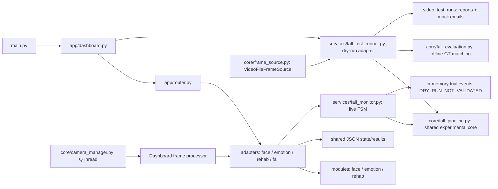

> C?p nh?t HFD 02/10/2026: backend pose worker ri?ng + per-track LSTM, UI video b?t ??ng b?. Trial-only; clip regression FAIL. Xem [b?o c?o HFD](fall_detection/BAO_CAO_TICH_HOP_HUMAN_FALL_DETECTION.md).

> C?p nh?t 02/10/2026: ?? tri?n khai prototype pose/tracking v3 v? backend ONNX local. Clip ngu?n v?n 0 s? ki?n x?c nh?n; accuracy NOT VERIFIED. Xem [k?t qu? tri?n khai v3](fall_detection/BAO_CAO_TRIEN_KHAI_POSE_TRACKING_V3.md). N?i dung/s? li?u v2 b?n d??i l? baseline l?ch s?.

# Kiến thức codebase hiện tại

Ngày rà soát: 02/10/2026, đã đối chiếu lại sau thay đổi FallPipeline v2. Đây là mô tả mã trong working tree, gồm cả thay đổi chưa commit; không phải chứng nhận chất lượng mô hình. Điểm vào cho lần làm việc tiếp theo: tài liệu này → [audit](CODEBASE_AUDIT.md) → [kế hoạch nâng cấp](UPGRADE_PLAN.md). Danh mục nguồn và SHA-256 nằm trong [codebase_inventory.json](codebase_inventory.json). Xem [biên bản hoàn tất](KNOWLEDGE_COMPLETION.md) để biết kết quả kiểm tra và phần nâng cấp còn lại.

## Kiến trúc và luồng chạy

Ứng dụng desktop PyQt5, OpenCV, MediaPipe, NumPy; cảm xúc có thêm PyTorch. `main.py` chuẩn bị môi trường DLL/Qt, tạo `DashboardWindow`. `config.py` xác định tài nguyên, thư mục ghi và cấu hình; import module này đã tạo thư mục, thiết lập logging và có thể seed dữ liệu.



Luồng live xử lý tuần tự trong camera worker. Chế độ giám sát: face overlay → emotion → fall. Chế độ tập: rehab → fall; cảm xúc chỉ đọc kết quả cũ. Fall hiện nhận thêm `raw_frame`, nên inference fall không nhận overlay; emotion trong monitor vẫn cần đối chiếu khung đã vẽ. UI cập nhật thông tin khoảng mỗi giây. Callback camera bỏ qua mode registration; các luồng quản lý hồ sơ/train khác vẫn cần kiểm tra quyền sở hữu model.

Video test dùng QTimer phía GUI, `VideoFileFrameSource` và `FallTestRunner`. Live và video hiện dùng chung `FallPipeline`: HOG proposals → MediaPipe stateless trên crop → Hungarian association → feature → FSM từng track theo PTS. MOG2/ROI cố định đã chuyển thành baseline ở `experiments/fall_legacy_reference.py`; không phải runner hiện tại. HOG là backend tham chiếu chưa được nghiệm thu, không phải model ngã đã kiểm định.

Camera dùng capture timestamp monotonic/validity; CameraFrameSource chặn đọc trùng timestamp và gọi đúng `pause`/`resume`. Video đọc PTS decoder, pause có hiệu lực; seek ở runner replay từ đầu với run_id mới. Report chỉ persist khi xuất/EOF thay vì mỗi sáu frame. Camera trial event chỉ ở bộ nhớ, `DRY_RUN_NOT_VALIDATED`, không gửi email hoặc lưu sự kiện bệnh nhân; code dispatch legacy vẫn tồn tại nhưng bị chặn. Theo báo cáo batch đã có, candidate bỏ sót hai nhãn ngã trên clip chuẩn; không bật vận hành thật chỉ vì contract tests pass.

## Trách nhiệm từng nhóm

| Nhóm | Trách nhiệm thực tế | Điểm cần biết khi sửa |
|---|---|---|
| `app/` | Dashboard, theme, đăng ký/quản lý bệnh nhân, router, lớp state, launcher cũ | Dashboard giữ nhiều trách nhiệm; singleton camera giữ callback cửa sổ |
| `core/` | Capture QThread, frame sources, vẽ Unicode, FallPipeline và evaluator | Capture/inference cùng vòng lặp; pipeline cần SciPy; observations/tracking chưa gắn patient identity |
| `adapters/face_adapter.py` | DNN/Haar tìm mặt, CLAHE+bilateral, LBPH, augmentation, hồ sơ | Ngưỡng LBPH 58; confidence là ánh xạ heuristic; huấn luyện lại khi đăng ký |
| `adapters/emotion_adapter.py` | FaceMesh + FACS heuristic và checkpoint neural | Blend mặc định 75% FACS/25% neural; UI còn ba trạng thái, model năm lớp |
| `modules/emotion/src/` | Thu thập CSV 63 đặc trưng, split session, train/evaluate, baseline | Split session có kiểm tra overlap, chưa bảo đảm tách subject |
| `modules/fall/fall_detector.py` | Detector Pose cũ còn được khởi tạo và có tests riêng | Không còn quyết định sự kiện trong luồng process_frame mới; cần tách/remove sau kiểm tra tương thích |
| `services/fall_monitor.py` | Adapter live cho FallPipeline, tổng hợp state/overlay; giữ code legacy | Pipeline có RLock; sự kiện camera trial-only; chưa có outbox bền vững cho tương lai |
| `services/fall_test_runner.py` | Replay/dry-run, mock dispatch, reports | Nhận GT chỉ cho evaluator; seek replay đồng bộ vẫn chặn GUI |
| `core/fall_evaluation.py` | GT hash, ghép subject theo bbox/PTS và event một-một | Thiếu spatial labels/adjudication báo NOT VERIFIED, không dựng nhãn từ prediction |
| `services/email_service.py` | Validate email, STARTTLS, retry, DeliveryResult | SMTP_ACCEPTED nghĩa là server nhận thư, chưa chứng minh vào inbox |
| `modules/rehabilitation/rehab_engine.py` | FSM nâng tay, đứng/ngồi, bước tại chỗ, đếm và điểm | Mục tiêu mặc định 10/10/15 khác UI 12/10/20; điểm phụ thuộc số frame lỗi |
| `services/user_service.py` | Hồ sơ user và fallback legacy | Có nhiều nguồn hồ sơ; đường dẫn legacy vẫn global khi truyền data_dir test |
| `services/state_service.py` | Read/modify/write JSON trạng thái | Chưa có lock/atomic transaction dù docstring nói thread-safe |
| `packaging/`, các `.bat`/`.spec` | Windows native/portable, launcher, kiểm tra môi trường | Có hai spec; copy dữ liệu cần kiểm tra riêng tư; hook hiện chưa gắn trong spec được rà soát |
| `tests/`, `experiments/` | Kiểm tra FSM/UI, demo, benchmark, video probe | Không phải mọi phép thử là đánh giá accuracy; vài test có tác dụng phụ dữ liệu/email |
| `modules/face/`, `archive/voice/`, `care.py` | Luồng standalone/legacy | Không đại diện pipeline dashboard; có chương trình chạy vòng lặp ngay khi import |

## Hợp đồng trạng thái và lưu trữ

- Danh tính: recognized/uncertain/unknown/no_face; cần phân biệt nhận diện hiện tại với hồ sơ được chọn bằng tay. Hiện dashboard chỉ chuyển identity recognized sang monitor.
- Fall core: NORMAL/UNCERTAIN/UNOBSERVABLE → SUSPECTED → CONFIRMING → FALL_CONFIRMED; phục hồi quan sát đi qua COOLDOWN/RECOVERED. Core defaults suspect 0.5 giây, confirm 0.8, cooldown 2, TTL 1.2, observation gap 0.25. Live adapter thêm PAUSED/CAMERA_DISCONNECTED. `config.py` còn thông số legacy 0.75/3/30 nhưng constructor monitor hiện 0.8/2; không suy config legacy thành thông số core đang chạy.
- Emotion: feature 21 landmark × xyz; smoothing và TTL được áp dụng khi `process_frame` chạy. Getter không bảo đảm dữ liệu còn mới.
- Rehab: điểm chưa có trước rep hoàn chỉnh; ba tracker có quy tắc riêng và reset rep dở dang. Chưa có luồng ghi session hoàn chỉnh vào SESSIONS_DIR.
- `shared/state.json`, `shared/results/*.json`: trạng thái giao tiếp; `shared/data/`: hồ sơ legacy và ảnh mặt; `data/users/`: hồ sơ từng user; fall_events: sự kiện/ảnh. Đây là nhiều nguồn dữ liệu, chưa phải một repository nhất quán.
- Resource nằm ở source/bundle; dữ liệu ghi phụ thuộc portable/runtime/LOCALAPPDATA và biến môi trường. Video runner mặc định vẫn dùng đường dẫn tương đối `data/video_test_runs`, chưa đồng bộ WRITABLE_ROOT.

## Kết nối codebase-memory

Binary cục bộ: `F:/codebase-memory/codebase-memory-mcp.exe` (0.11.0). Cấu hình MCP hiện có ở `.agents/plugins/codebase-memory/mcp_config.json`. Session này đã truy cập và index qua CLI của cùng binary; không tuyên bố công cụ MCP được hot-load vào session. Skill `codebase-memory` không có trong danh mục skill được cung cấp; việc đọc trực tiếp đã được người dùng cho phép.

```powershell
& 'F:/codebase-memory/codebase-memory-mcp.exe' cli --json list_projects
& 'F:/codebase-memory/codebase-memory-mcp.exe' cli --json index_repository --repo-path F:/AI_Rehabilitation_Safety_Assistant --mode full --persistence true
& 'F:/codebase-memory/codebase-memory-mcp.exe' cli --json manage_adr --project F-AI_Rehabilitation_Safety_Assistant --mode get
python scripts/build_codebase_inventory.py
python scripts/build_codebase_inventory.py --check
```

Graph hỗ trợ tìm cấu trúc; đọc nguồn và inventory vẫn cần thiết vì graph có file bỏ qua/parse một phần. Không đưa ảnh, hồ sơ cá nhân, credentials hay log nội dung riêng tư vào ADR. Khi sửa architecture, cập nhật ba tài liệu này, inventory, rồi refresh graph/ADR. SHA inventory chỉ xác nhận phiên bản file, không chứng minh đã chạy đúng.

Inventory sau đối chiếu v2: 116 file nguồn/cấu hình triển khai, gồm 95 file Python; Python/spec parse không lỗi; `--check` khớp snapshot. Kiểm tra lần này dùng `.venv/Scripts/python.exe`; alias `python` WindowsApps trước đó không thực thi được. Contract core 24 tests và UI lifecycle 1 test pass trong harness cô lập; không phải đánh giá accuracy.
