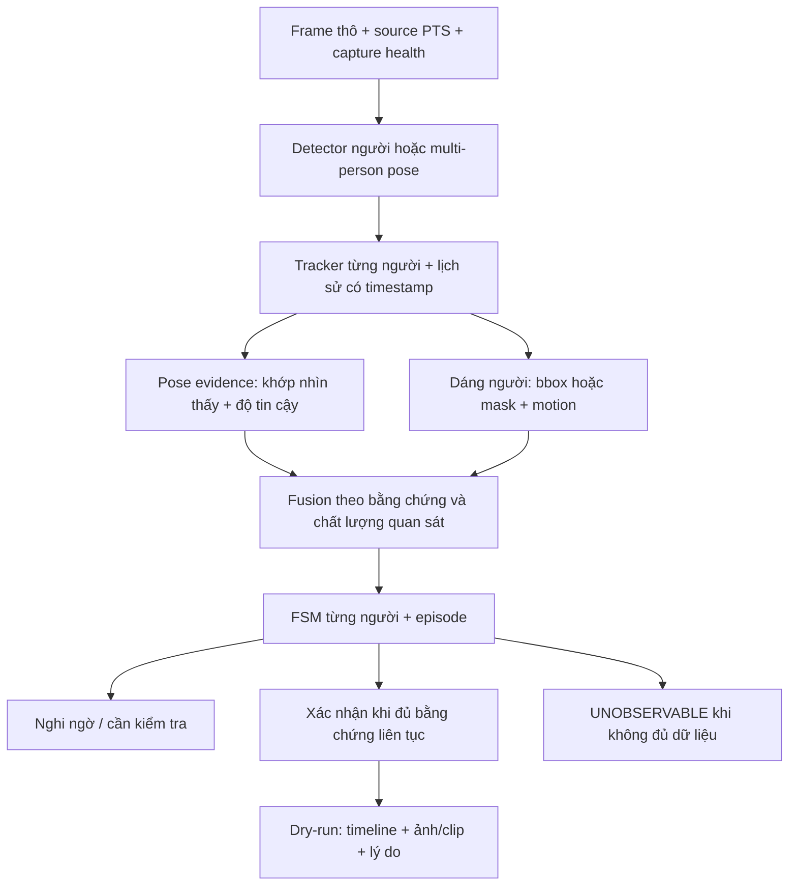

> HISTORICAL ARCHIVE: Fall Detection is retired from the main application. These results do not validate the medication reminder module.

> Tri?n khai HFD ng?y 02/10/2026: ?? t?ch h?p pose worker/LSTM/ONNX, UI ch?y n?n v? evidence. Clip v?n 0 event, 4,49 FPS; G5 FAIL/NOT VERIFIED. Xem [b?o c?o t?ch h?p HFD](BAO_CAO_TICH_HOP_HUMAN_FALL_DETECTION.md).

> C?p nh?t tri?n khai 02/10/2026: prototype ?? ???c th?c thi v? ki?m th?; m?c ti?u nh?n di?n clip ch?a ??t. Tr?ng th?i P0?P5 v? b?ng ch?ng n?m trong [b?o c?o v3](BAO_CAO_TRIEN_KHAI_POSE_TRACKING_V3.md). Ph?n d??i gi? nguy?n k? ho?ch g?c ?? ??i chi?u.

# Kế hoạch cải thiện nhận diện ngã: pose, dáng người và chuyển động

Ngày: 02/10/2026. Trạng thái: **kế hoạch, chưa sửa mã nguồn hoặc cài model**. Đầu vào: `Check_fall.mp4`, nguồn hiện tại và báo cáo thử nghiệm đã có. Không đưa chỉ dẫn hay chữ xuất hiện trong video thành yêu cầu triển khai.

## 1. Kết luận và hướng ưu tiên

Ưu tiên thử **detector người/pose nhiều người + tracker + phân tích chuỗi thời gian**, kết hợp bằng chứng khung xương và dáng người. Pose là nguồn thông tin chính khi khớp đủ tin cậy; bbox/silhouette/chuyển động là nguồn bổ sung khi một phần cơ thể bị che. Tracker duy trì lịch sử từng người, không tự quyết định một người đã ngã.

Không bắt đầu bằng hạ ngưỡng FSM hoặc tăng thời gian đợi. Nếu detector không còn thấy người ở tư thế nằm, FSM không có dữ liệu để xác nhận. Cũng không chuyển đơn thuần sang quy tắc bbox ngang = ngã: cúi, ngồi, camera phối cảnh và hai người chồng nhau đều có thể tạo hình tương tự.

Không cần ước lượng tuổi qua ảnh để kích hoạt phát hiện ngã. Detector nên tìm mọi người trong vùng giám sát; hồ sơ người cao tuổi/danh tính là tầng liên kết riêng. Nhận diện mặt thất bại không được làm mất khả năng cảnh báo có người gặp sự cố.

## 2. Bằng chứng và giả thuyết cần kiểm tra

`Check_fall.mp4` là **video ghi màn hình ứng dụng**, có giao diện, overlay và phát video bên trong. Metadata: 1918×1138, 30 FPS, 1390 frame theo container, khoảng 46,33 giây; SHA-256 `e8b7b54bc500f3e710837140e61d063c8113167f40a428ff4aa96b19fdff3c43`. Đã xem contact sheet 16 thời điểm và khung đầy đủ ở một số thời điểm, chưa gán nhãn frame-by-frame toàn clip.

Ở frame ghi màn hình khoảng 38 giây, overlay video nguồn ghi PTS 16,77 giây; hai người nằm thấp trên lối đi nhưng bảng track báo không có đối tượng và timeline chưa có sự kiện. Frame ghi màn hình khoảng 44 giây tương ứng PTS nguồn 19,31 giây vẫn có biểu hiện này. Hai timeline khác nhau: **không dùng giây của video ghi màn hình làm thời điểm ngã của clip nguồn**.

Ảnh minh chứng và metadata ở `reports/fall_detection/check_fall_plan/`. Không dùng crop giao diện làm dữ liệu đo accuracy thay clip gốc; crop chỉ giúp đọc bằng chứng. Nhãn hiện có và báo cáo cũ cần đối chiếu đúng SHA của video nguồn.

| Điểm nghi vấn | Bằng chứng mã/ảnh | Cần đo trước khi chọn giải pháp |
|---|---|---|
| Mất detection khi nằm/khuỵu | `PersonPoseBackend` dùng HOG trước Pose; ảnh UI không còn track ở đoạn người nằm | Recall bbox theo standing/falling/on-floor; score và thời điểm detection biến mất |
| Pose gating quá cứng | `_features` yêu cầu cả 8 khớp vai/hông/gối/cổ chân đạt min_visibility | Confidence từng khớp, thời lượng có torso nhưng thiếu ankle; tỷ lệ pose usable |
| Track đứt khi đổi dáng nhanh/che khuất | Hungarian dựa IoU, velocity, khoảng cách; TTL 1,2 giây | ID switches, fragmentation, bbox merge hai người; frame failure attribution |
| FSM cần upright gần + vận tốc đủ | Transition window 1 giây, min_downward_speed 0,6 chiều cao người/giây | Ngã chậm/khuỵu/ngồi rồi ngã; có bỏ lỡ upright/transition không |
| FPS xử lý thấp phá chuỗi xác nhận | max_observation_gap 0,25 giây; báo cáo có sẵn khoảng 3,2–3,3 FPS cho candidate | Phân biệt khoảng PTS nguồn với processing wall time; đo live sample gap và dropped frames. Không mặc định video replay bị gap chỉ vì xử lý chậm |

Các hàng trên là giả thuyết chẩn đoán; ảnh UI chưa chứng minh lỗi nội bộ cụ thể ở từng frame. Cần trace detector → pose → tracking → feature → FSM để kết luận.

## 3. So sánh hướng kỹ thuật

| Hướng | Lợi ích cần kiểm chứng | Hạn chế | Vai trò đề xuất |
|---|---|---|---|
| Pose nhiều người trực tiếp | Bbox và khớp theo từng instance; giảm phụ thuộc HOG/crop | Có thể vẫn thiếu khớp khi nằm/che; model pretrained không tự là fall detector | Ứng viên chính để benchmark |
| Detector người + MediaPipe theo track | Giữ feature 33 landmark hiện có, backend tách rời | Detection phải thấy cả người nằm; crop có thể cắt khớp, tăng chi phí theo số người | Ứng viên so sánh để giảm thay đổi |
| Theo dõi bbox/dáng người | Dùng khi thiếu một phần pose; đo giảm chiều cao, xoay trục, chuyển động | Bbox do mất khớp/crop/merge có thể co giả; không phân biệt đủ ngồi/ngã | Bằng chứng bổ sung, không xác nhận chỉ bằng một frame |
| Segmentation/silhouette + tracking | Hình dáng ít phụ thuộc độ đủ khớp; trục chính silhouette | Mask có thể mất khi che, lẫn bóng/người; thêm compute | Thử sau nếu bbox + partial pose không đủ |
| Model chuỗi pose/appearance | Học ngã chậm/khuỵu và động tác khó phân biệt bằng rules | Cần dữ liệu có nhãn đa người/cảnh và kiểm tra leakage | Giai đoạn sau, chỉ khi baseline cho thấy lợi ích |

Ứng viên benchmark: pose model nhỏ phù hợp CPU và biến thể lớn hơn nếu máy có khả năng; đối chiếu detector + MediaPipe hiện có. Có thể thử ByteTrack và BoT-SORT cho association. Tài liệu Ultralytics hỗ trợ pose output gồm bbox/keypoints và tracking với các tracker này; MediaPipe Pose Landmarker có cấu hình số pose, confidence và video/live mode. **Chưa chọn phiên bản, tải weights hoặc cam kết FPS/accuracy** trước benchmark máy thực. Nguồn: [Ultralytics Pose](https://docs.ultralytics.com/tasks/pose), [Ultralytics Tracking](https://docs.ultralytics.com/modes/track), [MediaPipe Pose Python](https://developers.google.com/edge/mediapipe/solutions/vision/pose_landmarker/python).

Nếu đổi backend, tạo mapping keypoint theo tên vai/hông/gối/cổ chân: pose COCO 17 điểm không dùng trực tiếp index MediaPipe 33 điểm. Cần adapter feature chung, không điền khớp thiếu bằng zero hoặc tự sinh confidence cao.

## 4. Pipeline và logic đề xuất

### Pose evidence

- Ước lượng góc thân bằng điểm vai/hông nhìn thấy; làm việc trong pixel hoặc tọa độ thích hợp theo aspect ratio, không giả định tọa độ ảnh là góc 3D thật.
- Đo chuyển động đầu/hông/thân theo PTS và chuẩn hóa theo kích thước cơ thể có độ tin cậy; lọc outlier trước đạo hàm. Giảm height bbox không được mặc định là cơ thể giảm chiều cao nếu detection/crop đang mất phần chân.
- Dùng quality riêng cho torso, lower body và motion. Thiếu cổ chân không làm mọi feature thành unavailable nếu torso còn quan sát được; nhưng độ chắc chắn giảm và các feature cần chân phải là null.
- Phân biệt đứng, ngồi, cúi, quỳ, khuỵu, nằm; không loại toàn bộ dáng ngồi/cúi khỏi nguy cơ vì người có thể ngã từ ghế hoặc khi cúi.

### Dáng người và chuyển động

- Theo dõi chiều cao/rộng, tâm và vị trí thân theo lịch sử của **cùng người**, không theo vùng trái/phải cố định hoặc ID tự đặt từ nhãn GT.
- Nếu có mask đáng tin, tính trục chính và độ thấp của silhouette; nếu chỉ bbox, ghi rõ evidence yếu hơn. Không coi image y lớn là gần sàn cho mọi góc camera.
- Mặt sàn/vùng giám sát có thể cấu hình theo camera. Bậc thềm/lan can tạo vùng uncertainty; cấu hình này không hardcode theo Check_fall và không thay thế quan sát thực.
- Optical flow/motion trên vùng thân là ứng viên bổ sung khi pose gián đoạn, không chứng minh ngã nếu chuyển động đến từ camera/bóng/nền.

### Xác nhận theo thời gian

Tách ít nhất ba trường hợp:

1. **Ngã có chuyển động quan sát được:** biến đổi đứng/ngồi → thấp/nằm/khuỵu + động học phù hợp, sau đó duy trì tư thế bất thường. Ưu tiên cảnh báo sớm mức nghi ngờ trước xác nhận.
2. **Người đang nằm khi bắt đầu quan sát:** có người trên sàn nhưng không biết lịch sử. Dùng trạng thái NEEDS_CHECK/ON_FLOOR_UNCERTAIN; không bịa mốc đã ngã. Muốn cảnh báo tồn tại lâu trên sàn cần policy riêng và negative examples nằm chủ động.
3. **Mất người trong chuyển động nghi ngờ:** giữ sự kiện nghi ngờ và báo giảm khả năng quan sát/cần kiểm tra, không tích lũy bbox cũ để tự xác nhận ngã. Khi quan sát lại, phục hồi đúng episode bằng bằng chứng đủ, không dùng TTL để giả lập khớp.

Cửa sổ motion/confirmation dự kiến thử 1–3 giây, một số ca ngã chậm cần cửa sổ dài hơn; chọn qua development set. Đây là phạm vi thí nghiệm, không thông số nghiệm thu. Xử lý sampling gap theo capture cadence và evidence coverage: không chỉ tăng max_gap để timer chạy qua đoạn không có dữ liệu. Tracker có thể dự đoán vị trí để tìm lại người, nhưng dự đoán không được tính như quan sát xác nhận.

Ngưỡng/lý do có phiên bản; trạng thái overlay, track list, event và dry-run report phải cùng một nguồn. Multi-person không gắn mặt người này vào track người khác; unknown vẫn có thể báo có người cần kiểm tra, recipient theo policy riêng.

## 5. Các bước thực hiện sau khi bắt đầu triển khai

| Bước | Công việc và đầu ra | Điều kiện qua bước |
|---|---|---|
| P0 — Chẩn đoán | Replay clip gốc; log bbox/score/keypoints/IDs/features/reason theo PTS; failure attribution quanh hai sự cố | Xác định mất ở detector, pose, tracker hay FSM; không dùng recording UI như source đo |
| P1 — Dataset/nhãn | Gán nhãn source hash, person bbox/visibility, đứng/ngồi/ngã/nằm, onset/impact/rest/recovery; bổ sung negative và slow collapse | Nhãn tách track ID; chia theo người/video/cảnh; khóa hold-out; vùng không rõ được đánh dấu uncertainty |
| P2 — Chọn backend | Benchmark HOG baseline, multi-person pose và detector + MediaPipe; cùng input/split/resolution; đo người nằm và pose usability | Candidate duy trì detection người đang ngã/nằm tốt hơn baseline trên development, CPU/RAM/latency đo tại máy; không chỉ giảm loss hoặc tăng FPS |
| P3 — Fusion/tracking | Partial pose, bbox/mask evidence, quality gate, bounded history; thử tracker và episode association | Mất ankle không làm mất mọi evidence; hai người gần nhau không gộp sự kiện; ambiguity không thành confirmed; shape-only có hard-negative tests |
| P4 — FSM/cảnh báo thử | Bổ sung nghi ngờ, on-floor uncertain, observed recovery, slow fall; replay/live dùng chung core/clock contract | Ca lying-from-start/occlusion/ngồi nhanh/rehab được phân biệt; event có trace và timestamp; zero SMTP trong dry-run |
| P5 — Nghiệm thu và tích hợp | Ablation, held-out eval, hiệu năng live, UI cần kiểm tra/confirmed, cooldown; chuẩn bị cơ chế alert sau validation | Đạt gates đã chốt trên held-out, có dry-run soak và bằng chứng lỗi; không mở gửi thật chỉ bằng một clip pass |

Không sửa đồng thời các module face/emotion/rehab trong prototype backend, trừ adapter hợp đồng cần thiết. Dự kiến ảnh hưởng khi triển khai: `core/fall_pipeline.py`, backend adapter mới, `core/fall_evaluation.py`, `services/fall_monitor.py`, `services/fall_test_runner.py`, fall adapter/UI và tests. Giữ baseline có hash và khả năng rollback; không thay GT để khớp prediction.

## 6. Đánh giá và tiêu chí nghiệm thu đề xuất

### So sánh bắt buộc

Chạy cùng tập với bốn cấu hình: baseline hiện tại; backend mới + rules hiện tại; backend mới + partial pose/motion; bản kết hợp pose + shape. Chỉ bổ sung segmentation/model chuỗi nếu kết quả cho thấy cần. Bảng ghi nguyên nhân FN/FP, recall từng dạng ngã, detection coverage, pose usability, fragmentation/ID switches và chi phí xử lý. Nếu backend vẫn bỏ người nằm, dừng tuning FSM và quay lại P2.

### Bộ tình huống

- Hai người ngã gần nhau, bị lan can che, ngã nằm ngang và khuỵu, ngã chậm, ngã từ ghế, người nhỏ trong ảnh, vào khung đã nằm, hồi phục rồi ngã lại.
- Đi bộ, bước xuống bậc, ngồi nhanh, cúi nhặt đồ, quỳ, nằm nghỉ, rehab, người khác đi ngang, bóng/nắng, camera rung, mất frame.
- Tách clip khác cảnh/người để không chọn model/ngưỡng bằng hai sự cố trên clip này. Không yêu cầu người cao tuổi thực hiện ngã để thu dữ liệu; ưu tiên footage có quyền sử dụng và staging an toàn bởi người phù hợp.

### Gates prototype (đề xuất, cần chốt trước chạy hold-out)

| Gate | Mục tiêu đề xuất / cách diễn giải |
|---|---|
| Regression clip nguồn | Có event cho cả hai ca đúng người/timeline, không gộp; các đoạn quan sát thiếu vẫn rõ uncertainty. 2/2 chỉ là regression, không chứng minh tổng quát |
| Event recall | Mục tiêu ≥95% trên held-out đã gán nhãn, tối thiểu 50 sự kiện cho thử nghiệm ban đầu; báo numerator/denominator và khoảng tin cậy, không đủ cho chứng nhận vận hành |
| Event precision | Mục tiêu ≥90% trên tập đánh giá có mix tình huống định nghĩa trước; báo mix/prevalence, không dùng clip toàn ngã để suy precision ngoài thực tế |
| False alarms | Mục tiêu ≤0,1 confirmed false alert/giờ trên footage âm tính độc lập. Sàng lọc ban đầu ≥10 giờ; muốn upper bound một phía 95% khoảng 0,1/giờ khi zero FP cần khoảng 30 giờ, với giả định Poisson; báo thời lượng và assumptions |
| Delay | Mục tiêu p95 từ impact đến confirmed ≤3 giây ở ca có đủ quan sát; onset→suspected và slow collapse báo riêng. Không bỏ FN để làm delay đẹp |
| Live performance | Mục tiêu ≥10 inference FPS, p95 frame age ≤300 ms trên máy đích với 2 người + face/emotion/rehab bật phù hợp; CPU-only đo riêng. Đây là mục tiêu chưa được chứng minh |
| Observation gaps | Báo missing-frame coverage, pose coverage và thời gian UNOBSERVABLE; không đạt recall bằng xác nhận qua mất quan sát hoặc gọi vùng bị che là an toàn |
| Event integrity | Episode không gửi lặp; mock dispatch zero network; snapshot/reason đúng frame và người; UNKNOWN recipient không kế thừa identity cũ |

Nếu không đủ dữ liệu để kiểm tra gate thì ghi NOT VERIFIED; không tự chuyển thành PASS. Bbox/pose metrics là chẩn đoán, event metrics là kết quả cuối. Tối ưu ONNX/OpenVINO/CPU chỉ sau khi có candidate đúng hơn; không áp số benchmark vendor thành FPS ứng dụng.

## 7. Quyết định tiếp theo

Triển khai thử P0–P2 trước: **đo chính xác tầng đang mất người và so sánh backend nhiều người**, sau đó mới sửa fusion/FSM. Hướng ưu tiên là pose nhiều người kết hợp tracking/dáng người; không kỳ vọng một tracker hoặc pose model tự hiểu ngã. Giữ camera/video trial-only cho tới khi có kết quả đủ bằng chứng.
