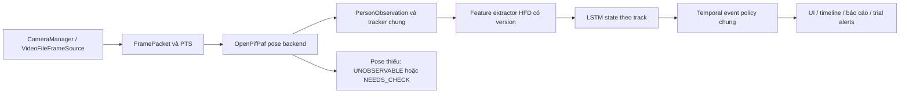

> HISTORICAL ARCHIVE: Fall Detection is retired from the main application. These results do not validate the medication reminder module.

> Tri?n khai HFD ng?y 02/10/2026: ?? t?ch h?p pose worker/LSTM/ONNX, UI ch?y n?n v? evidence. Clip v?n 0 event, 4,49 FPS; G5 FAIL/NOT VERIFIED. Xem [b?o c?o t?ch h?p HFD](BAO_CAO_TICH_HOP_HUMAN_FALL_DETECTION.md).

# Kế hoạch tích hợp HumanFallDetection

Ngày 02/10/2026. Trạng thái: **đã khảo sát source và checkpoint; chưa sửa mã tích hợp, chưa cài dependency của repo, chưa chạy accuracy model mới**. Tài liệu này bổ sung kế hoạch cải thiện nhận diện ngã hiện có.

## 1. Kết luận khảo sát

Repo local: `modules/fall/HumanFallDetection`, upstream `https://github.com/taufeeque9/HumanFallDetection`, commit `0f9fa0066d4305c65ef1f024d1297c7b5e35c535`, license MIT. Giữ license và attribution khi trích/chuyển mã.

Repo có hai thành phần riêng: OpenPifPaf tìm pose COCO17 và LSTM phân loại đặc trưng chuyển động. Không phải model nhận diện ngã trực tiếp từ ảnh. Checkpoint LSTM có sẵn, nhưng checkpoint OpenPifPaf chưa có trong thư mục clone. Chưa có bằng chứng repo này tìm được người nằm bị che khuất trong video của dự án.

Đã đọc README, requirements, entrypoint, processor, feature extraction, tracker, visualization, helpers và model. Đã đọc checkpoint bằng `torch.load(..., weights_only=True, map_location='cpu')`, không chạy entrypoint hay camera:

- File `model/lstm_weights.sav`: 120.954 byte, SHA-256 `87bc1abd5828d8d2e0e91ef203a7f1b76df7c77c0d5fbd41bef765058221661b`.
- State dict khớp LSTM input 5, hidden 48, 2 tầng, output 7 lớp. Đây là **7 logits**, dù README mô tả Fall/No Fall; mã hiển thị ánh xạ class 0 sang FALL, class 1–6 sang Normal. Phải xác minh label map từ artifact/train trước khi coi xác suất là đã được hiệu chuẩn.
- Thứ tự input: `ratio_bbox`, `log_angle`, `re`, `ratio_derivative`, `gf`.
- Inference upstream nhận `(batch, 1, 5)` từng bước và giữ hidden state theo người. `DEFAULT_CONSEC_FRAMES=36` là lịch sử và bộ lọc, không đủ cơ sở để tự đổi thành inference cửa sổ 36 bước reset hidden mỗi lần.
- Ngưỡng `confidence < 0.4` upstream sử dụng logit lớn nhất, không phải probability. Không dùng trực tiếp làm ngưỡng xác suất của hệ thống.

Môi trường hiện có: Python 3.12, torch 2.14.0, torchvision 0.29.0, NumPy 1.26.4, SciPy 1.17.1; chưa cài OpenPifPaf/pandas. Requirements upstream rất rộng, có `opencv-python` và gói không cần cho inference; không cài toàn bộ vào `.venv` hiện tại. [Release OpenPifPaf](https://github.com/openpifpaf/openpifpaf/releases) ghi các cặp torch/torchvision cũ; đây là lý do cần thử tương thích riêng, **chưa kết luận Windows không hỗ trợ**. [Upstream chính thức](https://github.com/openpifpaf/openpifpaf) có hướng dẫn và điều kiện license riêng với repo LSTM.

Skill `codebase-memory` không có SKILL.md trong catalog/thư mục đã tìm ở session này. Đã dùng CLI codebase-memory cục bộ để tra kiến trúc, kết hợp đọc source trực tiếp theo quyền đã được cấp; không tuyên bố đã chạy skill.

## 2. Các vấn đề cần xử lý trước

| Vấn đề phát hiện | Ảnh hưởng | Cách xử lý dự kiến |
|---|---|---|
| `modules/fall/fall_detector.py` và thư mục model v3 không còn ở vị trí cũ | `services/fall_monitor.py` vẫn import `FallDetector, PostureMetrics` và khởi tạo detector; live import/init có thể hỏng, auto thiếu weights sẽ quay về HOG | Khôi phục tương thích từ bản baseline local đã lưu hoặc bỏ dependency legacy sau kiểm kê call sites; không thay file bằng entrypoint repo mới |
| Upstream parse argv, set multiprocessing, mở VideoCapture và imshow | Tranh camera, xung đột Qt, không phù hợp API nhận frame | Tách inference thuần; ứng dụng giữ quyền sở hữu camera/UI |
| Import `from model...`, `from vis...`, đường dẫn weights tương đối CWD | Lỗi khi chạy từ root, xung đột package, lỗi packaged app | Namespace riêng và resolver resource tuyệt đối; không sửa `sys.path` toàn cục/chdir |
| `get_all_features` chỉ xử lý prediction/bộ lọc trong `if i == 0`, trả prediction người đầu | Bỏ qua ngã của người thứ hai | Xuất kết quả tất cả track, hidden/baseline/bộ lọc tách theo track |
| Tracker xóa history theo index nhưng `lstm_set.pop()` xóa phần tử cuối | Có thể lệch state giữa người | Giữ tracker dự án làm cơ sở; mọi state gắn với track ID, test mất track đầu/giữa |
| Timestamp video thông thường là `time.time()` | Derivative phụ thuộc tốc độ máy, replay không tái lập | Dùng decoder PTS; live monotonic capture, kiểm soát sampling theo thời gian |
| Force-complete pose, thiếu đầu/hông/vai, chia thời gian hoặc độ dài gần 0 | Đặc trưng giả/NaN/Inf, ngã giả | Giữ confidence gốc, kiểm tra tính hữu hạn, thông báo UNOBSERVABLE/NEEDS_CHECK; không bịa joint |
| Bbox upstream dùng 15 khớp đầu, không gồm ankle; normalization theo padded tensor, PIL nhận BGR | Khác phân phối feature hoặc lệch overlay | Harness đối chứng preprocessing gốc; tách hợp đồng legacy feature và tọa độ overlay đã bỏ pad; kiểm chứng thay RGB/bbox trước khi chọn |
| `gf` có biểu thức đạo hàm đáng kiểm tra; `np.math` cũ | Thay công thức có thể lệch checkpoint | Giữ mode parity trước; sửa có version và đánh giá lại/retrain, không âm thầm sửa toán |
| Không có hợp đồng event/dispatch của dashboard | Lặp email, nhầm loss-of-track thành fall | Gắn vào event policy chung, cooldown và trial mode hiện có |

## 3. Kiến trúc tích hợp được chọn

Giữ `CameraManager → FallAdapter → FallMonitor` và `VideoFileFrameSource → FallTestRunner` làm hai đầu vào của **cùng core**. Repo mới cung cấp inference, không nắm camera, UI, hồ sơ hay email.

**Đánh giá đầy đủ OpenPifPaf + LSTM là hướng chính.** Chỉ thay classifier bằng LSTM trên YOLO pose được giữ làm đối chứng: nếu YOLO tiếp tục mất người nằm thì classifier mới không chữa được lỗi detector. Không nối LSTM sau một FSM yêu cầu đủ điều kiện v3 khiến mọi dự đoán LSTM bị loại; policy dùng bằng chứng model, chất lượng quan sát và xác nhận theo thời gian, được chọn trên dev.

Ưu tiên backend trong process khi tương thích môi trường được chứng minh. Nếu dependency native không tương thích, dùng worker Python trong môi trường riêng, nhận frame từ ứng dụng, queue giới hạn và trả `source_id/frame_index/pts/observations` theo schema. Worker không mở camera; timeout/crash/out-of-order phải hiển thị lỗi và không phát sự kiện. Không chọn cơ chế worker trước khi đo overhead và khả năng đóng gói. ONNX LSTM là tối ưu hóa sau parity; export OpenPifPaf không được giả định là đơn giản vì có decoder native.

## 4. Các bước triển khai và điểm nghiệm thu

### G0 — Đưa hệ thống về trạng thái import được

1. Lưu snapshot/hash tree hiện tại, đọc mọi import legacy và artifacts baseline; giữ nguyên repo clone và dữ liệu người dùng.
2. Sửa dependency `modules.fall.fall_detector` còn treo bằng compatibility shim có kiểm thử hoặc loại nhánh legacy thật sự không dùng. Không khôi phục file/model bằng Git reset vì working tree có thay đổi của người dùng.
3. Kiểm tra import/init dashboard, live adapter và video runner không chạm camera/SMTP. Báo rõ backend/model thiếu; không silent fallback như đã nạp HFD.

Đạt khi các entrypoint import được trong harness, thiếu model có lỗi dễ hiểu và core tests không bị mất hợp đồng.

### G1 — Dependency, provenance và smoke test model

1. Tạo manifest commit/hash/license/model/schema; đọc checkpoint an toàn và `load_state_dict(strict=True)`.
2. Thử OpenPifPaf trong môi trường riêng; pin phiên bản thực sự chạy được với Python/torch/decoder trên Windows. Chỉ sau smoke mới quyết định cài vào runtime chính hay worker.
3. Chuẩn bị checkpoint pose local từ nguồn chính thức, lưu hash. Không tự tải lúc khởi động UI.
4. Chạy LSTM tensor hữu hạn và pose một frame raw, đo CPU/memory, kiểm tra empty-person/thiếu-joint.

Đạt khi cả pose và LSTM thực sự suy luận được; tải được LSTM một mình không phải hoàn thành G1.

### G2 — Adapter và feature parity

Các file dự kiến mới: `modules/fall/hfd_pose_backend.py`, `modules/fall/hfd_features.py`, `modules/fall/hfd_classifier.py`, manifest/requirements riêng. Repo clone giữ làm upstream/reference, tránh import module demo có side effect. Giữ notice/license trong mã được chuyển.

1. `observe(FramePacket) → list[PersonObservation]`: COCO17, bbox normalized, visibility nguyên bản, PTS nguồn; thông tin resize/pad phải đảo chính xác.
2. Bóc năm đặc trưng và LSTM architecture khỏi dependency pandas/matplotlib/demo; mode parity giữ đúng thứ tự, đơn vị, công thức, state update của upstream trên mẫu hợp lệ.
3. Harness tạo cùng pose/timestamp/history, so sánh feature vector, logits, hidden state upstream và adapter. Test cả zero-dt/zero-length/missing/NaN.
4. Xác minh cadence training/inference và thử sampler theo PTS; không mặc định `--fps=18` là FPS huấn luyện vì trong repo đây là FPS output video. Khi chưa rõ cadence, ghi NOT VERIFIED và đối chứng nhiều cadence trên dev.

Đạt khi parity mẫu hợp lệ trong tolerance công bố, mẫu không hợp lệ không sinh fall, classifier trả logits và score có nguồn rõ ràng. Softmax chỉ là model score, chưa được coi là xác suất đã hiệu chuẩn.

### G3 — Tracking nhiều người và temporal policy

1. Track ID ổn định, hidden state/history riêng; clear khi reset/seek/source-change/TTL/identity ambiguity. Khi gap ngắn, chỉ thử quy tắc thiếu dữ liệu có version và đo parity; gap dài phải reset.
2. Chạy LSTM cho mọi track; kết quả gồm `class_id`, `fall_score`, `quality`, `reason`, model/version, timestamps.
3. Thêm policy LSTM có warm-up, persistence theo giây, hysteresis/cooldown và event dedupe. Chọn ngưỡng trên dev, không dùng logit .4 như probability.
4. Mất dấu, frame stale và nằm sẵn từ đầu được thể hiện riêng; không gắn danh tính bệnh nhân bằng thứ tự track. Không đếm cảnh báo NEEDS_CHECK là FALL_CONFIRMED.

Đạt khi hai người/người thứ hai ngã, track rời/đổi chỗ, che khuất, pause/resume và seek không trộn state hoặc tạo duplicate event.

### G4 — Tích hợp UI/live/video và báo cáo

Sửa `core/fall_backends.py`, `core/fall_pipeline.py`, `services/fall_monitor.py`, `services/fall_test_runner.py`, `app/dashboard.py`, config và spec đóng gói theo hợp đồng đã chốt.

- Backend lựa chọn rõ ràng `hfd`, mode ablation pose-only/LSTM-only/full; không tự chuyển mặc định trước nghiệm thu.
- UI hiển thị đúng backend, warm-up, cần kiểm tra, nghi ngờ, xác nhận và thiếu model. Timeline theo từng người, overlay không vẽ bbox stale.
- Snapshot và clip quanh sự kiện có PTS/track/source; buffer giới hạn, thử retention và không lưu hồ sơ không liên quan. Event thử nghiệm giữ dry-run; cơ chế gửi thật chỉ bật sau acceptance của đường nhận diện và dispatch.
- Worker nếu cần phải stop/join/release khi đóng app; không block Qt. Báo cáo lưu code/model/config hash, feature trace, event và perf.

Đạt khi file và live dùng cùng code quyết định, không tranh camera, không gửi SMTP trong test, báo cáo replay được.

### G5 — Đối chứng trên dữ liệu thật, lựa chọn và đóng gói

Chạy cùng video nguồn raw trước, không chạy bản ghi màn hình làm accuracy. So sánh HOG/v3 còn chuẩn bị được assets, OpenPifPaf + FSM, YOLO + HFD LSTM và OpenPifPaf + HFD LSTM. Cache observation để phân biệt lợi ích detector/classifier/policy, ghi giới hạn nếu assets baseline không còn.

Review nhãn độc lập theo người: bbox/visibility/onset/impact/rest; khóa nhãn trước khi chọn policy. Clip hiện có là dev; không báo chất lượng tổng quát từ clip này. Theo kế hoạch gốc chuẩn bị heldout tối thiểu 50 sự kiện và 10–30 giờ âm tính; split theo người/cảnh/video tránh rò dữ liệu. Nếu chưa có dữ liệu thì gate ghi NOT VERIFIED.

| Gate | Tiêu chí |
|---|---|
| Clip regression | Cả hai ca được ghép đúng người, one-to-one, không dựa vào loss-of-track; ghi delay theo nhãn được review |
| Độ nhạy heldout | Mục tiêu recall ≥90%; công bố sample size, FN và khoảng tin cậy |
| Báo nhầm | Mục tiêu ≤0,1 false alert/giờ âm tính; báo thời lượng, event count và khoảng tin cậy, không suy diễn từ 0 FP clip ngắn |
| Delay | Mục tiêu p95 ≤3 giây sau impact theo định nghĩa nhãn đã chốt; báo ca không thể quan sát riêng |
| Hiệu năng | ≥10 FPS processing và p95 live frame-age ≤300 ms trên máy đích; đo UI/queue/worker, không thay bằng FPS LSTM riêng |
| Độ ổn định | Camera soak ≥30 phút, ngắt camera, thiếu weights, worker crash, restart/seek/close không leak/đơ/SMTP ngoài ý muốn |
| Package | Build clean, local model/license đầy đủ, launch trên máy không có source/venv; không bundle dữ liệu bệnh nhân |

Nếu pose mới vẫn mất người nằm, ghi FAIL ở detector và tiến hành dữ liệu/fine-tune hoặc lựa chọn pose khác; không hạ ngưỡng để tạo kết quả 2/2. Nếu chỉ phát hiện được một người thì không bật default. Rollback qua config về backend đã có assets và giữ schema event/UI; không báo backend fallback là backend đã nghiệm thu.

## 5. Đầu ra phải có khi hoàn tất tích hợp

Adapter suy luận không side effect; dependencies/model manifest tái lập; test parity và regression có ý nghĩa; UI live/video hoạt động; báo cáo before/after với event match theo người; hướng dẫn model/runtime; package được kiểm chứng hoặc ghi rõ chưa kiểm chứng. Cập nhật codebase-memory và knowledge docs theo **kết quả đo**, không theo kỳ vọng repo.

Thứ tự bắt buộc: **G0 → G1 → G2 → G3 → G4 → G5**. Chưa cam kết repo mới đáp ứng recognition trước khi vượt G5. Thời gian thực tế phụ thuộc tương thích OpenPifPaf và dữ liệu kiểm chứng; không cài/xóa/thay runtime chính trong bước lập kế hoạch này.
