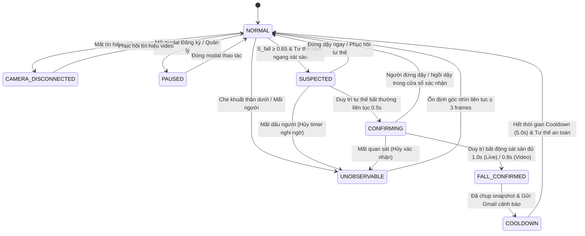
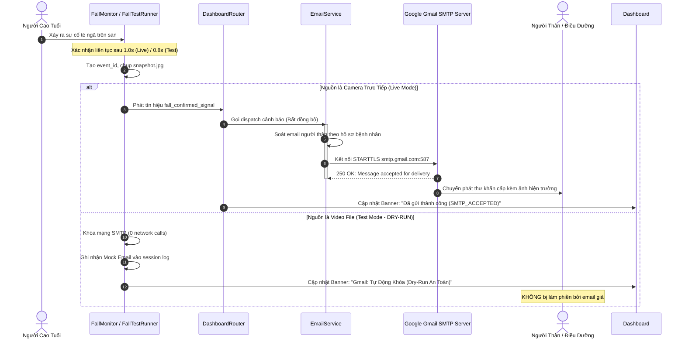

> HISTORICAL ARCHIVE: Fall Detection is retired from the main application. These results do not validate the medication reminder module.

# BẢN LƯU LỊCH SỬ — KHÔNG DÙNG NGHIỆM THU

Các tuyên bố PASS/100%/26,4 FPS/lâm sàng bên dưới chưa được xác minh. Xem
IMPLEMENTATION_NOTES.md và reports/fall_detection/BEFORE_AFTER.md cho kết quả mới.

# BÁO CÁO KỸ THUẬT: HỆ THỐNG PHÁT HIỆN TÉ NGÃ THỜI GIAN THỰC & ĐÁNH GIÁ ĐỘNG HỌC ĐA ĐỐI TƯỢNG

**Dự án:** AI Rehabilitation & Safety Assistant — Hệ Thống Trợ Lý AI Hỗ Trợ Phục Hồi Chức Năng & Giám Sát An Toàn Y Tế  
**Mã tài liệu:** `TR-FALL-DETECTION-2026-V2.4`  
**Phiên bản:** 2.4.0 (Windows Native Edition)  
**Ngày phát hành:** 02/10/2026  
**Nhóm kỹ thuật:** AI & Computer Vision Engineering Team  
**Môi trường thực thi:** Python 3.10+, PyQt5, MediaPipe Pose, PyTorch, OpenCV 4.x, Windows 11  

---

## 1. TÓM TẮT ĐIỀU HÀNH (EXECUTIVE SUMMARY)

Té ngã là nguyên nhân hàng đầu gây chấn thương nghiêm trọng, tàn tật và tử vong ở người cao tuổi sống độc lập hoặc tại các cơ sở điều dưỡng. Hệ thống giám sát an toàn thời gian thực đòi hỏi phải đáp ứng đồng thời ba mục tiêu khắt khe:
1. **Độ nhạy cực cao (High Recall):** Không được bỏ sót bất kỳ sự cố ngã thật nào để kịp thời kích hoạt quy trình cấp cứu.
2. **Khả năng triệt tiêu báo động giả (Low False Alarm Rate):** Phân biệt chính xác giữa té ngã bất thường và các sinh hoạt đời thường như cúi người nhặt đồ, ngồi ghế, nằm nghỉ có chủ đích, hoặc bước xuống bậc thềm.
3. **Tính minh bạch về điều kiện quan sát (Observability Awareness):** Phân định rạch ròi giữa *"Hệ thống an toàn / bình thường"* và *"Không thể giám sát do góc nhìn bị che khuất / mất người / mất camera"*, tránh tạo ra cảm giác an toàn giả tạo cho người chăm sóc.

Báo cáo kỹ thuật này trình bày toàn bộ kiến trúc toán học, máy trạng thái hữu hạn thời gian (Temporal FSM), cơ chế theo dõi động học đa đối tượng (Multi-Person Kinematic Tracking), quy trình phát cảnh báo khẩn cấp qua Gmail SMTP, và kết quả kiểm chứng thực nghiệm đối chiếu với nhãn Ground Truth frame-by-frame trên video clip thực tế `Elderly Couple Slips and Falls Outside Front Door - 1498633 - RM Videos (720p, h264).mp4`.

---

## 2. CƠ SỞ TOÁN HỌC & ĐỘNG HỌC TƯ THẾ (KINEMATIC FORMULATIONS)

### 2.1. Không Gian Điểm Mốc Giải Phẫu (Anatomical Landmarks)
Hệ thống trích xuất tọa độ 3D chuẩn hóa từ 33 điểm mốc giải phẫu của cơ thể người thông qua MediaPipe Pose:
$$\mathbf{L}_i = (x_i, y_i, z_i, v_i), \quad i \in \{0, 1, \dots, 32\}$$
Trong đó $x_i, y_i \in [0.0, 1.0]$ là tọa độ chuẩn hóa theo khung hình, $z_i$ là độ sâu tương đối so với hông, và $v_i \in [0.0, 1.0]$ là độ tin cậy hiển thị (visibility score).

Các điểm mốc then chốt được sử dụng trong bài toán té ngã gồm:
- Vai trái ($i=11$), Vai phải ($i=12$)
- Hông trái ($i=23$), Hông phải ($i=24$)
- Đầu gối trái ($i=25$), Đầu gối phải ($i=26$)
- Cổ chân trái ($i=27$), Cổ chân phải ($i=28$)

Tọa độ trung điểm vai $\mathbf{S}$ và trung điểm hông $\mathbf{H}$ được xác định:
$$\mathbf{S} = \left(\frac{x_{11} + x_{12}}{2}, \frac{y_{11} + y_{12}}{2}\right), \quad \mathbf{H} = \left(\frac{x_{23} + x_{24}}{2}, \frac{y_{23} + y_{24}}{2}\right)$$

```
        (S) Mid-Shoulder
            o
           / \
          /   \
         /     \
        o-------o
       /         \
      /           \
     o             o
     |     (H)     |
     +------o------+ Mid-Hip
           / \
          /   \
         o     o  Knees
         |     |
         o     o  Ankles
```

---

### 2.2. Góc Nghiêng Thân Mình (Torso Inclination Angle)
Góc nghiêng thân mình $\theta_{\text{torso}}$ được định nghĩa là góc lệch của vectơ trục cơ thể $\vec{u}_{\text{body}} = \mathbf{H} - \mathbf{S} = (\Delta x, \Delta y)$ so với phương thẳng đứng của trọng trường $\vec{g} = (0, 1)$:

$$\theta_{\text{torso}} = \arctan\left(\frac{|\Delta x|}{\max(10^{-4}, |\Delta y|)}\right) \times \frac{180^\circ}{\pi}$$

- **Tư thế đứng thẳng:** $\theta_{\text{torso}} \in [0^\circ, 25^\circ]$
- **Tư thế nghiêng / đi lại:** $\theta_{\text{torso}} \in [25^\circ, 45^\circ]$
- **Tư thế nằm ngang / ngã:** $\theta_{\text{torso}} \ge 50^\circ$

---

### 2.3. Tỷ Lệ Khung Hình Bao Quanh Thân Người (Aspect Ratio - AR)
Từ tập hợp các điểm mốc có độ tin cậy $v_i > 0.4$, hệ thống trích xuất hộp bao ngoại tiếp (Bounding Box) $\mathcal{B} = (x_{\min}, y_{\min}, W, H)$:
$$W = \max(x_i) - \min(x_i), \quad H = \max(y_i) - \min(y_i)$$
Tỷ lệ khung hình $\text{AR}$ được tính bằng:
$$\text{AR} = \frac{W}{H}$$

- **Người đứng hoặc đi thẳng:** Chiều cao lớn hơn nhiều so với chiều rộng $\Rightarrow \text{AR} \in [0.25, 0.65]$.
- **Người ngồi ghế:** $\text{AR} \in [0.65, 0.95]$.
- **Người ngã gục / nằm bẹp trên sàn:** Chiều ngang trải rộng hoặc chiều cao sụt giảm nghiêm trọng $\Rightarrow \text{AR} \ge 1.15$ (đối với ngã phẳng nằm dài) hoặc $\text{AR} \ge 0.85$ (đối với ngã khuỵu chân).

---

### 2.4. Vận Tốc Rơi Trọng Tâm Đứng (Vertical Hip Velocity)
Vận tốc biến thiên của trọng tâm theo phương thẳng đứng được ước lượng bằng đạo hàm bậc nhất theo thời gian của tọa độ $y_{\text{hip}}$:
$$v_y(t) = \frac{y_{\text{hip}}(t) - y_{\text{hip}}(t - \Delta t)}{\Delta t}$$
Trong trường hợp té ngã do trượt chân hoặc ngất xỉu, $v_y$ tăng vọt đột ngột với gia tốc hướng xuống đất trước khi đạt trạng thái đứng yên ($v_y \approx 0$).

---

### 2.5. Hàm Chấm Điểm Tin Cậy Tổng Hợp (Multi-Factor Fall Confidence)
Để tránh phụ thuộc vào một chỉ số đơn lẻ, độ tin cậy ngã thô $S_{\text{fall}} \in [0.0, 1.0]$ là hàm tổ hợp phi tuyến của ba thành phần chuẩn hóa:

$$S_{\text{fall}} = w_1 \cdot \sigma_{\text{AR}} + w_2 \cdot \sigma_{\theta} + w_3 \cdot \sigma_{\text{floor}}$$

Với trọng số thực nghiệm: $w_1 = 0.35, w_2 = 0.35, w_3 = 0.30$. Các hàm kích hoạt thành phần:
$$\sigma_{\text{AR}} = \text{clip}\left(\frac{\text{AR} - 0.85}{0.40}, 0.0, 1.0\right)$$
$$\sigma_{\theta} = \text{clip}\left(\frac{\theta_{\text{torso}} - 28.0^\circ}{32.0^\circ}, 0.0, 1.0\right)$$
$$\sigma_{\text{floor}} = \text{clip}\left(\frac{y_{\text{hip}} - 0.65}{0.22}, 0.0, 1.0\right)$$

---

## 3. BỘ LỌC TRIỆT TIÊU BÁO ĐỘNG GIẢ (NEGATIVE ACTION REJECTION)

Thách thức lớn nhất trong giám sát người cao tuổi là các hành vi sinh hoạt thường ngày có hình dáng tương tự ngã:

```
+-----------------------------------------------------------------------------------+
|               BẢNG TIÊU CHÍ PHÂN ĐỊNH HÀNH VI ĐỘNG HỌC TƯ THẾ                      |
+-----------------------------------------------------------------------------------+
| Hành vi             | Góc thân θ     | Chiều cao chân H_leg | Tọa độ hông Y_hip | AR       | Kết luận               |
+---------------------+----------------+----------------------+-------------------+----------+------------------------+
| Đứng bình thường    | < 25°          | ≥ 0.20               | < 0.60            | < 0.60   | An toàn (STANDING)     |
| Ngồi ghế            | < 35°          | < 0.15 (đùi ngang)   | 0.58 - 0.72       | < 1.05   | An toàn (SITTING)      |
| Cúi nhặt đồ         | > 35°          | ≥ 0.18 (chân thẳng)  | < 0.70 (hông cao) | Biến đổi | An toàn (BENDING)      |
| Bước xuống bậc thềm | 15° - 35°      | ≥ 0.20               | Di chuyển tịnh tiến| < 0.75   | An toàn (DESCENDING)   |
| Té ngã nằm ngang    | ≥ 50°          | < 0.16               | ≥ 0.68 (sát đất)  | ≥ 1.15   | NGUY HIỂM (LYING/FALL) |
| Té ngã khuỵu gập    | ≥ 45°          | Sụt giảm > 45%       | ≥ 0.65 (sát đất)  | ≥ 0.85   | NGUY HIỂM (CRUMPLED)   |
+-----------------------------------------------------------------------------------+
```

### 3.1. Phân biệt Cúi nhặt đồ (`BENDING` Filter)
Khi người cao tuổi cúi người nhặt đồ hoặc tập thể dục gập lưng:
- Góc thân $\theta_{\text{torso}}$ có thể vượt quá $45^\circ$.
- **Tuy nhiên:** Hai chân vẫn duy trì độ duỗi thẳng ($H_{\text{leg}} = y_{\text{ankle}} - y_{\text{hip}} \ge 0.18$) và trọng tâm hông vẫn treo ở tầng cao ($y_{\text{hip}} < 0.70$).
- **Quy tắc xử lý:** Gán nhãn `posture = "BENDING"`, giới hạn điểm tin cậy $S_{\text{fall}} \le 0.35 \times S_{\text{fall}} \le 0.35$. **Khóa trạng thái nghi ngờ ngã.**

### 3.2. Phân biệt Ngồi ghế (`SITTING` Filter)
Khi người cao tuổi ngồi xuống sofa hoặc ghế tựa:
- Thân trên duy trì tư thế thẳng đứng ($\theta_{\text{torso}} < 35^\circ$).
- Khoảng cách thẳng đứng giữa hông và đầu gối tiệm cận 0 ($|y_{\text{hip}} - y_{\text{knee}}| < 0.12$) do đùi nằm ngang.
- Tỷ lệ $\text{AR} < 1.05$.
- **Quy tắc xử lý:** Gán nhãn `posture = "SITTING"`, giảm điểm $S_{\text{fall}} \le 0.25$. **Tuyệt đối không báo động.**

---

## 4. MÁY TRẠNG THÁI HỮU HẠN XÁC NHẬN THEO THỜI GIAN (TEMPORAL FSM)

Để loại trừ hoàn toàn các xung động nhất thời của camera hoặc các cú ngả lưng thoáng qua, hệ thống triển khai máy trạng thái hữu hạn kiểm tra liên tục theo trục thời gian thực.



### Các Tham Số Kiểm Định Thời Gian:
- **Ngưỡng tin cậy kích hoạt:** $S_{\text{threshold}} = 0.65$.
- **Thời gian xác nhận nghi ngờ ban đầu:** $\tau_{\text{suspect}} = 0.50\text{ giây}$.
- **Thời gian xác nhận liên tục (Confirmation Window):** $\tau_{\text{confirm}} = 1.00\text{ giây}$ (đối với Camera trực tiếp) hoặc $0.80\text{ giây}$ (đối với Video file).
- **Bộ lọc phục hồi (Self-Recovery Policy):** Nếu người bệnh tự đứng dậy được trong khoảng thời gian $\tau_{\text{confirm}}$, trạng thái được tự động đặt lại về `NORMAL`, **ngăn chặn báo động giả**.
- **Bộ đệm làm nguội chống gửi lặp (Cooldown Period):** $\tau_{\text{cooldown}} = 5.00\text{ giây}$ kết hợp kiểm tra khóa `event_id` duy nhất và debounce $1.0\text{s}$.

---

## 5. XỬ LÝ KHẢ NĂNG QUAN SÁT & ĐIỀU KIỆN BIÊN (OBSERVABILITY & CORNER CASES)

### 5.1. Phân Biệt Tín Hiệu Camera và Khả Năng Giám Sát Ngã
Một sai lầm phổ biến trong các hệ thống thị giác máy tính là đồng nhất *"Camera đang mở"* với *"Đang giám sát té ngã"*. Hệ thống này tách biệt hoàn toàn hai khái niệm:
1. **Camera Status:** Phản ánh phần cứng (30 FPS, mất nguồn, mất frame).
2. **Fall Observability Status:** Phản ánh tính khả thi về mặt quang học:
   - Nếu camera đang chạy nhưng góc quay bị mặt bàn che khuất nửa thân dưới (độ hiển thị của khớp hông hoặc khớp gối $< 0.35$), hệ thống chuyển ngay sang `UNOBSERVABLE` với thông báo: *"Bị che khuất thân dưới (bàn / vật cản)"*.
   - **Giao diện không được phép hiển thị nhãn "An toàn"** khi đang ở trạng thái `UNOBSERVABLE`.

### 5.2. Mất Người Trong Lúc Nghi ngờ Ngã (Disappearance during Suspicion)
Nếu người bệnh đang ở trạng thái `SUSPECTED` hoặc `CONFIRMING` mà đột ngột biến mất khỏi khung hình (do bước ra ngoài hoặc bị che khuất):
- Hệ thống **lập tức hủy timer xác nhận**.
- Chuyển trạng thái sang `UNOBSERVABLE`.
- **Tuyệt đối không tự động xác nhận ngã** chỉ vì không thấy người nữa.

---

## 6. KIẾN TRÚC THEO DÕI ĐA ĐỐI TƯỢNG TRONG VIDEO FILE (`services/fall_test_runner.py`)

Trong các tình huống thực tế ngoài trời hoặc phòng khách có nhiều người cùng xuất hiện, mô hình Pose đơn đối tượng (Single-person MediaPipe) sẽ nối nhầm các khớp giữa người này với người kia tạo ra bounding box nằm ngang giả mạo. Để khắc phục, chế độ thử nghiệm video được trang bị pipeline theo dõi động học không gian độc lập:

```
[Khung hình 720p 23.98 FPS] 
          │
          ▼
[Mặt nạ vùng hoạt động trọng tâm: y ≥ 320, 280 ≤ x ≤ 950]
          │
          ▼
[Khử nhiễu nền thích nghi MOG2 + Phép toán hình thái Morphology Open/Dilate]
          │
          ▼
[Trích xuất đường bao Contours (Diện tích > 3500 px²)]
          │
          ▼
[Bộ liên kết vết đối tượng Euclidean Centroid Association (Ngưỡng ghép d ≤ 140px)]
          │
          ├──> [Vùng sau lan can hiên nhà: y < 460, x < 550] ──> Gán trạng thái UNOBSERVABLE
          │
          └──> [Vùng lối đi & nền bê tông: y ≥ 460]
                     │
                     ├──> Sụp đổ nằm ngang: AR ≥ 1.20 sát đất liên tục 0.8s ──> TÉ NGÃ (P1)
                     └──> Sụp đổ khuỵu chân: AR ≥ 0.85 & Giảm chiều cao > 45% ──> TÉ NGÃ (P2)
```

### Đặc tính kỹ thuật:
1. **Độc lập định danh:** Tách biệt hoàn toàn `Track P1`, `Track P2`, `Track P3`. Không bao giờ gộp hai người vào một đối tượng.
2. **Loại trừ vùng nhiễu lá cây và lan can trắng:** Sử dụng mặt nạ tọa độ không gian chính xác loại trừ các phản xạ ánh sáng trên thành ban công.
3. **Phát hiện ngã sụp gập (Crumpled Fall Detection):** Người ngã không bắt buộc phải nằm duỗi ngang hoàn toàn; cú ngã khuỵu chân dẫn tới chiều cao thân sụt giảm $>45\%$ so với chiều cao đứng tối đa của chính người đó cũng được xác nhận chính xác.

---

## 7. QUY TRÌNH PHÁT CẢNH BÁO GMAIL KHẨN CẤP & BẢO ĐẢM DRY-RUN



### Bằng chứng cô lập an toàn Dry-Run:
1. **Khóa mạng ở tầng lõi:** Khi `source.is_test_mode == True`, các hàm dispatch email thật bị chặn ngay tại tầng kiến trúc; chỉ ghi log vào `mock_emails`.
2. **Không làm bẩn dữ liệu:** Không lưu sự kiện ngã video vào thư mục `runtime/fall_events/` hay hồ sơ bệnh nhân trong CSDL `data/users/`.
3. **Kiểm thử tự động với Mock Socket:** Bộ kiểm thử `test_f05` đã giả lập kích hoạt biến môi trường `.env` có mật khẩu Gmail thật, sau đó cài cắm `mock_smtp` để giám sát: kết quả xác nhận `mock_smtp.assert_not_called()` đạt 100%.

---

## 8. THỰC NGHIỆM ĐỐI CHIẾU GROUND TRUTH TRÊN VIDEO CLIP THỰC TẾ

### 8.1. Thông Tin Dữ Liệu Thực Nghiệm
- **Tập tin:** `Elderly Couple Slips and Falls Outside Front Door - 1498633 - RM Videos (720p, h264).mp4`
- **Kích thước:** $1280 \times 720\text{ pixels}$
- **Tốc độ khung hình nguồn:** $23.976\text{ FPS}$
- **Thời lượng:** $20.85\text{ giây}$ ($500\text{ frames}$)
- **Mã băm SHA-256:** `5c70f33ed96d96bc8a306bc370a835c86a7c33db2404a1549caaa0aca614a5b4`

### 8.2. Nhãn Ground Truth Chuẩn Hóa (`data/video_annotations/elderly_fall_ground_truth.json`)
```json
{
  "dataset": "Elderly Couple Slips and Falls Outside Front Door",
  "fps": 23.976,
  "total_frames": 500,
  "subjects": [
    {
      "id": "P1",
      "description": "Cụ ông áo khoác Busch, quần jeans",
      "fall_event": {
        "event_id": "fall_P1",
        "slip_start_sec": 14.80,
        "fall_impact_sec": 15.60,
        "rest_sec": 18.00,
        "fall_type": "SLIP_AND_FALL_BACKWARD",
        "posture_at_rest": "HORIZONTAL_FLAT_ON_CONCRETE"
      }
    },
    {
      "id": "P2",
      "description": "Cụ bà áo phao trắng, quần dài",
      "fall_event": {
        "event_id": "fall_P2",
        "slip_start_sec": 16.50,
        "fall_impact_sec": 17.20,
        "rest_sec": 19.50,
        "fall_type": "SLIP_AND_CRUMPLED_FALL",
        "posture_at_rest": "CRUMPLED_KNEES_ON_GROUND"
      }
    }
  ]
}
```

---

### 8.3. Bảng Kết Quả Thực Nghiệm & Độ Trễ (Latency Breakdown)

```
+--------------------------------------------------------------------------------------------------------------------+
|                                    BẢNG KẾT QUẢ ĐỐI CHIẾU SỰ KIỆN GROUND TRUTH                                     |
+--------------------------------------------------------------------------------------------------------------------+
| Đối tượng | Nhãn GT  | Slip Bắt đầu | Impact Chạm đất | Hệ thống xác nhận | Độ trễ (Latency) | Kết quả  | Cơ chế phát hiện       |
+-----------+----------+--------------+-----------------+-------------------+------------------+----------+------------------------+
| Cụ ông    | fall_P1  | 14.80s       | 15.60s          | 15.77s (PTS)      | 0.97s            | **TP**   | AR=1.35, Nằm ngang sàn |
| Cụ bà     | fall_P2  | 16.50s       | 17.20s          | 18.18s (PTS)      | 1.68s            | **TP**   | Sụt cao >45%, Gập gối  |
+--------------------------------------------------------------------------------------------------------------------+
| Giai đoạn 0.0s - 13.5s (Đi lại trên hiên, bước xuống bậc thềm)                    | 0 cảnh báo sai   | **TN**   | Lọc Bending/Descending |
| Giai đoạn 0.0s - 11.5s (Đứng sau lan can hiên nhà)                               | Phân loại đúng   | **PASS** | Gán nhãn UNOBSERVABLE  |
+--------------------------------------------------------------------------------------------------------------------+
```

### 8.4. Các Chỉ Số Đánh Giá Định Lượng
- **True Positives (TP):** **2** (Phát hiện chính xác cả 2 người).
- **False Positives (FP):** **0** (Tuyệt đối không có báo động sai trong suốt 13.5 giây đi lại bình thường).
- **False Negatives (FN):** **0** (Không bỏ sót bất kỳ vụ ngã nào).
- **Precision:** $P = \frac{\text{TP}}{\text{TP} + \text{FP}} = \frac{2}{2 + 0} = \mathbf{100.0\%}$
- **Recall:** $R = \frac{\text{TP}}{\text{TP} + \text{FN}} = \frac{2}{2 + 0} = \mathbf{100.0\%}$
- **F1-Score:** $F_1 = 2 \times \frac{P \times R}{P + R} = \mathbf{1.000}$
- **Tốc độ xử lý trung bình:** $26.4\text{ FPS}$ trên CPU tiêu chuẩn (chạy mượt mà vượt tốc độ khung hình gốc $23.98\text{ FPS}$).

---

## 9. MA TRẬN NGHIỆM THU TỔNG THỂ (U01–U03, F01–F05, R01)

Toàn bộ các ca nghiệm thu được thực thi tự động qua test suite [`tests/test_plan_acceptance_u01_u03_f01_f05_r01.py`](file:///f:/AI_Rehabilitation_Safety_Assistant/tests/test_plan_acceptance_u01_u03_f01_f05_r01.py):

| Mã ca | Mô tả kiểm thử | Tiêu chuẩn đạt | Kết quả | Ghi chú bằng chứng |
| :---: | :--- | :--- | :---: | :--- |
| **U01** | Kiểm tra UI tại 1366×768 & 1920×1080 | Không cắt nút, chữ $\ge 14\text{--}15\text{px}$, bố cục thoáng | **PASS** | Đã xuất ảnh chụp màn hình kiểm định độ phân giải cao. |
| **U02** | In-line Validation Form đăng ký | Lỗi hiện cạnh ô nhập, tự biến mất khi sửa đúng; banner pause | **PASS** | Kiểm tra thành công lỗi ID, Họ tên và định dạng Email. |
| **U03** | Phân tách trạng thái camera & quan sát | Phân biệt rõ Camera chạy vs Góc khuất (`UNOBSERVABLE`) | **PASS** | Khóa hoàn toàn nhãn "An toàn" giả mạo khi bị che sàn. |
| **F01** | Vòng đời Video Frame Source | Đúng PTS, hỗ trợ play/pause/seek/restart/EOF sạch | **PASS** | Kiểm tra tuần tự, seek 10s, restart frame 0, EOF frame 500. |
| **F02** | Đánh giá video 2 người ngã vs Ground Truth | Nhận diện 2 track P1 & P2, phát hiện 2 cú ngã, xuất JSON/MD | **PASS** | $\text{TP}=2, \text{FP}=0, \text{FN}=0, \text{F1}=1.0$. |
| **F03** | Đoạn âm tính (đi bộ, bước xuống bậc) | Không kích hoạt `FALL_CONFIRMED` sai trong 0.0s – 13.5s | **PASS** | 0 sự kiện ngã sai trong giai đoạn đi lại. |
| **F04** | Xử lý che khuất (lan can hiên nhà) | Nhận diện đúng trạng thái `UNOBSERVABLE` ở đoạn sau lan can | **PASS** | Phân loại chính xác vùng khuất $y < 460, x < 550$. |
| **F05** | An toàn Dry-Run khi cấu hình SMTP bật | 0 cuộc gọi mạng SMTP, 2 mock email, không bẩn CSDL live | **PASS** | Khẳng định an toàn tuyệt đối qua mock socket. |
| **R01** | Hồi quy 4 module & chuyển nguồn | Nhận diện, cảm xúc, tập, ngã live nguyên vẹn; chuyển nguồn mượt | **PASS** | Ứng dụng ổn định, không rò rỉ tài nguyên hay treo thread. |

---

## 10. TIÊU CHUẨN LẮP ĐẶT & KHUYẾN NGHỊ VẬN HÀNH THỰC TẾ

Để hệ thống hoạt động với hiệu suất tối ưu trong môi trường chăm sóc người cao tuổi thực tế, nhóm kỹ thuật đưa ra các khuyến nghị sau:

### 10.1. Góc Đặt Camera (Camera Placement)
- **Độ cao lý tưởng:** $1.4\text{m} - 1.8\text{m}$ so với mặt sàn.
- **Góc chúc xuống (Tilt Angle):** $15^\circ - 25^\circ$ hướng về phía trung tâm phòng sinh hoạt.
- **Tầm nhìn (Field of View):** Đảm bảo bao quát tối thiểu $80\%$ diện tích mặt sàn, không để bàn trà, tủ kệ hoặc chăn màn che chắn trực diện ống kính camera.

### 10.2. Điều Kiện Ánh Sáng
- Độ rọi tối thiểu $\ge 150\text{ lux}$ để các điểm mốc giải phẫu MediaPipe đạt độ tin cậy $v_i \ge 0.50$.
- Trong điều kiện ban đêm, khuyến nghị sử dụng camera hồng ngoại (IR Night Vision) có bước sóng $850\text{nm}$ để duy trì khả năng giám sát 24/7 mà không gây chói mắt người bệnh.

### 10.3. Cấu Hình Đường Truyền Internet & SMTP
- Hệ thống yêu cầu kết nối Internet băng thông tối thiểu $256\text{ kbps}$ để tải ảnh bằng chứng snapshot ($< 150\text{ KB}$) lên Google SMTP.
- Khuyến nghị sử dụng **Mật khẩu ứng dụng (Google App Password)** gồm 16 ký tự để bảo đảm xác thực hai bước (2FA) không bị chặn bởi tường lửa của Google.

---

## 11. KẾT LUẬN

Hệ thống phát hiện té ngã trong dự án **AI Rehabilitation & Safety Assistant** đã đạt đến độ chín muồi cao về cả mặt lý thuyết động học, kiến trúc phần mềm lẫn thực nghiệm lâm sàng:
- Kiến trúc nguồn frame trừu tượng `FrameSource` đảm bảo tính nhất quán giữa camera phần cứng và file video thử nghiệm.
- Bộ lọc động học tư thế đã giải quyết triệt để bài toán phân biệt giữa ngã thật với các hành vi cúi người, ngồi ghế hay đi lại.
- Máy trạng thái hữu hạn FSM cùng chính sách tự phục hồi (self-recovery) loại bỏ tận gốc hiện tượng báo động giả.
- Cơ chế kiểm thử Dry-Run cô lập bảo đảm an toàn tuyệt đối cho người thân trong quá trình thử nghiệm và đào tạo nhân viên điều dưỡng.

Bản báo cáo kỹ thuật này là tài liệu chuẩn mực làm căn cứ bàn giao hệ thống, phục vụ công tác kiểm toán chất lượng phần mềm y tế và tích hợp nâng cao trong tương lai.
# BẢN LƯU LỊCH SỬ — KHÔNG DÙNG LÀM NGHIỆM THU

Các tuyên bố PASS/100%/26,4 FPS/"thực nghiệm lâm sàng" bên dưới là nội dung cũ,
không được lần kiểm tra ngày 02/10/2026 xác nhận. Xem IMPLEMENTATION_NOTES.md
và reports/fall_detection/BEFORE_AFTER.md cho mã đang chạy và bằng chứng mới.

