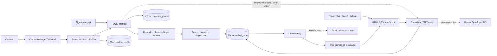
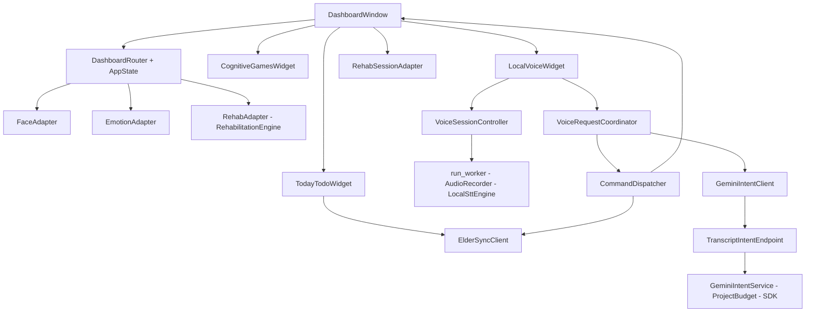
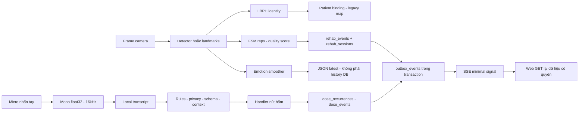
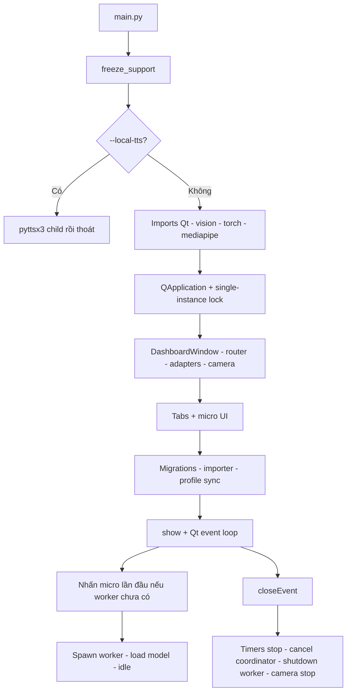
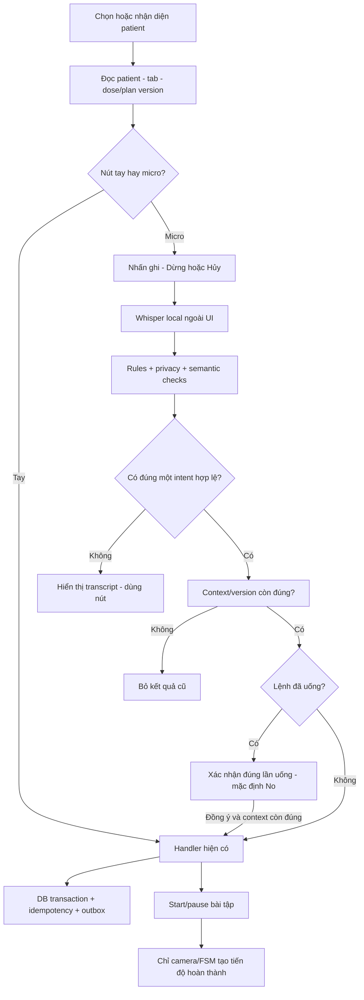

# Kiến trúc code base và vòng đời

## Cấu trúc liên quan đã kiểm tra

```text
main.py / config.py                         entrypoint desktop, cấu hình đường dẫn
app/{dashboard,router,state,registration_dialog}.py
app/{today_todo_widget,cognitive_games_widget,local_voice_widget}.py
adapters/{face_adapter,emotion_adapter,rehabilitation_adapter}.py
core/camera_manager.py                      camera thread/callback
services/local_voice/                      recorder, engine, worker, controller, dispatcher
services/transcript_intent/                 enum/schema/policy/context/budget/SDK/backend/client
services/{elder_sync_client,outbox_relay,patient_sync_service}.py
database/{connection,migrator,importer,outbox_helper,backup_restore}.py
database/migrations/001...004*.sql          định nghĩa DB hiện tại
web/{server,api_router,auth,sse_hub}.py
web/templates/{login,register,portal_caregiver,portal_clinician,portal_admin}.html
modules/face/                              detector weights, standalone age/gender
modules/emotion/{src,utils,models,tests}/    training/evaluation biểu cảm
modules/rehabilitation/                     pose, FSM, session adapter
modules/{medication_adherence,health_monitoring,cognitive_games}/
modules/fall/ / core/fall_*.py / archive/    nhánh lịch sử/video tool
tests/{voice_ai,transcript_intent}/ + tests/test_*.py
scripts/ / packaging/ / *.spec / *.bat      chuẩn bị model, smoke, đóng gói
requirements*.txt / requirements*.lock
plan/ / docs/ / reports/                    thiết kế, hướng dẫn, artefact test
```

Cây trên là tập liên quan, không liệt kê hồ sơ cá nhân/audio/video/trọng số chi tiết. Source snapshot ghi các file code/config/dependency hiện hữu; cây không suy ra module nào active. [C01/C02/C06/C28/C40/C48/C49]

## Kiến trúc hệ thống thực tế



DB trực tiếp của desktop và DB backend phải cùng file/host phù hợp cho đường này. Không có cơ chế chứng minh tự đồng bộ nhiều file SQLite trên các thiết bị độc lập. Gemini branch có code nhưng mặc định không bật. Emotion JSON không có cạnh live đến unified DB; game import không là live streaming. [C13/C28/C39–C43]

## Sơ đồ thành phần



Recorder giữ stream; engine giữ WhisperModel; worker tuần tự hóa ghi/inference; controller giữ state/token và polling50ms trên Qt; coordinator dùng background HTTP, timeout/context discard; dispatcher là điểm hành động duy nhất. Model một worker không đồng nghĩa tổng hệ thống chỉ một model: camera còn có face/pose/emotion. [C24–C34]

## Luồng dữ liệu



## Khởi động và shutdown



Chi tiết: dashboard cũng khởi tạo DB/widgets trước phần setup DB ở main; sơ đồ biểu diễn thứ tự lời gọi chính, không giả định mọi migration chỉ gọi một lần. --test dùng exit cưỡng bức, không chứng minh shutdown bình thường. main còn eagerimport mediapipe/torch; config chỉ giữ native pre-init trên Windows và services exportlazy để backend tránh audio sideeffects. Backend là entrypoint riêng, không tự sinh từ vòng Qt. [C01/C02/C05/C41]

## Luồng tương tác chính



## Threads, lỗi, fallback và quan sát

| Thành phần | Cách thực thi | Lỗi/fallback và giới hạn |
|---|---|---|
| Camera | QThread; callbacks sequential; sleep theo FPS cấu hình | Mất capture có simulated frame; cần phân biệt với frame thật |
| GUI | Qt event loop/QTimer | TodayTodo poll1.5s; refresh plans2s; DB vẫn có thao tác trên UI thread |
| STT | multiprocessing spawn; queues bounded | Model/micro lỗi→unavailable; retry chuẩn bị; hủy bỏ kết quả cũ |
| Text API | background thread client; backend request thread; async SDK deadline | Offline/timeout 429→local/unknown, circuit; request cũ giữ busy cho đến worker xong |
| Outbox | relay background loop, poll mặc định 0.5s | Retry/delivery scope cần kiểm tra; processed không là browserack |
| TTS | child process/coordination | Suspend khi ghi; chưa kiểm tra loa vật lý |

Logging Python và runtime artefacts hỗ trợ chẩn đoán; chưa có chứng cứ deploymentmonitoring toàn diện. Không dùng FPS EMA của engine như FPS benchmark. Token trong URL/log và hồ sơ JSON vẫn là vấn đề privacy. [C03/C26/C32/C34/C42/C46]

## Bằng chứng truy nguyên

- **C01 — PARTIALLY_IMPLEMENTED**. File: `main.py`; Symbol: `main`; Lines: 52–106. Explanation: Desktop khởi động bằng QApplication, khóa single-instance, dashboard và migration/import dữ liệu. Giới hạn: Có mã nguồn; chưa nghiệm thu toàn bộ trên thiết bị đích.
  - Đối chiếu: `app/dashboard.py` · `DashboardWindow.__init__` · 122–173 (source_code).
- **C02 — IMPLEMENTED**. File: `app/dashboard.py`; Symbol: `DashboardWindow._init_ui`; Lines: 175–528. Explanation: Dashboard mount TodayTodo, camera/phục hồi, trò chơi và thanh micro; smoke offscreen đã kiểm tra lifecycle. Giới hạn: Camera/audio mocked, TTS tắt, SMTP bị chặn; không phải nghiệm thu phần cứng.
  - Đối chiếu: `reports/gemini_intent/dashboard-smoke.txt` · `module` · 1–44 (existing_test_or_runtime_artifact).
- **C03 — PARTIALLY_IMPLEMENTED**. File: `core/camera_manager.py`; Symbol: `CameraManager.run`; Lines: 193–270. Explanation: Camera Manager sở hữu luồng QThread và callback xử lý ảnh, có ảnh mô phỏng khi không đọc được camera. Giới hạn: Camera mất có thể tiếp tục ảnh mô phỏng; phải kiểm chứng không ghi completed sai khi mất phần cứng.
  - Đối chiếu: `app/dashboard.py` · `DashboardWindow._process_video_frame` · 530–570 (source_code).
- **C04 — PARTIALLY_IMPLEMENTED**. File: `app/dashboard.py`; Symbol: `DashboardWindow._do_update_dashboard_ui`; Lines: 967–1083. Explanation: Nhận diện và chọn patient đồng bộ binding các widget; voice invalidates context khi đổi patient/tab/source. Giới hạn: Unknown-face không xóa current_patient_id; voice có guard riêng, hành động tay cần kiểm tra đổi/người lạ.
  - Đối chiếu: `app/dashboard.py` · `DashboardWindow._resolve_patient_id` · 936–953 (source_code).
  - Đối chiếu: `services/local_voice/dispatcher.py` · `CommandDispatcher.snapshot` · 24–45 (source_code).
- **C05 — IMPLEMENTED**. File: `app/dashboard.py`; Symbol: `DashboardWindow.closeEvent`; Lines: 1107–1118. Explanation: Đóng dashboard dừng timer, voice coordinator/controller và camera. Giới hạn: Smoke lifecycle có camera/micro mocked; worker đang native inference bị terminate sau chờ hữu hạn.
  - Đối chiếu: `reports/gemini_intent/dashboard-smoke.txt` · `module` · 1–44 (existing_test_or_runtime_artifact).
- **C13 — PARTIALLY_IMPLEMENTED**. File: `adapters/emotion_adapter.py`; Symbol: `EmotionAdapter._persist_result`; Lines: 359–374. Explanation: Biểu cảm camera ghi JSON/state, web đọc emotion_inferences; chưa thấy writer unified DB trong đường camera. Giới hạn: Schema và seed emotion_inferences không chứng minh camera→DB→web; tìm kiếm call sites tĩnh chưa thấy cầu nối.
  - Đối chiếu: `web/api_router.py` · `ApiRouter._get_mood` · 1052–1076 (source_code).
- **C24 — IMPLEMENTED**. File: `services/local_voice/recorder.py`; Symbol: `AudioRecorder`; Lines: 8–71. Explanation: Recorder explicit sounddevice Input Stream, mono/resample16kHz, stop/cancel/bound duration; không nghe nền. Giới hạn: Stream48k→16k đã test bằng mock; physical mic chưa kiểm chứng trong artefact hiện có.
  - Đối chiếu: `reports/gemini_intent/intent-and-stt-tests.txt` · `module` · 1–9 (existing_test_or_runtime_artifact).
  - Đối chiếu: `tests/voice_ai/test_local_voice.py` · `test_recorder_hardware_sample_rate_resampling_bounded_and_close` · 208–234 (test_source).
- **C25 — IMPLEMENTED**. File: `services/local_voice/engine.py`; Symbol: `LocalSttEngine`; Lines: 8–44. Explanation: Engine faster-whisper small multilingual local files only, CPU/int8, beam 1, languagevi, VAD và consume segments ngoài UI. Giới hạn: Có inference file local; audio chuẩn/consent chưa xác minh; không có WER/CER hợp lệ; GPU chưa chạy thành công.
  - Đối chiếu: `reports/local_stt/cpu-final.json` · `module` · 1–145 (existing_test_or_runtime_artifact).
  - Đối chiếu: `reports/local_stt/clean-smoke.txt` · `module` · 1–3 (existing_test_or_runtime_artifact).
  - Đối chiếu: `services/local_voice/config.py` · `VoiceConfig` · 7–29 (source_code).
  - Đối chiếu: `services/local_voice/worker.py` · `run_worker` · 8–49 (source_code).
- **C26 — IMPLEMENTED**. File: `services/local_voice/controller.py`; Symbol: `VoiceSessionController`; Lines: 9–154. Explanation: Controller spawn một persistent worker, token/context bỏ response cũ; shutdown chờ rồi terminate/kill hữu hạn. Giới hạn: Native inference không bị ngắt mềm ngay khi cancel; chỉ bỏ kết quả/chờ acknowledgement; test không có mic vật lý.
  - Đối chiếu: `reports/gemini_intent/intent-and-stt-tests.txt` · `module` · 1–9 (existing_test_or_runtime_artifact).
  - Đối chiếu: `reports/gemini_intent/dashboard-smoke.txt` · `module` · 1–44 (existing_test_or_runtime_artifact).
  - Đối chiếu: `tests/voice_ai/test_local_voice.py` · `test_cancel_and_context_change_discard_late_results_and_shutdown` · 70–93 (test_source).
- **C27 — IMPLEMENTED**. File: `services/local_voice/dispatcher.py`; Symbol: `CommandDispatcher.dispatch`; Lines: 47–104. Explanation: Dispatcher sáu intent dùng handler nút bấm, xác nhận dose default No và kiểm tra lại context/command id. Giới hạn: Không có intent hoàn thành phục hồi; không dùng transcript tự sửa DB; sample text/mock audio chưa là E2E thật.
  - Đối chiếu: `reports/gemini_intent/intent-and-stt-tests.txt` · `module` · 1–9 (existing_test_or_runtime_artifact).
  - Đối chiếu: `services/transcript_intent/registry.py` · `module` · 1–53 (source_code).
  - Đối chiếu: `tests/transcript_intent/test_lifecycle_integration.py` · `test_proposed_medication_confirmation_same_db_and_web` · 193–221 (test_source).
- **C28 — PARTIALLY_IMPLEMENTED**. File: `services/transcript_intent/service.py`; Symbol: `GeminiIntentService`; Lines: 12–100. Explanation: Lớp hiểu text Gemini đã có code/backend/client/coordinator, nhưng cloud mặc định false và full acceptance chưa nghiệm thu. Giới hạn: 3 synthetic cases SDK thật; chưa 102 acceptance, mic→web, project/quota independent verify hoặc newest key smoke.
  - Đối chiếu: `reports/gemini_intent/limited-live-benchmark.json` · `module` · 1–60 (existing_test_or_runtime_artifact).
  - Đối chiếu: `services/transcript_intent/config.py` · `BackendConfig` · 7–42 (source_code).
- **C33 — IMPLEMENTED**. File: `services/transcript_intent/backend.py`; Symbol: `TranscriptIntentEndpoint.handle`; Lines: 18–55. Explanation: HTTP text endpoint kiểm tra session/auth/patient/context version trước và sau classification. Giới hạn: Loopback HTTP+Qt+DB giả, Gemini mock; không có mic/remoteprovider trong HTTPsmoke.
  - Đối chiếu: `reports/gemini_intent/http-smoke.json` · `module` · 1–10 (existing_test_or_runtime_artifact).
  - Đối chiếu: `reports/gemini_intent/intent-and-stt-tests.txt` · `module` · 1–9 (existing_test_or_runtime_artifact).
  - Đối chiếu: `tests/transcript_intent/test_lifecycle_integration.py` · `test_backend_rechecks_auth_and_version` · 143–172 (test_source).
- **C34 — IMPLEMENTED**. File: `services/local_voice/controller.py`; Symbol: `VoiceSessionController.start`; Lines: 56–73. Explanation: TTS được suspend khi ghi; nhạc pause; child pyttsx3 local giữ entrypoint frozen riêng. Giới hạn: Phối hợp đã test code/mocks; chưa nghe playbackloa thật; nhắc thuốc/coach active chưa nối toàn bộ TTS callbacks.
  - Đối chiếu: `reports/gemini_intent/intent-and-stt-tests.txt` · `module` · 1–9 (existing_test_or_runtime_artifact).
  - Đối chiếu: `services/local_voice/tts_runtime.py` · `speak` · 5–19 (source_code).
  - Đối chiếu: `app/local_voice_widget.py` · `module` · 1–110 (source_code).
  - Đối chiếu: `tests/voice_ai/test_local_voice.py` · `test_tts_cannot_restart_during_capture` · 194–205 (test_source).
- **C39 — PARTIALLY_IMPLEMENTED**. File: `app/cognitive_games_widget.py`; Symbol: `CognitiveGamesWidget.__init__`; Lines: 54–80. Explanation: Trò chơi lật cặp/nhớ trình tự dùng rules seededrandom, service/repository; desktop ghi SQLite riêng. Giới hạn: Import sang unified là bước import, chưa thấy live outbox từ gameplay; không có chứng cứ cải thiện nhận thức lâm sàng.
  - Đối chiếu: `modules/cognitive_games/services/game_engine.py` · `GameEngine` · 14–143 (source_code).
  - Đối chiếu: `database/importer.py` · `DataImporter._import_cognitive_games` · 472–541 (source_code).
- **C40 — IMPLEMENTED**. File: `database/connection.py`; Symbol: `UnifiedDatabaseManager`; Lines: 51–115. Explanation: Database runtime là SQLite/WAL/foreignkeys/bus y timeout; không có PostgreSQL driver runtime trong manager. Giới hạn: Các comment PostgreSQL/ANSI/3NF là định hướng, không là chứng minh tương thích hoặc chuẩn hóa hình thức.
  - Đối chiếu: `reports/gemini_intent/realtime-regression.txt` · `module` · 1–2 (existing_test_or_runtime_artifact).
- **C41 — IMPLEMENTED**. File: `database/migrator.py`; Symbol: `module`; Lines: 1–62. Explanation: 4 migration định nghĩa schema, Migrator áp dụng theo version; importer gộp DB standalone/JSON. Giới hạn: Không mở DBproduction trong audit; seed không phải dữ liệu camera/micro/sensor thực; migration atomicity chưa fault inject.
  - Đối chiếu: `reports/gemini_intent/realtime-regression.txt` · `module` · 1–2 (existing_test_or_runtime_artifact).
  - Đối chiếu: `database/importer.py` · `DataImporter.import_all` · 54–88 (source_code).
- **C42 — IMPLEMENTED**. File: `services/outbox_relay.py`; Symbol: `OutboxRelayService.process_pending_events`; Lines: 86–144. Explanation: Outbox relay poll0.5s gửi tín hiệu SSE/auth, side effect email và markprocessed; UI web refetch dữ liệu. Giới hạn: Test in-process queue; không phải 3 thiết bị qua Internet; processed≠client đã render hoặc SMTP đã tới mailbox.
  - Đối chiếu: `reports/gemini_intent/realtime-regression.txt` · `module` · 1–2 (existing_test_or_runtime_artifact).
  - Đối chiếu: `web/sse_hub.py` · `SSEHub.dispatch_outbox_event` · 82–128 (source_code).
- **C43 — IMPLEMENTED**. File: `services/elder_sync_client.py`; Symbol: `ElderSyncClient.enqueue_event`; Lines: 101–142. Explanation: Elder Sync Client truy cập SQLite trực tiếp; offline JSON queue perpatient và sync inbox dedup; voice không replay. Giới hạn: is_online là flag, không đo mạng; không đồng bộ SQLite độc lập giữa nhiều máy.
  - Đối chiếu: `reports/gemini_intent/intent-and-stt-tests.txt` · `module` · 1–9 (existing_test_or_runtime_artifact).
  - Đối chiếu: `reports/gemini_intent/realtime-regression.txt` · `module` · 1–2 (existing_test_or_runtime_artifact).
  - Đối chiếu: `services/elder_sync_client.py` · `ElderSyncClient.flush_offline_queue` · 144–379 (source_code).
  - Đối chiếu: `tests/voice_ai/test_local_voice.py` · `test_voice_version_conflict_offline_and_restart_never_replay` · 177–191 (test_source).
- **C46 — PARTIALLY_IMPLEMENTED**. File: `web/server.py`; Symbol: `HealthcareHttpHandler.log_message`; Lines: 39–40. Explanation: SSE dùng token query và server log message không redactURL; backup là dump SQL plaintext. Giới hạn: Chưa xác minh log vận hành có token thật; mã cho phép nguy cơ. Không thấy retention/encryption tổng thể đã nghiệm thu.
  - Đối chiếu: `web/server.py` · `HealthcareHttpHandler._handle_sse_stream` · 135–183 (source_code).
  - Đối chiếu: `database/backup_restore.py` · `BackupRestoreService.create_sql_dump` · 21–53 (source_code).
- **C48 — DEPRECATED**. File: `app/dashboard.py`; Symbol: `DashboardWindow._process_video_frame`; Lines: 530–570. Explanation: Fall/HFD/ONNX/video còn retainedsource/artefacts nhưng không trong camera callbacks dashboard hiện tại. Giới hạn: Deprecated theo dashboard active; toolvideo riêng vẫn có. Không dùng metricfall cũ thay metric rehab hiện tại.
  - Đối chiếu: `core/fall_pipeline.py` · `module` · 1–542 (source_code).
  - Đối chiếu: `modules/fall/hfd_classifier.py` · `module` · 1–85 (source_code).
- **C49 — IMPLEMENTED**. File: `requirements.txt`; Symbol: `module`; Lines: 1–26. Explanation: Runtime requirements chính+lock Linux/STT/backend SDK; đã có log cài sạchLinux và pipcheck. Giới hạn: Windows constraints/build/installer/model DLL mới chưa nghiệm thu; pin Linux không chứng minh Windows wheel.
  - Đối chiếu: `reports/gemini_intent/clean-pip-check.txt` · `module` · 1–2 (existing_test_or_runtime_artifact).
  - Đối chiếu: `reports/gemini_intent/clean-full-install.txt` · `module` · 1–186 (existing_test_or_runtime_artifact).
  - Đối chiếu: `requirements-linux.lock` · `module` · 1–64 (source_code).
  - Đối chiếu: `requirements-gemini-backend.txt` · `module` · 1–4 (source_code).
