# Cơ sở dữ liệu, ERD và đồng bộ

## Công nghệ và phân tán thực tế

UnifiedDatabaseManager dùng sqlite 3, filedata/unified_care.sqlite3(default), foreign_keysON, WAL, busy_timeout5000ms, connectiontimeout30s. connect dùng transaction context; API business writer commit cùng outbox. Không có PostgreSQL runtime trong manager; comment“PostgreSQLcurrent/3NF” chưa là kiểm chứng. Schemajournalversion4migration. Không đọcproductionDB/hồ sơ trong audit. [C40/C41/C47]

SQLitecognitive_games vẫn là DB active của gameplay; medication_standalone/health_standalone là nguồn import/moduleđộc lập; JSON face/emotion/shared state là store khác. Unified tên gọi không làm mọi writer tự dùng chung DB. Phải phân biệt migration/import một lần với livereplication. [C09/C13/C23/C39/C41]

## Nhóm entity và ownership

| Nhóm | Entity và vai trò |
|---|---|
| Identity/permission | users, patients, caregivers, clinicians, legacy_patient_map, patient_caregivers, care_team; quan hệ/consent và quyền |
| Thuốc | medications, prescriptions, prescription_items, medication_schedules, dose_occurrences, dose_events; schedule revision và dose snapshot |
| Cảnh báo | alerts, notification_deliveries; DBalert khác delivery và userreceipt |
| Sức khỏe | observation_types, measurement_groups, health_observations, symptom_entries, clinician_reviews, clinical_messages, message_receipts, monitoring_plans, patient_thresholds |
| Tâm trạng/biểu cảm | mood_checkins, emotion_inferences; selfreport tách camera inference; live camera writer chưa nối |
| Phục hồi | rehab_plans, exercise_plan_versions, rehab_sessions, rehab_events; target/quality/version và event idempotency |
| Trò chơi | game_types, content_packs, game_sessions, game_results; bảngunified không chứng minh writer active dùng nó |
| Liên lạc/theo dõi | caregiver_reports, report_messages, care_recommendations, recommendation_receipts, emergency_contacts, emergency_contact_events, audit_events |
| Điều phối | outbox_events, sync_inbox, device_sessions, schema_migrations, measurement_requests, measurement_request_logs |

Entitypatient ownership đa số FK patient_id; audit/lookup/actor không phải mọi bảng có patient_id. FK RESTRICT/CASCADE/SET NULL thực tế nằm dưới; không gọi cascade xóa an toàn nếu chưa test retention/recovery. Fields UTC/local/time z one và snapshot bảo tồn ngữ cảnh, nhưng create prescription hardcode UTC+7/session host date còn cần kiểm tra. [C18/C21/C40/C41]

## Ràng buộc, idempotency và conflict

Schema có PK/foreignkeys, enumCHECK, UNIQUE revision/client event/request id/repkeys tùy bảng. Unique constraint không tự chứng minh chống mọi race; business voice dùng BEGINIMMEDIATE khi so expected context; repadapter đọc count và check idempotency rồiwrite chưa test 2 writer. Dữ liệu cũ theo snapshot không bị đổi cùng tênthuốc/target hiện tại; cần đối chiếu duplicate join trongTodayTodo chỉ join schedule_id so với web join id+revision. [C18/C20/C21/C43]

Voice context hashing từ authoritative DB state gồm dose/prescription revision, plan/session version; UI runtime/epoch được kiểm tra tại desktop. Hash gửi backend nội bộ không gửi provider. Backend auth và version recheck trước/sau classification; không tin permissions do model tạo. [C27/C30/C33]

## Đồng bộ và offline

Elder Sync Client ghi SQLite trực tiếp, JSON queue perpatient và sync_inbox chống duplicate client_event_id. is_online được set bằngflag, không networkhealthprobe. Buttonqueue có persist/reconnect/restart behavior đã có test; voice command failed/stale không replay với ID mới. Đây là queue business local, không là distributedreplication nhiều SQLite file. [C43]

Outbox event đượcinsert cùng business transaction. Relaypoll mặc định 0.5s đọcprocessed_atNULL, dispatch SSE minimal signal được lọc quyền, side effect email nếu có config, markprocessed. SSEHub bounded queue; stream HTTP gửi event, frontendrefetch bằng auth API. Webpollfallback30s/reconnect, desktopTodayTodo1.5s vàplan2s. Một request/backend event processed không là receipt browser/email. Cần benchmark commit→browser render qua HTTPS và3thiếtbị. [C42/C44]

Không thấy replay durable theoLast-Event-ID toàn bộ history; refetch giúp khôi phục snapshot thay bảo đảm nhận mọi event. Không có conflictresolver/vectorclock/CDC/multi host limiter đã kiểm chứng. Thu hồi quyền giữa phiên được test SSE/auth; vẫn cần cookie/tokenprovisioning/refresh cho elder device thật. [C33/C42–C44]

## Xác thực và privacy cần khắc phục

Auth session in-memory, random token, 7 ngày; check user/patient active vàcareteam/caregiver consent permission. Các guard có testsuccess và deny, nhưng authenticate_credentials còn demo bypass, prefix pbkdf2 chứaplaintext và trảhintpassword. Publicquick-accounts route còn trả password từ store, publicpatientlist cần reviewdataexposure. Đánh giá đây là nguyên mẫu, không kết luận secureproduction. Không sao chép giá trị bí mật vào report. [C44/C45/C56]

SSE token query vàlog_message có thể lưutoken trong URL; backupcreate_sql_dump ghi plaintext SQL. Chưa tìm thấy policy retention/encryption end-to-end đã nghiệm thu. Không mở dump DB, .envprivate hoặc sao chép email/patient records. Backuproundtrip code so tablecount/rowcount, không chứng minh check sum từng row hay PostgreSQLrestore; audit không thực hiệnbackup. [C46]

## ERD theo khóa ngoại SQL

Sơ đồ bên dưới được tạo trực tiếp từ CREATE TABLE của 4 migration; chỉ hiển thịcolumnsPK/FK cho dễ đọc. Parent có thể không có children; ký hiệu parent optional được giữ bảo thủ, một số FKNOTNULL thực tế bắt buộc parent khi childtồn tại. Cardinalityunique được phân biệt; schema_dictionary.json chứa mọi column/type/constraints/DDL, không chứa dữ liệu.

```mermaid
erDiagram
  schema_migrations {
    VARCHAR64 version PK
  }
  users {
    VARCHAR64 user_id PK
  }
  patients {
    VARCHAR64 patient_id PK
    VARCHAR64 user_id FK
  }
  legacy_patient_map {
    VARCHAR64 legacy_id PK
    VARCHAR64 patient_id FK
  }
  caregivers {
    VARCHAR64 caregiver_id PK
    VARCHAR64 user_id FK
  }
  clinicians {
    VARCHAR64 clinician_id PK
    VARCHAR64 user_id FK
  }
  patient_caregivers {
    VARCHAR64 patient_caregiver_id PK
    VARCHAR64 patient_id FK
    VARCHAR64 caregiver_id FK
  }
  care_team {
    VARCHAR64 care_team_id PK
    VARCHAR64 patient_id FK
    VARCHAR64 clinician_id FK
  }
  medications {
    VARCHAR64 medication_id PK
  }
  prescriptions {
    VARCHAR64 prescription_id PK
    VARCHAR64 patient_id FK
    VARCHAR64 entered_by_user_id FK
    VARCHAR64 prescriber_clinician_id FK
  }
  prescription_items {
    VARCHAR64 prescription_item_id PK
    VARCHAR64 prescription_id FK
    VARCHAR64 medication_id FK
  }
  medication_schedules {
    VARCHAR64 schedule_id PK
    VARCHAR64 prescription_item_id FK
    INTEGER revision PK
  }
  dose_occurrences {
    VARCHAR64 occurrence_id PK
    VARCHAR64 patient_id FK
  }
  dose_events {
    VARCHAR64 event_id PK
    VARCHAR64 occurrence_id FK
  }
  alerts {
    VARCHAR64 alert_id PK
    VARCHAR64 occurrence_id FK
    VARCHAR64 patient_id FK
  }
  notification_deliveries {
    VARCHAR64 delivery_id PK
    VARCHAR64 alert_id FK
    VARCHAR64 caregiver_id FK
  }
  observation_types {
    VARCHAR64 observation_type_id PK
  }
  measurement_groups {
    VARCHAR64 group_id PK
    VARCHAR64 patient_id FK
    VARCHAR64 entered_by_user_id FK
  }
  health_observations {
    VARCHAR64 observation_id PK
    VARCHAR64 group_id FK
    VARCHAR64 patient_id FK
    VARCHAR64 observation_type_id FK
    VARCHAR64 corrects_observation_id FK
  }
  symptom_entries {
    VARCHAR64 symptom_id PK
    VARCHAR64 patient_id FK
    VARCHAR64 reported_by_user_id FK
  }
  clinician_reviews {
    VARCHAR64 review_id PK
    VARCHAR64 clinician_id FK
    VARCHAR64 patient_id FK
  }
  clinical_messages {
    VARCHAR64 message_id PK
    VARCHAR64 patient_id FK
    VARCHAR64 clinician_id FK
    VARCHAR64 review_id FK
    VARCHAR64 observation_id FK
  }
  message_receipts {
    VARCHAR64 receipt_id PK
    VARCHAR64 message_id FK
    VARCHAR64 user_id FK
  }
  monitoring_plans {
    VARCHAR64 plan_id PK
    VARCHAR64 patient_id FK
    VARCHAR64 clinician_id FK
    VARCHAR64 observation_type_id FK
  }
  patient_thresholds {
    VARCHAR64 threshold_id PK
    VARCHAR64 plan_id FK
  }
  game_types {
    VARCHAR64 game_type_id PK
  }
  content_packs {
    VARCHAR64 pack_id PK
  }
  game_sessions {
    VARCHAR64 session_id PK
  }
  game_results {
    VARCHAR64 session_id PK
  }
  mood_checkins {
    VARCHAR64 checkin_id PK
    VARCHAR64 patient_id FK
  }
  emotion_inferences {
    VARCHAR64 inference_id PK
    VARCHAR64 patient_id FK
  }
  rehab_plans {
    VARCHAR64 plan_id PK
    VARCHAR64 patient_id FK
  }
  rehab_sessions {
    VARCHAR64 session_id PK
    VARCHAR64 patient_id FK
    VARCHAR64 plan_id FK
  }
  rehab_events {
    VARCHAR64 event_id PK
    VARCHAR64 session_id FK
    VARCHAR64 patient_id FK
  }
  caregiver_reports {
    VARCHAR64 report_id PK
    VARCHAR64 patient_id FK
    VARCHAR64 caregiver_id FK
  }
  report_messages {
    VARCHAR64 message_id PK
    VARCHAR64 report_id FK
    VARCHAR64 sender_user_id FK
  }
  care_recommendations {
    VARCHAR64 recommendation_id PK
    VARCHAR64 patient_id FK
    VARCHAR64 clinician_id FK
  }
  recommendation_receipts {
    VARCHAR64 receipt_id PK
    VARCHAR64 recommendation_id FK
    VARCHAR64 user_id FK
  }
  emergency_contacts {
    VARCHAR64 contact_id PK
    VARCHAR64 patient_id FK
  }
  emergency_contact_events {
    VARCHAR64 event_id PK
    VARCHAR64 patient_id FK
    VARCHAR64 initiator_user_id FK
  }
  audit_events {
    VARCHAR64 audit_id PK
    VARCHAR64 user_id FK
  }
  outbox_events {
    VARCHAR64 event_id PK
    VARCHAR64 patient_id FK
  }
  sync_inbox {
    VARCHAR64 client_event_id PK
    VARCHAR64 patient_id FK
  }
  device_sessions {
    VARCHAR64 device_id PK
    VARCHAR64 patient_id FK
  }
  measurement_requests {
    VARCHAR64 request_id PK
    VARCHAR64 patient_id FK
    VARCHAR64 requested_by_user_id FK
    VARCHAR64 observation_type_id FK
    VARCHAR64 completed_observation_id FK
  }
  exercise_plan_versions {
    VARCHAR64 plan_version_id PK
    VARCHAR64 plan_id FK
    VARCHAR64 patient_id FK
    VARCHAR64 created_by_user_id FK
  }
  measurement_request_logs {
    VARCHAR64 log_id PK
    VARCHAR64 request_id FK
  }
  users |o--o| patients : user_id
  patients |o--o{ legacy_patient_map : patient_id
  users |o--o| caregivers : user_id
  users |o--o| clinicians : user_id
  patients |o--o{ patient_caregivers : patient_id
  caregivers |o--o{ patient_caregivers : caregiver_id
  patients |o--o{ care_team : patient_id
  clinicians |o--o{ care_team : clinician_id
  patients |o--o{ prescriptions : patient_id
  users |o--o{ prescriptions : entered_by_user_id
  clinicians |o--o{ prescriptions : prescriber_clinician_id
  prescriptions |o--o{ prescription_items : prescription_id
  medications |o--o{ prescription_items : medication_id
  prescription_items |o--o{ medication_schedules : prescription_item_id
  patients |o--o{ dose_occurrences : patient_id
  dose_occurrences |o--o{ dose_events : occurrence_id
  dose_occurrences |o--o{ alerts : occurrence_id
  patients |o--o{ alerts : patient_id
  alerts |o--o{ notification_deliveries : alert_id
  caregivers |o--o{ notification_deliveries : caregiver_id
  patients |o--o{ measurement_groups : patient_id
  users |o--o{ measurement_groups : entered_by_user_id
  measurement_groups |o--o{ health_observations : group_id
  patients |o--o{ health_observations : patient_id
  observation_types |o--o{ health_observations : observation_type_id
  health_observations |o--o{ health_observations : corrects_observation_id
  patients |o--o{ symptom_entries : patient_id
  users |o--o{ symptom_entries : reported_by_user_id
  clinicians |o--o{ clinician_reviews : clinician_id
  patients |o--o{ clinician_reviews : patient_id
  patients |o--o{ clinical_messages : patient_id
  clinicians |o--o{ clinical_messages : clinician_id
  clinician_reviews |o--o{ clinical_messages : review_id
  health_observations |o--o{ clinical_messages : observation_id
  clinical_messages |o--o{ message_receipts : message_id
  users |o--o{ message_receipts : user_id
  patients |o--o{ monitoring_plans : patient_id
  clinicians |o--o{ monitoring_plans : clinician_id
  observation_types |o--o{ monitoring_plans : observation_type_id
  monitoring_plans |o--o{ patient_thresholds : plan_id
  patients |o--o{ mood_checkins : patient_id
  patients |o--o{ emotion_inferences : patient_id
  patients |o--o{ rehab_plans : patient_id
  patients |o--o{ rehab_sessions : patient_id
  rehab_plans |o--o{ rehab_sessions : plan_id
  rehab_sessions |o--o{ rehab_events : session_id
  patients |o--o{ rehab_events : patient_id
  patients |o--o{ caregiver_reports : patient_id
  caregivers |o--o{ caregiver_reports : caregiver_id
  caregiver_reports |o--o{ report_messages : report_id
  users |o--o{ report_messages : sender_user_id
  patients |o--o{ care_recommendations : patient_id
  clinicians |o--o{ care_recommendations : clinician_id
  care_recommendations |o--o{ recommendation_receipts : recommendation_id
  users |o--o{ recommendation_receipts : user_id
  patients |o--o{ emergency_contacts : patient_id
  patients |o--o{ emergency_contact_events : patient_id
  users |o--o{ emergency_contact_events : initiator_user_id
  users |o--o{ audit_events : user_id
  patients |o--o{ outbox_events : patient_id
  patients |o--o{ sync_inbox : patient_id
  patients |o--o{ device_sessions : patient_id
  patients |o--o{ measurement_requests : patient_id
  users |o--o{ measurement_requests : requested_by_user_id
  observation_types |o--o{ measurement_requests : observation_type_id
  health_observations |o--o{ measurement_requests : completed_observation_id
  rehab_plans |o--o{ exercise_plan_versions : plan_id
  patients |o--o{ exercise_plan_versions : patient_id
  users |o--o{ exercise_plan_versions : created_by_user_id
  measurement_requests |o--o{ measurement_request_logs : request_id
```

## Từ điển PK/FK/Unique theo DDL

| Bảng | PK | FK và deleteaction | Unique | DDL |
|---|---|---|---|---|
| `schema_migrations` | version | — | — | `database/migrations/001_initial_schema.sql`:7–10 [DB_schema_migrations] |
| `users` | user_id | — | — | `database/migrations/001_initial_schema.sql`:13–22 [DB_users] |
| `patients` | patient_id | user_id→users(user_id), SET NULL | user_id | `database/migrations/001_initial_schema.sql`:25–35 [DB_patients] |
| `legacy_patient_map` | legacy_id | patient_id→patients(patient_id), CASCADE | — | `database/migrations/001_initial_schema.sql`:38–43 [DB_legacy_patient_map] |
| `caregivers` | caregiver_id | user_id→users(user_id), RESTRICT | user_id | `database/migrations/001_initial_schema.sql`:46–53 [DB_caregivers] |
| `clinicians` | clinician_id | user_id→users(user_id), RESTRICT | user_id | `database/migrations/001_initial_schema.sql`:56–65 [DB_clinicians] |
| `patient_caregivers` | patient_caregiver_id | patient_id→patients(patient_id), RESTRICT; caregiver_id→caregivers(caregiver_id), RESTRICT | patient_id, caregiver_id | `database/migrations/001_initial_schema.sql`:68–84 [DB_patient_caregivers] |
| `care_team` | care_team_id | patient_id→patients(patient_id), RESTRICT; clinician_id→clinicians(clinician_id), RESTRICT | patient_id, clinician_id | `database/migrations/001_initial_schema.sql`:87–99 [DB_care_team] |
| `medications` | medication_id | — | — | `database/migrations/001_initial_schema.sql`:102–111 [DB_medications] |
| `prescriptions` | prescription_id | patient_id→patients(patient_id), RESTRICT; entered_by_user_id→users(user_id), RESTRICT; prescriber_clinician_id→clinicians(clinician_id), RESTRICT | — | `database/migrations/001_initial_schema.sql`:114–130 [DB_prescriptions] |
| `prescription_items` | prescription_item_id | prescription_id→prescriptions(prescription_id), RESTRICT; medication_id→medications(medication_id), RESTRICT | — | `database/migrations/001_initial_schema.sql`:133–147 [DB_prescription_items] |
| `medication_schedules` | schedule_id, revision | prescription_item_id→prescription_items(prescription_item_id), RESTRICT | — | `database/migrations/001_initial_schema.sql`:150–165 [DB_medication_schedules] |
| `dose_occurrences` | occurrence_id | patient_id→patients(patient_id), RESTRICT | schedule_id, revision, scheduled_at_utc | `database/migrations/001_initial_schema.sql`:168–190 [DB_dose_occurrences] |
| `dose_events` | event_id | occurrence_id→dose_occurrences(occurrence_id), RESTRICT | — | `database/migrations/001_initial_schema.sql`:193–206 [DB_dose_events] |
| `alerts` | alert_id | occurrence_id→dose_occurrences(occurrence_id), RESTRICT; patient_id→patients(patient_id), RESTRICT | occurrence_id, alert_type | `database/migrations/001_initial_schema.sql`:209–222 [DB_alerts] |
| `notification_deliveries` | delivery_id | alert_id→alerts(alert_id), RESTRICT; caregiver_id→caregivers(caregiver_id), RESTRICT | alert_id, caregiver_id, channel | `database/migrations/001_initial_schema.sql`:225–239 [DB_notification_deliveries] |
| `observation_types` | observation_type_id | — | code | `database/migrations/001_initial_schema.sql`:242–250 [DB_observation_types] |
| `measurement_groups` | group_id | patient_id→patients(patient_id), RESTRICT; entered_by_user_id→users(user_id), RESTRICT | client_request_id | `database/migrations/001_initial_schema.sql`:253–266 [DB_measurement_groups] |
| `health_observations` | observation_id | group_id→measurement_groups(group_id), CASCADE; patient_id→patients(patient_id), RESTRICT; observation_type_id→observation_types(observation_type_id), RESTRICT; corrects_observation_id→health_observations(observation_id), SET NULL | group_id, observation_type_id | `database/migrations/001_initial_schema.sql`:269–284 [DB_health_observations] |
| `symptom_entries` | symptom_id | patient_id→patients(patient_id), RESTRICT; reported_by_user_id→users(user_id), RESTRICT | — | `database/migrations/001_initial_schema.sql`:287–297 [DB_symptom_entries] |
| `clinician_reviews` | review_id | clinician_id→clinicians(clinician_id), RESTRICT; patient_id→patients(patient_id), RESTRICT | — | `database/migrations/001_initial_schema.sql`:300–311 [DB_clinician_reviews] |
| `clinical_messages` | message_id | patient_id→patients(patient_id), RESTRICT; clinician_id→clinicians(clinician_id), RESTRICT; review_id→clinician_reviews(review_id), SET NULL; observation_id→health_observations(observation_id), SET NULL | — | `database/migrations/001_initial_schema.sql`:314–328 [DB_clinical_messages] |
| `message_receipts` | receipt_id | message_id→clinical_messages(message_id), CASCADE; user_id→users(user_id), RESTRICT | message_id, user_id | `database/migrations/001_initial_schema.sql`:331–339 [DB_message_receipts] |
| `monitoring_plans` | plan_id | patient_id→patients(patient_id), RESTRICT; clinician_id→clinicians(clinician_id), RESTRICT; observation_type_id→observation_types(observation_type_id), RESTRICT | — | `database/migrations/001_initial_schema.sql`:342–355 [DB_monitoring_plans] |
| `patient_thresholds` | threshold_id | plan_id→monitoring_plans(plan_id), CASCADE | — | `database/migrations/001_initial_schema.sql`:357–368 [DB_patient_thresholds] |
| `game_types` | game_type_id | — | code | `database/migrations/001_initial_schema.sql`:371–378 [DB_game_types] |
| `content_packs` | pack_id | — | — | `database/migrations/001_initial_schema.sql`:380–389 [DB_content_packs] |
| `game_sessions` | session_id | — | client_request_id | `database/migrations/001_initial_schema.sql`:391–406 [DB_game_sessions] |
| `game_results` | session_id | — | — | `database/migrations/001_initial_schema.sql`:408–417 [DB_game_results] |
| `mood_checkins` | checkin_id | patient_id→patients(patient_id), RESTRICT | — | `database/migrations/002_rehab_and_audit.sql`:8–16 [DB_mood_checkins] |
| `emotion_inferences` | inference_id | patient_id→patients(patient_id), RESTRICT | — | `database/migrations/002_rehab_and_audit.sql`:19–29 [DB_emotion_inferences] |
| `rehab_plans` | plan_id | patient_id→patients(patient_id), RESTRICT | — | `database/migrations/002_rehab_and_audit.sql`:32–45 [DB_rehab_plans] |
| `rehab_sessions` | session_id | patient_id→patients(patient_id), RESTRICT; plan_id→rehab_plans(plan_id), RESTRICT | patient_id, plan_id, local_date | `database/migrations/002_rehab_and_audit.sql`:48–67 [DB_rehab_sessions] |
| `rehab_events` | event_id | session_id→rehab_sessions(session_id), CASCADE; patient_id→patients(patient_id), RESTRICT | idempotency_key | `database/migrations/002_rehab_and_audit.sql`:70–82 [DB_rehab_events] |
| `caregiver_reports` | report_id | patient_id→patients(patient_id), RESTRICT; caregiver_id→caregivers(caregiver_id), RESTRICT | — | `database/migrations/002_rehab_and_audit.sql`:85–97 [DB_caregiver_reports] |
| `report_messages` | message_id | report_id→caregiver_reports(report_id), CASCADE; sender_user_id→users(user_id), RESTRICT | — | `database/migrations/002_rehab_and_audit.sql`:100–109 [DB_report_messages] |
| `care_recommendations` | recommendation_id | patient_id→patients(patient_id), RESTRICT; clinician_id→clinicians(clinician_id), RESTRICT | — | `database/migrations/002_rehab_and_audit.sql`:112–127 [DB_care_recommendations] |
| `recommendation_receipts` | receipt_id | recommendation_id→care_recommendations(recommendation_id), CASCADE; user_id→users(user_id), RESTRICT | recommendation_id, user_id | `database/migrations/002_rehab_and_audit.sql`:130–138 [DB_recommendation_receipts] |
| `emergency_contacts` | contact_id | patient_id→patients(patient_id), RESTRICT | — | `database/migrations/002_rehab_and_audit.sql`:141–154 [DB_emergency_contacts] |
| `emergency_contact_events` | event_id | patient_id→patients(patient_id), RESTRICT; initiator_user_id→users(user_id), RESTRICT | — | `database/migrations/002_rehab_and_audit.sql`:157–169 [DB_emergency_contact_events] |
| `audit_events` | audit_id | user_id→users(user_id), RESTRICT | — | `database/migrations/002_rehab_and_audit.sql`:172–182 [DB_audit_events] |
| `outbox_events` | event_id | patient_id→patients(patient_id), RESTRICT | — | `database/migrations/003_outbox_and_sync.sql`:8–23 [DB_outbox_events] |
| `sync_inbox` | client_event_id | patient_id→patients(patient_id), RESTRICT | — | `database/migrations/003_outbox_and_sync.sql`:26–35 [DB_sync_inbox] |
| `device_sessions` | device_id | patient_id→patients(patient_id), CASCADE | — | `database/migrations/003_outbox_and_sync.sql`:38–45 [DB_device_sessions] |
| `measurement_requests` | request_id | patient_id→patients(patient_id), RESTRICT; requested_by_user_id→users(user_id), RESTRICT; observation_type_id→observation_types(observation_type_id), RESTRICT; completed_observation_id→health_observations(observation_id), SET NULL | client_request_id | `database/migrations/004_flow_adjustments_and_measurement_requests.sql`:11–27 [DB_measurement_requests] |
| `exercise_plan_versions` | plan_version_id | plan_id→rehab_plans(plan_id), CASCADE; patient_id→patients(patient_id), RESTRICT; created_by_user_id→users(user_id), RESTRICT | plan_id, version | `database/migrations/004_flow_adjustments_and_measurement_requests.sql`:30–48 [DB_exercise_plan_versions] |
| `measurement_request_logs` | log_id | request_id→measurement_requests(request_id), CASCADE | — | `database/migrations/004_flow_adjustments_and_measurement_requests.sql`:51–59 [DB_measurement_request_logs] |

## Từ điển đầy đủ

Mọi cột, kiểu, constraint nguyên văn DDL trong schema_dictionary.json; không suy ra writer/runtime chỉ từ existence table.

## Bằng chứng truy nguyên

- **C09 — PARTIALLY_IMPLEMENTED**. File: `adapters/face_adapter.py`; Symbol: `FaceAdapter.register_patient`; Lines: 614–719. Explanation: Đăng ký lưu crop và hồ sơ JSON, sync sang unified DB và retrain LBPH. Giới hạn: Test registration tồn tại nhưng một số dùng đường dữ liệu mặc định; không chạy trong audit để tránh sửa hồ sơ.
  - Đối chiếu: `services/patient_sync_service.py` · `sync_single_patient` · 44–262 (source_code).
- **C13 — PARTIALLY_IMPLEMENTED**. File: `adapters/emotion_adapter.py`; Symbol: `EmotionAdapter._persist_result`; Lines: 359–374. Explanation: Biểu cảm camera ghi JSON/state, web đọc emotion_inferences; chưa thấy writer unified DB trong đường camera. Giới hạn: Schema và seed emotion_inferences không chứng minh camera→DB→web; tìm kiếm call sites tĩnh chưa thấy cầu nối.
  - Đối chiếu: `web/api_router.py` · `ApiRouter._get_mood` · 1052–1076 (source_code).
- **C18 — IMPLEMENTED**. File: `modules/rehabilitation/rehab_session_adapter.py`; Symbol: `RehabSessionAdapter.record_verified_rep`; Lines: 196–290. Explanation: RehabSessionAdapter khóa target snapshot, ghi event idempotent/outbox và completed khi count>=target. Giới hạn: Test DB với rep giả; tag camera là metadata từ caller, không tự xác thực frame/score; race đa writer chưa chứng minh.
  - Đối chiếu: `reports/gemini_intent/realtime-regression.txt` · `module` · 1–2 (existing_test_or_runtime_artifact).
  - Đối chiếu: `modules/rehabilitation/rehab_session_adapter.py` · `RehabSessionAdapter.get_or_create_daily_session` · 126–194 (source_code).
  - Đối chiếu: `tests/test_realtime_sync_12_scenarios.py` · `TestRealtimeSync12Scenarios.test_scenario_03_camera_target_10_reps_auto_completion` · 187–253 (test_source).
- **C20 — IMPLEMENTED**. File: `app/today_todo_widget.py`; Symbol: `TodayTodoWidget._on_confirm_taken`; Lines: 505–509. Explanation: Thuốc hiện hiển thị và thao tác qua TodayTodo/Elder Sync Client cùng unified DB. Giới hạn: Tự khai báo self_reported_taken; không chứng minh đã nuốt thuốc. Test không phải xác nhận từ người dùng thật.
  - Đối chiếu: `reports/gemini_intent/intent-and-stt-tests.txt` · `module` · 1–9 (existing_test_or_runtime_artifact).
  - Đối chiếu: `reports/gemini_intent/realtime-regression.txt` · `module` · 1–2 (existing_test_or_runtime_artifact).
  - Đối chiếu: `services/elder_sync_client.py` · `ElderSyncClient.flush_offline_queue` · 144–379 (source_code).
- **C21 — PARTIALLY_IMPLEMENTED**. File: `web/api_router.py`; Symbol: `ApiRouter._create_prescription`; Lines: 1384–1535. Explanation: Prescription create sinh occurrences hôm nay và3 ngày tiếp theo; relay chuyển quá hạn PENDING/REMINDING. Giới hạn: Chưa thấy tác vụ gia hạn occurrences dài ngày ở active dashboard/backend; UTC+7 hardcode ở create; SNOOZED không thuộc scan quá hạn.
  - Đối chiếu: `services/outbox_relay.py` · `OutboxRelayService.scan_overdue_tasks` · 208–331 (source_code).
- **C23 — DEPRECATED**. File: `app/dashboard.py`; Symbol: `DashboardWindow._init_ui`; Lines: 175–528. Explanation: Medication Panel/Medication Service và scheduler standalone còn code/test nhưng không mount trong dashboard hiện tại. Giới hạn: Deprecated theo active dashboard, standalone vẫn có thể chạy; kết quả scheduler cũ không chứng minh luồng thuốc unified.
  - Đối chiếu: `reports/medication_migration/medication_tests.txt` · `module` · 1–21 (existing_test_or_runtime_artifact).
  - Đối chiếu: `services/medication_service.py` · `module` · 1–262 (source_code).
  - Đối chiếu: `modules/medication_adherence/services/scheduler.py` · `module` · 1–325 (source_code).
- **C27 — IMPLEMENTED**. File: `services/local_voice/dispatcher.py`; Symbol: `CommandDispatcher.dispatch`; Lines: 47–104. Explanation: Dispatcher sáu intent dùng handler nút bấm, xác nhận dose default No và kiểm tra lại context/command id. Giới hạn: Không có intent hoàn thành phục hồi; không dùng transcript tự sửa DB; sample text/mock audio chưa là E2E thật.
  - Đối chiếu: `reports/gemini_intent/intent-and-stt-tests.txt` · `module` · 1–9 (existing_test_or_runtime_artifact).
  - Đối chiếu: `services/transcript_intent/registry.py` · `module` · 1–53 (source_code).
  - Đối chiếu: `tests/transcript_intent/test_lifecycle_integration.py` · `test_proposed_medication_confirmation_same_db_and_web` · 193–221 (test_source).
- **C30 — IMPLEMENTED**. File: `services/transcript_intent/schema.py`; Symbol: `module`; Lines: 1–44. Explanation: Schema Pydantic enum/extraforbid và semantic validator giới hạn intent/context/evidence/negation; không tin confidence. Giới hạn: Đúng trên các mock/tập tổng hợp đã kiểm tra; chưa đo unsafe routing quy mô người dùng thực.
  - Đối chiếu: `reports/gemini_intent/intent-and-stt-tests.txt` · `module` · 1–9 (existing_test_or_runtime_artifact).
  - Đối chiếu: `services/transcript_intent/policy.py` · `validate_proposal` · 61–76 (source_code).
  - Đối chiếu: `tests/transcript_intent/test_contract_policy.py` · `test_schema_forbids_policy_confidence_tools_and_custom_snooze` · 52–63 (test_source).
- **C33 — IMPLEMENTED**. File: `services/transcript_intent/backend.py`; Symbol: `TranscriptIntentEndpoint.handle`; Lines: 18–55. Explanation: HTTP text endpoint kiểm tra session/auth/patient/context version trước và sau classification. Giới hạn: Loopback HTTP+Qt+DB giả, Gemini mock; không có mic/remoteprovider trong HTTPsmoke.
  - Đối chiếu: `reports/gemini_intent/http-smoke.json` · `module` · 1–10 (existing_test_or_runtime_artifact).
  - Đối chiếu: `reports/gemini_intent/intent-and-stt-tests.txt` · `module` · 1–9 (existing_test_or_runtime_artifact).
  - Đối chiếu: `tests/transcript_intent/test_lifecycle_integration.py` · `test_backend_rechecks_auth_and_version` · 143–172 (test_source).
- **C39 — PARTIALLY_IMPLEMENTED**. File: `app/cognitive_games_widget.py`; Symbol: `CognitiveGamesWidget.__init__`; Lines: 54–80. Explanation: Trò chơi lật cặp/nhớ trình tự dùng rules seededrandom, service/repository; desktop ghi SQLite riêng. Giới hạn: Import sang unified là bước import, chưa thấy live outbox từ gameplay; không có chứng cứ cải thiện nhận thức lâm sàng.
  - Đối chiếu: `modules/cognitive_games/services/game_engine.py` · `GameEngine` · 14–143 (source_code).
  - Đối chiếu: `database/importer.py` · `DataImporter._import_cognitive_games` · 472–541 (source_code).
- **C40 — IMPLEMENTED**. File: `database/connection.py`; Symbol: `UnifiedDatabaseManager`; Lines: 51–115. Explanation: Database runtime là SQLite/WAL/foreignkeys/bus y timeout; không có PostgreSQL driver runtime trong manager. Giới hạn: Các comment PostgreSQL/ANSI/3NF là định hướng, không là chứng minh tương thích hoặc chuẩn hóa hình thức.
  - Đối chiếu: `reports/gemini_intent/realtime-regression.txt` · `module` · 1–2 (existing_test_or_runtime_artifact).
- **C41 — IMPLEMENTED**. File: `database/migrator.py`; Symbol: `module`; Lines: 1–62. Explanation: 4 migration định nghĩa schema, Migrator áp dụng theo version; importer gộp DB standalone/JSON. Giới hạn: Không mở DBproduction trong audit; seed không phải dữ liệu camera/micro/sensor thực; migration atomicity chưa fault inject.
  - Đối chiếu: `reports/gemini_intent/realtime-regression.txt` · `module` · 1–2 (existing_test_or_runtime_artifact).
  - Đối chiếu: `database/importer.py` · `DataImporter.import_all` · 54–88 (source_code).
- **C42 — IMPLEMENTED**. File: `services/outbox_relay.py`; Symbol: `OutboxRelayService.process_pending_events`; Lines: 86–144. Explanation: Outbox relay poll0.5s gửi tín hiệu SSE/auth, side effect email và markprocessed; UI web refetch dữ liệu. Giới hạn: Test in-process queue; không phải 3 thiết bị qua Internet; processed≠client đã render hoặc SMTP đã tới mailbox.
  - Đối chiếu: `reports/gemini_intent/realtime-regression.txt` · `module` · 1–2 (existing_test_or_runtime_artifact).
  - Đối chiếu: `web/sse_hub.py` · `SSEHub.dispatch_outbox_event` · 82–128 (source_code).
- **C43 — IMPLEMENTED**. File: `services/elder_sync_client.py`; Symbol: `ElderSyncClient.enqueue_event`; Lines: 101–142. Explanation: Elder Sync Client truy cập SQLite trực tiếp; offline JSON queue perpatient và sync inbox dedup; voice không replay. Giới hạn: is_online là flag, không đo mạng; không đồng bộ SQLite độc lập giữa nhiều máy.
  - Đối chiếu: `reports/gemini_intent/intent-and-stt-tests.txt` · `module` · 1–9 (existing_test_or_runtime_artifact).
  - Đối chiếu: `reports/gemini_intent/realtime-regression.txt` · `module` · 1–2 (existing_test_or_runtime_artifact).
  - Đối chiếu: `services/elder_sync_client.py` · `ElderSyncClient.flush_offline_queue` · 144–379 (source_code).
  - Đối chiếu: `tests/voice_ai/test_local_voice.py` · `test_voice_version_conflict_offline_and_restart_never_replay` · 177–191 (test_source).
- **C44 — IMPLEMENTED**. File: `web/auth.py`; Symbol: `AuthService.check_patient_access`; Lines: 428–509. Explanation: Auth phân quyền theo users active/patient active/careteam/consent và SSE recheck quyền; session RAM7 ngày. Giới hạn: Có các guard đã test; không suy ra hệ thống bảo mật production. Restart mất token/session.
  - Đối chiếu: `reports/gemini_intent/realtime-regression.txt` · `module` · 1–2 (existing_test_or_runtime_artifact).
  - Đối chiếu: `reports/gemini_intent/http-smoke.json` · `module` · 1–10 (existing_test_or_runtime_artifact).
  - Đối chiếu: `web/auth.py` · `AuthService.create_session` · 399–412 (source_code).
  - Đối chiếu: `tests/transcript_intent/test_lifecycle_integration.py` · `test_real_auth_relationship_revocation` · 349–369 (test_source).
- **C45 — PARTIALLY_IMPLEMENTED**. File: `web/auth.py`; Symbol: `AuthService.authenticate_credentials`; Lines: 67–200. Explanation: Auth còn lưu password dạng prefix+plaintext, bypass kiểudemo và hint lộ mật khẩu khi sai. Giới hạn: Rủi ro nghiêm trọng nhìn thấy từ code; không kiểm tra khai thác, không sao chép giá trị mật khẩu vào báo cáo.
  - Đối chiếu: `web/auth.py` · `AuthService.register_caregiver` · 207–335 (source_code).
- **C46 — PARTIALLY_IMPLEMENTED**. File: `web/server.py`; Symbol: `HealthcareHttpHandler.log_message`; Lines: 39–40. Explanation: SSE dùng token query và server log message không redactURL; backup là dump SQL plaintext. Giới hạn: Chưa xác minh log vận hành có token thật; mã cho phép nguy cơ. Không thấy retention/encryption tổng thể đã nghiệm thu.
  - Đối chiếu: `web/server.py` · `HealthcareHttpHandler._handle_sse_stream` · 135–183 (source_code).
  - Đối chiếu: `database/backup_restore.py` · `BackupRestoreService.create_sql_dump` · 21–53 (source_code).
- **C47 — PLANNED**. File: `database/migrations/001_initial_schema.sql`; Symbol: `module`; Lines: 1–434. Explanation: PostgreSQL là định hướng trong tài liệu/schema comment, chưa là runtime backend. Giới hạn: Không suy đoán đã deploy Postgres/Supabase/Redis vì tên mục tiêu; runtime đã kiểm tra source chỉ sqlite 3.
  - Đối chiếu: `database/connection.py` · `UnifiedDatabaseManager` · 51–115 (source_code).
- **C56 — PARTIALLY_IMPLEMENTED**. File: `web/api_router.py`; Symbol: `ApiRouter._get_quick_accounts`; Lines: 298–371. Explanation: Route public quick-accounts trả password đã bóc prefix/plaintext cùng thông tin tài khoản. Giới hạn: Phát hiện source, không gọi route hay trích dữ liệu thật. Rủi ro privacy/auth production cần ưu tiên xử lý.
  - Đối chiếu: `web/api_router.py` · `ApiRouter.handle_request` · 65–258 (source_code).
- **DB_schema_migrations — IMPLEMENTED**. File: `database/migrations/001_initial_schema.sql`; Symbol: `CREATE TABLE schema_migrations`; Lines: 7–10. Explanation: DDL khai báo bảngschema_migrations, columns/PK/FK/constraints như từ điển schema. Giới hạn: DDL đã test migration; không truy vấnproduction rows. ERD thể hiện khóa ngoại, không chứng minh live writer/3NF/multi DB sync.
  - Đối chiếu: `reports/gemini_intent/realtime-regression.txt` · `module` · 1–2 (existing_test_or_runtime_artifact).
- **DB_users — IMPLEMENTED**. File: `database/migrations/001_initial_schema.sql`; Symbol: `CREATE TABLE users`; Lines: 13–22. Explanation: DDL khai báo bảng users, columns/PK/FK/constraints như từ điển schema. Giới hạn: DDL đã test migration; không truy vấnproduction rows. ERD thể hiện khóa ngoại, không chứng minh live writer/3NF/multi DB sync.
  - Đối chiếu: `reports/gemini_intent/realtime-regression.txt` · `module` · 1–2 (existing_test_or_runtime_artifact).
- **DB_patients — IMPLEMENTED**. File: `database/migrations/001_initial_schema.sql`; Symbol: `CREATE TABLE patients`; Lines: 25–35. Explanation: DDL khai báo bảngpatients, columns/PK/FK/constraints như từ điển schema. Giới hạn: DDL đã test migration; không truy vấnproduction rows. ERD thể hiện khóa ngoại, không chứng minh live writer/3NF/multi DB sync.
  - Đối chiếu: `reports/gemini_intent/realtime-regression.txt` · `module` · 1–2 (existing_test_or_runtime_artifact).
- **DB_legacy_patient_map — IMPLEMENTED**. File: `database/migrations/001_initial_schema.sql`; Symbol: `CREATE TABLE legacy_patient_map`; Lines: 38–43. Explanation: DDL khai báo bảnglegacy_patient_map, columns/PK/FK/constraints như từ điển schema. Giới hạn: DDL đã test migration; không truy vấnproduction rows. ERD thể hiện khóa ngoại, không chứng minh live writer/3NF/multi DB sync.
  - Đối chiếu: `reports/gemini_intent/realtime-regression.txt` · `module` · 1–2 (existing_test_or_runtime_artifact).
- **DB_caregivers — IMPLEMENTED**. File: `database/migrations/001_initial_schema.sql`; Symbol: `CREATE TABLE caregivers`; Lines: 46–53. Explanation: DDL khai báo bảngcaregivers, columns/PK/FK/constraints như từ điển schema. Giới hạn: DDL đã test migration; không truy vấnproduction rows. ERD thể hiện khóa ngoại, không chứng minh live writer/3NF/multi DB sync.
  - Đối chiếu: `reports/gemini_intent/realtime-regression.txt` · `module` · 1–2 (existing_test_or_runtime_artifact).
- **DB_clinicians — IMPLEMENTED**. File: `database/migrations/001_initial_schema.sql`; Symbol: `CREATE TABLE clinicians`; Lines: 56–65. Explanation: DDL khai báo bảngclinicians, columns/PK/FK/constraints như từ điển schema. Giới hạn: DDL đã test migration; không truy vấnproduction rows. ERD thể hiện khóa ngoại, không chứng minh live writer/3NF/multi DB sync.
  - Đối chiếu: `reports/gemini_intent/realtime-regression.txt` · `module` · 1–2 (existing_test_or_runtime_artifact).
- **DB_patient_caregivers — IMPLEMENTED**. File: `database/migrations/001_initial_schema.sql`; Symbol: `CREATE TABLE patient_caregivers`; Lines: 68–84. Explanation: DDL khai báo bảngpatient_caregivers, columns/PK/FK/constraints như từ điển schema. Giới hạn: DDL đã test migration; không truy vấnproduction rows. ERD thể hiện khóa ngoại, không chứng minh live writer/3NF/multi DB sync.
  - Đối chiếu: `reports/gemini_intent/realtime-regression.txt` · `module` · 1–2 (existing_test_or_runtime_artifact).
- **DB_care_team — IMPLEMENTED**. File: `database/migrations/001_initial_schema.sql`; Symbol: `CREATE TABLE care_team`; Lines: 87–99. Explanation: DDL khai báo bảngcare_team, columns/PK/FK/constraints như từ điển schema. Giới hạn: DDL đã test migration; không truy vấnproduction rows. ERD thể hiện khóa ngoại, không chứng minh live writer/3NF/multi DB sync.
  - Đối chiếu: `reports/gemini_intent/realtime-regression.txt` · `module` · 1–2 (existing_test_or_runtime_artifact).
- **DB_medications — IMPLEMENTED**. File: `database/migrations/001_initial_schema.sql`; Symbol: `CREATE TABLE medications`; Lines: 102–111. Explanation: DDL khai báo bảngmedications, columns/PK/FK/constraints như từ điển schema. Giới hạn: DDL đã test migration; không truy vấnproduction rows. ERD thể hiện khóa ngoại, không chứng minh live writer/3NF/multi DB sync.
  - Đối chiếu: `reports/gemini_intent/realtime-regression.txt` · `module` · 1–2 (existing_test_or_runtime_artifact).
- **DB_prescriptions — IMPLEMENTED**. File: `database/migrations/001_initial_schema.sql`; Symbol: `CREATE TABLE prescriptions`; Lines: 114–130. Explanation: DDL khai báo bảng prescriptions, columns/PK/FK/constraints như từ điển schema. Giới hạn: DDL đã test migration; không truy vấnproduction rows. ERD thể hiện khóa ngoại, không chứng minh live writer/3NF/multi DB sync.
  - Đối chiếu: `reports/gemini_intent/realtime-regression.txt` · `module` · 1–2 (existing_test_or_runtime_artifact).
- **DB_prescription_items — IMPLEMENTED**. File: `database/migrations/001_initial_schema.sql`; Symbol: `CREATE TABLE prescription_items`; Lines: 133–147. Explanation: DDL khai báo bảngprescription_items, columns/PK/FK/constraints như từ điển schema. Giới hạn: DDL đã test migration; không truy vấnproduction rows. ERD thể hiện khóa ngoại, không chứng minh live writer/3NF/multi DB sync.
  - Đối chiếu: `reports/gemini_intent/realtime-regression.txt` · `module` · 1–2 (existing_test_or_runtime_artifact).
- **DB_medication_schedules — IMPLEMENTED**. File: `database/migrations/001_initial_schema.sql`; Symbol: `CREATE TABLE medication_schedules`; Lines: 150–165. Explanation: DDL khai báo bảngmedication_schedules, columns/PK/FK/constraints như từ điển schema. Giới hạn: DDL đã test migration; không truy vấnproduction rows. ERD thể hiện khóa ngoại, không chứng minh live writer/3NF/multi DB sync.
  - Đối chiếu: `reports/gemini_intent/realtime-regression.txt` · `module` · 1–2 (existing_test_or_runtime_artifact).
- **DB_dose_occurrences — IMPLEMENTED**. File: `database/migrations/001_initial_schema.sql`; Symbol: `CREATE TABLE dose_occurrences`; Lines: 168–190. Explanation: DDL khai báo bảngdose_occurrences, columns/PK/FK/constraints như từ điển schema. Giới hạn: DDL đã test migration; không truy vấnproduction rows. ERD thể hiện khóa ngoại, không chứng minh live writer/3NF/multi DB sync.
  - Đối chiếu: `reports/gemini_intent/realtime-regression.txt` · `module` · 1–2 (existing_test_or_runtime_artifact).
- **DB_dose_events — IMPLEMENTED**. File: `database/migrations/001_initial_schema.sql`; Symbol: `CREATE TABLE dose_events`; Lines: 193–206. Explanation: DDL khai báo bảngdose_events, columns/PK/FK/constraints như từ điển schema. Giới hạn: DDL đã test migration; không truy vấnproduction rows. ERD thể hiện khóa ngoại, không chứng minh live writer/3NF/multi DB sync.
  - Đối chiếu: `reports/gemini_intent/realtime-regression.txt` · `module` · 1–2 (existing_test_or_runtime_artifact).
- **DB_alerts — IMPLEMENTED**. File: `database/migrations/001_initial_schema.sql`; Symbol: `CREATE TABLE alerts`; Lines: 209–222. Explanation: DDL khai báo bảngalerts, columns/PK/FK/constraints như từ điển schema. Giới hạn: DDL đã test migration; không truy vấnproduction rows. ERD thể hiện khóa ngoại, không chứng minh live writer/3NF/multi DB sync.
  - Đối chiếu: `reports/gemini_intent/realtime-regression.txt` · `module` · 1–2 (existing_test_or_runtime_artifact).
- **DB_notification_deliveries — IMPLEMENTED**. File: `database/migrations/001_initial_schema.sql`; Symbol: `CREATE TABLE notification_deliveries`; Lines: 225–239. Explanation: DDL khai báo bảngnotification_deliveries, columns/PK/FK/constraints như từ điển schema. Giới hạn: DDL đã test migration; không truy vấnproduction rows. ERD thể hiện khóa ngoại, không chứng minh live writer/3NF/multi DB sync.
  - Đối chiếu: `reports/gemini_intent/realtime-regression.txt` · `module` · 1–2 (existing_test_or_runtime_artifact).
- **DB_observation_types — IMPLEMENTED**. File: `database/migrations/001_initial_schema.sql`; Symbol: `CREATE TABLE observation_types`; Lines: 242–250. Explanation: DDL khai báo bảngobservation_types, columns/PK/FK/constraints như từ điển schema. Giới hạn: DDL đã test migration; không truy vấnproduction rows. ERD thể hiện khóa ngoại, không chứng minh live writer/3NF/multi DB sync.
  - Đối chiếu: `reports/gemini_intent/realtime-regression.txt` · `module` · 1–2 (existing_test_or_runtime_artifact).
- **DB_measurement_groups — IMPLEMENTED**. File: `database/migrations/001_initial_schema.sql`; Symbol: `CREATE TABLE measurement_groups`; Lines: 253–266. Explanation: DDL khai báo bảngmeasurement_groups, columns/PK/FK/constraints như từ điển schema. Giới hạn: DDL đã test migration; không truy vấnproduction rows. ERD thể hiện khóa ngoại, không chứng minh live writer/3NF/multi DB sync.
  - Đối chiếu: `reports/gemini_intent/realtime-regression.txt` · `module` · 1–2 (existing_test_or_runtime_artifact).
- **DB_health_observations — IMPLEMENTED**. File: `database/migrations/001_initial_schema.sql`; Symbol: `CREATE TABLE health_observations`; Lines: 269–284. Explanation: DDL khai báo bảnghealth_observations, columns/PK/FK/constraints như từ điển schema. Giới hạn: DDL đã test migration; không truy vấnproduction rows. ERD thể hiện khóa ngoại, không chứng minh live writer/3NF/multi DB sync.
  - Đối chiếu: `reports/gemini_intent/realtime-regression.txt` · `module` · 1–2 (existing_test_or_runtime_artifact).
- **DB_symptom_entries — IMPLEMENTED**. File: `database/migrations/001_initial_schema.sql`; Symbol: `CREATE TABLE symptom_entries`; Lines: 287–297. Explanation: DDL khai báo bảngsymptom_entries, columns/PK/FK/constraints như từ điển schema. Giới hạn: DDL đã test migration; không truy vấnproduction rows. ERD thể hiện khóa ngoại, không chứng minh live writer/3NF/multi DB sync.
  - Đối chiếu: `reports/gemini_intent/realtime-regression.txt` · `module` · 1–2 (existing_test_or_runtime_artifact).
- **DB_clinician_reviews — IMPLEMENTED**. File: `database/migrations/001_initial_schema.sql`; Symbol: `CREATE TABLE clinician_reviews`; Lines: 300–311. Explanation: DDL khai báo bảngclinician_reviews, columns/PK/FK/constraints như từ điển schema. Giới hạn: DDL đã test migration; không truy vấnproduction rows. ERD thể hiện khóa ngoại, không chứng minh live writer/3NF/multi DB sync.
  - Đối chiếu: `reports/gemini_intent/realtime-regression.txt` · `module` · 1–2 (existing_test_or_runtime_artifact).
- **DB_clinical_messages — IMPLEMENTED**. File: `database/migrations/001_initial_schema.sql`; Symbol: `CREATE TABLE clinical_messages`; Lines: 314–328. Explanation: DDL khai báo bảngclinical_messages, columns/PK/FK/constraints như từ điển schema. Giới hạn: DDL đã test migration; không truy vấnproduction rows. ERD thể hiện khóa ngoại, không chứng minh live writer/3NF/multi DB sync.
  - Đối chiếu: `reports/gemini_intent/realtime-regression.txt` · `module` · 1–2 (existing_test_or_runtime_artifact).
- **DB_message_receipts — IMPLEMENTED**. File: `database/migrations/001_initial_schema.sql`; Symbol: `CREATE TABLE message_receipts`; Lines: 331–339. Explanation: DDL khai báo bảngmessage_receipts, columns/PK/FK/constraints như từ điển schema. Giới hạn: DDL đã test migration; không truy vấnproduction rows. ERD thể hiện khóa ngoại, không chứng minh live writer/3NF/multi DB sync.
  - Đối chiếu: `reports/gemini_intent/realtime-regression.txt` · `module` · 1–2 (existing_test_or_runtime_artifact).
- **DB_monitoring_plans — IMPLEMENTED**. File: `database/migrations/001_initial_schema.sql`; Symbol: `CREATE TABLE monitoring_plans`; Lines: 342–355. Explanation: DDL khai báo bảngmonitoring_plans, columns/PK/FK/constraints như từ điển schema. Giới hạn: DDL đã test migration; không truy vấnproduction rows. ERD thể hiện khóa ngoại, không chứng minh live writer/3NF/multi DB sync.
  - Đối chiếu: `reports/gemini_intent/realtime-regression.txt` · `module` · 1–2 (existing_test_or_runtime_artifact).
- **DB_patient_thresholds — IMPLEMENTED**. File: `database/migrations/001_initial_schema.sql`; Symbol: `CREATE TABLE patient_thresholds`; Lines: 357–368. Explanation: DDL khai báo bảngpatient_thresholds, columns/PK/FK/constraints như từ điển schema. Giới hạn: DDL đã test migration; không truy vấnproduction rows. ERD thể hiện khóa ngoại, không chứng minh live writer/3NF/multi DB sync.
  - Đối chiếu: `reports/gemini_intent/realtime-regression.txt` · `module` · 1–2 (existing_test_or_runtime_artifact).
- **DB_game_types — IMPLEMENTED**. File: `database/migrations/001_initial_schema.sql`; Symbol: `CREATE TABLE game_types`; Lines: 371–378. Explanation: DDL khai báo bảnggame_types, columns/PK/FK/constraints như từ điển schema. Giới hạn: DDL đã test migration; không truy vấnproduction rows. ERD thể hiện khóa ngoại, không chứng minh live writer/3NF/multi DB sync.
  - Đối chiếu: `reports/gemini_intent/realtime-regression.txt` · `module` · 1–2 (existing_test_or_runtime_artifact).
- **DB_content_packs — IMPLEMENTED**. File: `database/migrations/001_initial_schema.sql`; Symbol: `CREATE TABLE content_packs`; Lines: 380–389. Explanation: DDL khai báo bảngcontent_packs, columns/PK/FK/constraints như từ điển schema. Giới hạn: DDL đã test migration; không truy vấnproduction rows. ERD thể hiện khóa ngoại, không chứng minh live writer/3NF/multi DB sync.
  - Đối chiếu: `reports/gemini_intent/realtime-regression.txt` · `module` · 1–2 (existing_test_or_runtime_artifact).
- **DB_game_sessions — IMPLEMENTED**. File: `database/migrations/001_initial_schema.sql`; Symbol: `CREATE TABLE game_sessions`; Lines: 391–406. Explanation: DDL khai báo bảnggame_sessions, columns/PK/FK/constraints như từ điển schema. Giới hạn: DDL đã test migration; không truy vấnproduction rows. ERD thể hiện khóa ngoại, không chứng minh live writer/3NF/multi DB sync.
  - Đối chiếu: `reports/gemini_intent/realtime-regression.txt` · `module` · 1–2 (existing_test_or_runtime_artifact).
- **DB_game_results — IMPLEMENTED**. File: `database/migrations/001_initial_schema.sql`; Symbol: `CREATE TABLE game_results`; Lines: 408–417. Explanation: DDL khai báo bảnggame_results, columns/PK/FK/constraints như từ điển schema. Giới hạn: DDL đã test migration; không truy vấnproduction rows. ERD thể hiện khóa ngoại, không chứng minh live writer/3NF/multi DB sync.
  - Đối chiếu: `reports/gemini_intent/realtime-regression.txt` · `module` · 1–2 (existing_test_or_runtime_artifact).
- **DB_mood_checkins — IMPLEMENTED**. File: `database/migrations/002_rehab_and_audit.sql`; Symbol: `CREATE TABLE mood_checkins`; Lines: 8–16. Explanation: DDL khai báo bảngmood_checkins, columns/PK/FK/constraints như từ điển schema. Giới hạn: DDL đã test migration; không truy vấnproduction rows. ERD thể hiện khóa ngoại, không chứng minh live writer/3NF/multi DB sync.
  - Đối chiếu: `reports/gemini_intent/realtime-regression.txt` · `module` · 1–2 (existing_test_or_runtime_artifact).
- **DB_emotion_inferences — IMPLEMENTED**. File: `database/migrations/002_rehab_and_audit.sql`; Symbol: `CREATE TABLE emotion_inferences`; Lines: 19–29. Explanation: DDL khai báo bảngemotion_inferences, columns/PK/FK/constraints như từ điển schema. Giới hạn: DDL đã test migration; không truy vấnproduction rows. ERD thể hiện khóa ngoại, không chứng minh live writer/3NF/multi DB sync.
  - Đối chiếu: `reports/gemini_intent/realtime-regression.txt` · `module` · 1–2 (existing_test_or_runtime_artifact).
- **DB_rehab_plans — IMPLEMENTED**. File: `database/migrations/002_rehab_and_audit.sql`; Symbol: `CREATE TABLE rehab_plans`; Lines: 32–45. Explanation: DDL khai báo bảngrehab_plans, columns/PK/FK/constraints như từ điển schema. Giới hạn: DDL đã test migration; không truy vấnproduction rows. ERD thể hiện khóa ngoại, không chứng minh live writer/3NF/multi DB sync.
  - Đối chiếu: `reports/gemini_intent/realtime-regression.txt` · `module` · 1–2 (existing_test_or_runtime_artifact).
- **DB_rehab_sessions — IMPLEMENTED**. File: `database/migrations/002_rehab_and_audit.sql`; Symbol: `CREATE TABLE rehab_sessions`; Lines: 48–67. Explanation: DDL khai báo bảngrehab_sessions, columns/PK/FK/constraints như từ điển schema. Giới hạn: DDL đã test migration; không truy vấnproduction rows. ERD thể hiện khóa ngoại, không chứng minh live writer/3NF/multi DB sync.
  - Đối chiếu: `reports/gemini_intent/realtime-regression.txt` · `module` · 1–2 (existing_test_or_runtime_artifact).
- **DB_rehab_events — IMPLEMENTED**. File: `database/migrations/002_rehab_and_audit.sql`; Symbol: `CREATE TABLE rehab_events`; Lines: 70–82. Explanation: DDL khai báo bảngrehab_events, columns/PK/FK/constraints như từ điển schema. Giới hạn: DDL đã test migration; không truy vấnproduction rows. ERD thể hiện khóa ngoại, không chứng minh live writer/3NF/multi DB sync.
  - Đối chiếu: `reports/gemini_intent/realtime-regression.txt` · `module` · 1–2 (existing_test_or_runtime_artifact).
- **DB_caregiver_reports — IMPLEMENTED**. File: `database/migrations/002_rehab_and_audit.sql`; Symbol: `CREATE TABLE caregiver_reports`; Lines: 85–97. Explanation: DDL khai báo bảngcaregiver_reports, columns/PK/FK/constraints như từ điển schema. Giới hạn: DDL đã test migration; không truy vấnproduction rows. ERD thể hiện khóa ngoại, không chứng minh live writer/3NF/multi DB sync.
  - Đối chiếu: `reports/gemini_intent/realtime-regression.txt` · `module` · 1–2 (existing_test_or_runtime_artifact).
- **DB_report_messages — IMPLEMENTED**. File: `database/migrations/002_rehab_and_audit.sql`; Symbol: `CREATE TABLE report_messages`; Lines: 100–109. Explanation: DDL khai báo bảngreport_messages, columns/PK/FK/constraints như từ điển schema. Giới hạn: DDL đã test migration; không truy vấnproduction rows. ERD thể hiện khóa ngoại, không chứng minh live writer/3NF/multi DB sync.
  - Đối chiếu: `reports/gemini_intent/realtime-regression.txt` · `module` · 1–2 (existing_test_or_runtime_artifact).
- **DB_care_recommendations — IMPLEMENTED**. File: `database/migrations/002_rehab_and_audit.sql`; Symbol: `CREATE TABLE care_recommendations`; Lines: 112–127. Explanation: DDL khai báo bảngcare_recommendations, columns/PK/FK/constraints như từ điển schema. Giới hạn: DDL đã test migration; không truy vấnproduction rows. ERD thể hiện khóa ngoại, không chứng minh live writer/3NF/multi DB sync.
  - Đối chiếu: `reports/gemini_intent/realtime-regression.txt` · `module` · 1–2 (existing_test_or_runtime_artifact).
- **DB_recommendation_receipts — IMPLEMENTED**. File: `database/migrations/002_rehab_and_audit.sql`; Symbol: `CREATE TABLE recommendation_receipts`; Lines: 130–138. Explanation: DDL khai báo bảngrecommendation_receipts, columns/PK/FK/constraints như từ điển schema. Giới hạn: DDL đã test migration; không truy vấnproduction rows. ERD thể hiện khóa ngoại, không chứng minh live writer/3NF/multi DB sync.
  - Đối chiếu: `reports/gemini_intent/realtime-regression.txt` · `module` · 1–2 (existing_test_or_runtime_artifact).
- **DB_emergency_contacts — IMPLEMENTED**. File: `database/migrations/002_rehab_and_audit.sql`; Symbol: `CREATE TABLE emergency_contacts`; Lines: 141–154. Explanation: DDL khai báo bảngemergency_contacts, columns/PK/FK/constraints như từ điển schema. Giới hạn: DDL đã test migration; không truy vấnproduction rows. ERD thể hiện khóa ngoại, không chứng minh live writer/3NF/multi DB sync.
  - Đối chiếu: `reports/gemini_intent/realtime-regression.txt` · `module` · 1–2 (existing_test_or_runtime_artifact).
- **DB_emergency_contact_events — IMPLEMENTED**. File: `database/migrations/002_rehab_and_audit.sql`; Symbol: `CREATE TABLE emergency_contact_events`; Lines: 157–169. Explanation: DDL khai báo bảngemergency_contact_events, columns/PK/FK/constraints như từ điển schema. Giới hạn: DDL đã test migration; không truy vấnproduction rows. ERD thể hiện khóa ngoại, không chứng minh live writer/3NF/multi DB sync.
  - Đối chiếu: `reports/gemini_intent/realtime-regression.txt` · `module` · 1–2 (existing_test_or_runtime_artifact).
- **DB_audit_events — IMPLEMENTED**. File: `database/migrations/002_rehab_and_audit.sql`; Symbol: `CREATE TABLE audit_events`; Lines: 172–182. Explanation: DDL khai báo bảngaudit_events, columns/PK/FK/constraints như từ điển schema. Giới hạn: DDL đã test migration; không truy vấnproduction rows. ERD thể hiện khóa ngoại, không chứng minh live writer/3NF/multi DB sync.
  - Đối chiếu: `reports/gemini_intent/realtime-regression.txt` · `module` · 1–2 (existing_test_or_runtime_artifact).
- **DB_outbox_events — IMPLEMENTED**. File: `database/migrations/003_outbox_and_sync.sql`; Symbol: `CREATE TABLE outbox_events`; Lines: 8–23. Explanation: DDL khai báo bảngoutbox_events, columns/PK/FK/constraints như từ điển schema. Giới hạn: DDL đã test migration; không truy vấnproduction rows. ERD thể hiện khóa ngoại, không chứng minh live writer/3NF/multi DB sync.
  - Đối chiếu: `reports/gemini_intent/realtime-regression.txt` · `module` · 1–2 (existing_test_or_runtime_artifact).
- **DB_sync_inbox — IMPLEMENTED**. File: `database/migrations/003_outbox_and_sync.sql`; Symbol: `CREATE TABLE sync_inbox`; Lines: 26–35. Explanation: DDL khai báo bảngsync_inbox, columns/PK/FK/constraints như từ điển schema. Giới hạn: DDL đã test migration; không truy vấnproduction rows. ERD thể hiện khóa ngoại, không chứng minh live writer/3NF/multi DB sync.
  - Đối chiếu: `reports/gemini_intent/realtime-regression.txt` · `module` · 1–2 (existing_test_or_runtime_artifact).
- **DB_device_sessions — IMPLEMENTED**. File: `database/migrations/003_outbox_and_sync.sql`; Symbol: `CREATE TABLE device_sessions`; Lines: 38–45. Explanation: DDL khai báo bảngdevice_sessions, columns/PK/FK/constraints như từ điển schema. Giới hạn: DDL đã test migration; không truy vấnproduction rows. ERD thể hiện khóa ngoại, không chứng minh live writer/3NF/multi DB sync.
  - Đối chiếu: `reports/gemini_intent/realtime-regression.txt` · `module` · 1–2 (existing_test_or_runtime_artifact).
- **DB_measurement_requests — IMPLEMENTED**. File: `database/migrations/004_flow_adjustments_and_measurement_requests.sql`; Symbol: `CREATE TABLE measurement_requests`; Lines: 11–27. Explanation: DDL khai báo bảngmeasurement_requests, columns/PK/FK/constraints như từ điển schema. Giới hạn: DDL đã test migration; không truy vấnproduction rows. ERD thể hiện khóa ngoại, không chứng minh live writer/3NF/multi DB sync.
  - Đối chiếu: `reports/gemini_intent/realtime-regression.txt` · `module` · 1–2 (existing_test_or_runtime_artifact).
- **DB_exercise_plan_versions — IMPLEMENTED**. File: `database/migrations/004_flow_adjustments_and_measurement_requests.sql`; Symbol: `CREATE TABLE exercise_plan_versions`; Lines: 30–48. Explanation: DDL khai báo bảngexercise_plan_versions, columns/PK/FK/constraints như từ điển schema. Giới hạn: DDL đã test migration; không truy vấnproduction rows. ERD thể hiện khóa ngoại, không chứng minh live writer/3NF/multi DB sync.
  - Đối chiếu: `reports/gemini_intent/realtime-regression.txt` · `module` · 1–2 (existing_test_or_runtime_artifact).
- **DB_measurement_request_logs — IMPLEMENTED**. File: `database/migrations/004_flow_adjustments_and_measurement_requests.sql`; Symbol: `CREATE TABLE measurement_request_logs`; Lines: 51–59. Explanation: DDL khai báo bảngmeasurement_request_logs, columns/PK/FK/constraints như từ điển schema. Giới hạn: DDL đã test migration; không truy vấnproduction rows. ERD thể hiện khóa ngoại, không chứng minh live writer/3NF/multi DB sync.
  - Đối chiếu: `reports/gemini_intent/realtime-regression.txt` · `module` · 1–2 (existing_test_or_runtime_artifact).

## Ghi nhận quyền ghi còn thiếu

ApiRouter._handle_rehab_event nhận session_id từ body, query session không ràng buộc patient_id rồi tăng count. Route patient-specific hiện chỉ yêu cầu view cho resource này. Guard patient URL không tự chứng minh quyền sở hữu session; cần negative test cross-patient và nguồn camera. Audit không thực hiện request hay khai thác. [C58]

## Bằng chứng truy nguyên

- **C58 — PARTIALLY_IMPLEMENTED**. File: `web/api_router.py`; Symbol: `ApiRouter._handle_rehab_event`; Lines: 1128–1224. Explanation: Rehab-event API nhận quyền view, tăng count từ body; chưa so session.patient_id với patient URL hay xác thực nguồn camera. Giới hạn: Rủi ro theo source, chưa gọi endpoint/thử khai thác. Không dùng tag camera_ai như at test at io n; cần auth/write/ownership tests.
  - Đối chiếu: `web/api_router.py` · `ApiRouter.handle_request` · 65–258 (source_code).

## Phụ lục mọi cột và constraint khai báo

### schema_migrations [DB_schema_migrations]

| Cột | Kiểu SQL | Constraint/default khai báo |
|---|---|---|
| `version` | `VARCHAR(64)` | PRIMARY KEY |
| `applied_at` | `TEXT` | NOT NULL |

### users [DB_users]

| Cột | Kiểu SQL | Constraint/default khai báo |
|---|---|---|
| `user_id` | `VARCHAR(64)` | PRIMARY KEY |
| `email` | `VARCHAR(128)` | NOT NULL |
| `phone` | `VARCHAR(32)` | NOT NULL |
| `full_name` | `VARCHAR(128)` | NOT NULL |
| `password_hash` | `VARCHAR(128)` | DEFAULT '' |
| `role` | `VARCHAR(32)` | NOT NULL DEFAULT 'caregiver' CHECK(role IN ('admin', 'clinician', 'caregiver', 'patient')) |
| `is_active` | `INTEGER` | NOT NULL DEFAULT 1 CHECK(is_active IN (0, 1)) |
| `created_at` | `TEXT` | NOT NULL |

### patients [DB_patients]

| Cột | Kiểu SQL | Constraint/default khai báo |
|---|---|---|
| `patient_id` | `VARCHAR(64)` | PRIMARY KEY |
| `user_id` | `VARCHAR(64)` | UNIQUE |
| `full_name` | `VARCHAR(128)` | NOT NULL |
| `date_of_birth` | `TEXT` | — |
| `gender` | `VARCHAR(16)` | NOT NULL DEFAULT 'Nam' |
| `timezone` | `VARCHAR(64)` | NOT NULL DEFAULT 'Asia/Ho_Chi_Minh' |
| `status` | `VARCHAR(32)` | NOT NULL DEFAULT 'ACTIVE' CHECK(status IN ('ACTIVE', 'IN ACTIVE', 'SUSPENDED')) |
| `notes` | `TEXT` | DEFAULT '' |

### legacy_patient_map [DB_legacy_patient_map]

| Cột | Kiểu SQL | Constraint/default khai báo |
|---|---|---|
| `legacy_id` | `VARCHAR(64)` | PRIMARY KEY |
| `source_system` | `VARCHAR(64)` | NOT NULL |
| `patient_id` | `VARCHAR(64)` | NOT NULL |

### caregivers [DB_caregivers]

| Cột | Kiểu SQL | Constraint/default khai báo |
|---|---|---|
| `caregiver_id` | `VARCHAR(64)` | PRIMARY KEY |
| `user_id` | `VARCHAR(64)` | NOT NULL UNIQUE |
| `email_verified` | `INTEGER` | NOT NULL DEFAULT 1 CHECK(email_verified IN (0, 1)) |
| `phone_verified` | `INTEGER` | NOT NULL DEFAULT 1 CHECK(phone_verified IN (0, 1)) |
| `relationship_desc` | `VARCHAR(64)` | DEFAULT 'Người thân' |

### clinicians [DB_clinicians]

| Cột | Kiểu SQL | Constraint/default khai báo |
|---|---|---|
| `clinician_id` | `VARCHAR(64)` | PRIMARY KEY |
| `user_id` | `VARCHAR(64)` | NOT NULL UNIQUE |
| `workplace` | `VARCHAR(128)` | NOT NULL DEFAULT '' |
| `specialty` | `VARCHAR(128)` | NOT NULL DEFAULT 'Lão khoa' |
| `license_number` | `VARCHAR(64)` | NOT NULL DEFAULT '' |
| `is_verified` | `INTEGER` | NOT NULL DEFAULT 1 CHECK(is_verified IN (0, 1)) |
| `is_simulation` | `INTEGER` | NOT NULL DEFAULT 1 CHECK(is_simulation IN (0, 1)) |

### patient_caregivers [DB_patient_caregivers]

| Cột | Kiểu SQL | Constraint/default khai báo |
|---|---|---|
| `patient_caregiver_id` | `VARCHAR(64)` | PRIMARY KEY |
| `patient_id` | `VARCHAR(64)` | NOT NULL |
| `caregiver_id` | `VARCHAR(64)` | NOT NULL |
| `relationship_type` | `VARCHAR(64)` | NOT NULL DEFAULT 'Người thân' |
| `is_primary` | `INTEGER` | NOT NULL DEFAULT 1 CHECK(is_primary IN (0, 1)) |
| `notification_priority` | `INTEGER` | NOT NULL DEFAULT 1 |
| `can_edit_schedule` | `INTEGER` | NOT NULL DEFAULT 1 CHECK(can_edit_schedule IN (0, 1)) |
| `can_view_health` | `INTEGER` | NOT NULL DEFAULT 1 CHECK(can_view_health IN (0, 1)) |
| `consent_status` | `VARCHAR(32)` | NOT NULL DEFAULT 'GRANTED' CHECK(consent_status IN ('GRANTED', 'REVOKED', 'PENDING')) |
| `valid_from` | `TEXT` | NOT NULL |
| `valid_to` | `TEXT` | NOT NULL |
| `is_active` | `INTEGER` | NOT NULL DEFAULT 1 CHECK(is_active IN (0, 1)) |

### care_team [DB_care_team]

| Cột | Kiểu SQL | Constraint/default khai báo |
|---|---|---|
| `care_team_id` | `VARCHAR(64)` | PRIMARY KEY |
| `patient_id` | `VARCHAR(64)` | NOT NULL |
| `clinician_id` | `VARCHAR(64)` | NOT NULL |
| `role_description` | `VARCHAR(128)` | NOT NULL DEFAULT 'Bác sĩ phụ trách' |
| `valid_from` | `TEXT` | NOT NULL |
| `valid_to` | `TEXT` | NOT NULL |
| `consent_status` | `VARCHAR(32)` | NOT NULL DEFAULT 'GRANTED' CHECK(consent_status IN ('GRANTED', 'REVOKED', 'EXPIRED')) |
| `is_active` | `INTEGER` | NOT NULL DEFAULT 1 CHECK(is_active IN (0, 1)) |

### medications [DB_medications]

| Cột | Kiểu SQL | Constraint/default khai báo |
|---|---|---|
| `medication_id` | `VARCHAR(64)` | PRIMARY KEY |
| `brand_name` | `VARCHAR(128)` | NOT NULL |
| `generic_name` | `VARCHAR(128)` | DEFAULT '' |
| `product_strength` | `VARCHAR(64)` | NOT NULL |
| `strength_unit` | `VARCHAR(32)` | NOT NULL DEFAULT 'mg' |
| `dosage_form` | `VARCHAR(64)` | NOT NULL DEFAULT 'Viên nén' |
| `image_path` | `TEXT` | DEFAULT '' |
| `safety_notes` | `TEXT` | DEFAULT '' |

### prescriptions [DB_prescriptions]

| Cột | Kiểu SQL | Constraint/default khai báo |
|---|---|---|
| `prescription_id` | `VARCHAR(64)` | PRIMARY KEY |
| `patient_id` | `VARCHAR(64)` | NOT NULL |
| `entered_by_user_id` | `VARCHAR(64)` | NOT NULL |
| `prescription_code` | `VARCHAR(64)` | DEFAULT '' |
| `prescribed_date` | `TEXT` | NOT NULL |
| `prescriber_clinician_id` | `VARCHAR(64)` | — |
| `source` | `VARCHAR(64)` | NOT NULL DEFAULT 'caregiver_transcribed' CHECK(source IN ('clinician_entered', 'uploaded_document', 'caregiver_transcribed')) |
| `document_url` | `TEXT` | DEFAULT '' |
| `status` | `VARCHAR(32)` | NOT NULL DEFAULT 'ACTIVE' CHECK(status IN ('ACTIVE', 'SUPERSEDED', 'CANCELLED', 'EXPIRED')) |
| `version` | `INTEGER` | NOT NULL DEFAULT 1 |
| `valid_from` | `TEXT` | NOT NULL |
| `valid_to` | `TEXT` | — |

### prescription_items [DB_prescription_items]

| Cột | Kiểu SQL | Constraint/default khai báo |
|---|---|---|
| `prescription_item_id` | `VARCHAR(64)` | PRIMARY KEY |
| `prescription_id` | `VARCHAR(64)` | NOT NULL |
| `medication_id` | `VARCHAR(64)` | NOT NULL |
| `dose_amount` | `REAL` | NOT NULL CHECK(dose_amount > 0) |
| `dose_unit` | `VARCHAR(32)` | NOT NULL DEFAULT 'viên' |
| `route_of_administration` | `VARCHAR(64)` | NOT NULL DEFAULT 'Đường uống' |
| `frequency_description` | `VARCHAR(128)` | DEFAULT 'Hàng ngày' |
| `original_instructions` | `TEXT` | NOT NULL |
| `start_date` | `TEXT` | NOT NULL |
| `end_date` | `TEXT` | — |
| `status` | `VARCHAR(32)` | NOT NULL DEFAULT 'ACTIVE' CHECK(status IN ('ACTIVE', 'STOPPED', 'COMPLETED')) |

### medication_schedules [DB_medication_schedules]

| Cột | Kiểu SQL | Constraint/default khai báo |
|---|---|---|
| `schedule_id` | `VARCHAR(64)` | NOT NULL |
| `prescription_item_id` | `VARCHAR(64)` | NOT NULL |
| `revision` | `INTEGER` | NOT NULL DEFAULT 1 |
| `timezone` | `VARCHAR(64)` | NOT NULL DEFAULT 'Asia/Ho_Chi_Minh' |
| `local_times` | `TEXT` | NOT NULL |
| `days_of_week` | `TEXT` | NOT NULL |
| `reminder_delay_minutes` | `INTEGER` | NOT NULL DEFAULT 10 CHECK(reminder_delay_minutes >= 1) |
| `grace_period_minutes` | `INTEGER` | NOT NULL DEFAULT 60 CHECK(grace_period_minutes >= 1) |
| `caregiver_alert_enabled` | `INTEGER` | NOT NULL DEFAULT 1 CHECK(caregiver_alert_enabled IN (0, 1)) |
| `is_active` | `INTEGER` | NOT NULL DEFAULT 1 CHECK(is_active IN (0, 1)) |
| `effective_from` | `TEXT` | NOT NULL |
| `effective_to` | `TEXT` | — |

### dose_occurrences [DB_dose_occurrences]

| Cột | Kiểu SQL | Constraint/default khai báo |
|---|---|---|
| `occurrence_id` | `VARCHAR(64)` | PRIMARY KEY |
| `schedule_id` | `VARCHAR(64)` | NOT NULL |
| `revision` | `INTEGER` | NOT NULL |
| `scheduled_at_utc` | `TEXT` | NOT NULL |
| `local_scheduled_time` | `TEXT` | NOT NULL |
| `grace_deadline_utc` | `TEXT` | NOT NULL |
| `state` | `VARCHAR(32)` | NOT NULL DEFAULT 'PENDING' CHECK(state IN ( |
| `medication_name_snapshot` | `VARCHAR(128)` | NOT NULL |
| `dose_snapshot` | `VARCHAR(64)` | NOT NULL |
| `instructions_snapshot` | `TEXT` | NOT NULL |
| `image_snapshot` | `TEXT` | DEFAULT '' |
| `patient_id` | `VARCHAR(64)` | NOT NULL |
| `snooze_count` | `INTEGER` | NOT NULL DEFAULT 0 |
| `snoozed_until_utc` | `TEXT` | — |
| `action_taken_at_utc` | `TEXT` | — |
| `action_actor` | `VARCHAR(64)` | — |
| `action_notes` | `TEXT` | — |

### dose_events [DB_dose_events]

| Cột | Kiểu SQL | Constraint/default khai báo |
|---|---|---|
| `event_id` | `VARCHAR(64)` | PRIMARY KEY |
| `occurrence_id` | `VARCHAR(64)` | NOT NULL |
| `event_type` | `VARCHAR(32)` | NOT NULL CHECK(event_type IN ( |
| `actor_id` | `VARCHAR(64)` | NOT NULL |
| `actor_role` | `VARCHAR(32)` | NOT NULL DEFAULT 'patient' |
| `timestamp_utc` | `TEXT` | NOT NULL |
| `idempotency_key` | `VARCHAR(128)` | NOT NULL |
| `metadata` | `TEXT` | DEFAULT '{}' |

### alerts [DB_alerts]

| Cột | Kiểu SQL | Constraint/default khai báo |
|---|---|---|
| `alert_id` | `VARCHAR(64)` | PRIMARY KEY |
| `occurrence_id` | `VARCHAR(64)` | NOT NULL |
| `patient_id` | `VARCHAR(64)` | NOT NULL |
| `alert_type` | `VARCHAR(32)` | NOT NULL CHECK(alert_type IN ('OVERDUE', 'HELP_REQUESTED')) |
| `status` | `VARCHAR(32)` | NOT NULL DEFAULT 'NEW' CHECK(status IN ('NEW', 'DISPATCHED', 'ACKNOWLEDGED', 'RESOLVED')) |
| `created_at_utc` | `TEXT` | NOT NULL |
| `resolved_at_utc` | `TEXT` | — |
| `resolved_by` | `VARCHAR(64)` | — |
| `resolution_notes` | `TEXT` | — |

### notification_deliveries [DB_notification_deliveries]

| Cột | Kiểu SQL | Constraint/default khai báo |
|---|---|---|
| `delivery_id` | `VARCHAR(64)` | PRIMARY KEY |
| `alert_id` | `VARCHAR(64)` | NOT NULL |
| `caregiver_id` | `VARCHAR(64)` | NOT NULL |
| `channel` | `VARCHAR(32)` | NOT NULL DEFAULT 'EMAIL' CHECK(channel IN ('EMAIL', 'SMS', 'IN_APP')) |
| `recipient_snapshot` | `VARCHAR(128)` | NOT NULL |
| `status` | `VARCHAR(32)` | NOT NULL DEFAULT 'QUEUED' CHECK(status IN ('QUEUED', 'SENT', 'DELIVERED', 'FAILED', 'ACKNOWLEDGED')) |
| `attempt_count` | `INTEGER` | NOT NULL DEFAULT 0 |
| `last_attempt_at_utc` | `TEXT` | — |
| `error_message` | `TEXT` | DEFAULT '' |
| `idempotency_key` | `VARCHAR(128)` | NOT NULL |

### observation_types [DB_observation_types]

| Cột | Kiểu SQL | Constraint/default khai báo |
|---|---|---|
| `observation_type_id` | `VARCHAR(64)` | PRIMARY KEY |
| `code` | `VARCHAR(32)` | NOT NULL UNIQUE |
| `name` | `VARCHAR(128)` | NOT NULL |
| `standard_unit` | `VARCHAR(32)` | NOT NULL |
| `min_plausible_value` | `REAL` | NOT NULL |
| `max_plausible_value` | `REAL` | NOT NULL |
| `category` | `VARCHAR(32)` | NOT NULL DEFAULT 'vitals' |

### measurement_groups [DB_measurement_groups]

| Cột | Kiểu SQL | Constraint/default khai báo |
|---|---|---|
| `group_id` | `VARCHAR(64)` | PRIMARY KEY |
| `patient_id` | `VARCHAR(64)` | NOT NULL |
| `measured_at` | `TEXT` | NOT NULL |
| `recorded_at` | `TEXT` | NOT NULL |
| `entered_by_user_id` | `VARCHAR(64)` | NOT NULL |
| `source_type` | `VARCHAR(32)` | NOT NULL CHECK(source_type IN ('manual_patient', 'manual_caregiver', 'device_import')) |
| `device_label` | `VARCHAR(128)` | NOT NULL DEFAULT 'Người dùng nhập' |
| `context` | `TEXT` | DEFAULT '' |
| `status` | `VARCHAR(32)` | NOT NULL DEFAULT 'active' CHECK(status IN ('active', 'corrected', 'entered_in_error')) |
| `client_request_id` | `VARCHAR(128)` | NOT NULL UNIQUE |

### health_observations [DB_health_observations]

| Cột | Kiểu SQL | Constraint/default khai báo |
|---|---|---|
| `observation_id` | `VARCHAR(64)` | PRIMARY KEY |
| `group_id` | `VARCHAR(64)` | NOT NULL |
| `patient_id` | `VARCHAR(64)` | NOT NULL |
| `observation_type_id` | `VARCHAR(64)` | NOT NULL |
| `value_numeric` | `REAL` | NOT NULL |
| `unit_code` | `VARCHAR(32)` | NOT NULL |
| `status` | `VARCHAR(32)` | NOT NULL DEFAULT 'active' CHECK(status IN ('active', 'corrected', 'entered_in_error')) |
| `corrects_observation_id` | `VARCHAR(64)` | — |
| `notes` | `TEXT` | DEFAULT '' |

### symptom_entries [DB_symptom_entries]

| Cột | Kiểu SQL | Constraint/default khai báo |
|---|---|---|
| `symptom_id` | `VARCHAR(64)` | PRIMARY KEY |
| `patient_id` | `VARCHAR(64)` | NOT NULL |
| `reported_by_user_id` | `VARCHAR(64)` | NOT NULL |
| `reported_at` | `TEXT` | NOT NULL |
| `text` | `TEXT` | NOT NULL |
| `discomfort_level` | `INTEGER` | DEFAULT 1 CHECK(discomfort_level BETWEEN 1 AND 5) |
| `status` | `VARCHAR(32)` | NOT NULL DEFAULT 'active' CHECK(status IN ('active', 'retracted')) |

### clinician_reviews [DB_clinician_reviews]

| Cột | Kiểu SQL | Constraint/default khai báo |
|---|---|---|
| `review_id` | `VARCHAR(64)` | PRIMARY KEY |
| `clinician_id` | `VARCHAR(64)` | NOT NULL |
| `patient_id` | `VARCHAR(64)` | NOT NULL |
| `reviewed_at` | `TEXT` | NOT NULL |
| `period_start` | `TEXT` | NOT NULL |
| `period_end` | `TEXT` | NOT NULL |
| `status` | `VARCHAR(32)` | NOT NULL DEFAULT 'CONFIRMED' CHECK(status IN ('CONFIRMED', 'CANCELLED')) |
| `notes` | `TEXT` | DEFAULT '' |

### clinical_messages [DB_clinical_messages]

| Cột | Kiểu SQL | Constraint/default khai báo |
|---|---|---|
| `message_id` | `VARCHAR(64)` | PRIMARY KEY |
| `patient_id` | `VARCHAR(64)` | NOT NULL |
| `clinician_id` | `VARCHAR(64)` | NOT NULL |
| `review_id` | `VARCHAR(64)` | — |
| `observation_id` | `VARCHAR(64)` | — |
| `body` | `TEXT` | NOT NULL |
| `visibility` | `VARCHAR(32)` | NOT NULL DEFAULT 'PATIENT_AND_CAREGIVERS' CHECK(visibility IN ('PATIENT_AND_CAREGIVERS', 'PATIENT_ONLY', 'CLINICIAN_ONLY')) |
| `created_at` | `TEXT` | NOT NULL |
| `status` | `VARCHAR(32)` | NOT NULL DEFAULT 'sent' CHECK(status IN ('sent', 'delivered', 'read')) |

### message_receipts [DB_message_receipts]

| Cột | Kiểu SQL | Constraint/default khai báo |
|---|---|---|
| `receipt_id` | `VARCHAR(64)` | PRIMARY KEY |
| `message_id` | `VARCHAR(64)` | NOT NULL |
| `user_id` | `VARCHAR(64)` | NOT NULL |
| `read_at` | `TEXT` | NOT NULL |

### monitoring_plans [DB_monitoring_plans]

| Cột | Kiểu SQL | Constraint/default khai báo |
|---|---|---|
| `plan_id` | `VARCHAR(64)` | PRIMARY KEY |
| `patient_id` | `VARCHAR(64)` | NOT NULL |
| `clinician_id` | `VARCHAR(64)` | NOT NULL |
| `observation_type_id` | `VARCHAR(64)` | NOT NULL |
| `frequency_rule` | `VARCHAR(128)` | NOT NULL |
| `valid_from` | `TEXT` | NOT NULL |
| `valid_to` | `TEXT` | — |
| `status` | `VARCHAR(32)` | NOT NULL DEFAULT 'ACTIVE' |
| `version` | `INTEGER` | NOT NULL DEFAULT 1 |

### patient_thresholds [DB_patient_thresholds]

| Cột | Kiểu SQL | Constraint/default khai báo |
|---|---|---|
| `threshold_id` | `VARCHAR(64)` | PRIMARY KEY |
| `plan_id` | `VARCHAR(64)` | NOT NULL |
| `min_value` | `REAL` | — |
| `max_value` | `REAL` | — |
| `unit_code` | `VARCHAR(32)` | NOT NULL |
| `severity` | `VARCHAR(32)` | NOT NULL DEFAULT 'INFO' |
| `valid_from` | `TEXT` | NOT NULL |
| `valid_to` | `TEXT` | — |
| `version` | `INTEGER` | NOT NULL DEFAULT 1 |

### game_types [DB_game_types]

| Cột | Kiểu SQL | Constraint/default khai báo |
|---|---|---|
| `game_type_id` | `VARCHAR(64)` | PRIMARY KEY |
| `code` | `VARCHAR(32)` | NOT NULL UNIQUE |
| `name` | `VARCHAR(128)` | NOT NULL |
| `description` | `TEXT` | — |
| `rules_version` | `VARCHAR(16)` | NOT NULL DEFAULT 'v1.0' |
| `is_active` | `INTEGER` | NOT NULL DEFAULT 1 CHECK(is_active IN (0, 1)) |

### content_packs [DB_content_packs]

| Cột | Kiểu SQL | Constraint/default khai báo |
|---|---|---|
| `pack_id` | `VARCHAR(64)` | PRIMARY KEY |
| `game_type_id` | `VARCHAR(64)` | NOT NULL REFERENCES game_types(game_type_id) |
| `title` | `VARCHAR(128)` | NOT NULL |
| `theme` | `VARCHAR(64)` | NOT NULL |
| `assets_manifest` | `TEXT` | NOT NULL |
| `license` | `VARCHAR(64)` | NOT NULL DEFAULT 'CC0-1.0' |
| `locale` | `VARCHAR(16)` | NOT NULL DEFAULT 'vi-VN' |
| `version` | `VARCHAR(16)` | NOT NULL DEFAULT '1.0' |

### game_sessions [DB_game_sessions]

| Cột | Kiểu SQL | Constraint/default khai báo |
|---|---|---|
| `session_id` | `VARCHAR(64)` | PRIMARY KEY |
| `patient_id` | `VARCHAR(64)` | NOT NULL REFERENCES patients(patient_id) ON DELETE CASCADE |
| `game_type_id` | `VARCHAR(64)` | NOT NULL REFERENCES game_types(game_type_id) |
| `pack_id` | `VARCHAR(64)` | NOT NULL REFERENCES content_packs(pack_id) |
| `difficulty` | `VARCHAR(32)` | NOT NULL CHECK(difficulty IN ('easy', 'medium', 'hard', 'expert')) |
| `seed` | `INTEGER` | NOT NULL DEFAULT 42 |
| `started_at` | `TEXT` | NOT NULL |
| `ended_at` | `TEXT` | — |
| `status` | `VARCHAR(32)` | NOT NULL CHECK(status IN ('in_progress', 'completed', 'abandoned', 'paused')) |
| `active_seconds` | `REAL` | NOT NULL DEFAULT 0.0 |
| `help_count` | `INTEGER` | NOT NULL DEFAULT 0 |
| `rules_version` | `VARCHAR(16)` | NOT NULL DEFAULT 'v1.0' |
| `client_request_id` | `VARCHAR(64)` | UNIQUE |
| `notes` | `TEXT` | DEFAULT '' |

### game_results [DB_game_results]

| Cột | Kiểu SQL | Constraint/default khai báo |
|---|---|---|
| `session_id` | `VARCHAR(64)` | PRIMARY KEY REFERENCES game_sessions(session_id) ON DELETE CASCADE |
| `attempts` | `INTEGER` | NOT NULL DEFAULT 0 |
| `correct_count` | `INTEGER` | NOT NULL DEFAULT 0 |
| `total_tasks` | `INTEGER` | NOT NULL DEFAULT 0 |
| `accuracy_percent` | `REAL` | NOT NULL DEFAULT 0.0 |
| `user_feedback` | `VARCHAR(32)` | DEFAULT '' |
| `enjoyment` | `VARCHAR(32)` | DEFAULT '' |
| `metrics_json` | `TEXT` | DEFAULT '{}' |

### mood_checkins [DB_mood_checkins]

| Cột | Kiểu SQL | Constraint/default khai báo |
|---|---|---|
| `checkin_id` | `VARCHAR(64)` | PRIMARY KEY |
| `patient_id` | `VARCHAR(64)` | NOT NULL |
| `self_rating` | `INTEGER` | NOT NULL CHECK(self_rating BETWEEN 1 AND 5) |
| `note` | `TEXT` | DEFAULT '' |
| `recorded_at` | `TEXT` | NOT NULL |
| `recorded_by` | `VARCHAR(64)` | NOT NULL |

### emotion_inferences [DB_emotion_inferences]

| Cột | Kiểu SQL | Constraint/default khai báo |
|---|---|---|
| `inference_id` | `VARCHAR(64)` | PRIMARY KEY |
| `patient_id` | `VARCHAR(64)` | NOT NULL |
| `model_version` | `VARCHAR(64)` | NOT NULL DEFAULT 'ExpressionNet-v1.0' |
| `label` | `VARCHAR(32)` | NOT NULL |
| `confidence` | `REAL` | NOT NULL CHECK(confidence BETWEEN 0.0 AND 1.0) |
| `observed_at` | `TEXT` | NOT NULL |
| `consent_id` | `VARCHAR(64)` | — |
| `is_consent_active` | `INTEGER` | NOT NULL DEFAULT 1 CHECK(is_consent_active IN (0, 1)) |

### rehab_plans [DB_rehab_plans]

| Cột | Kiểu SQL | Constraint/default khai báo |
|---|---|---|
| `plan_id` | `VARCHAR(64)` | PRIMARY KEY |
| `patient_id` | `VARCHAR(64)` | NOT NULL |
| `exercise_id` | `VARCHAR(64)` | NOT NULL |
| `exercise_name` | `VARCHAR(128)` | NOT NULL |
| `target_count` | `INTEGER` | NOT NULL CHECK(target_count > 0) |
| `local_reminder_time` | `VARCHAR(16)` | NOT NULL DEFAULT '16:00' |
| `timezone` | `VARCHAR(64)` | NOT NULL DEFAULT 'Asia/Ho_Chi_Minh' |
| `version` | `INTEGER` | NOT NULL DEFAULT 1 |
| `is_active` | `INTEGER` | NOT NULL DEFAULT 1 CHECK(is_active IN (0, 1)) |
| `effective_from` | `TEXT` | NOT NULL |
| `effective_to` | `TEXT` | — |

### rehab_sessions [DB_rehab_sessions]

| Cột | Kiểu SQL | Constraint/default khai báo |
|---|---|---|
| `session_id` | `VARCHAR(64)` | PRIMARY KEY |
| `patient_id` | `VARCHAR(64)` | NOT NULL |
| `plan_id` | `VARCHAR(64)` | NOT NULL |
| `plan_version` | `INTEGER` | NOT NULL |
| `local_date` | `VARCHAR(16)` | NOT NULL |
| `started_at` | `TEXT` | — |
| `ended_at` | `TEXT` | — |
| `target_count_snapshot` | `INTEGER` | NOT NULL |
| `verified_count` | `INTEGER` | NOT NULL DEFAULT 0 |
| `completion_source` | `VARCHAR(64)` | DEFAULT 'camera' |
| `status` | `VARCHAR(32)` | NOT NULL DEFAULT 'pending' CHECK(status IN ( |
| `algorithm_version` | `VARCHAR(64)` | DEFAULT 'MediaPipe-Pose-FSM-v1.0' |
| `notes` | `TEXT` | DEFAULT '' |

### rehab_events [DB_rehab_events]

| Cột | Kiểu SQL | Constraint/default khai báo |
|---|---|---|
| `event_id` | `VARCHAR(64)` | PRIMARY KEY |
| `session_id` | `VARCHAR(64)` | NOT NULL |
| `patient_id` | `VARCHAR(64)` | NOT NULL |
| `exercise_id` | `VARCHAR(64)` | NOT NULL |
| `rep_number` | `INTEGER` | NOT NULL |
| `score` | `REAL` | NOT NULL |
| `timestamp_utc` | `TEXT` | NOT NULL |
| `idempotency_key` | `VARCHAR(128)` | NOT NULL UNIQUE |
| `metadata` | `TEXT` | DEFAULT '{}' |

### caregiver_reports [DB_caregiver_reports]

| Cột | Kiểu SQL | Constraint/default khai báo |
|---|---|---|
| `report_id` | `VARCHAR(64)` | PRIMARY KEY |
| `patient_id` | `VARCHAR(64)` | NOT NULL |
| `caregiver_id` | `VARCHAR(64)` | NOT NULL |
| `description` | `TEXT` | NOT NULL |
| `observed_at` | `TEXT` | NOT NULL |
| `severity` | `VARCHAR(32)` | NOT NULL DEFAULT 'NORMAL' CHECK(severity IN ('LOW', 'NORMAL', 'URGENT')) |
| `status` | `VARCHAR(32)` | NOT NULL DEFAULT 'NEW' CHECK(status IN ('NEW', 'VIEWED', 'ADDITIONAL_INFO', 'RESPONDED', 'CLOSED')) |
| `attachments` | `TEXT` | DEFAULT '[]' |
| `created_at` | `TEXT` | NOT NULL |

### report_messages [DB_report_messages]

| Cột | Kiểu SQL | Constraint/default khai báo |
|---|---|---|
| `message_id` | `VARCHAR(64)` | PRIMARY KEY |
| `report_id` | `VARCHAR(64)` | NOT NULL |
| `sender_user_id` | `VARCHAR(64)` | NOT NULL |
| `body` | `TEXT` | NOT NULL |
| `created_at` | `TEXT` | NOT NULL |
| `status` | `VARCHAR(32)` | NOT NULL DEFAULT 'sent' CHECK(status IN ('sent', 'delivered', 'read')) |

### care_recommendations [DB_care_recommendations]

| Cột | Kiểu SQL | Constraint/default khai báo |
|---|---|---|
| `recommendation_id` | `VARCHAR(64)` | PRIMARY KEY |
| `patient_id` | `VARCHAR(64)` | NOT NULL |
| `clinician_id` | `VARCHAR(64)` | NOT NULL |
| `category` | `VARCHAR(64)` | NOT NULL CHECK(category IN ('nutrition', 'exercise', 'mental', 'general')) |
| `title` | `VARCHAR(128)` | NOT NULL |
| `content` | `TEXT` | NOT NULL |
| `version` | `INTEGER` | NOT NULL DEFAULT 1 |
| `valid_from` | `TEXT` | NOT NULL |
| `valid_to` | `TEXT` | — |
| `status` | `VARCHAR(32)` | NOT NULL DEFAULT 'ACTIVE' CHECK(status IN ('ACTIVE', 'SUPERSEDED', 'REVOKED')) |
| `is_simulation` | `INTEGER` | NOT NULL DEFAULT 1 CHECK(is_simulation IN (0, 1)) |
| `created_at` | `TEXT` | NOT NULL |

### recommendation_receipts [DB_recommendation_receipts]

| Cột | Kiểu SQL | Constraint/default khai báo |
|---|---|---|
| `receipt_id` | `VARCHAR(64)` | PRIMARY KEY |
| `recommendation_id` | `VARCHAR(64)` | NOT NULL |
| `user_id` | `VARCHAR(64)` | NOT NULL |
| `read_at` | `TEXT` | NOT NULL |

### emergency_contacts [DB_emergency_contacts]

| Cột | Kiểu SQL | Constraint/default khai báo |
|---|---|---|
| `contact_id` | `VARCHAR(64)` | PRIMARY KEY |
| `patient_id` | `VARCHAR(64)` | NOT NULL |
| `contact_type` | `VARCHAR(32)` | NOT NULL CHECK(contact_type IN ('clinician_on_duty', 'local_emergency', 'caregiver_primary')) |
| `contact_name` | `VARCHAR(128)` | NOT NULL |
| `phone` | `VARCHAR(32)` | NOT NULL |
| `on_duty_start` | `VARCHAR(8)` | DEFAULT '08:00' |
| `on_duty_end` | `VARCHAR(8)` | DEFAULT '17:00' |
| `is_verified` | `INTEGER` | NOT NULL DEFAULT 0 CHECK(is_verified IN (0, 1)) |
| `is_active` | `INTEGER` | NOT NULL DEFAULT 1 CHECK(is_active IN (0, 1)) |
| `priority` | `INTEGER` | NOT NULL DEFAULT 1 |
| `notes` | `TEXT` | DEFAULT '' |

### emergency_contact_events [DB_emergency_contact_events]

| Cột | Kiểu SQL | Constraint/default khai báo |
|---|---|---|
| `event_id` | `VARCHAR(64)` | PRIMARY KEY |
| `patient_id` | `VARCHAR(64)` | NOT NULL |
| `initiator_user_id` | `VARCHAR(64)` | NOT NULL |
| `contact_id` | `VARCHAR(64)` | — |
| `phone_snapshot` | `VARCHAR(32)` | NOT NULL |
| `on_duty_status` | `VARCHAR(32)` | NOT NULL CHECK(on_duty_status IN ('ON_DUTY', 'OFF_DUTY')) |
| `channel` | `VARCHAR(32)` | NOT NULL DEFAULT 'TEL_PROMPT' |
| `user_reported_status` | `VARCHAR(64)` | DEFAULT 'dial_initiated' |
| `timestamp_utc` | `TEXT` | NOT NULL |

### audit_events [DB_audit_events]

| Cột | Kiểu SQL | Constraint/default khai báo |
|---|---|---|
| `audit_id` | `VARCHAR(64)` | PRIMARY KEY |
| `user_id` | `VARCHAR(64)` | NOT NULL |
| `action` | `VARCHAR(64)` | NOT NULL |
| `entity_type` | `VARCHAR(64)` | NOT NULL |
| `entity_id` | `VARCHAR(64)` | NOT NULL |
| `details` | `TEXT` | DEFAULT '{}' |
| `ip_address` | `VARCHAR(45)` | DEFAULT '127.0.0.1' |
| `timestamp_utc` | `TEXT` | NOT NULL |

### outbox_events [DB_outbox_events]

| Cột | Kiểu SQL | Constraint/default khai báo |
|---|---|---|
| `event_id` | `VARCHAR(64)` | PRIMARY KEY |
| `patient_id` | `VARCHAR(64)` | NOT NULL |
| `event_type` | `VARCHAR(64)` | NOT NULL |
| `aggregate_type` | `VARCHAR(64)` | NOT NULL |
| `aggregate_id` | `VARCHAR(64)` | NOT NULL |
| `aggregate_version` | `INTEGER` | NOT NULL DEFAULT 1 |
| `occurred_at` | `TEXT` | NOT NULL |
| `actor_id` | `VARCHAR(64)` | — |
| `source` | `VARCHAR(64)` | NOT NULL DEFAULT 'elder_app' |
| `payload_minimal` | `TEXT` | NOT NULL DEFAULT '{}' |
| `processed_at` | `TEXT` | — |
| `attempts` | `INTEGER` | NOT NULL DEFAULT 0 |
| `last_error` | `TEXT` | — |

### sync_inbox [DB_sync_inbox]

| Cột | Kiểu SQL | Constraint/default khai báo |
|---|---|---|
| `client_event_id` | `VARCHAR(64)` | PRIMARY KEY |
| `patient_id` | `VARCHAR(64)` | NOT NULL |
| `source_device_id` | `VARCHAR(64)` | DEFAULT 'desktop_01' |
| `received_at` | `TEXT` | NOT NULL |
| `status` | `VARCHAR(32)` | NOT NULL DEFAULT 'PROCESSED' |
| `canonical_event_id` | `VARCHAR(64)` | — |
| `error_code` | `VARCHAR(64)` | — |

### device_sessions [DB_device_sessions]

| Cột | Kiểu SQL | Constraint/default khai báo |
|---|---|---|
| `device_id` | `VARCHAR(64)` | PRIMARY KEY |
| `patient_id` | `VARCHAR(64)` | NOT NULL |
| `app_version` | `VARCHAR(32)` | NOT NULL DEFAULT '1.0.0' |
| `last_seen_at` | `TEXT` | NOT NULL |
| `is_online` | `INTEGER` | NOT NULL DEFAULT 1 CHECK(is_online IN (0, 1)) |

### measurement_requests [DB_measurement_requests]

| Cột | Kiểu SQL | Constraint/default khai báo |
|---|---|---|
| `request_id` | `VARCHAR(64)` | PRIMARY KEY |
| `patient_id` | `VARCHAR(64)` | NOT NULL |
| `requested_by_user_id` | `VARCHAR(64)` | NOT NULL |
| `observation_type_id` | `VARCHAR(64)` | NOT NULL |
| `due_at_utc` | `TEXT` | NOT NULL |
| `local_due_time` | `TEXT` | NOT NULL |
| `instructions` | `TEXT` | DEFAULT '' |
| `status` | `VARCHAR(32)` | NOT NULL DEFAULT 'PENDING' CHECK(status IN ('PENDING', 'COMPLETED', 'MISSED', 'CANCELLED')) |
| `completed_observation_id` | `VARCHAR(64)` | — |
| `created_at_utc` | `TEXT` | NOT NULL |
| `client_request_id` | `VARCHAR(128)` | UNIQUE |

### exercise_plan_versions [DB_exercise_plan_versions]

| Cột | Kiểu SQL | Constraint/default khai báo |
|---|---|---|
| `plan_version_id` | `VARCHAR(64)` | PRIMARY KEY |
| `plan_id` | `VARCHAR(64)` | NOT NULL |
| `patient_id` | `VARCHAR(64)` | NOT NULL |
| `version` | `INTEGER` | NOT NULL |
| `target_count` | `INTEGER` | NOT NULL CHECK(target_count > 0) |
| `quality_threshold` | `REAL` | NOT NULL DEFAULT 80.0 |
| `local_reminder_time` | `VARCHAR(16)` | NOT NULL DEFAULT '16:00' |
| `timezone` | `VARCHAR(64)` | NOT NULL DEFAULT 'Asia/Ho_Chi_Minh' |
| `effective_from` | `TEXT` | NOT NULL |
| `effective_to` | `TEXT` | — |
| `created_by_user_id` | `VARCHAR(64)` | NOT NULL |
| `created_at` | `TEXT` | NOT NULL |
| `reason` | `TEXT` | DEFAULT '' |

### measurement_request_logs [DB_measurement_request_logs]

| Cột | Kiểu SQL | Constraint/default khai báo |
|---|---|---|
| `log_id` | `VARCHAR(64)` | PRIMARY KEY |
| `request_id` | `VARCHAR(64)` | NOT NULL |
| `action` | `VARCHAR(32)` | NOT NULL CHECK(action IN ('CREATED', 'COMPLETED', 'MARKED_MISSED', 'CANCELLED')) |
| `actor_id` | `VARCHAR(64)` | NOT NULL |
| `occurred_at_utc` | `TEXT` | NOT NULL |
| `details` | `TEXT` | DEFAULT '{}' |

## Quy mô DDL và index

Bốn migration khai báo 47 bảng và 25 CREATE INDEX riêng (ngoài index ngầm do PK/UNIQUE). schema_indexes.json ghi index, columns, file/dòng và DDL. Index hỗ trợ truy vấn, không chứng minh tốc độ nếu thiếu query benchmark.
