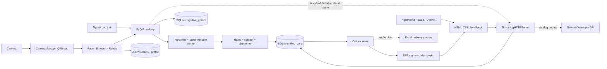
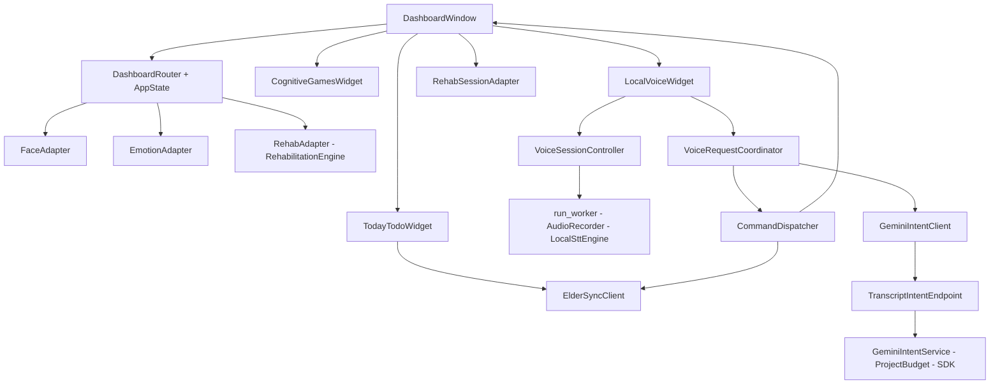
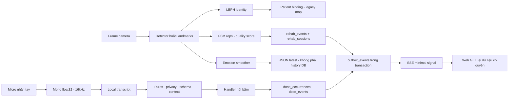
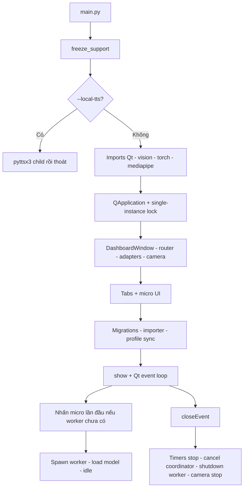
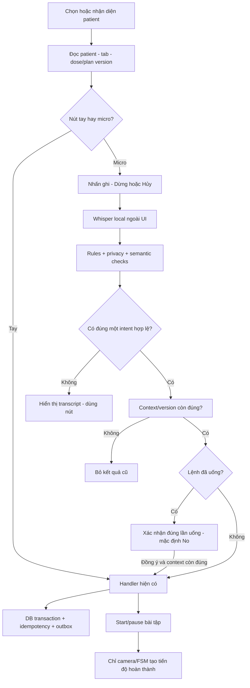

# Hồ sơ bằng chứng kỹ thuật tổng hợp — AI Care & Rehabilitation System

Ngày09/10/2026 · kiểm toán tĩnh snapshot worktree. Tài liệu tự chứa: thuật toán, sơ đồ, schema, test, giới hạn và mapping KHKT. Không phải chứng nhận nghiệm thu sản phẩm hoặc hiệu quả lâm sàng.

## Quy ước trạng thái và độ tin cậy

| Trạng thái | Nghĩa và điều kiện |
|---|---|
| IMPLEMENTED | Có code và test/runtime thành công liên quan trong phạm vi ghi rõ; không tự suy ra E2E hoặc tính chính xác y khoa |
| PARTIALLY_IMPLEMENTED | Có implementation nhưng workflow hoặc nghiệm thu còn thiếu |
| PLANNED | Có định hướng/tài liệu, chưa thấy runtime làm việc tương ứng |
| DEPRECATED | Code giữ lại nhưng không thuộc tuyến active được kiểm toán |
| REMOVED | Có record/tombstone/removal evidence; phải ghi rõ phần nào bị gỡ |
| UNKNOWN | Không đủ bằng chứng để xác định hoặc kết luận định lượng |

Confidence HIGH/MEDIUM là độ tin cậy của kết luận kiểm toán dựa nguồn, **không phải độ chính xác model**. Mọi status ở manifest là cho câu claim cụ thể. Source-only không tự thành IMPLEMENTED. Kết quả log được kiểm tra tồn tại/nội dung, không chạy lại. “NOT VERIFIED” là chú thích giới hạn, không thay status enum.


## Phần 01 — 00_EXECUTIVE_SUMMARY.md

### Tổng quan kiểm toán kỹ thuật phục vụ KHKT

Ngày lập: 09/10/2026. Đối tượng là trạng thái worktree hiện tại, gồm nhiều thay đổi chưa commit; đây không phải bản phát hành được xác nhận. Kiểm toán chỉ đọc mã, cấu hình, migration, test và artefact có sẵn; không mở camera/micro, chạy app, cài dependency, gọi API hay gửi thông báo. Các số đo bên dưới là kết quả lịch sử có đường dẫn truy nguyên, chưa được chạy lại trong lượt này.

#### Kết luận về mức sẵn sàng

Repo có nguyên mẫu desktop PyQt5 và web người nhà/bác sĩ/admin, xử lý ảnh cục bộ, STT faster-whisper, intent allowlist và lớp Gemini text có giới hạn. Có bằng chứng kiểm thử cho nhiều thành phần kỹ thuật. Chưa đủ bằng chứng để gọi đây là hệ thống đã nghiệm thu tổng thể, có độ chính xác nhận dạng đã xác lập, bảo mật production hoặc hiệu quả lâm sàng. [C01–C55]

| Năng lực và phạm vi phân loại | Trạng thái duy nhất | Bằng chứng / phần thiếu |
|---|---|---|
| Desktop tabs/micro và đóng worker, smoke offscreen | IMPLEMENTED | C02/C05; phần cứng mocked |
| Nhận dạng identity LBPH trên người thật | PARTIALLY_IMPLEMENTED | C06–C09; thiếu FAR/FRR |
| Biểu cảm ba lớp trên dashboard | PARTIALLY_IMPLEMENTED | C10–C13; thiếu holdout và cầu nối DB web |
| FSM ba bài tập với landmark tổng hợp | PARTIALLY_IMPLEMENTED | C15/C16 chỉ test chuyển state; C17 test một bước marching; chưa trọn chu kỳ/người thật |
| Camera thật→rep đúng form→completed→web | PARTIALLY_IMPLEMENTED | C14/C18/C19; tổng reps vẫn gồm sai form |
| Xác nhận thuốc DB/outbox/dedup | IMPLEMENTED | C20; chỉ tự khai báo |
| Nhắc thuốc liên tục và snooze timed trong dashboard active | PARTIALLY_IMPLEMENTED | C21/C22; thiếu vòng scheduler đầy đủ |
| Recorder/worker/engine file local và lifecycle mock | IMPLEMENTED | C24–C26; thiếu micro vật lý |
| Gemini hiểu text trong luồng production toàn diện | PARTIALLY_IMPLEMENTED | C28–C33; cloud=false, chỉ3 livecases |
| Đồng bộ DB→SSE queue có quyền trong test nội bộ | IMPLEMENTED | C40–C44; không phải Internet nhiều máy |
| Trò chơi và sức khỏe/reporting toàn chuỗi giao diện | PARTIALLY_IMPLEMENTED | C37–C39; game vẫn DB riêng |
| PostgreSQL runtime | PLANNED | C47; manager chỉ sqlite 3 |
| Fall/Vosk/orchestrator voice cũ theo dashboard active | DEPRECATED | C36/C48; source vẫn còn |
| Đường API STT cũ active | REMOVED | C35; còn compatibility tombstones |
| Hiệu quả phục hồi/nhận thức/chẩn đoán lâm sàng | UNKNOWN | C55; không có nghiên cứu chứng minh |

Một capability ở phạm vi rộng có thể chưa hoàn thiện dù các thành phần con đã IMPLEMENTED. Không dùng status của unit test thay status của tính năng trên người thật. Manifest quy định phạm vi cho từng claim.

#### Các phát hiện cần công bố trung thực

1. Face confidence và score biểu cảm là điểm heuristic, chưa được calibration; ba lớp biểu cảm hiển thị không tương đương chẩn đoán tâm lý. Check point MLP tồn tại nhưng dữ liệu/split/metrics tái lập không có tại vị trí config. [C08/C10–C12]
2. Camera emotion ghi JSON trong khi web đọc bảng emotion_inferences; trò chơi ghi SQLite riêng. Import/seed không chứng minh luồng live nối hoàn chỉnh. [C13/C39/C41]
3. Completed phục hồi dựa count đạt target, chưa bắt buộc quality_threshold; dashboard đồng bộ cả incorrect_reps. Camera completion tag không là chứng cứ nguồn ảnh tự động được xác thực. [C18/C19]
4. Xác nhận thuốc là self_reported_taken. Snooze state có nhưng đường nhắc lại và gia hạn lịch liên tục còn cần kiểm chứng. Hộp thoại hỗ trợ nói mạnh hơn bằng chứng delivery hiện có. [C20–C22]
5. Auth có password dạng prefix+plaintext, demo bypass và hint; backup/log/SSE token cần được xử lý trước dùng dữ liệu thật. Audit chỉ ghi rủi ro, không sửa ứng dụng. [C45/C46]
6. Gemini đã có SDK/backend và live textsmoke, không còn chỉ là kế hoạch; vẫn cloud=false. Production chỉ cho catalog điều hướng trung tính, các câu sức khỏe không gửi lên free tier. [C28–C33]

#### Bằng chứng thực nghiệm hiện có

Ba log pytest Gemini/STT, legacy và real time lần lượt 107, 41, 13 passed; không có kết luận toàn bộ repo pass. STT CPU 12 lượt có p95=6015.95ms trên audio 873–1170 ms, chưa có WER/CER. Policy khi cloud tắt đạt 72/102 acceptance; ba mẫu Gemini thật có latency 1138–1633 ms và schema/intent đúng. Tất cả có giới hạn mẫu, môi trường, mock và tuổi artefact. [C51–C55]

#### Cách sử dụng bộ tài liệu

Dùng 01–05 cho thiết kế/nguyên lý, 06 cho kết quả đã đo và thí nghiệm đề xuất, 07 cho lịch sử có chứng cứ, 08 để map cấu trúc KHKT, 09 để ưu tiên phần thiếu. 10 là bản tổng hợp tự chứa; evidence_manifest.json là chỉ mục máy đọc. Chỉ trình bày tính mới ở mức giải pháp tích hợp của dự án, chưa kết luận mới khoa học nếu chưa khảo sát tài liệu đối chứng.

#### Bằng chứng truy nguyên

- **C01 — PARTIALLY_IMPLEMENTED**. File: `main.py`; Symbol: `main`; Lines: 52–106. Explanation: Desktop khởi động bằng QApplication, khóa single-instance, dashboard và migration/import dữ liệu. Giới hạn: Có mã nguồn; chưa nghiệm thu toàn bộ trên thiết bị đích.
  - Đối chiếu: `app/dashboard.py` · `DashboardWindow.__init__` · 122–173 (source_code).
- **C02 — IMPLEMENTED**. File: `app/dashboard.py`; Symbol: `DashboardWindow._init_ui`; Lines: 175–528. Explanation: Dashboard mount TodayTodo, camera/phục hồi, trò chơi và thanh micro; smoke offscreen đã kiểm tra lifecycle. Giới hạn: Camera/audio mocked, TTS tắt, SMTP bị chặn; không phải nghiệm thu phần cứng.
  - Đối chiếu: `reports/gemini_intent/dashboard-smoke.txt` · `module` · 1–44 (existing_test_or_runtime_artifact).
- **C05 — IMPLEMENTED**. File: `app/dashboard.py`; Symbol: `DashboardWindow.closeEvent`; Lines: 1107–1118. Explanation: Đóng dashboard dừng timer, voice coordinator/controller và camera. Giới hạn: Smoke lifecycle có camera/micro mocked; worker đang native inference bị terminate sau chờ hữu hạn.
  - Đối chiếu: `reports/gemini_intent/dashboard-smoke.txt` · `module` · 1–44 (existing_test_or_runtime_artifact).
- **C06 — PARTIALLY_IMPLEMENTED**. File: `adapters/face_adapter.py`; Symbol: `FaceAdapter.__init__`; Lines: 40–81. Explanation: Face detection ưu tiên OpenCV DNN, fallback Haar; nhận diện bằng LBPH radius 1/neighbors 8/grid8x8. Giới hạn: Có pipeline; chưa có FAR/FRR trên tập người độc lập; DNN detector không phải model nhận dạng identity.
  - Đối chiếu: `adapters/face_adapter.py` · `FaceAdapter.detect_face` · 107–146 (source_code).
- **C10 — PARTIALLY_IMPLEMENTED**. File: `adapters/emotion_adapter.py`; Symbol: `EmotionAdapter.process_frame`; Lines: 213–325. Explanation: Biểu cảm dashboard có3 lớp Neutral/Happy/Sad, landmark heuristic và ensemble 75%heuristic+25%MLP khi có model. Giới hạn: Không chẩn đoán tâm lý; chưa có accuracy/macro-F1 holdout hợp lệ cho ensemble 3 lớp.
  - Đối chiếu: `adapters/emotion_adapter.py` · `EmotionAdapter._compute_facs_probabilities` · 146–211 (source_code).
- **C13 — PARTIALLY_IMPLEMENTED**. File: `adapters/emotion_adapter.py`; Symbol: `EmotionAdapter._persist_result`; Lines: 359–374. Explanation: Biểu cảm camera ghi JSON/state, web đọc emotion_inferences; chưa thấy writer unified DB trong đường camera. Giới hạn: Schema và seed emotion_inferences không chứng minh camera→DB→web; tìm kiếm call sites tĩnh chưa thấy cầu nối.
  - Đối chiếu: `web/api_router.py` · `ApiRouter._get_mood` · 1052–1076 (source_code).
- **C18 — IMPLEMENTED**. File: `modules/rehabilitation/rehab_session_adapter.py`; Symbol: `RehabSessionAdapter.record_verified_rep`; Lines: 196–290. Explanation: RehabSessionAdapter khóa target snapshot, ghi event idempotent/outbox và completed khi count>=target. Giới hạn: Test DB với rep giả; tag camera là metadata từ caller, không tự xác thực frame/score; race đa writer chưa chứng minh.
  - Đối chiếu: `reports/gemini_intent/realtime-regression.txt` · `module` · 1–2 (existing_test_or_runtime_artifact).
  - Đối chiếu: `modules/rehabilitation/rehab_session_adapter.py` · `RehabSessionAdapter.get_or_create_daily_session` · 126–194 (source_code).
  - Đối chiếu: `tests/test_realtime_sync_12_scenarios.py` · `TestRealtimeSync12Scenarios.test_scenario_03_camera_target_10_reps_auto_completion` · 187–253 (test_source).
- **C19 — PARTIALLY_IMPLEMENTED**. File: `app/dashboard.py`; Symbol: `DashboardWindow._do_update_dashboard_ui`; Lines: 967–1083. Explanation: Dashboard ghi DB theo tổng reps, gồm incorrect_reps; score<=0 được thay 90 và quality_threshold chưa là điều kiện completed. Giới hạn: UI khen hoàn thành không chứng minh mọi lần đúng form. Chưa thấy chặn hardware_valid tại điểm record_verified_rep.
- **C20 — IMPLEMENTED**. File: `app/today_todo_widget.py`; Symbol: `TodayTodoWidget._on_confirm_taken`; Lines: 505–509. Explanation: Thuốc hiện hiển thị và thao tác qua TodayTodo/Elder Sync Client cùng unified DB. Giới hạn: Tự khai báo self_reported_taken; không chứng minh đã nuốt thuốc. Test không phải xác nhận từ người dùng thật.
  - Đối chiếu: `reports/gemini_intent/intent-and-stt-tests.txt` · `module` · 1–9 (existing_test_or_runtime_artifact).
  - Đối chiếu: `reports/gemini_intent/realtime-regression.txt` · `module` · 1–2 (existing_test_or_runtime_artifact).
  - Đối chiếu: `services/elder_sync_client.py` · `ElderSyncClient.flush_offline_queue` · 144–379 (source_code).
- **C21 — PARTIALLY_IMPLEMENTED**. File: `web/api_router.py`; Symbol: `ApiRouter._create_prescription`; Lines: 1384–1535. Explanation: Prescription create sinh occurrences hôm nay và3 ngày tiếp theo; relay chuyển quá hạn PENDING/REMINDING. Giới hạn: Chưa thấy tác vụ gia hạn occurrences dài ngày ở active dashboard/backend; UTC+7 hardcode ở create; SNOOZED không thuộc scan quá hạn.
  - Đối chiếu: `services/outbox_relay.py` · `OutboxRelayService.scan_overdue_tasks` · 208–331 (source_code).
- **C28 — PARTIALLY_IMPLEMENTED**. File: `services/transcript_intent/service.py`; Symbol: `GeminiIntentService`; Lines: 12–100. Explanation: Lớp hiểu text Gemini đã có code/backend/client/coordinator, nhưng cloud mặc định false và full acceptance chưa nghiệm thu. Giới hạn: 3 synthetic cases SDK thật; chưa 102 acceptance, mic→web, project/quota independent verify hoặc newest key smoke.
  - Đối chiếu: `reports/gemini_intent/limited-live-benchmark.json` · `module` · 1–60 (existing_test_or_runtime_artifact).
  - Đối chiếu: `services/transcript_intent/config.py` · `BackendConfig` · 7–42 (source_code).
- **C39 — PARTIALLY_IMPLEMENTED**. File: `app/cognitive_games_widget.py`; Symbol: `CognitiveGamesWidget.__init__`; Lines: 54–80. Explanation: Trò chơi lật cặp/nhớ trình tự dùng rules seededrandom, service/repository; desktop ghi SQLite riêng. Giới hạn: Import sang unified là bước import, chưa thấy live outbox từ gameplay; không có chứng cứ cải thiện nhận thức lâm sàng.
  - Đối chiếu: `modules/cognitive_games/services/game_engine.py` · `GameEngine` · 14–143 (source_code).
  - Đối chiếu: `database/importer.py` · `DataImporter._import_cognitive_games` · 472–541 (source_code).
- **C45 — PARTIALLY_IMPLEMENTED**. File: `web/auth.py`; Symbol: `AuthService.authenticate_credentials`; Lines: 67–200. Explanation: Auth còn lưu password dạng prefix+plaintext, bypass kiểudemo và hint lộ mật khẩu khi sai. Giới hạn: Rủi ro nghiêm trọng nhìn thấy từ code; không kiểm tra khai thác, không sao chép giá trị mật khẩu vào báo cáo.
  - Đối chiếu: `web/auth.py` · `AuthService.register_caregiver` · 207–335 (source_code).
- **C46 — PARTIALLY_IMPLEMENTED**. File: `web/server.py`; Symbol: `HealthcareHttpHandler.log_message`; Lines: 39–40. Explanation: SSE dùng token query và server log message không redactURL; backup là dump SQL plaintext. Giới hạn: Chưa xác minh log vận hành có token thật; mã cho phép nguy cơ. Không thấy retention/encryption tổng thể đã nghiệm thu.
  - Đối chiếu: `web/server.py` · `HealthcareHttpHandler._handle_sse_stream` · 135–183 (source_code).
  - Đối chiếu: `database/backup_restore.py` · `BackupRestoreService.create_sql_dump` · 21–53 (source_code).
- **C51 — IMPLEMENTED**. File: `reports/local_stt/cpu-final.json`; Symbol: `module`; Lines: 1–145. Explanation: STT CPU 12 lượt: cold 727 ms, p50=4642 ms, p95=6015.95ms, RSS 1830600704 bytes; camera/GPU thất bại. Giới hạn: Đo script engine/audio 873–1170 ms, không phải full app/micđồngthời, thiếu groundtruth; p95 này là số cũ, chưa chạy lại.
  - Đối chiếu: `reports/local_stt/cpu-final.json` · `module` · 1–145 (existing_test_or_runtime_artifact).
  - Đối chiếu: `reports/local_stt/gpu-camera.json` · `module` · 1–7 (existing_test_or_runtime_artifact).
- **C52 — IMPLEMENTED**. File: `reports/gemini_intent/offline-benchmark.json`; Symbol: `module`; Lines: 1–1385. Explanation: Offline policy 150 cases:104 correct; acceptance 72/102; 0 unexpected sensitive routes trong tập tổng hợp. Giới hạn: Cloudtắt; 69.33%toàn tập, 70.59%acceptance là policy coverage không là Geminiaccuracy hoặc STT WER.
  - Đối chiếu: `reports/gemini_intent/offline-benchmark.json` · `module` · 1–1385 (existing_test_or_runtime_artifact).
- **C53 — IMPLEMENTED**. File: `reports/gemini_intent/limited-live-benchmark.json`; Symbol: `module`; Lines: 1–60. Explanation: 3 synthetic API cases đạt schema/intent, latency 1633/1138/1562 ms; full acceptance=false/quota_verified=false. Giới hạn: n3 và một smoke1746ms riêng; không đủ chứng minh accuracy95% hay latency ổn định. Audit không gọi API.
  - Đối chiếu: `reports/gemini_intent/limited-live-benchmark.json` · `module` · 1–60 (existing_test_or_runtime_artifact).
- **C54 — IMPLEMENTED**. File: `reports/gemini_intent/REPORT.md`; Symbol: `module`; Lines: 1–75. Explanation: 3 nhóm test log hiện có 107+41+13 passed; không có bằng chứng toàn repo pass và không chạy lại trong audit. Giới hạn: Tổng 161 thuộc 3 nhóm được ghi; 85/17/6/16 ở report khác có overlap. Một số baseline native audio timeout/DB fail còn ghi.
  - Đối chiếu: `reports/gemini_intent/intent-and-stt-tests.txt` · `module` · 1–9 (existing_test_or_runtime_artifact).
  - Đối chiếu: `reports/gemini_intent/legacy-regression-isolated.txt` · `module` · 1–8 (existing_test_or_runtime_artifact).
  - Đối chiếu: `reports/gemini_intent/realtime-regression.txt` · `module` · 1–2 (existing_test_or_runtime_artifact).
- **C55 — UNKNOWN**. File: `reports/local_stt/REPORT.md`; Symbol: `module`; Lines: 1–58. Explanation: Face FAR/FRR, emotion holdout F1, rehab clinical angle error, STT WER và nghiệm thu mic/camera/multi host chưa có bằng chứng phù hợp. Giới hạn: Không có số đo hợp lệ trong các artefact đã đối chiếu; không khẳng định không tồn tại ngoài repo.
  - Đối chiếu: `reports/gemini_intent/REPORT.md` · `module` · 1–75 (source_code).

Public quick-accounts còn trả password. Endpoint rehab-event chưa kiểm tra ownership của session so với patient URL; nguồn camera được gán metadata chứ không xác thực. Đây là phát hiện source, không là kết quả thử khai thác. [C56/C58]

#### Bằng chứng truy nguyên

- **C56 — PARTIALLY_IMPLEMENTED**. File: `web/api_router.py`; Symbol: `ApiRouter._get_quick_accounts`; Lines: 298–371. Explanation: Route public quick-accounts trả password đã bóc prefix/plaintext cùng thông tin tài khoản. Giới hạn: Phát hiện source, không gọi route hay trích dữ liệu thật. Rủi ro privacy/auth production cần ưu tiên xử lý.
  - Đối chiếu: `web/api_router.py` · `ApiRouter.handle_request` · 65–258 (source_code).
- **C58 — PARTIALLY_IMPLEMENTED**. File: `web/api_router.py`; Symbol: `ApiRouter._handle_rehab_event`; Lines: 1128–1224. Explanation: Rehab-event API nhận quyền view, tăng count từ body; chưa so session.patient_id với patient URL hay xác thực nguồn camera. Giới hạn: Rủi ro theo source, chưa gọi endpoint/thử khai thác. Không dùng tag camera_ai như at test at io n; cần auth/write/ownership tests.
  - Đối chiếu: `web/api_router.py` · `ApiRouter.handle_request` · 65–258 (source_code).

#### Quy ước trạng thái và độ tin cậy

| Trạng thái | Nghĩa và điều kiện |
|---|---|
| IMPLEMENTED | Có code và test/runtime thành công liên quan trong phạm vi ghi rõ; không tự suy ra E2E hoặc tính chính xác y khoa |
| PARTIALLY_IMPLEMENTED | Có implementation nhưng workflow hoặc nghiệm thu còn thiếu |
| PLANNED | Có định hướng/tài liệu, chưa thấy runtime làm việc tương ứng |
| DEPRECATED | Code giữ lại nhưng không thuộc tuyến active được kiểm toán |
| REMOVED | Có record/tombstone/removal evidence; phải ghi rõ phần nào bị gỡ |
| UNKNOWN | Không đủ bằng chứng để xác định hoặc kết luận định lượng |

Confidence HIGH/MEDIUM là độ tin cậy của kết luận kiểm toán dựa nguồn, **không phải độ chính xác model**. Mọi status ở manifest là cho câu claim cụ thể. Source-only không tự thành IMPLEMENTED. Kết quả log được kiểm tra tồn tại/nội dung, không chạy lại. “NOT VERIFIED” là chú thích giới hạn, không thay status enum.


## Phần 02 — 01_CODEBASE_ARCHITECTURE.md

### Kiến trúc code base và vòng đời

#### Cấu trúc liên quan đã kiểm tra

```text
main.py / config.py                         entrypoint desktop, cấu hình đường dẫn
app/{dashboard,router,state,registration_dialog}.py
app/{today_todo_widget,cognitive_games_widget,local_voice_widget}.py
adapters/{face_adapter,emotion_adapter,rehabilitation_adapter}.py
core/camera_manager.py                      camera thread/callback
services/local_voice/                      recorder, engine, worker, controller, dispatcher
services/transcript_intent/                 enum/schema/policy/context/budget/SDK/backend/client
services/{elder_sync_client,outbox_relay,patient_sync_service}.py
database/{connection,migrator,importer,outbox_helper,backup_restore}.py
database/migrations/001...004*.sql          định nghĩa DB hiện tại
web/{server,api_router,auth,sse_hub}.py
web/templates/{login,register,portal_caregiver,portal_clinician,portal_admin}.html
modules/face/                              detector weights, standalone age/gender
modules/emotion/{src,utils,models,tests}/    training/evaluation biểu cảm
modules/rehabilitation/                     pose, FSM, session adapter
modules/{medication_adherence,health_monitoring,cognitive_games}/
modules/fall/ / core/fall_*.py / archive/    nhánh lịch sử/video tool
tests/{voice_ai,transcript_intent}/ + tests/test_*.py
scripts/ / packaging/ / *.spec / *.bat      chuẩn bị model, smoke, đóng gói
requirements*.txt / requirements*.lock
plan/ / docs/ / reports/                    thiết kế, hướng dẫn, artefact test
```

Cây trên là tập liên quan, không liệt kê hồ sơ cá nhân/audio/video/trọng số chi tiết. Source snapshot ghi các file code/config/dependency hiện hữu; cây không suy ra module nào active. [C01/C02/C06/C28/C40/C48/C49]

#### Kiến trúc hệ thống thực tế



DB trực tiếp của desktop và DB backend phải cùng file/host phù hợp cho đường này. Không có cơ chế chứng minh tự đồng bộ nhiều file SQLite trên các thiết bị độc lập. Gemini branch có code nhưng mặc định không bật. Emotion JSON không có cạnh live đến unified DB; game import không là live streaming. [C13/C28/C39–C43]

#### Sơ đồ thành phần



Recorder giữ stream; engine giữ WhisperModel; worker tuần tự hóa ghi/inference; controller giữ state/token và polling50ms trên Qt; coordinator dùng background HTTP, timeout/context discard; dispatcher là điểm hành động duy nhất. Model một worker không đồng nghĩa tổng hệ thống chỉ một model: camera còn có face/pose/emotion. [C24–C34]

#### Luồng dữ liệu



#### Khởi động và shutdown



Chi tiết: dashboard cũng khởi tạo DB/widgets trước phần setup DB ở main; sơ đồ biểu diễn thứ tự lời gọi chính, không giả định mọi migration chỉ gọi một lần. --test dùng exit cưỡng bức, không chứng minh shutdown bình thường. main còn eagerimport mediapipe/torch; config chỉ giữ native pre-init trên Windows và services exportlazy để backend tránh audio sideeffects. Backend là entrypoint riêng, không tự sinh từ vòng Qt. [C01/C02/C05/C41]

#### Luồng tương tác chính



#### Threads, lỗi, fallback và quan sát

| Thành phần | Cách thực thi | Lỗi/fallback và giới hạn |
|---|---|---|
| Camera | QThread; callbacks sequential; sleep theo FPS cấu hình | Mất capture có simulated frame; cần phân biệt với frame thật |
| GUI | Qt event loop/QTimer | TodayTodo poll1.5s; refresh plans2s; DB vẫn có thao tác trên UI thread |
| STT | multiprocessing spawn; queues bounded | Model/micro lỗi→unavailable; retry chuẩn bị; hủy bỏ kết quả cũ |
| Text API | background thread client; backend request thread; async SDK deadline | Offline/timeout 429→local/unknown, circuit; request cũ giữ busy cho đến worker xong |
| Outbox | relay background loop, poll mặc định 0.5s | Retry/delivery scope cần kiểm tra; processed không là browserack |
| TTS | child process/coordination | Suspend khi ghi; chưa kiểm tra loa vật lý |

Logging Python và runtime artefacts hỗ trợ chẩn đoán; chưa có chứng cứ deploymentmonitoring toàn diện. Không dùng FPS EMA của engine như FPS benchmark. Token trong URL/log và hồ sơ JSON vẫn là vấn đề privacy. [C03/C26/C32/C34/C42/C46]

#### Bằng chứng truy nguyên

- **C01 — PARTIALLY_IMPLEMENTED**. File: `main.py`; Symbol: `main`; Lines: 52–106. Explanation: Desktop khởi động bằng QApplication, khóa single-instance, dashboard và migration/import dữ liệu. Giới hạn: Có mã nguồn; chưa nghiệm thu toàn bộ trên thiết bị đích.
  - Đối chiếu: `app/dashboard.py` · `DashboardWindow.__init__` · 122–173 (source_code).
- **C02 — IMPLEMENTED**. File: `app/dashboard.py`; Symbol: `DashboardWindow._init_ui`; Lines: 175–528. Explanation: Dashboard mount TodayTodo, camera/phục hồi, trò chơi và thanh micro; smoke offscreen đã kiểm tra lifecycle. Giới hạn: Camera/audio mocked, TTS tắt, SMTP bị chặn; không phải nghiệm thu phần cứng.
  - Đối chiếu: `reports/gemini_intent/dashboard-smoke.txt` · `module` · 1–44 (existing_test_or_runtime_artifact).
- **C03 — PARTIALLY_IMPLEMENTED**. File: `core/camera_manager.py`; Symbol: `CameraManager.run`; Lines: 193–270. Explanation: Camera Manager sở hữu luồng QThread và callback xử lý ảnh, có ảnh mô phỏng khi không đọc được camera. Giới hạn: Camera mất có thể tiếp tục ảnh mô phỏng; phải kiểm chứng không ghi completed sai khi mất phần cứng.
  - Đối chiếu: `app/dashboard.py` · `DashboardWindow._process_video_frame` · 530–570 (source_code).
- **C04 — PARTIALLY_IMPLEMENTED**. File: `app/dashboard.py`; Symbol: `DashboardWindow._do_update_dashboard_ui`; Lines: 967–1083. Explanation: Nhận diện và chọn patient đồng bộ binding các widget; voice invalidates context khi đổi patient/tab/source. Giới hạn: Unknown-face không xóa current_patient_id; voice có guard riêng, hành động tay cần kiểm tra đổi/người lạ.
  - Đối chiếu: `app/dashboard.py` · `DashboardWindow._resolve_patient_id` · 936–953 (source_code).
  - Đối chiếu: `services/local_voice/dispatcher.py` · `CommandDispatcher.snapshot` · 24–45 (source_code).
- **C05 — IMPLEMENTED**. File: `app/dashboard.py`; Symbol: `DashboardWindow.closeEvent`; Lines: 1107–1118. Explanation: Đóng dashboard dừng timer, voice coordinator/controller và camera. Giới hạn: Smoke lifecycle có camera/micro mocked; worker đang native inference bị terminate sau chờ hữu hạn.
  - Đối chiếu: `reports/gemini_intent/dashboard-smoke.txt` · `module` · 1–44 (existing_test_or_runtime_artifact).
- **C13 — PARTIALLY_IMPLEMENTED**. File: `adapters/emotion_adapter.py`; Symbol: `EmotionAdapter._persist_result`; Lines: 359–374. Explanation: Biểu cảm camera ghi JSON/state, web đọc emotion_inferences; chưa thấy writer unified DB trong đường camera. Giới hạn: Schema và seed emotion_inferences không chứng minh camera→DB→web; tìm kiếm call sites tĩnh chưa thấy cầu nối.
  - Đối chiếu: `web/api_router.py` · `ApiRouter._get_mood` · 1052–1076 (source_code).
- **C24 — IMPLEMENTED**. File: `services/local_voice/recorder.py`; Symbol: `AudioRecorder`; Lines: 8–71. Explanation: Recorder explicit sounddevice Input Stream, mono/resample16kHz, stop/cancel/bound duration; không nghe nền. Giới hạn: Stream48k→16k đã test bằng mock; physical mic chưa kiểm chứng trong artefact hiện có.
  - Đối chiếu: `reports/gemini_intent/intent-and-stt-tests.txt` · `module` · 1–9 (existing_test_or_runtime_artifact).
  - Đối chiếu: `tests/voice_ai/test_local_voice.py` · `test_recorder_hardware_sample_rate_resampling_bounded_and_close` · 208–234 (test_source).
- **C25 — IMPLEMENTED**. File: `services/local_voice/engine.py`; Symbol: `LocalSttEngine`; Lines: 8–44. Explanation: Engine faster-whisper small multilingual local files only, CPU/int8, beam 1, languagevi, VAD và consume segments ngoài UI. Giới hạn: Có inference file local; audio chuẩn/consent chưa xác minh; không có WER/CER hợp lệ; GPU chưa chạy thành công.
  - Đối chiếu: `reports/local_stt/cpu-final.json` · `module` · 1–145 (existing_test_or_runtime_artifact).
  - Đối chiếu: `reports/local_stt/clean-smoke.txt` · `module` · 1–3 (existing_test_or_runtime_artifact).
  - Đối chiếu: `services/local_voice/config.py` · `VoiceConfig` · 7–29 (source_code).
  - Đối chiếu: `services/local_voice/worker.py` · `run_worker` · 8–49 (source_code).
- **C26 — IMPLEMENTED**. File: `services/local_voice/controller.py`; Symbol: `VoiceSessionController`; Lines: 9–154. Explanation: Controller spawn một persistent worker, token/context bỏ response cũ; shutdown chờ rồi terminate/kill hữu hạn. Giới hạn: Native inference không bị ngắt mềm ngay khi cancel; chỉ bỏ kết quả/chờ acknowledgement; test không có mic vật lý.
  - Đối chiếu: `reports/gemini_intent/intent-and-stt-tests.txt` · `module` · 1–9 (existing_test_or_runtime_artifact).
  - Đối chiếu: `reports/gemini_intent/dashboard-smoke.txt` · `module` · 1–44 (existing_test_or_runtime_artifact).
  - Đối chiếu: `tests/voice_ai/test_local_voice.py` · `test_cancel_and_context_change_discard_late_results_and_shutdown` · 70–93 (test_source).
- **C27 — IMPLEMENTED**. File: `services/local_voice/dispatcher.py`; Symbol: `CommandDispatcher.dispatch`; Lines: 47–104. Explanation: Dispatcher sáu intent dùng handler nút bấm, xác nhận dose default No và kiểm tra lại context/command id. Giới hạn: Không có intent hoàn thành phục hồi; không dùng transcript tự sửa DB; sample text/mock audio chưa là E2E thật.
  - Đối chiếu: `reports/gemini_intent/intent-and-stt-tests.txt` · `module` · 1–9 (existing_test_or_runtime_artifact).
  - Đối chiếu: `services/transcript_intent/registry.py` · `module` · 1–53 (source_code).
  - Đối chiếu: `tests/transcript_intent/test_lifecycle_integration.py` · `test_proposed_medication_confirmation_same_db_and_web` · 193–221 (test_source).
- **C28 — PARTIALLY_IMPLEMENTED**. File: `services/transcript_intent/service.py`; Symbol: `GeminiIntentService`; Lines: 12–100. Explanation: Lớp hiểu text Gemini đã có code/backend/client/coordinator, nhưng cloud mặc định false và full acceptance chưa nghiệm thu. Giới hạn: 3 synthetic cases SDK thật; chưa 102 acceptance, mic→web, project/quota independent verify hoặc newest key smoke.
  - Đối chiếu: `reports/gemini_intent/limited-live-benchmark.json` · `module` · 1–60 (existing_test_or_runtime_artifact).
  - Đối chiếu: `services/transcript_intent/config.py` · `BackendConfig` · 7–42 (source_code).
- **C33 — IMPLEMENTED**. File: `services/transcript_intent/backend.py`; Symbol: `TranscriptIntentEndpoint.handle`; Lines: 18–55. Explanation: HTTP text endpoint kiểm tra session/auth/patient/context version trước và sau classification. Giới hạn: Loopback HTTP+Qt+DB giả, Gemini mock; không có mic/remoteprovider trong HTTPsmoke.
  - Đối chiếu: `reports/gemini_intent/http-smoke.json` · `module` · 1–10 (existing_test_or_runtime_artifact).
  - Đối chiếu: `reports/gemini_intent/intent-and-stt-tests.txt` · `module` · 1–9 (existing_test_or_runtime_artifact).
  - Đối chiếu: `tests/transcript_intent/test_lifecycle_integration.py` · `test_backend_rechecks_auth_and_version` · 143–172 (test_source).
- **C34 — IMPLEMENTED**. File: `services/local_voice/controller.py`; Symbol: `VoiceSessionController.start`; Lines: 56–73. Explanation: TTS được suspend khi ghi; nhạc pause; child pyttsx3 local giữ entrypoint frozen riêng. Giới hạn: Phối hợp đã test code/mocks; chưa nghe playbackloa thật; nhắc thuốc/coach active chưa nối toàn bộ TTS callbacks.
  - Đối chiếu: `reports/gemini_intent/intent-and-stt-tests.txt` · `module` · 1–9 (existing_test_or_runtime_artifact).
  - Đối chiếu: `services/local_voice/tts_runtime.py` · `speak` · 5–19 (source_code).
  - Đối chiếu: `app/local_voice_widget.py` · `module` · 1–110 (source_code).
  - Đối chiếu: `tests/voice_ai/test_local_voice.py` · `test_tts_cannot_restart_during_capture` · 194–205 (test_source).
- **C39 — PARTIALLY_IMPLEMENTED**. File: `app/cognitive_games_widget.py`; Symbol: `CognitiveGamesWidget.__init__`; Lines: 54–80. Explanation: Trò chơi lật cặp/nhớ trình tự dùng rules seededrandom, service/repository; desktop ghi SQLite riêng. Giới hạn: Import sang unified là bước import, chưa thấy live outbox từ gameplay; không có chứng cứ cải thiện nhận thức lâm sàng.
  - Đối chiếu: `modules/cognitive_games/services/game_engine.py` · `GameEngine` · 14–143 (source_code).
  - Đối chiếu: `database/importer.py` · `DataImporter._import_cognitive_games` · 472–541 (source_code).
- **C40 — IMPLEMENTED**. File: `database/connection.py`; Symbol: `UnifiedDatabaseManager`; Lines: 51–115. Explanation: Database runtime là SQLite/WAL/foreignkeys/bus y timeout; không có PostgreSQL driver runtime trong manager. Giới hạn: Các comment PostgreSQL/ANSI/3NF là định hướng, không là chứng minh tương thích hoặc chuẩn hóa hình thức.
  - Đối chiếu: `reports/gemini_intent/realtime-regression.txt` · `module` · 1–2 (existing_test_or_runtime_artifact).
- **C41 — IMPLEMENTED**. File: `database/migrator.py`; Symbol: `module`; Lines: 1–62. Explanation: 4 migration định nghĩa schema, Migrator áp dụng theo version; importer gộp DB standalone/JSON. Giới hạn: Không mở DBproduction trong audit; seed không phải dữ liệu camera/micro/sensor thực; migration atomicity chưa fault inject.
  - Đối chiếu: `reports/gemini_intent/realtime-regression.txt` · `module` · 1–2 (existing_test_or_runtime_artifact).
  - Đối chiếu: `database/importer.py` · `DataImporter.import_all` · 54–88 (source_code).
- **C42 — IMPLEMENTED**. File: `services/outbox_relay.py`; Symbol: `OutboxRelayService.process_pending_events`; Lines: 86–144. Explanation: Outbox relay poll0.5s gửi tín hiệu SSE/auth, side effect email và markprocessed; UI web refetch dữ liệu. Giới hạn: Test in-process queue; không phải 3 thiết bị qua Internet; processed≠client đã render hoặc SMTP đã tới mailbox.
  - Đối chiếu: `reports/gemini_intent/realtime-regression.txt` · `module` · 1–2 (existing_test_or_runtime_artifact).
  - Đối chiếu: `web/sse_hub.py` · `SSEHub.dispatch_outbox_event` · 82–128 (source_code).
- **C43 — IMPLEMENTED**. File: `services/elder_sync_client.py`; Symbol: `ElderSyncClient.enqueue_event`; Lines: 101–142. Explanation: Elder Sync Client truy cập SQLite trực tiếp; offline JSON queue perpatient và sync inbox dedup; voice không replay. Giới hạn: is_online là flag, không đo mạng; không đồng bộ SQLite độc lập giữa nhiều máy.
  - Đối chiếu: `reports/gemini_intent/intent-and-stt-tests.txt` · `module` · 1–9 (existing_test_or_runtime_artifact).
  - Đối chiếu: `reports/gemini_intent/realtime-regression.txt` · `module` · 1–2 (existing_test_or_runtime_artifact).
  - Đối chiếu: `services/elder_sync_client.py` · `ElderSyncClient.flush_offline_queue` · 144–379 (source_code).
  - Đối chiếu: `tests/voice_ai/test_local_voice.py` · `test_voice_version_conflict_offline_and_restart_never_replay` · 177–191 (test_source).
- **C46 — PARTIALLY_IMPLEMENTED**. File: `web/server.py`; Symbol: `HealthcareHttpHandler.log_message`; Lines: 39–40. Explanation: SSE dùng token query và server log message không redactURL; backup là dump SQL plaintext. Giới hạn: Chưa xác minh log vận hành có token thật; mã cho phép nguy cơ. Không thấy retention/encryption tổng thể đã nghiệm thu.
  - Đối chiếu: `web/server.py` · `HealthcareHttpHandler._handle_sse_stream` · 135–183 (source_code).
  - Đối chiếu: `database/backup_restore.py` · `BackupRestoreService.create_sql_dump` · 21–53 (source_code).
- **C48 — DEPRECATED**. File: `app/dashboard.py`; Symbol: `DashboardWindow._process_video_frame`; Lines: 530–570. Explanation: Fall/HFD/ONNX/video còn retainedsource/artefacts nhưng không trong camera callbacks dashboard hiện tại. Giới hạn: Deprecated theo dashboard active; toolvideo riêng vẫn có. Không dùng metricfall cũ thay metric rehab hiện tại.
  - Đối chiếu: `core/fall_pipeline.py` · `module` · 1–542 (source_code).
  - Đối chiếu: `modules/fall/hfd_classifier.py` · `module` · 1–85 (source_code).
- **C49 — IMPLEMENTED**. File: `requirements.txt`; Symbol: `module`; Lines: 1–26. Explanation: Runtime requirements chính+lock Linux/STT/backend SDK; đã có log cài sạchLinux và pipcheck. Giới hạn: Windows constraints/build/installer/model DLL mới chưa nghiệm thu; pin Linux không chứng minh Windows wheel.
  - Đối chiếu: `reports/gemini_intent/clean-pip-check.txt` · `module` · 1–2 (existing_test_or_runtime_artifact).
  - Đối chiếu: `reports/gemini_intent/clean-full-install.txt` · `module` · 1–186 (existing_test_or_runtime_artifact).
  - Đối chiếu: `requirements-linux.lock` · `module` · 1–64 (source_code).
  - Đối chiếu: `requirements-gemini-backend.txt` · `module` · 1–4 (source_code).


## Phần 03 — 02_TECHNOLOGY_STACK.md

### Công nghệ, dependency và model

#### Ngôn ngữ và thư viện có vai trò thực tế

| Công nghệ | Vai trò trong mã | Nguồn chính / giới hạn |
|---|---|---|
| Python | GUI, AI, service, HTTP server, SQLadapter và test | main.py; services; web; không phải backend Node |
| PyQt5 | QWidget, signals/slots, QThread/QTimer, dialogs | app/dashboard.py; requirements>=5.15.10 |
| HTML/CSS/JavaScript | Web portal, fetchAPI, Event Source và rendering | web/templates; không thấy frontendReact trong đường này |
| OpenCV contrib | cv2.face.LBPH, detectorDNN/Haar, frame/drawing | adapters/face_adapter.py; không dùng embeddingFaceNet cho identity |
| MediaPipe | FaceMesh/FaceLandmarker và Pose/PoseLandmarkerLite | adapters/emotion_adapter.py; rehab_engine.py |
| NumPy/SciPy | Tọa độ, softmax/smoothing, PCM/resample_poly | emotion/rehab/local_voice; NumPy>=1.24; SciPy>=1.10,<2 |
| PyTorch/torchvision | MLPbiểu cảm và code CV phụ trợ | module emotion; runtime Torch CPU log không là chứng cứ CUDA |
| faster-whisper1.2.1 / CTranslate2 | Whisper local encoder/decoder/int8 | requirements primary và Linux lock; CT2=4.8.2 trong lock |
| PyAV18.1.0 / tokenizers / ONNX Runtime | Decode audio và transitive Whisper/VAD dependencies | STT lock; pin PyAV sửa compatibility theo log cài sạch |
| sounddevice0.5.6 / PortAudio native | Input Stream microphone | pip package không tự chứng minh libportaudio/mic của OS |
| pyttsx3 | TTSlocal trong child process | không API STT; voices phụ thuộc OS |
| Pydantic>=2.10 | strict schema cho proposal/request | không dùng model confidence làm authorization |
| google-genai2.29.0 | Official DeveloperAPI text/JSON backend | requirements-gemini-backend.txt; excluded khỏi elderEXE |
| filelock4.0.12 | Shared file system quota lock | không phối hợp quota nhiều host độc lập |
| requests / urllib HTTP | Internalclient và các công cụ network | Gemini Intent Client/server; không gửi audio đến STT API |
| sqlite 3, http.server, threading, multiprocessing | DB và stdlib backend/server/worker | không FastAPI, không PostgreSQL runtime hiện tại |
| python-dotenv / Pillow / psutil / tzdata | Config, ảnh UI, đo RSS và time z one | Vai trò config/runtime/script; không chứng minh IoTsensor |
| pytest/unit test, sklearn/joblib | Test và training/evaluation standalone | Phân biệt dev/module requirements với runtime primary |

Các role trên có source trong manifest C06–C14/C24–C34/C40/C49. OpenCV/MediaPipe/Torch có nhiều manifest standalone cũ; không thay manifest chính bằng một file trong module.

#### Phiên bản và môi trường

requirements.txt là manifest runtime chính; requirements-gemini-backend.txt include nó và pin SDK. requirements-linux.lock là snapshot Linux đã có log cài sạch; requirements-local-stt.lock là closure STT; backend.lock là closure SDK. requirements-windows.txt có bounds riêng cho Python3.11–3.12/NumPy<2/MediaPipe<0.10.21. Không dùng Linux lock thay khóa Windows. [C49]

Log bàn giao ghi Python3.14.4 Linuxx86_64, cài sạch trong /tmp/ai-care-gemini-clean và pipcheck không brokenrequirements. Linux lock có PyQt5=5.15.11, Qt5=5.15.19, OpenCV=5.0.0.93, MediaPipe=1.1.0, NumPy=2.5.3, SciPy=1.18.1, Torch=2.14.1+cpu, Torchvision=0.29.1+cpu. Đây là số từ lock/log, không phải lệnh kiểm tra môi trường hiện tại trong audit. [C49]

Root constraints nhiều gói dùng>=, không bảo đảm reproducibility một mình. Manifest rehab standalone còn liệt kê `time` dù đây là stdlib; manifest face có pins khác Windowsbounds. Cần thống nhất cho bản phát hành sau, không sửa trong nhiệm vụ tài liệu. .spec/setup/buildbat/installer và GitHubworkflow đã có nhưng nghiệm thu Windows DLL/model/TTS/newSDKbinary chưa có. [C49/C50]

#### Model và trọng số

| Model/asset | Vai trò active | Nguồn biết được | Điều chưa biết |
|---|---|---|---|
| OpenCVface_detector_uint8.pb +pbtxt | DNNface detection; Haarfallback | modules/face/models; đọc bằngcv2.dnn | Provenance revision/training data set chưa xác minh |
| LBPH recognizer | Identity, train in-memory từ crop đăng ký | FaceAdapter.train_recognizer | Tập đánh giá độc lập, calibration ngưỡng 58 |
| face_landmarker.task | MediaPipeTasks face landmarks nếu API legacy thiếu | modules/emotion/models | Artifact không tự chứng minh expressionaccuracy |
| expression_net.pth | OptionalMLP5lớp; dashboard sử dụng 3 logits đầu | modules/emotion/models; 71785 bytes tại audit | Không CSV/split/metrics tại vị trí config; provenance UNKNOWN |
| pose_landmarker_lite.task | MediaPipeTasks pose | modules/rehabilitation/models | Camera 3D/gócchuẩn không được cung cấp |
| faster-whisper-small/model.bin | Local STT multilingual | data/models; chuẩn bị từ cache Systran/faster-whisper-small, revision536b0662742c02347bc0e980a01041f333bce120 theo report | Không download mới trong audit; chưa giọng Việt được đồng ý/groundtruth |
| age/genderCaffe weights | Module face standalone lịch sử | modules/face/models; face_processor.py | Không phải identity activeDashboard |
| HFD/ONNX fall weights | Nhánhvideo/legacy | modules/fall/models, hfd_manifest | Không trong callback camera active; metric cũ không dùng cho rehab |

Model Whisper tại audit có 483546902 bytes; chỉ stat file, không load. CheckpointMLP cũng chỉ stat, không deserializepickle. Kích thước không đánh giá chất lượng hoặc license. Có file LICENSE cho một số module; chưa chứng minh đầy đủ license/provenance cho mọi weight và asset âm nhạc/ảnh. [C06/C11/C14/C25/C48/C55]

#### Dịch vụ ngoài, cấu hình và boundary

Gemini là DeveloperAPI, vertex ai=False, textgenerateContent với JSON schema/tools=[]; không có DBtools/functionexecution/grounding/SQL hoặc tư vấn y tế. Model config pin gemini-3.5-flash-lite. Key/backend flags chỉ backend secret; desktop chỉinternalURL/token/flag. Free-tier được operator xác nhận trong bàn giao, chưa independentlyverifyprojectbilling/quota. Không dùng alias latest làm chứng minh model quota. [C28/C31/C32/C50/C53]

SMTP là service có cấu hình; test mock không chứng minh thư được nhận. Các cấu hình không chứa dữ liệu nhạy cảm được mô tả bằng tên biến: VOICE_AI_ENABLED; VOICE_MODEL_PATH/VOICE_DEVICE/VOICE_COMPUTE_TYPE/VOICE_CPU_THREADS/VOICE_MAX_SECONDS/VOICE_BEAM_SIZE; GEMINI_INTENT_ENABLED/GEMINI_FREE_TIER_VERIFIED/GEMINI_API_KEY/GEMINI_PROJECT_ID/GEMINI_INTENT_*CAP; VOICE_INTENT_ENABLED/VOICE_INTENT_BACKEND_URL/VOICE_INTENT_SESSION_TOKEN. Tên biến phải đối chiếu setup/config actual khi vận hành; không đọc/copy .envprivate vào bộ tài liệu. [C25/C28/C32/C46/C49/C50]

#### Bằng chứng truy nguyên

- **C06 — PARTIALLY_IMPLEMENTED**. File: `adapters/face_adapter.py`; Symbol: `FaceAdapter.__init__`; Lines: 40–81. Explanation: Face detection ưu tiên OpenCV DNN, fallback Haar; nhận diện bằng LBPH radius 1/neighbors 8/grid8x8. Giới hạn: Có pipeline; chưa có FAR/FRR trên tập người độc lập; DNN detector không phải model nhận dạng identity.
  - Đối chiếu: `adapters/face_adapter.py` · `FaceAdapter.detect_face` · 107–146 (source_code).
- **C07 — PARTIALLY_IMPLEMENTED**. File: `adapters/face_adapter.py`; Symbol: `FaceAdapter.extract_face_roi`; Lines: 171–221. Explanation: ROI khuôn mặt grayscale, CLAHE, bilateral và resize200x200; augmentation flip, sáng/tối, xoay±4°. Giới hạn: Không có lớp background thực tế dù doc string nhắc; augmentation không tăng số người độc lập.
  - Đối chiếu: `adapters/face_adapter.py` · `FaceAdapter.train_recognizer` · 223–312 (source_code).
- **C11 — PARTIALLY_IMPLEMENTED**. File: `modules/emotion/src/model.py`; Symbol: `ExpressionNet`; Lines: 7–21. Explanation: MLP độc lập nhận 63 tọa độ landmark, Linear63→128→64→5, ReLU và dropout0.25. Giới hạn: Check point tồn tại không chứng minh dữ liệu/huấn luyện; dashboard chỉ lấy3 logits đầu và softmax lại.
  - Đối chiếu: `modules/emotion/utils/preprocess.py` · `module` · 1–70 (source_code).
  - Đối chiếu: `modules/emotion/src/config.py` · `module` · 1–69 (source_code).
- **C12 — PARTIALLY_IMPLEMENTED**. File: `modules/emotion/src/data.py`; Symbol: `module`; Lines: 1–190. Explanation: Training biểu cảm có split theo session, baseline logistic regression và evaluator classification metrics. Giới hạn: Không tìm thấy CSV/splits/results phục vụ tái lập ở vị trí config; số người/data set/provenance UNKNOWN.
  - Đối chiếu: `modules/emotion/src/train.py` · `module` · 1–223 (source_code).
  - Đối chiếu: `modules/emotion/src/evaluate.py` · `module` · 1–189 (source_code).
  - Đối chiếu: `modules/emotion/src/baseline.py` · `module` · 1–66 (source_code).
- **C14 — PARTIALLY_IMPLEMENTED**. File: `modules/rehabilitation/rehab_engine.py`; Symbol: `calculate_angle`; Lines: 44–57. Explanation: Phục hồi dùng MediaPipe Pose/Tasks lite và góc2D từ tọa độ landmark chuẩn hóa. Giới hạn: Không dùng 3D chuẩn lâm sàng; x/y chuẩn hóa chưa sửa tỷ lệ khung hình; chưa có sai số góc với thước chuẩn.
  - Đối chiếu: `modules/rehabilitation/rehab_engine.py` · `RehabilitationEngine._init_pose` · 531–583 (source_code).
- **C25 — IMPLEMENTED**. File: `services/local_voice/engine.py`; Symbol: `LocalSttEngine`; Lines: 8–44. Explanation: Engine faster-whisper small multilingual local files only, CPU/int8, beam 1, languagevi, VAD và consume segments ngoài UI. Giới hạn: Có inference file local; audio chuẩn/consent chưa xác minh; không có WER/CER hợp lệ; GPU chưa chạy thành công.
  - Đối chiếu: `reports/local_stt/cpu-final.json` · `module` · 1–145 (existing_test_or_runtime_artifact).
  - Đối chiếu: `reports/local_stt/clean-smoke.txt` · `module` · 1–3 (existing_test_or_runtime_artifact).
  - Đối chiếu: `services/local_voice/config.py` · `VoiceConfig` · 7–29 (source_code).
  - Đối chiếu: `services/local_voice/worker.py` · `run_worker` · 8–49 (source_code).
- **C28 — PARTIALLY_IMPLEMENTED**. File: `services/transcript_intent/service.py`; Symbol: `GeminiIntentService`; Lines: 12–100. Explanation: Lớp hiểu text Gemini đã có code/backend/client/coordinator, nhưng cloud mặc định false và full acceptance chưa nghiệm thu. Giới hạn: 3 synthetic cases SDK thật; chưa 102 acceptance, mic→web, project/quota independent verify hoặc newest key smoke.
  - Đối chiếu: `reports/gemini_intent/limited-live-benchmark.json` · `module` · 1–60 (existing_test_or_runtime_artifact).
  - Đối chiếu: `services/transcript_intent/config.py` · `BackendConfig` · 7–42 (source_code).
- **C31 — IMPLEMENTED**. File: `services/transcript_intent/gemini_adapter.py`; Symbol: `GeminiIntentAdapter.generate`; Lines: 14–64. Explanation: OfficialSDK textgenerateContent, JSON schema, tools=[] và functioncalling disabled; total≤8s, transport≥10s. Giới hạn: Không cấp DB/SQL/email/grounding. Hạn total là client deadline; transport cancel/release thiết bị thật cần stress.
  - Đối chiếu: `reports/gemini_intent/limited-live-benchmark.json` · `module` · 1–60 (existing_test_or_runtime_artifact).
  - Đối chiếu: `reports/gemini_intent/intent-and-stt-tests.txt` · `module` · 1–9 (existing_test_or_runtime_artifact).
  - Đối chiếu: `tests/transcript_intent/test_lifecycle_integration.py` · `test_sdk_contract_and_no_implicit_tools` · 234–251 (test_source).
- **C32 — IMPLEMENTED**. File: `services/transcript_intent/budget.py`; Symbol: `ProjectBudget`; Lines: 17–75. Explanation: Quota file lock, reservation1200tokens, caps 1 RPM/2400 TPM/10 RPD reserve 2, retry bounded và circuit breaker. Giới hạn: Caps local, không phải quota provider được xác minh; file system shared không phải limiter nhiều host.
  - Đối chiếu: `reports/gemini_intent/intent-and-stt-tests.txt` · `module` · 1–9 (existing_test_or_runtime_artifact).
  - Đối chiếu: `services/transcript_intent/service.py` · `GeminiIntentService._cloud_locked` · 43–82 (source_code).
  - Đối chiếu: `tests/transcript_intent/test_contract_policy.py` · `test_quota_shared_across_instances_and_circuit` · 107–123 (test_source).
- **C34 — IMPLEMENTED**. File: `services/local_voice/controller.py`; Symbol: `VoiceSessionController.start`; Lines: 56–73. Explanation: TTS được suspend khi ghi; nhạc pause; child pyttsx3 local giữ entrypoint frozen riêng. Giới hạn: Phối hợp đã test code/mocks; chưa nghe playbackloa thật; nhắc thuốc/coach active chưa nối toàn bộ TTS callbacks.
  - Đối chiếu: `reports/gemini_intent/intent-and-stt-tests.txt` · `module` · 1–9 (existing_test_or_runtime_artifact).
  - Đối chiếu: `services/local_voice/tts_runtime.py` · `speak` · 5–19 (source_code).
  - Đối chiếu: `app/local_voice_widget.py` · `module` · 1–110 (source_code).
  - Đối chiếu: `tests/voice_ai/test_local_voice.py` · `test_tts_cannot_restart_during_capture` · 194–205 (test_source).
- **C40 — IMPLEMENTED**. File: `database/connection.py`; Symbol: `UnifiedDatabaseManager`; Lines: 51–115. Explanation: Database runtime là SQLite/WAL/foreignkeys/bus y timeout; không có PostgreSQL driver runtime trong manager. Giới hạn: Các comment PostgreSQL/ANSI/3NF là định hướng, không là chứng minh tương thích hoặc chuẩn hóa hình thức.
  - Đối chiếu: `reports/gemini_intent/realtime-regression.txt` · `module` · 1–2 (existing_test_or_runtime_artifact).
- **C48 — DEPRECATED**. File: `app/dashboard.py`; Symbol: `DashboardWindow._process_video_frame`; Lines: 530–570. Explanation: Fall/HFD/ONNX/video còn retainedsource/artefacts nhưng không trong camera callbacks dashboard hiện tại. Giới hạn: Deprecated theo dashboard active; toolvideo riêng vẫn có. Không dùng metricfall cũ thay metric rehab hiện tại.
  - Đối chiếu: `core/fall_pipeline.py` · `module` · 1–542 (source_code).
  - Đối chiếu: `modules/fall/hfd_classifier.py` · `module` · 1–85 (source_code).
- **C49 — IMPLEMENTED**. File: `requirements.txt`; Symbol: `module`; Lines: 1–26. Explanation: Runtime requirements chính+lock Linux/STT/backend SDK; đã có log cài sạchLinux và pipcheck. Giới hạn: Windows constraints/build/installer/model DLL mới chưa nghiệm thu; pin Linux không chứng minh Windows wheel.
  - Đối chiếu: `reports/gemini_intent/clean-pip-check.txt` · `module` · 1–2 (existing_test_or_runtime_artifact).
  - Đối chiếu: `reports/gemini_intent/clean-full-install.txt` · `module` · 1–186 (existing_test_or_runtime_artifact).
  - Đối chiếu: `requirements-linux.lock` · `module` · 1–64 (source_code).
  - Đối chiếu: `requirements-gemini-backend.txt` · `module` · 1–4 (source_code).
- **C50 — PARTIALLY_IMPLEMENTED**. File: `AI_Rehab_Safety_Assistant.spec`; Symbol: `module`; Lines: 1–143. Explanation: Spec excludes Gemini SDK/provider/backend env khỏi EXE; chưa build binary kiểm chứng ranh giới này. Giới hạn: Reviewsource recipe thôi, không chứng minh binary không secret. Không đọc .envprivate hoặc tải/cài package trong audit.
- **C53 — IMPLEMENTED**. File: `reports/gemini_intent/limited-live-benchmark.json`; Symbol: `module`; Lines: 1–60. Explanation: 3 synthetic API cases đạt schema/intent, latency 1633/1138/1562 ms; full acceptance=false/quota_verified=false. Giới hạn: n3 và một smoke1746ms riêng; không đủ chứng minh accuracy95% hay latency ổn định. Audit không gọi API.
  - Đối chiếu: `reports/gemini_intent/limited-live-benchmark.json` · `module` · 1–60 (existing_test_or_runtime_artifact).
- **C55 — UNKNOWN**. File: `reports/local_stt/REPORT.md`; Symbol: `module`; Lines: 1–58. Explanation: Face FAR/FRR, emotion holdout F1, rehab clinical angle error, STT WER và nghiệm thu mic/camera/multi host chưa có bằng chứng phù hợp. Giới hạn: Không có số đo hợp lệ trong các artefact đã đối chiếu; không khẳng định không tồn tại ngoài repo.
  - Đối chiếu: `reports/gemini_intent/REPORT.md` · `module` · 1–75 (source_code).


#### Bằng chứng truy nguyên

- **C59 — PARTIALLY_IMPLEMENTED**. File: `docs/khkt_technical_evidence/audit_observations.json`; Symbol: `module`; Lines: 1–33. Explanation: Stat xác nhận checkpoint expression_net.pth 71785bytes và Whispermodel.bin483546902bytes; CSV/results thiếu ở pathconfig. Giới hạn: Chỉ stat, không loadcheckpoint; kích thước/tồn tại không chứng minh modelquality/provenance hoặc nghiệm thu.


## Phần 04 — 03_AI_MODULES.md

### Phân tích thuật toán và module AI

#### 1. Face: detection tách biệt recognition

DNN nhận blob300×300, mean[104, 117, 123], lọc confidence>0.50; lấy box phù hợp nhất theo logic detector. Haarfallback dùng scaleFactor1.1, min Neighbors 5, minSize 40 và chọn khuôn mặt lớn. Giá trị0.90 ở fallback là số gán, không detector probability đã đo. [C06]

ROI padding 15% khi được chọn, chuyển grayscale, CLAHEclip2/tile8×8, bilateral d5/sigma 25, resize200×200. Huấn luyện LBPH dùng image gốc, flipngang, brightness±12, rotation±4°. Một ảnh hợp lệ sinh nhiều ảnh tương quan; không gọi chúng là nhiều người/mẫu độc lập. Trên nhánh hiện tại không có background class thực dù doc string gợi ý. [C07]

LBPH mã hóa cấu trúc cục bộ theo nguyên lý LocalBinaryPattern:

\[
LBP_{P, R}=\sum_{p=0}^{P-1}\mathbf{1}(g_p\geq g_c)2^p,\quad P=8, R=1.
\]

Đây là giải thích thuật toán của thư việncv2.face, không phải code Python tự cài LBP. Histogram theo lưới8×8 được so với traininglabels; distance nhỏ hơn ngưỡng 58 tạo rawmatch. Không có faceembeddingneural hay cosinesimilarity trong identitypipeline này. Temporal history 15, unknown counters vàTTL2s tạo recognized/uncertain/unknown/no_face. GUIconfidence bị clamp và nội suy theo distance, khoảng0.65–0.99; không được dùng như accuracy. [C06/C08]

Đăng ký crop/profile JSON rồi sync patient/legacy_map và retrain. Nhận diện face ID được resolveunified_patient_id; dữ liệu tên/thuốc phải truy từ patientbinding, không dựa textASR. Khi unknown, GUI có thể vẫn giữ current_patient_id; voice guard đọc status, nhưng thao tác tay cần nghiệm thu đổi/người lạ. Nhiều mặt, ánh sáng, khẩu trang, góc nghiêng, TTL giữ người trước và anti-spoof/liveness là phần chưa đo. Chưa có FAR/FRR/accuracy trên holdout identity. [C04/C09/C55]

#### 2. Biểu cảm: heuristic landmark và MLP tùy chọn

Dashboard có Neutral/Happy/Sad. FaceMeshlegacy hoặc FaceLandmarkerTasks lấy landmark, sau đó heuristic dùng độ rộng miệng, độ nâng khóe và khoảng lông mày chia theo khoảng mắt. Đặt d=||p263-p33||xy, w=||p291-p61||xy/d, e=((p13y+p14y)/2-(p61y+p291y)/2)/d, b=||p336-p107||xy/d:

\[
h=40\max(0, e-0.012)+12\max(0, w-0.49),\quad s=45\max(0,-0.010-e)+10\max(0, 0.27-b).
\]

\[
z=(2-1.6(h+s),\; 3.6h-1.2,\; 3.6s-1.2),\quad p_i=\frac{e^{z_i-\max(z)}}{\sum_j e^{z_j-\max(z)}}.
\]

Khi d<1e-4 trả default[.90,.05,.05]. Tên FACS trong code không chứng minh model được chuyên gia FACS gán actionunits hay validation y khoa. [C10]

MLP độc lập dùng21landmarks×3tọa độ=63 features. Preprocesscenter theo mũi và normalize theo khoảng mắt3D, flatten. Network Linear63→128→64→5 với ReLU/dropout. Năm lớp training là Neutral/Happy/Sad/Angry/Surprised. Dashboard chỉ lấy ba logits đầu, softmax riêng; khi model có, p=0.75pheuristic+0.25pMLP3. Lấy trung bình 10 frames rồi argmax; no face giữ ngắnTTL1.2s trước clear. Đây không phải bộ phân loại5lớp đầy đủ trên dashboard. [C10/C11]

Training code có seed 42, batch 32, max200epochs,lr0.001,weightdecay0.0001,dropout0.25, patience25; session train/val/testfractions0.6/0.2/0.2 với tối thiểu5session và kiểm tra không overlap session. Baseline LogisticRegression dùng cùng split; evaluator dự kiếnaccuracy, macroP/R/F1, confusion matrix/support. Có code không chứng minh training đã chạy đúng hay metrics cao: check point tồn tại, CSV/splits/results theo config không có. Cần kiểm tra tách theo người nếu nhiều session một người; session-disjoint chưa bảo đảm subject-disjoint. [C12/C55]

Output camera hiện JSON latest và shared state, không historyunifiedDB. Mood selfreport là đường riêng vào mood_checkins; không thay bằng emotion camera. Không suy diễn “buồn” thành trầm cảm, tình trạng sức khỏe hoặc nguyên nhân. [C13]

#### 3. Phục hồi: landmark, hình học 2D và FSM

MediaPipe Pose legacy dùng modelcomplexity0, detection/tracking0.55; fallbackTasksliteIMAGE, numposes1,confidence0.45. Xử lý lost pose/occlusionTTL1.2s reset partialrep; pause/resume reset phần đang làm, giữ count đã ghi. Required visibility đa số0.35; missing hip/ankle có surrogate ở các bài. [C14–C17]

calculate_angle dùng vector tại khớpb, lấy at an 2 giữa c-b và a-b:

\[
\theta=\left|\operator name{at an 2}(c_y-b_y, c_x-b_x)-\operator name{at an 2}(a_y-b_y, a_x-b_x)\right|\frac{180}{\pi},\quad \theta>180\Rightarrow\theta=360-\theta.
\]

Tọa độ là normalized x/y; không nhân lại theo width/height trong phép góc này. Phép đo là góc chiếu 2D, ảnh hưởng aspectratio, camera view point, che khuất và surrogate, không góc giải phẫu3D chuẩn. [C14]

| Bài | FSM/đếm thực tế | Chấm form / điểm yếu |
|---|---|---|
| Nâng tay | down→raising khi mean>60°; peak>=142→hold_peak; mean<130→lowering; hạ<=50 đếm | Khuỷu<130 và chênh trái/phải>25° tăng penalty; hold<0.35s phạt, cuehold0.5s; score max(50, 100-penalty); correct nếu penalty<15 |
| Đứng-ngồi | read y→standing>=155 hoặc sitting<=118; descending<140→sitting<=118→ascending>125→standing>=155; phải had_bottom | Torsolean>45° thêm lỗi; ankle thiếu surrogate; score floor 50; correct penalty<15 |
| Đi tại chỗ | chênh rk.y-lk.y>.065→leftup, <-.065→rightup; lastfoot bảo đảm xen kẽ; absdiff<.035 vềstance | Đếm ngay lift; knee.y<hip_y+.18 formgood100, còn lại 80/incorrect; chưa đo gaitphase chuẩn |

Defaulttargets10/10/15 với reminder16h có thể sửa qua plan version. DB session giữ target_count_snapshot và plan_version. Rep_idempotency mặc định session/exercise/repnumber; insert event, update count/status và outbox cùng transaction. Chỉ khi count>=target mới camera_verified_completed; voice không có intentcomplete. [C15–C18/C27]

Nhưng dashboard so totalreps với target và ghi cảincorrectreps. Adapter không tự kiểm tra quality_threshold, visibility/source/hardware_valid hoặc tính hợp lệ score. Score<=0 dashboard còn dùng fallback 90. Vì vậy “camera verified” là tên trạng thái phần mềm, chưa chứng minh từng rep đúng form, nguồn camera thật hay lợi ích phục hồi. Chưa test đồng thời 2 writer/fault inject; unique idempotency không tự loại mọi lost update. [C18/C19/C55]

#### 4. Voice STT và hiểu transcript

Explicitmicro→Audio Recorder(Input Stream)→mono float 32→resample_poly16k→WhisperModelsmallmultilingual local files only. Durationmặc định15s, giới hạn config 1–30s, CPU int8/2 threads/beam 1/languagevi; condition_on_previous_text=False, vad_filter=True. Model load một lần trong persistent worker; decode và consume generator hoàn tất ngoài UI; audio zero trảempty, NaN/file invalid bị reject. Không truyền audio vào Gemini/API STT. [C24/C25]

Controller state/loading/idle/recording/stopping/transcribing/cancelling; queues bounded, session UUID và immutablecapturedcontext kiểm tra từ polling50ms. Hủy native inference không có nghĩa model dừng ngay, nhưng response bị bỏ; không mở phiên chồng trước idleack. Context change/tab/patient/plan hoặcshutdown invalidates. TTSsuspend/nhạc pause khi ghi; physicalTTS/mic vẫn chưa nghiệm thu. [C26/C34]

##### Registry và chính sách quyết định

| Intent enum | Handler thật | Điều kiện |
|---|---|---|
| navigate_home | medication_tabs.setCurrentIndex(0) | Có patient, khôngrunning |
| snooze_medication | ElderSyncClient.confirm_dose_taken(snooze) | Tabtoday, đúng 1 dose, khôngOVERDUE |
| confirm_medication_taken | cùng service self_reported_taken | Đúng 1 dose + dialog default No + recheck |
| request_medication_help | cùng service help_requested | Đúng 1 dose/context |
| start_rehabilitation | Dashboard._on_start_exercise | Tabrehab, camera, active plan, khôngrunning |
| pause_rehabilitation | Dashboard._on_pause_exercise | Tabrehab, camera, running, không paused |
| unknown | Không dispatch | Câu mơ hồ/nhiều ý/context không hợp lệ |

No intent tư vấny tế/SQL/emergencycall/completeexercise. NormalizeUnicode/case/punctuation và exact allowlist/paraphrases xử lý local; phủ định, uncertain, conjunction/inject io n được guard. Exact“không biết dùng thuốc này” là help exception, không confirmation. Proposal gồm intent enum, slots(snooze_minutes chỉ null), decision(route/clarify/reject), evidence_text; extra fields bịforbid. Evidence phải substring transcript, intent thuộc context allowlist và khớp semantics độc lập. Model confidence/policy không có quyền mở rộng handler. [C27/C29/C30]

Gemini production chỉ nhận 20 câu neutral navigation đãreview; payload không patient ID/context DB hash/medication/health record. Luồng local tiếp tục xử lý thuốc/phục hồi. HTTP không chấp nhận synthetic flag; CLI synthetic riêng thử enum rộng bằng dữ liệu giả. Đây là gateclosedcatalog, không phải anonymizationhealthrecords hoặc xử lý ngôn ngữ tự do. [C28–C33]

BackendSDKgoogle-genai2.29, model pin, JSON schema/tools=[]/autofunctiondisabled/temp0/maxoutput 512. Total client deadline<=8s, transportminimum10s; SDKimplicitattempts1 và app retry 0(default), tối đa1 khi cònbudget. Quota reserve1200tokens/request; caps 1 RPM/2400 TPM/10 RPD reserve 2; circuit3fails/30s, 429cooldown60s và filelock. Caps không là quota thật AI Studio. Keybackendkhôngbundleapp; cloud mặc định false. API offline/429/badJSON/stale→local/unknown, không businessreplay. [C28/C31–C33/C50]

#### 5. Module lịch sử và phạm vi AI

Faceage/gender standalone, Voskarchive, semantic/orchestratorcũ và fallHFD/ONNX/video có source. Dashboard hiện không gọi fall trong callback camera; API voice/STT cũ 410, compatibilityfactorydisabled. Một số TTScoordinator được reuse nên không nói toàn bộservices/voice_ai đã xóa. Trò chơi/thuốc/health record là rules/business workflow, không gọi chúng là model AI chỉ vì cùng sản phẩm. [C23/C35/C36/C39/C48]

#### Bằng chứng truy nguyên

- **C04 — PARTIALLY_IMPLEMENTED**. File: `app/dashboard.py`; Symbol: `DashboardWindow._do_update_dashboard_ui`; Lines: 967–1083. Explanation: Nhận diện và chọn patient đồng bộ binding các widget; voice invalidates context khi đổi patient/tab/source. Giới hạn: Unknown-face không xóa current_patient_id; voice có guard riêng, hành động tay cần kiểm tra đổi/người lạ.
  - Đối chiếu: `app/dashboard.py` · `DashboardWindow._resolve_patient_id` · 936–953 (source_code).
  - Đối chiếu: `services/local_voice/dispatcher.py` · `CommandDispatcher.snapshot` · 24–45 (source_code).
- **C05 — IMPLEMENTED**. File: `app/dashboard.py`; Symbol: `DashboardWindow.closeEvent`; Lines: 1107–1118. Explanation: Đóng dashboard dừng timer, voice coordinator/controller và camera. Giới hạn: Smoke lifecycle có camera/micro mocked; worker đang native inference bị terminate sau chờ hữu hạn.
  - Đối chiếu: `reports/gemini_intent/dashboard-smoke.txt` · `module` · 1–44 (existing_test_or_runtime_artifact).
- **C06 — PARTIALLY_IMPLEMENTED**. File: `adapters/face_adapter.py`; Symbol: `FaceAdapter.__init__`; Lines: 40–81. Explanation: Face detection ưu tiên OpenCV DNN, fallback Haar; nhận diện bằng LBPH radius 1/neighbors 8/grid8x8. Giới hạn: Có pipeline; chưa có FAR/FRR trên tập người độc lập; DNN detector không phải model nhận dạng identity.
  - Đối chiếu: `adapters/face_adapter.py` · `FaceAdapter.detect_face` · 107–146 (source_code).
- **C07 — PARTIALLY_IMPLEMENTED**. File: `adapters/face_adapter.py`; Symbol: `FaceAdapter.extract_face_roi`; Lines: 171–221. Explanation: ROI khuôn mặt grayscale, CLAHE, bilateral và resize200x200; augmentation flip, sáng/tối, xoay±4°. Giới hạn: Không có lớp background thực tế dù doc string nhắc; augmentation không tăng số người độc lập.
  - Đối chiếu: `adapters/face_adapter.py` · `FaceAdapter.train_recognizer` · 223–312 (source_code).
- **C08 — PARTIALLY_IMPLEMENTED**. File: `adapters/face_adapter.py`; Symbol: `FaceAdapter.recognize_face`; Lines: 330–463. Explanation: LBPH distance<58 tạo raw match; history 15 và TTL2 giây làm mượt; confidence UI là heuristic. Giới hạn: Distance và confidence không phải xác suất đúng hay độ chính xác đã đo; TTL có thể giữ danh tính cũ.
- **C09 — PARTIALLY_IMPLEMENTED**. File: `adapters/face_adapter.py`; Symbol: `FaceAdapter.register_patient`; Lines: 614–719. Explanation: Đăng ký lưu crop và hồ sơ JSON, sync sang unified DB và retrain LBPH. Giới hạn: Test registration tồn tại nhưng một số dùng đường dữ liệu mặc định; không chạy trong audit để tránh sửa hồ sơ.
  - Đối chiếu: `services/patient_sync_service.py` · `sync_single_patient` · 44–262 (source_code).
- **C10 — PARTIALLY_IMPLEMENTED**. File: `adapters/emotion_adapter.py`; Symbol: `EmotionAdapter.process_frame`; Lines: 213–325. Explanation: Biểu cảm dashboard có3 lớp Neutral/Happy/Sad, landmark heuristic và ensemble 75%heuristic+25%MLP khi có model. Giới hạn: Không chẩn đoán tâm lý; chưa có accuracy/macro-F1 holdout hợp lệ cho ensemble 3 lớp.
  - Đối chiếu: `adapters/emotion_adapter.py` · `EmotionAdapter._compute_facs_probabilities` · 146–211 (source_code).
- **C11 — PARTIALLY_IMPLEMENTED**. File: `modules/emotion/src/model.py`; Symbol: `ExpressionNet`; Lines: 7–21. Explanation: MLP độc lập nhận 63 tọa độ landmark, Linear63→128→64→5, ReLU và dropout0.25. Giới hạn: Check point tồn tại không chứng minh dữ liệu/huấn luyện; dashboard chỉ lấy3 logits đầu và softmax lại.
  - Đối chiếu: `modules/emotion/utils/preprocess.py` · `module` · 1–70 (source_code).
  - Đối chiếu: `modules/emotion/src/config.py` · `module` · 1–69 (source_code).
- **C12 — PARTIALLY_IMPLEMENTED**. File: `modules/emotion/src/data.py`; Symbol: `module`; Lines: 1–190. Explanation: Training biểu cảm có split theo session, baseline logistic regression và evaluator classification metrics. Giới hạn: Không tìm thấy CSV/splits/results phục vụ tái lập ở vị trí config; số người/data set/provenance UNKNOWN.
  - Đối chiếu: `modules/emotion/src/train.py` · `module` · 1–223 (source_code).
  - Đối chiếu: `modules/emotion/src/evaluate.py` · `module` · 1–189 (source_code).
  - Đối chiếu: `modules/emotion/src/baseline.py` · `module` · 1–66 (source_code).
- **C13 — PARTIALLY_IMPLEMENTED**. File: `adapters/emotion_adapter.py`; Symbol: `EmotionAdapter._persist_result`; Lines: 359–374. Explanation: Biểu cảm camera ghi JSON/state, web đọc emotion_inferences; chưa thấy writer unified DB trong đường camera. Giới hạn: Schema và seed emotion_inferences không chứng minh camera→DB→web; tìm kiếm call sites tĩnh chưa thấy cầu nối.
  - Đối chiếu: `web/api_router.py` · `ApiRouter._get_mood` · 1052–1076 (source_code).
- **C14 — PARTIALLY_IMPLEMENTED**. File: `modules/rehabilitation/rehab_engine.py`; Symbol: `calculate_angle`; Lines: 44–57. Explanation: Phục hồi dùng MediaPipe Pose/Tasks lite và góc2D từ tọa độ landmark chuẩn hóa. Giới hạn: Không dùng 3D chuẩn lâm sàng; x/y chuẩn hóa chưa sửa tỷ lệ khung hình; chưa có sai số góc với thước chuẩn.
  - Đối chiếu: `modules/rehabilitation/rehab_engine.py` · `RehabilitationEngine._init_pose` · 531–583 (source_code).
- **C15 — PARTIALLY_IMPLEMENTED**. File: `modules/rehabilitation/rehab_engine.py`; Symbol: `ArmRaiseTracker.process`; Lines: 143–246. Explanation: FSM nâng tay đếm khi nâng rồi hạ; ngưỡng 60/142/130/50°, chấm lỗi khuỷu/đối xứng/hold. Giới hạn: Test landmark tổng hợp; không chứng minh count thực tế. Penalty một số lỗi tăng theo frame, ảnh hưởng FPS. Test hiện có chỉ đưa một trạng thái landmark và assert stage; chưa test toàn chu kỳ rồi đếm.
  - Đối chiếu: `reports/local_stt/rehab-regression.txt` · `module` · 1–2 (existing_test_or_runtime_artifact).
  - Đối chiếu: `tests/test_rehab_assistant.py` · `TestRehabilitationEngine.test_arm_raise_state_machine` · 201–219 (test_source).
- **C16 — PARTIALLY_IMPLEMENTED**. File: `modules/rehabilitation/rehab_engine.py`; Symbol: `SitToStandTracker.process`; Lines: 277–396. Explanation: FSM đứng-ngồi dùng góc gối 155/140/118/125° và dấu đã chạm đáy trước khi đếm. Giới hạn: Test tổng hợp, thiếu góc camera/occlusion thực; ankle thiếu dùng surrogate có thể ảnh hưởng góc. Test hiện có chỉ đưa một trạng thái landmark và assert stage; chưa test toàn chu kỳ rồi đếm.
  - Đối chiếu: `reports/local_stt/rehab-regression.txt` · `module` · 1–2 (existing_test_or_runtime_artifact).
  - Đối chiếu: `tests/test_rehab_assistant.py` · `TestRehabilitationEngine.test_sit_to_stand_state_machine` · 221–238 (test_source).
- **C17 — IMPLEMENTED**. File: `modules/rehabilitation/rehab_engine.py`; Symbol: `MarchingTracker.process`; Lines: 423–488. Explanation: Đi bộ tại chỗ đếm bước trái/phải xen kẽ khi chênh tọa độ gối vượt±0.065; reset stance ở0.035. Giới hạn: Ngưỡng normalized image units; count ngay khi nhấc, không đo quãng đường hoặc năng lực đi lại.
  - Đối chiếu: `reports/local_stt/rehab-regression.txt` · `module` · 1–2 (existing_test_or_runtime_artifact).
  - Đối chiếu: `tests/test_rehab_assistant.py` · `TestRehabilitationEngine.test_marching_state_machine` · 240–252 (test_source).
- **C18 — IMPLEMENTED**. File: `modules/rehabilitation/rehab_session_adapter.py`; Symbol: `RehabSessionAdapter.record_verified_rep`; Lines: 196–290. Explanation: RehabSessionAdapter khóa target snapshot, ghi event idempotent/outbox và completed khi count>=target. Giới hạn: Test DB với rep giả; tag camera là metadata từ caller, không tự xác thực frame/score; race đa writer chưa chứng minh.
  - Đối chiếu: `reports/gemini_intent/realtime-regression.txt` · `module` · 1–2 (existing_test_or_runtime_artifact).
  - Đối chiếu: `modules/rehabilitation/rehab_session_adapter.py` · `RehabSessionAdapter.get_or_create_daily_session` · 126–194 (source_code).
  - Đối chiếu: `tests/test_realtime_sync_12_scenarios.py` · `TestRealtimeSync12Scenarios.test_scenario_03_camera_target_10_reps_auto_completion` · 187–253 (test_source).
- **C19 — PARTIALLY_IMPLEMENTED**. File: `app/dashboard.py`; Symbol: `DashboardWindow._do_update_dashboard_ui`; Lines: 967–1083. Explanation: Dashboard ghi DB theo tổng reps, gồm incorrect_reps; score<=0 được thay 90 và quality_threshold chưa là điều kiện completed. Giới hạn: UI khen hoàn thành không chứng minh mọi lần đúng form. Chưa thấy chặn hardware_valid tại điểm record_verified_rep.
- **C24 — IMPLEMENTED**. File: `services/local_voice/recorder.py`; Symbol: `AudioRecorder`; Lines: 8–71. Explanation: Recorder explicit sounddevice Input Stream, mono/resample16kHz, stop/cancel/bound duration; không nghe nền. Giới hạn: Stream48k→16k đã test bằng mock; physical mic chưa kiểm chứng trong artefact hiện có.
  - Đối chiếu: `reports/gemini_intent/intent-and-stt-tests.txt` · `module` · 1–9 (existing_test_or_runtime_artifact).
  - Đối chiếu: `tests/voice_ai/test_local_voice.py` · `test_recorder_hardware_sample_rate_resampling_bounded_and_close` · 208–234 (test_source).
- **C25 — IMPLEMENTED**. File: `services/local_voice/engine.py`; Symbol: `LocalSttEngine`; Lines: 8–44. Explanation: Engine faster-whisper small multilingual local files only, CPU/int8, beam 1, languagevi, VAD và consume segments ngoài UI. Giới hạn: Có inference file local; audio chuẩn/consent chưa xác minh; không có WER/CER hợp lệ; GPU chưa chạy thành công.
  - Đối chiếu: `reports/local_stt/cpu-final.json` · `module` · 1–145 (existing_test_or_runtime_artifact).
  - Đối chiếu: `reports/local_stt/clean-smoke.txt` · `module` · 1–3 (existing_test_or_runtime_artifact).
  - Đối chiếu: `services/local_voice/config.py` · `VoiceConfig` · 7–29 (source_code).
  - Đối chiếu: `services/local_voice/worker.py` · `run_worker` · 8–49 (source_code).
- **C26 — IMPLEMENTED**. File: `services/local_voice/controller.py`; Symbol: `VoiceSessionController`; Lines: 9–154. Explanation: Controller spawn một persistent worker, token/context bỏ response cũ; shutdown chờ rồi terminate/kill hữu hạn. Giới hạn: Native inference không bị ngắt mềm ngay khi cancel; chỉ bỏ kết quả/chờ acknowledgement; test không có mic vật lý.
  - Đối chiếu: `reports/gemini_intent/intent-and-stt-tests.txt` · `module` · 1–9 (existing_test_or_runtime_artifact).
  - Đối chiếu: `reports/gemini_intent/dashboard-smoke.txt` · `module` · 1–44 (existing_test_or_runtime_artifact).
  - Đối chiếu: `tests/voice_ai/test_local_voice.py` · `test_cancel_and_context_change_discard_late_results_and_shutdown` · 70–93 (test_source).
- **C27 — IMPLEMENTED**. File: `services/local_voice/dispatcher.py`; Symbol: `CommandDispatcher.dispatch`; Lines: 47–104. Explanation: Dispatcher sáu intent dùng handler nút bấm, xác nhận dose default No và kiểm tra lại context/command id. Giới hạn: Không có intent hoàn thành phục hồi; không dùng transcript tự sửa DB; sample text/mock audio chưa là E2E thật.
  - Đối chiếu: `reports/gemini_intent/intent-and-stt-tests.txt` · `module` · 1–9 (existing_test_or_runtime_artifact).
  - Đối chiếu: `services/transcript_intent/registry.py` · `module` · 1–53 (source_code).
  - Đối chiếu: `tests/transcript_intent/test_lifecycle_integration.py` · `test_proposed_medication_confirmation_same_db_and_web` · 193–221 (test_source).
- **C28 — PARTIALLY_IMPLEMENTED**. File: `services/transcript_intent/service.py`; Symbol: `GeminiIntentService`; Lines: 12–100. Explanation: Lớp hiểu text Gemini đã có code/backend/client/coordinator, nhưng cloud mặc định false và full acceptance chưa nghiệm thu. Giới hạn: 3 synthetic cases SDK thật; chưa 102 acceptance, mic→web, project/quota independent verify hoặc newest key smoke.
  - Đối chiếu: `reports/gemini_intent/limited-live-benchmark.json` · `module` · 1–60 (existing_test_or_runtime_artifact).
  - Đối chiếu: `services/transcript_intent/config.py` · `BackendConfig` · 7–42 (source_code).
- **C29 — IMPLEMENTED**. File: `services/transcript_intent/policy.py`; Symbol: `module`; Lines: 1–76. Explanation: Privacy gate production chỉ 20 câu điều hướng trung tính; nội dung thuốc/phục hồi xử lý local, unknown không đoán. Giới hạn: Đảm bảo theo catalog đã review, không phải bộ khử nhạy cảm tổng quát; không cho tùy ý text sức khỏe vào free API.
  - Đối chiếu: `reports/gemini_intent/intent-and-stt-tests.txt` · `module` · 1–9 (existing_test_or_runtime_artifact).
  - Đối chiếu: `services/transcript_intent/prompts.py` · `module` · 1–23 (source_code).
  - Đối chiếu: `tests/transcript_intent/test_contract_policy.py` · `test_privacy_default_deny_not_id_redaction` · 38–39 (test_source).
- **C30 — IMPLEMENTED**. File: `services/transcript_intent/schema.py`; Symbol: `module`; Lines: 1–44. Explanation: Schema Pydantic enum/extraforbid và semantic validator giới hạn intent/context/evidence/negation; không tin confidence. Giới hạn: Đúng trên các mock/tập tổng hợp đã kiểm tra; chưa đo unsafe routing quy mô người dùng thực.
  - Đối chiếu: `reports/gemini_intent/intent-and-stt-tests.txt` · `module` · 1–9 (existing_test_or_runtime_artifact).
  - Đối chiếu: `services/transcript_intent/policy.py` · `validate_proposal` · 61–76 (source_code).
  - Đối chiếu: `tests/transcript_intent/test_contract_policy.py` · `test_schema_forbids_policy_confidence_tools_and_custom_snooze` · 52–63 (test_source).
- **C31 — IMPLEMENTED**. File: `services/transcript_intent/gemini_adapter.py`; Symbol: `GeminiIntentAdapter.generate`; Lines: 14–64. Explanation: OfficialSDK textgenerateContent, JSON schema, tools=[] và functioncalling disabled; total≤8s, transport≥10s. Giới hạn: Không cấp DB/SQL/email/grounding. Hạn total là client deadline; transport cancel/release thiết bị thật cần stress.
  - Đối chiếu: `reports/gemini_intent/limited-live-benchmark.json` · `module` · 1–60 (existing_test_or_runtime_artifact).
  - Đối chiếu: `reports/gemini_intent/intent-and-stt-tests.txt` · `module` · 1–9 (existing_test_or_runtime_artifact).
  - Đối chiếu: `tests/transcript_intent/test_lifecycle_integration.py` · `test_sdk_contract_and_no_implicit_tools` · 234–251 (test_source).
- **C32 — IMPLEMENTED**. File: `services/transcript_intent/budget.py`; Symbol: `ProjectBudget`; Lines: 17–75. Explanation: Quota file lock, reservation1200tokens, caps 1 RPM/2400 TPM/10 RPD reserve 2, retry bounded và circuit breaker. Giới hạn: Caps local, không phải quota provider được xác minh; file system shared không phải limiter nhiều host.
  - Đối chiếu: `reports/gemini_intent/intent-and-stt-tests.txt` · `module` · 1–9 (existing_test_or_runtime_artifact).
  - Đối chiếu: `services/transcript_intent/service.py` · `GeminiIntentService._cloud_locked` · 43–82 (source_code).
  - Đối chiếu: `tests/transcript_intent/test_contract_policy.py` · `test_quota_shared_across_instances_and_circuit` · 107–123 (test_source).
- **C33 — IMPLEMENTED**. File: `services/transcript_intent/backend.py`; Symbol: `TranscriptIntentEndpoint.handle`; Lines: 18–55. Explanation: HTTP text endpoint kiểm tra session/auth/patient/context version trước và sau classification. Giới hạn: Loopback HTTP+Qt+DB giả, Gemini mock; không có mic/remoteprovider trong HTTPsmoke.
  - Đối chiếu: `reports/gemini_intent/http-smoke.json` · `module` · 1–10 (existing_test_or_runtime_artifact).
  - Đối chiếu: `reports/gemini_intent/intent-and-stt-tests.txt` · `module` · 1–9 (existing_test_or_runtime_artifact).
  - Đối chiếu: `tests/transcript_intent/test_lifecycle_integration.py` · `test_backend_rechecks_auth_and_version` · 143–172 (test_source).
- **C34 — IMPLEMENTED**. File: `services/local_voice/controller.py`; Symbol: `VoiceSessionController.start`; Lines: 56–73. Explanation: TTS được suspend khi ghi; nhạc pause; child pyttsx3 local giữ entrypoint frozen riêng. Giới hạn: Phối hợp đã test code/mocks; chưa nghe playbackloa thật; nhắc thuốc/coach active chưa nối toàn bộ TTS callbacks.
  - Đối chiếu: `reports/gemini_intent/intent-and-stt-tests.txt` · `module` · 1–9 (existing_test_or_runtime_artifact).
  - Đối chiếu: `services/local_voice/tts_runtime.py` · `speak` · 5–19 (source_code).
  - Đối chiếu: `app/local_voice_widget.py` · `module` · 1–110 (source_code).
  - Đối chiếu: `tests/voice_ai/test_local_voice.py` · `test_tts_cannot_restart_during_capture` · 194–205 (test_source).
- **C35 — REMOVED**. File: `web/api_router.py`; Symbol: `ApiRouter.handle_request`; Lines: 65–258. Explanation: API STT cũ không còn active: router 410 và factory compatibility disabled; không restore orchestrator cũ. Giới hạn: REMOVED chỉ đường API STT active; file/provider/test legacy vẫn tồn tại, không nói mọi source STT đã xóa.
  - Đối chiếu: `services/voice_ai/asr/factory.py` · `module` · 1–14 (source_code).
  - Đối chiếu: `archive/voice/README.md` · `module` · 1–96 (source_code).
  - Đối chiếu: `tests/voice_ai/test_local_voice.py` · `test_legacy_web_voice_disabled_even_when_local_flag_enabled` · 250–257 (test_source).
- **C36 — DEPRECATED**. File: `services/voice_ai/orchestrator/router.py`; Symbol: `module`; Lines: 1–634. Explanation: Các semantic/orchestrator/voicewidget cũ và Voskarchive không là tuyến nhận giọng active. Giới hạn: TTS coordinator cũ còn được reuse; không quy toàn bộ services/voice_ai thành deadcode.
  - Đối chiếu: `app/voice_button_widget.py` · `module` · 1–266 (source_code).
  - Đối chiếu: `app/local_voice_widget.py` · `module` · 1–110 (source_code).
- **C39 — PARTIALLY_IMPLEMENTED**. File: `app/cognitive_games_widget.py`; Symbol: `CognitiveGamesWidget.__init__`; Lines: 54–80. Explanation: Trò chơi lật cặp/nhớ trình tự dùng rules seededrandom, service/repository; desktop ghi SQLite riêng. Giới hạn: Import sang unified là bước import, chưa thấy live outbox từ gameplay; không có chứng cứ cải thiện nhận thức lâm sàng.
  - Đối chiếu: `modules/cognitive_games/services/game_engine.py` · `GameEngine` · 14–143 (source_code).
  - Đối chiếu: `database/importer.py` · `DataImporter._import_cognitive_games` · 472–541 (source_code).
- **C48 — DEPRECATED**. File: `app/dashboard.py`; Symbol: `DashboardWindow._process_video_frame`; Lines: 530–570. Explanation: Fall/HFD/ONNX/video còn retainedsource/artefacts nhưng không trong camera callbacks dashboard hiện tại. Giới hạn: Deprecated theo dashboard active; toolvideo riêng vẫn có. Không dùng metricfall cũ thay metric rehab hiện tại.
  - Đối chiếu: `core/fall_pipeline.py` · `module` · 1–542 (source_code).
  - Đối chiếu: `modules/fall/hfd_classifier.py` · `module` · 1–85 (source_code).
- **C50 — PARTIALLY_IMPLEMENTED**. File: `AI_Rehab_Safety_Assistant.spec`; Symbol: `module`; Lines: 1–143. Explanation: Spec excludes Gemini SDK/provider/backend env khỏi EXE; chưa build binary kiểm chứng ranh giới này. Giới hạn: Reviewsource recipe thôi, không chứng minh binary không secret. Không đọc .envprivate hoặc tải/cài package trong audit.
- **C55 — UNKNOWN**. File: `reports/local_stt/REPORT.md`; Symbol: `module`; Lines: 1–58. Explanation: Face FAR/FRR, emotion holdout F1, rehab clinical angle error, STT WER và nghiệm thu mic/camera/multi host chưa có bằng chứng phù hợp. Giới hạn: Không có số đo hợp lệ trong các artefact đã đối chiếu; không khẳng định không tồn tại ngoài repo.
  - Đối chiếu: `reports/gemini_intent/REPORT.md` · `module` · 1–75 (source_code).


## Phần 05 — 04_FUNCTIONAL_WORKFLOWS.md

### Luồng chức năng và boundary dữ liệu

#### 1. Danh tính→hồ sơ

Frame→FaceAdapter.detect_face→preprocess ROI→LBPH→recognize_face temporal state→Dashboard._do_update_dashboard_ui→_resolve_patient_id(legacy_patient_map trước fallback)→set_patient cho TodayTodo/games và context voice. Hồ sơ đăng ký qua Registration Dialog/FaceAdapter.register_patient, JSON/crop và sync_single_patient. Không có một faceembeddingDB riêng hiện hành. [C04/C06–C09]

Input cần mặt nhìn camera và crop có chất lượng. No face/unknown hiển thị trạng thái tương ứng; uncertain có TTL. Unknown không xóa current_patient_id nên cần nghiệm thu quyền thao tác tay khi người cũ rời chỗ. TodayTodo.refresh_data có fallbackfirstACTIVEpatient nếu patient không tìm thấy; branch này chưa thấy switch_patient sync client tương ứng. Voice snapshot rejectbindingmismatch; không suy ra mọi nút tay được bảo vệ tương tự. [C04/C20/C27]

#### 2. Thuốc→hiển thị→xác nhận→người nhà

| Bước | Code path | Đọc/ghi và giới hạn |
|---|---|---|
| Tạo/sửa đơn | ApiRouter._create_prescription/_revise_prescription | prescriptions/items/schedules revision, occurrence snapshots; create sinh 4 ngày, UTC+7 hardcode |
| Hiển thị hôm nay | TodayTodo.refresh_data/_render_medications | SELECTdose theo ngày; ảnh, tên, dose, instructions và các nút state-dependent |
| Nhắc/quá hạn | OutboxRelayService.scan_overdue_tasks | PENDING/REMINDING quá grace→OVERDUE, alerts, outbox; SNOOZED không thuộc scan |
| Xác nhận tay | TodayTodo._on_confirm_taken | ElderSyncClient.confirm_dose_taken(self_reported_taken) |
| Xác nhận voice | CommandDispatcher.dispatch | Đúng 1 dose, exact context, dialog default No, recheck trước service |
| Commit | ElderSyncClient.flush_offline_queue | sync_inbox idempotency, dose_occurrencesCONFIRMED, dose_events, outbox; lateaction có note |
| Theo dõi | Relay→SSEHub→web refetch _get_medication_doses | Có selfreported label; SSE queue test đãpass, browser Internet/email thật chưa nghiệm thu |

Snooze hiện lưu stateSNOOZED; cần bổ sung bằng chứng nhắc lại sau delay và không mắc kẹt khi quá hạn. Help đổistateREMINDING và tạoalert, relay chọnprimaryactivecaregiver có consent/email. Hộp thoại desktop có liên hệ hardcode và khẳng định gửi tới người nhà/bác sĩ; không coi đây là chứng cứ thư đã tới hay bên kia sẽ đến ngay. [C20–C23/C27/C42]

Medication Service/Medication Panel và moduleScheduler có test riêng 16 case nhưng panel=None trong dashboard active. Không nối mũi tên từ schedulerlegacy sang TodayTodo khi source không có call. Xác nhận chỉ tự khai báo, không dùng camera để xác minh nuốt thuốc, không suy ra tuân thủ điều trị khách quan. [C20/C23]

#### 3. Kế hoạch→camera reps→DB→bác sĩ

Web _update_exercise_plan tạo version/audit/outbox; dashboard pollplan mỗi2s, chọnbài và _on_start_exercise kiểm tra expected plan. RehabSessionAdapter.get_or_create_daily_session giữplan_version/target_count_snapshot. Camera Manager callback→RehabAdapter→RehabilitationEngine/FSM→metrics→dashboard record_verified_rep cho mỗi rep mới. Event unique +update count +outbox cùng transaction; web _get_rehab_sessions đọc sau SSE. [C14–C19/C27/C42]

Stop/pause/hide/mất pose xử lý state partial và metrics; missing camera cần markunavailable thay hoàn thành. Tuy nhiên hardware_valid không được chuyển thành điều kiện bắt buộc tại điểmDBwrite đã kiểm tra. Cần test ngắt camera/simulated frame và tình huốngframecũ trước gọi camera_verified_completed. DBcaller có thể đưa rep giả; tên state không là at test at io n nguồn camera. [C03/C18/C19]

Khi tổngreps đạt target, routine tiến bài tiếp theo và completed label, gồm cảincorrectreps; quality_threshold chỉ lưuversion chưa chặn completed. Không viết “10/10 đúng chuẩn” từ count 10/10. Ngày session dùng date.today của host, plan có time z one nhưng chưa chứng minh mọi đường respectIANA/DST. [C18/C19]

#### 4. Biểu cảm→lưu→monitoring

Camera→EmotionAdapter.process_frame→3lớp/smoothing→_persist_result→shared/results/emotion.json và shared state. Web _get_mood đọc mood_checkins và emotion_inferences. Không thấy insertioncamera trongactiveadapter/controller/service. Seed DataImporter._seed_mood_and_emotions tạo demonstrationrows; không xem seed như historycảmxúc thực. Vì vậy workflow camera emotion→unifiedDB→web là PARTIALLY_IMPLEMENTED. Moodbutton→record_mood→mood_checkins/outbox là luồng tự khai báo riêng. [C10–C13/C41]

#### 5. Voice→intent→action

LocalVoiceWidget dưới tabs luôn có micro; khi flagfalse/worker chưa có, clickđầu chuẩn bịmodel và idle; clicktiếp mới record. Ghi chủ động, Dừng→inference, Hủy→token invalidate; tối đa15s(default). Khi đổi patient/tab/source/plan, captured context mất giá trị. Các state/error code được render để giữ nút tay dùng tiếp. [C02/C24–C26]

Transcript→VoiceRequestCoordinator→local rules; câu đủ neutralcatalog và cloudconfigured mới→internalHTTPauthenticated→Transcript Intent Endpoint recheckauth/stateversion→Gemini Intent Service privacy/schema/budget→SDK→semanticvalidate→response ID/context check→dispatcher. Backend request có patient/context phục vụ auth nội bộ, payloadprovider bỏ chúng; không coi “ẩnID” đủ để gửi health text. Local med/rehab intent không gửi provider. [C27–C33]

Transcript chỉ là input, không SQL update. Proposal val id mới gọi cùng handler nút; confirmationtaken yêu cầu đúng occurrence/dose revision/context sau dialog, command dedup và service transaction. Offline voice không queue/replay về sau; buttonqueue vẫn tồn tại. Failure Gemini/offline 429/badJSON/late context không mất khả năng bấm tay. Voice không đánh dấu completed rehab. [C20/C27/C30/C33/C43]

#### 6. Nhập sức khỏe, lời khuyên và báo cáo

Caregiver web nhập chỉ số→ApiRouter._add_observation→measurement_groups(client_request_idunique) +health_observations +requestmatchingPENDING→COMPLETED/log +outbox. Thời gian measured_at khác recorded_at; corrections/clinicianreviews được schema/API hỗ trợ. Web vẽ timeline/trend từ API, chưa có sensordevice ingestđã nghiệm thu. Nút“đã nhớ đo” ở elder chỉ hiệninfo, không là bản ghi kết quả đo. [C37/C38]

Caregiver report→caregiver_reports/outbox→đúngcareteam; clinician recommendation→care_recommendations→elder read→recommendation_receipts. Emergencycontacts/events chỉ lưu/hiển thị/log, không tự liên lạc cứu hộ. Aggregationtrend có trong Monitoring Service standalone; active Web có SQL/API riêng, không giả định dùng mọi phép aggregate của standalone. [C38/C42/C44]

#### 7. Trò chơi và nhạc

CognitiveGamesWidget→Game Engine seededrandom tạoboard3/4/6cặp trên UI, sequence 2/3/4 hình; service repository ghi gamesessions/results vào data/cognitive_games.sqlite3. Engine có expert 8 cặp/5 hình nhưng UI hiện không expose mặc định. Musicwidget dùng Audio Service; voicepausesaudio khi record. Identity module dùng MockPatientIdentityAdapter như binding explicit, không một model nhận diệnthứhai. Importer có thể gộp history games vàounified; chưa chứng minh livepushgame→web. Không có bằng chứng trị liệu trí nhớ hiệu quả. [C34/C39/C41]

#### Ma trận lỗi và fallback

| Trigger | Phản ứng có source/test | Phần chưa kiểm chứng |
|---|---|---|
| Thiếu model/PortAudio/micro | Voice unavailable, retry, nút tay | Micdriver/OS thật và restartkhi đang ghi |
| Face unknown/patient đổi | Voice context invalidate/guard | Hành động tay vàfallbackfirstpatient |
| Context/dose/plan đổi giữa request | Bỏ response/rechecktransaction | Stress nhiều writer/phút/thiết bị |
| Network/429/provider timeout | Bounded retry/circuit, local/unknown | Quota AI Studio, full 102 acceptance |
| SMTP error | Delivery FAILED trong service/test mock | Mailbox/nhận đọc/retry timed thực tế |
| SSEdisconnect | Frontendrefetch/reconnect/pollfallback | Latencybrowser3thiếtbị/HTTPS ngoài LAN |
| Cameraunplug/occlusion | Simulated frame/partial reset | Hardwaregate tạiDBcompletion |

#### Bằng chứng truy nguyên

- **C02 — IMPLEMENTED**. File: `app/dashboard.py`; Symbol: `DashboardWindow._init_ui`; Lines: 175–528. Explanation: Dashboard mount TodayTodo, camera/phục hồi, trò chơi và thanh micro; smoke offscreen đã kiểm tra lifecycle. Giới hạn: Camera/audio mocked, TTS tắt, SMTP bị chặn; không phải nghiệm thu phần cứng.
  - Đối chiếu: `reports/gemini_intent/dashboard-smoke.txt` · `module` · 1–44 (existing_test_or_runtime_artifact).
- **C03 — PARTIALLY_IMPLEMENTED**. File: `core/camera_manager.py`; Symbol: `CameraManager.run`; Lines: 193–270. Explanation: Camera Manager sở hữu luồng QThread và callback xử lý ảnh, có ảnh mô phỏng khi không đọc được camera. Giới hạn: Camera mất có thể tiếp tục ảnh mô phỏng; phải kiểm chứng không ghi completed sai khi mất phần cứng.
  - Đối chiếu: `app/dashboard.py` · `DashboardWindow._process_video_frame` · 530–570 (source_code).
- **C04 — PARTIALLY_IMPLEMENTED**. File: `app/dashboard.py`; Symbol: `DashboardWindow._do_update_dashboard_ui`; Lines: 967–1083. Explanation: Nhận diện và chọn patient đồng bộ binding các widget; voice invalidates context khi đổi patient/tab/source. Giới hạn: Unknown-face không xóa current_patient_id; voice có guard riêng, hành động tay cần kiểm tra đổi/người lạ.
  - Đối chiếu: `app/dashboard.py` · `DashboardWindow._resolve_patient_id` · 936–953 (source_code).
  - Đối chiếu: `services/local_voice/dispatcher.py` · `CommandDispatcher.snapshot` · 24–45 (source_code).
- **C06 — PARTIALLY_IMPLEMENTED**. File: `adapters/face_adapter.py`; Symbol: `FaceAdapter.__init__`; Lines: 40–81. Explanation: Face detection ưu tiên OpenCV DNN, fallback Haar; nhận diện bằng LBPH radius 1/neighbors 8/grid8x8. Giới hạn: Có pipeline; chưa có FAR/FRR trên tập người độc lập; DNN detector không phải model nhận dạng identity.
  - Đối chiếu: `adapters/face_adapter.py` · `FaceAdapter.detect_face` · 107–146 (source_code).
- **C09 — PARTIALLY_IMPLEMENTED**. File: `adapters/face_adapter.py`; Symbol: `FaceAdapter.register_patient`; Lines: 614–719. Explanation: Đăng ký lưu crop và hồ sơ JSON, sync sang unified DB và retrain LBPH. Giới hạn: Test registration tồn tại nhưng một số dùng đường dữ liệu mặc định; không chạy trong audit để tránh sửa hồ sơ.
  - Đối chiếu: `services/patient_sync_service.py` · `sync_single_patient` · 44–262 (source_code).
- **C13 — PARTIALLY_IMPLEMENTED**. File: `adapters/emotion_adapter.py`; Symbol: `EmotionAdapter._persist_result`; Lines: 359–374. Explanation: Biểu cảm camera ghi JSON/state, web đọc emotion_inferences; chưa thấy writer unified DB trong đường camera. Giới hạn: Schema và seed emotion_inferences không chứng minh camera→DB→web; tìm kiếm call sites tĩnh chưa thấy cầu nối.
  - Đối chiếu: `web/api_router.py` · `ApiRouter._get_mood` · 1052–1076 (source_code).
- **C18 — IMPLEMENTED**. File: `modules/rehabilitation/rehab_session_adapter.py`; Symbol: `RehabSessionAdapter.record_verified_rep`; Lines: 196–290. Explanation: RehabSessionAdapter khóa target snapshot, ghi event idempotent/outbox và completed khi count>=target. Giới hạn: Test DB với rep giả; tag camera là metadata từ caller, không tự xác thực frame/score; race đa writer chưa chứng minh.
  - Đối chiếu: `reports/gemini_intent/realtime-regression.txt` · `module` · 1–2 (existing_test_or_runtime_artifact).
  - Đối chiếu: `modules/rehabilitation/rehab_session_adapter.py` · `RehabSessionAdapter.get_or_create_daily_session` · 126–194 (source_code).
  - Đối chiếu: `tests/test_realtime_sync_12_scenarios.py` · `TestRealtimeSync12Scenarios.test_scenario_03_camera_target_10_reps_auto_completion` · 187–253 (test_source).
- **C19 — PARTIALLY_IMPLEMENTED**. File: `app/dashboard.py`; Symbol: `DashboardWindow._do_update_dashboard_ui`; Lines: 967–1083. Explanation: Dashboard ghi DB theo tổng reps, gồm incorrect_reps; score<=0 được thay 90 và quality_threshold chưa là điều kiện completed. Giới hạn: UI khen hoàn thành không chứng minh mọi lần đúng form. Chưa thấy chặn hardware_valid tại điểm record_verified_rep.
- **C20 — IMPLEMENTED**. File: `app/today_todo_widget.py`; Symbol: `TodayTodoWidget._on_confirm_taken`; Lines: 505–509. Explanation: Thuốc hiện hiển thị và thao tác qua TodayTodo/Elder Sync Client cùng unified DB. Giới hạn: Tự khai báo self_reported_taken; không chứng minh đã nuốt thuốc. Test không phải xác nhận từ người dùng thật.
  - Đối chiếu: `reports/gemini_intent/intent-and-stt-tests.txt` · `module` · 1–9 (existing_test_or_runtime_artifact).
  - Đối chiếu: `reports/gemini_intent/realtime-regression.txt` · `module` · 1–2 (existing_test_or_runtime_artifact).
  - Đối chiếu: `services/elder_sync_client.py` · `ElderSyncClient.flush_offline_queue` · 144–379 (source_code).
- **C21 — PARTIALLY_IMPLEMENTED**. File: `web/api_router.py`; Symbol: `ApiRouter._create_prescription`; Lines: 1384–1535. Explanation: Prescription create sinh occurrences hôm nay và3 ngày tiếp theo; relay chuyển quá hạn PENDING/REMINDING. Giới hạn: Chưa thấy tác vụ gia hạn occurrences dài ngày ở active dashboard/backend; UTC+7 hardcode ở create; SNOOZED không thuộc scan quá hạn.
  - Đối chiếu: `services/outbox_relay.py` · `OutboxRelayService.scan_overdue_tasks` · 208–331 (source_code).
- **C22 — PARTIALLY_IMPLEMENTED**. File: `services/elder_sync_client.py`; Symbol: `ElderSyncClient.flush_offline_queue`; Lines: 144–379. Explanation: Snooze đổi state sangSNOOZED, help tạo cảnh báo; chưa xác minh nhắc lại timed trong active dashboard. Giới hạn: Hộp thoại help tuyên bố gửi/nhận và dùng liên hệ hardcode; DB alert không chứng minh SMTP delivery hoặc người nhận xử lý.
  - Đối chiếu: `app/today_todo_widget.py` · `TodayTodoWidget._on_help_requested` · 515–525 (source_code).
- **C23 — DEPRECATED**. File: `app/dashboard.py`; Symbol: `DashboardWindow._init_ui`; Lines: 175–528. Explanation: Medication Panel/Medication Service và scheduler standalone còn code/test nhưng không mount trong dashboard hiện tại. Giới hạn: Deprecated theo active dashboard, standalone vẫn có thể chạy; kết quả scheduler cũ không chứng minh luồng thuốc unified.
  - Đối chiếu: `reports/medication_migration/medication_tests.txt` · `module` · 1–21 (existing_test_or_runtime_artifact).
  - Đối chiếu: `services/medication_service.py` · `module` · 1–262 (source_code).
  - Đối chiếu: `modules/medication_adherence/services/scheduler.py` · `module` · 1–325 (source_code).
- **C24 — IMPLEMENTED**. File: `services/local_voice/recorder.py`; Symbol: `AudioRecorder`; Lines: 8–71. Explanation: Recorder explicit sounddevice Input Stream, mono/resample16kHz, stop/cancel/bound duration; không nghe nền. Giới hạn: Stream48k→16k đã test bằng mock; physical mic chưa kiểm chứng trong artefact hiện có.
  - Đối chiếu: `reports/gemini_intent/intent-and-stt-tests.txt` · `module` · 1–9 (existing_test_or_runtime_artifact).
  - Đối chiếu: `tests/voice_ai/test_local_voice.py` · `test_recorder_hardware_sample_rate_resampling_bounded_and_close` · 208–234 (test_source).
- **C26 — IMPLEMENTED**. File: `services/local_voice/controller.py`; Symbol: `VoiceSessionController`; Lines: 9–154. Explanation: Controller spawn một persistent worker, token/context bỏ response cũ; shutdown chờ rồi terminate/kill hữu hạn. Giới hạn: Native inference không bị ngắt mềm ngay khi cancel; chỉ bỏ kết quả/chờ acknowledgement; test không có mic vật lý.
  - Đối chiếu: `reports/gemini_intent/intent-and-stt-tests.txt` · `module` · 1–9 (existing_test_or_runtime_artifact).
  - Đối chiếu: `reports/gemini_intent/dashboard-smoke.txt` · `module` · 1–44 (existing_test_or_runtime_artifact).
  - Đối chiếu: `tests/voice_ai/test_local_voice.py` · `test_cancel_and_context_change_discard_late_results_and_shutdown` · 70–93 (test_source).
- **C27 — IMPLEMENTED**. File: `services/local_voice/dispatcher.py`; Symbol: `CommandDispatcher.dispatch`; Lines: 47–104. Explanation: Dispatcher sáu intent dùng handler nút bấm, xác nhận dose default No và kiểm tra lại context/command id. Giới hạn: Không có intent hoàn thành phục hồi; không dùng transcript tự sửa DB; sample text/mock audio chưa là E2E thật.
  - Đối chiếu: `reports/gemini_intent/intent-and-stt-tests.txt` · `module` · 1–9 (existing_test_or_runtime_artifact).
  - Đối chiếu: `services/transcript_intent/registry.py` · `module` · 1–53 (source_code).
  - Đối chiếu: `tests/transcript_intent/test_lifecycle_integration.py` · `test_proposed_medication_confirmation_same_db_and_web` · 193–221 (test_source).
- **C28 — PARTIALLY_IMPLEMENTED**. File: `services/transcript_intent/service.py`; Symbol: `GeminiIntentService`; Lines: 12–100. Explanation: Lớp hiểu text Gemini đã có code/backend/client/coordinator, nhưng cloud mặc định false và full acceptance chưa nghiệm thu. Giới hạn: 3 synthetic cases SDK thật; chưa 102 acceptance, mic→web, project/quota independent verify hoặc newest key smoke.
  - Đối chiếu: `reports/gemini_intent/limited-live-benchmark.json` · `module` · 1–60 (existing_test_or_runtime_artifact).
  - Đối chiếu: `services/transcript_intent/config.py` · `BackendConfig` · 7–42 (source_code).
- **C29 — IMPLEMENTED**. File: `services/transcript_intent/policy.py`; Symbol: `module`; Lines: 1–76. Explanation: Privacy gate production chỉ 20 câu điều hướng trung tính; nội dung thuốc/phục hồi xử lý local, unknown không đoán. Giới hạn: Đảm bảo theo catalog đã review, không phải bộ khử nhạy cảm tổng quát; không cho tùy ý text sức khỏe vào free API.
  - Đối chiếu: `reports/gemini_intent/intent-and-stt-tests.txt` · `module` · 1–9 (existing_test_or_runtime_artifact).
  - Đối chiếu: `services/transcript_intent/prompts.py` · `module` · 1–23 (source_code).
  - Đối chiếu: `tests/transcript_intent/test_contract_policy.py` · `test_privacy_default_deny_not_id_redaction` · 38–39 (test_source).
- **C30 — IMPLEMENTED**. File: `services/transcript_intent/schema.py`; Symbol: `module`; Lines: 1–44. Explanation: Schema Pydantic enum/extraforbid và semantic validator giới hạn intent/context/evidence/negation; không tin confidence. Giới hạn: Đúng trên các mock/tập tổng hợp đã kiểm tra; chưa đo unsafe routing quy mô người dùng thực.
  - Đối chiếu: `reports/gemini_intent/intent-and-stt-tests.txt` · `module` · 1–9 (existing_test_or_runtime_artifact).
  - Đối chiếu: `services/transcript_intent/policy.py` · `validate_proposal` · 61–76 (source_code).
  - Đối chiếu: `tests/transcript_intent/test_contract_policy.py` · `test_schema_forbids_policy_confidence_tools_and_custom_snooze` · 52–63 (test_source).
- **C33 — IMPLEMENTED**. File: `services/transcript_intent/backend.py`; Symbol: `TranscriptIntentEndpoint.handle`; Lines: 18–55. Explanation: HTTP text endpoint kiểm tra session/auth/patient/context version trước và sau classification. Giới hạn: Loopback HTTP+Qt+DB giả, Gemini mock; không có mic/remoteprovider trong HTTPsmoke.
  - Đối chiếu: `reports/gemini_intent/http-smoke.json` · `module` · 1–10 (existing_test_or_runtime_artifact).
  - Đối chiếu: `reports/gemini_intent/intent-and-stt-tests.txt` · `module` · 1–9 (existing_test_or_runtime_artifact).
  - Đối chiếu: `tests/transcript_intent/test_lifecycle_integration.py` · `test_backend_rechecks_auth_and_version` · 143–172 (test_source).
- **C34 — IMPLEMENTED**. File: `services/local_voice/controller.py`; Symbol: `VoiceSessionController.start`; Lines: 56–73. Explanation: TTS được suspend khi ghi; nhạc pause; child pyttsx3 local giữ entrypoint frozen riêng. Giới hạn: Phối hợp đã test code/mocks; chưa nghe playbackloa thật; nhắc thuốc/coach active chưa nối toàn bộ TTS callbacks.
  - Đối chiếu: `reports/gemini_intent/intent-and-stt-tests.txt` · `module` · 1–9 (existing_test_or_runtime_artifact).
  - Đối chiếu: `services/local_voice/tts_runtime.py` · `speak` · 5–19 (source_code).
  - Đối chiếu: `app/local_voice_widget.py` · `module` · 1–110 (source_code).
  - Đối chiếu: `tests/voice_ai/test_local_voice.py` · `test_tts_cannot_restart_during_capture` · 194–205 (test_source).
- **C37 — IMPLEMENTED**. File: `web/api_router.py`; Symbol: `ApiRouter._add_observation`; Lines: 701–822. Explanation: Theo dõi sức khỏe web ghi measurementgroups/observations, request completed và outbox cùng transaction. Giới hạn: Nhập tay từ người chăm sóc; không có đường sensor IoT đã nghiệm thu; unit/range validation cần đối chiếu backend/UI.
  - Đối chiếu: `reports/gemini_intent/realtime-regression.txt` · `module` · 1–2 (existing_test_or_runtime_artifact).
- **C38 — PARTIALLY_IMPLEMENTED**. File: `web/api_router.py`; Symbol: `ApiRouter.handle_request`; Lines: 65–258. Explanation: Web có recommendation/reports/review/emergencycontacts và các màn caregiver/clinician/admin. Giới hạn: Sự có mặt endpoint/UI không chứng minh tất cả chức năng được browser nghiệm thu; emergencycontacts không tự gọi điện.
  - Đối chiếu: `web/templates/portal_caregiver.html` · `module` · 1–2375 (source_code).
  - Đối chiếu: `web/templates/portal_clinician.html` · `module` · 1–2256 (source_code).
  - Đối chiếu: `web/templates/portal_admin.html` · `module` · 1–2385 (source_code).
- **C39 — PARTIALLY_IMPLEMENTED**. File: `app/cognitive_games_widget.py`; Symbol: `CognitiveGamesWidget.__init__`; Lines: 54–80. Explanation: Trò chơi lật cặp/nhớ trình tự dùng rules seededrandom, service/repository; desktop ghi SQLite riêng. Giới hạn: Import sang unified là bước import, chưa thấy live outbox từ gameplay; không có chứng cứ cải thiện nhận thức lâm sàng.
  - Đối chiếu: `modules/cognitive_games/services/game_engine.py` · `GameEngine` · 14–143 (source_code).
  - Đối chiếu: `database/importer.py` · `DataImporter._import_cognitive_games` · 472–541 (source_code).
- **C41 — IMPLEMENTED**. File: `database/migrator.py`; Symbol: `module`; Lines: 1–62. Explanation: 4 migration định nghĩa schema, Migrator áp dụng theo version; importer gộp DB standalone/JSON. Giới hạn: Không mở DBproduction trong audit; seed không phải dữ liệu camera/micro/sensor thực; migration atomicity chưa fault inject.
  - Đối chiếu: `reports/gemini_intent/realtime-regression.txt` · `module` · 1–2 (existing_test_or_runtime_artifact).
  - Đối chiếu: `database/importer.py` · `DataImporter.import_all` · 54–88 (source_code).
- **C42 — IMPLEMENTED**. File: `services/outbox_relay.py`; Symbol: `OutboxRelayService.process_pending_events`; Lines: 86–144. Explanation: Outbox relay poll0.5s gửi tín hiệu SSE/auth, side effect email và markprocessed; UI web refetch dữ liệu. Giới hạn: Test in-process queue; không phải 3 thiết bị qua Internet; processed≠client đã render hoặc SMTP đã tới mailbox.
  - Đối chiếu: `reports/gemini_intent/realtime-regression.txt` · `module` · 1–2 (existing_test_or_runtime_artifact).
  - Đối chiếu: `web/sse_hub.py` · `SSEHub.dispatch_outbox_event` · 82–128 (source_code).
- **C43 — IMPLEMENTED**. File: `services/elder_sync_client.py`; Symbol: `ElderSyncClient.enqueue_event`; Lines: 101–142. Explanation: Elder Sync Client truy cập SQLite trực tiếp; offline JSON queue perpatient và sync inbox dedup; voice không replay. Giới hạn: is_online là flag, không đo mạng; không đồng bộ SQLite độc lập giữa nhiều máy.
  - Đối chiếu: `reports/gemini_intent/intent-and-stt-tests.txt` · `module` · 1–9 (existing_test_or_runtime_artifact).
  - Đối chiếu: `reports/gemini_intent/realtime-regression.txt` · `module` · 1–2 (existing_test_or_runtime_artifact).
  - Đối chiếu: `services/elder_sync_client.py` · `ElderSyncClient.flush_offline_queue` · 144–379 (source_code).
  - Đối chiếu: `tests/voice_ai/test_local_voice.py` · `test_voice_version_conflict_offline_and_restart_never_replay` · 177–191 (test_source).
- **C44 — IMPLEMENTED**. File: `web/auth.py`; Symbol: `AuthService.check_patient_access`; Lines: 428–509. Explanation: Auth phân quyền theo users active/patient active/careteam/consent và SSE recheck quyền; session RAM7 ngày. Giới hạn: Có các guard đã test; không suy ra hệ thống bảo mật production. Restart mất token/session.
  - Đối chiếu: `reports/gemini_intent/realtime-regression.txt` · `module` · 1–2 (existing_test_or_runtime_artifact).
  - Đối chiếu: `reports/gemini_intent/http-smoke.json` · `module` · 1–10 (existing_test_or_runtime_artifact).
  - Đối chiếu: `web/auth.py` · `AuthService.create_session` · 399–412 (source_code).
  - Đối chiếu: `tests/transcript_intent/test_lifecycle_integration.py` · `test_real_auth_relationship_revocation` · 349–369 (test_source).
- **C55 — UNKNOWN**. File: `reports/local_stt/REPORT.md`; Symbol: `module`; Lines: 1–58. Explanation: Face FAR/FRR, emotion holdout F1, rehab clinical angle error, STT WER và nghiệm thu mic/camera/multi host chưa có bằng chứng phù hợp. Giới hạn: Không có số đo hợp lệ trong các artefact đã đối chiếu; không khẳng định không tồn tại ngoài repo.
  - Đối chiếu: `reports/gemini_intent/REPORT.md` · `module` · 1–75 (source_code).

#### Boundary bổ sung cần nghiệm thu

API rehab-event chỉ qua permission view, handler tăng count theo body và chưa đối chiếu session.patient_id với patient URL. Vì vậy API ngoài đường camera có thể ghi nhãn camera_verified_completed; phải kiểm tra quyền write/ownership và nguồn event trước sử dụng dữ liệu thật. Web chart còn có dải tham chiếu hardcode, chưa chứng minh cá nhân hóa/validation lâm sàng. Không dùng nhãn “an toàn” trên UI làm chứng cứ y tế. [C57/C58]

#### Bằng chứng truy nguyên

- **C57 — PARTIALLY_IMPLEMENTED**. File: `web/templates/portal_clinician.html`; Symbol: `module`; Lines: 1–2256. Explanation: Web chart có dải tham chiếu sức khỏe hardcode; chưa có chứng cứ validation/personalization lâm sàng. Giới hạn: Chỉ mô tả source UI; không công nhận các dải này là khuyến nghị y tế đúng cho mọi người.
- **C58 — PARTIALLY_IMPLEMENTED**. File: `web/api_router.py`; Symbol: `ApiRouter._handle_rehab_event`; Lines: 1128–1224. Explanation: Rehab-event API nhận quyền view, tăng count từ body; chưa so session.patient_id với patient URL hay xác thực nguồn camera. Giới hạn: Rủi ro theo source, chưa gọi endpoint/thử khai thác. Không dùng tag camera_ai như at test at io n; cần auth/write/ownership tests.
  - Đối chiếu: `web/api_router.py` · `ApiRouter.handle_request` · 65–258 (source_code).


## Phần 06 — 05_DATABASE_AND_SYNC.md

### Cơ sở dữ liệu, ERD và đồng bộ

#### Công nghệ và phân tán thực tế

UnifiedDatabaseManager dùng sqlite 3, filedata/unified_care.sqlite3(default), foreign_keysON, WAL, busy_timeout5000ms, connectiontimeout30s. connect dùng transaction context; API business writer commit cùng outbox. Không có PostgreSQL runtime trong manager; comment“PostgreSQLcurrent/3NF” chưa là kiểm chứng. Schemajournalversion4migration. Không đọcproductionDB/hồ sơ trong audit. [C40/C41/C47]

SQLitecognitive_games vẫn là DB active của gameplay; medication_standalone/health_standalone là nguồn import/moduleđộc lập; JSON face/emotion/shared state là store khác. Unified tên gọi không làm mọi writer tự dùng chung DB. Phải phân biệt migration/import một lần với livereplication. [C09/C13/C23/C39/C41]

#### Nhóm entity và ownership

| Nhóm | Entity và vai trò |
|---|---|
| Identity/permission | users, patients, caregivers, clinicians, legacy_patient_map, patient_caregivers, care_team; quan hệ/consent và quyền |
| Thuốc | medications, prescriptions, prescription_items, medication_schedules, dose_occurrences, dose_events; schedule revision và dose snapshot |
| Cảnh báo | alerts, notification_deliveries; DBalert khác delivery và userreceipt |
| Sức khỏe | observation_types, measurement_groups, health_observations, symptom_entries, clinician_reviews, clinical_messages, message_receipts, monitoring_plans, patient_thresholds |
| Tâm trạng/biểu cảm | mood_checkins, emotion_inferences; selfreport tách camera inference; live camera writer chưa nối |
| Phục hồi | rehab_plans, exercise_plan_versions, rehab_sessions, rehab_events; target/quality/version và event idempotency |
| Trò chơi | game_types, content_packs, game_sessions, game_results; bảngunified không chứng minh writer active dùng nó |
| Liên lạc/theo dõi | caregiver_reports, report_messages, care_recommendations, recommendation_receipts, emergency_contacts, emergency_contact_events, audit_events |
| Điều phối | outbox_events, sync_inbox, device_sessions, schema_migrations, measurement_requests, measurement_request_logs |

Entitypatient ownership đa số FK patient_id; audit/lookup/actor không phải mọi bảng có patient_id. FK RESTRICT/CASCADE/SET NULL thực tế nằm dưới; không gọi cascade xóa an toàn nếu chưa test retention/recovery. Fields UTC/local/time z one và snapshot bảo tồn ngữ cảnh, nhưng create prescription hardcode UTC+7/session host date còn cần kiểm tra. [C18/C21/C40/C41]

#### Ràng buộc, idempotency và conflict

Schema có PK/foreignkeys, enumCHECK, UNIQUE revision/client event/request id/repkeys tùy bảng. Unique constraint không tự chứng minh chống mọi race; business voice dùng BEGINIMMEDIATE khi so expected context; repadapter đọc count và check idempotency rồiwrite chưa test 2 writer. Dữ liệu cũ theo snapshot không bị đổi cùng tênthuốc/target hiện tại; cần đối chiếu duplicate join trongTodayTodo chỉ join schedule_id so với web join id+revision. [C18/C20/C21/C43]

Voice context hashing từ authoritative DB state gồm dose/prescription revision, plan/session version; UI runtime/epoch được kiểm tra tại desktop. Hash gửi backend nội bộ không gửi provider. Backend auth và version recheck trước/sau classification; không tin permissions do model tạo. [C27/C30/C33]

#### Đồng bộ và offline

Elder Sync Client ghi SQLite trực tiếp, JSON queue perpatient và sync_inbox chống duplicate client_event_id. is_online được set bằngflag, không networkhealthprobe. Buttonqueue có persist/reconnect/restart behavior đã có test; voice command failed/stale không replay với ID mới. Đây là queue business local, không là distributedreplication nhiều SQLite file. [C43]

Outbox event đượcinsert cùng business transaction. Relaypoll mặc định 0.5s đọcprocessed_atNULL, dispatch SSE minimal signal được lọc quyền, side effect email nếu có config, markprocessed. SSEHub bounded queue; stream HTTP gửi event, frontendrefetch bằng auth API. Webpollfallback30s/reconnect, desktopTodayTodo1.5s vàplan2s. Một request/backend event processed không là receipt browser/email. Cần benchmark commit→browser render qua HTTPS và3thiếtbị. [C42/C44]

Không thấy replay durable theoLast-Event-ID toàn bộ history; refetch giúp khôi phục snapshot thay bảo đảm nhận mọi event. Không có conflictresolver/vectorclock/CDC/multi host limiter đã kiểm chứng. Thu hồi quyền giữa phiên được test SSE/auth; vẫn cần cookie/tokenprovisioning/refresh cho elder device thật. [C33/C42–C44]

#### Xác thực và privacy cần khắc phục

Auth session in-memory, random token, 7 ngày; check user/patient active vàcareteam/caregiver consent permission. Các guard có testsuccess và deny, nhưng authenticate_credentials còn demo bypass, prefix pbkdf2 chứaplaintext và trảhintpassword. Publicquick-accounts route còn trả password từ store, publicpatientlist cần reviewdataexposure. Đánh giá đây là nguyên mẫu, không kết luận secureproduction. Không sao chép giá trị bí mật vào report. [C44/C45/C56]

SSE token query vàlog_message có thể lưutoken trong URL; backupcreate_sql_dump ghi plaintext SQL. Chưa tìm thấy policy retention/encryption end-to-end đã nghiệm thu. Không mở dump DB, .envprivate hoặc sao chép email/patient records. Backuproundtrip code so tablecount/rowcount, không chứng minh check sum từng row hay PostgreSQLrestore; audit không thực hiệnbackup. [C46]

#### ERD theo khóa ngoại SQL

Sơ đồ bên dưới được tạo trực tiếp từ CREATE TABLE của 4 migration; chỉ hiển thịcolumnsPK/FK cho dễ đọc. Parent có thể không có children; ký hiệu parent optional được giữ bảo thủ, một số FKNOTNULL thực tế bắt buộc parent khi childtồn tại. Cardinalityunique được phân biệt; schema_dictionary.json chứa mọi column/type/constraints/DDL, không chứa dữ liệu.

```mermaid
erDiagram
  schema_migrations {
    VARCHAR64 version PK
  }
  users {
    VARCHAR64 user_id PK
  }
  patients {
    VARCHAR64 patient_id PK
    VARCHAR64 user_id FK
  }
  legacy_patient_map {
    VARCHAR64 legacy_id PK
    VARCHAR64 patient_id FK
  }
  caregivers {
    VARCHAR64 caregiver_id PK
    VARCHAR64 user_id FK
  }
  clinicians {
    VARCHAR64 clinician_id PK
    VARCHAR64 user_id FK
  }
  patient_caregivers {
    VARCHAR64 patient_caregiver_id PK
    VARCHAR64 patient_id FK
    VARCHAR64 caregiver_id FK
  }
  care_team {
    VARCHAR64 care_team_id PK
    VARCHAR64 patient_id FK
    VARCHAR64 clinician_id FK
  }
  medications {
    VARCHAR64 medication_id PK
  }
  prescriptions {
    VARCHAR64 prescription_id PK
    VARCHAR64 patient_id FK
    VARCHAR64 entered_by_user_id FK
    VARCHAR64 prescriber_clinician_id FK
  }
  prescription_items {
    VARCHAR64 prescription_item_id PK
    VARCHAR64 prescription_id FK
    VARCHAR64 medication_id FK
  }
  medication_schedules {
    VARCHAR64 schedule_id PK
    VARCHAR64 prescription_item_id FK
    INTEGER revision PK
  }
  dose_occurrences {
    VARCHAR64 occurrence_id PK
    VARCHAR64 patient_id FK
  }
  dose_events {
    VARCHAR64 event_id PK
    VARCHAR64 occurrence_id FK
  }
  alerts {
    VARCHAR64 alert_id PK
    VARCHAR64 occurrence_id FK
    VARCHAR64 patient_id FK
  }
  notification_deliveries {
    VARCHAR64 delivery_id PK
    VARCHAR64 alert_id FK
    VARCHAR64 caregiver_id FK
  }
  observation_types {
    VARCHAR64 observation_type_id PK
  }
  measurement_groups {
    VARCHAR64 group_id PK
    VARCHAR64 patient_id FK
    VARCHAR64 entered_by_user_id FK
  }
  health_observations {
    VARCHAR64 observation_id PK
    VARCHAR64 group_id FK
    VARCHAR64 patient_id FK
    VARCHAR64 observation_type_id FK
    VARCHAR64 corrects_observation_id FK
  }
  symptom_entries {
    VARCHAR64 symptom_id PK
    VARCHAR64 patient_id FK
    VARCHAR64 reported_by_user_id FK
  }
  clinician_reviews {
    VARCHAR64 review_id PK
    VARCHAR64 clinician_id FK
    VARCHAR64 patient_id FK
  }
  clinical_messages {
    VARCHAR64 message_id PK
    VARCHAR64 patient_id FK
    VARCHAR64 clinician_id FK
    VARCHAR64 review_id FK
    VARCHAR64 observation_id FK
  }
  message_receipts {
    VARCHAR64 receipt_id PK
    VARCHAR64 message_id FK
    VARCHAR64 user_id FK
  }
  monitoring_plans {
    VARCHAR64 plan_id PK
    VARCHAR64 patient_id FK
    VARCHAR64 clinician_id FK
    VARCHAR64 observation_type_id FK
  }
  patient_thresholds {
    VARCHAR64 threshold_id PK
    VARCHAR64 plan_id FK
  }
  game_types {
    VARCHAR64 game_type_id PK
  }
  content_packs {
    VARCHAR64 pack_id PK
  }
  game_sessions {
    VARCHAR64 session_id PK
  }
  game_results {
    VARCHAR64 session_id PK
  }
  mood_checkins {
    VARCHAR64 checkin_id PK
    VARCHAR64 patient_id FK
  }
  emotion_inferences {
    VARCHAR64 inference_id PK
    VARCHAR64 patient_id FK
  }
  rehab_plans {
    VARCHAR64 plan_id PK
    VARCHAR64 patient_id FK
  }
  rehab_sessions {
    VARCHAR64 session_id PK
    VARCHAR64 patient_id FK
    VARCHAR64 plan_id FK
  }
  rehab_events {
    VARCHAR64 event_id PK
    VARCHAR64 session_id FK
    VARCHAR64 patient_id FK
  }
  caregiver_reports {
    VARCHAR64 report_id PK
    VARCHAR64 patient_id FK
    VARCHAR64 caregiver_id FK
  }
  report_messages {
    VARCHAR64 message_id PK
    VARCHAR64 report_id FK
    VARCHAR64 sender_user_id FK
  }
  care_recommendations {
    VARCHAR64 recommendation_id PK
    VARCHAR64 patient_id FK
    VARCHAR64 clinician_id FK
  }
  recommendation_receipts {
    VARCHAR64 receipt_id PK
    VARCHAR64 recommendation_id FK
    VARCHAR64 user_id FK
  }
  emergency_contacts {
    VARCHAR64 contact_id PK
    VARCHAR64 patient_id FK
  }
  emergency_contact_events {
    VARCHAR64 event_id PK
    VARCHAR64 patient_id FK
    VARCHAR64 initiator_user_id FK
  }
  audit_events {
    VARCHAR64 audit_id PK
    VARCHAR64 user_id FK
  }
  outbox_events {
    VARCHAR64 event_id PK
    VARCHAR64 patient_id FK
  }
  sync_inbox {
    VARCHAR64 client_event_id PK
    VARCHAR64 patient_id FK
  }
  device_sessions {
    VARCHAR64 device_id PK
    VARCHAR64 patient_id FK
  }
  measurement_requests {
    VARCHAR64 request_id PK
    VARCHAR64 patient_id FK
    VARCHAR64 requested_by_user_id FK
    VARCHAR64 observation_type_id FK
    VARCHAR64 completed_observation_id FK
  }
  exercise_plan_versions {
    VARCHAR64 plan_version_id PK
    VARCHAR64 plan_id FK
    VARCHAR64 patient_id FK
    VARCHAR64 created_by_user_id FK
  }
  measurement_request_logs {
    VARCHAR64 log_id PK
    VARCHAR64 request_id FK
  }
  users |o--o| patients : user_id
  patients |o--o{ legacy_patient_map : patient_id
  users |o--o| caregivers : user_id
  users |o--o| clinicians : user_id
  patients |o--o{ patient_caregivers : patient_id
  caregivers |o--o{ patient_caregivers : caregiver_id
  patients |o--o{ care_team : patient_id
  clinicians |o--o{ care_team : clinician_id
  patients |o--o{ prescriptions : patient_id
  users |o--o{ prescriptions : entered_by_user_id
  clinicians |o--o{ prescriptions : prescriber_clinician_id
  prescriptions |o--o{ prescription_items : prescription_id
  medications |o--o{ prescription_items : medication_id
  prescription_items |o--o{ medication_schedules : prescription_item_id
  patients |o--o{ dose_occurrences : patient_id
  dose_occurrences |o--o{ dose_events : occurrence_id
  dose_occurrences |o--o{ alerts : occurrence_id
  patients |o--o{ alerts : patient_id
  alerts |o--o{ notification_deliveries : alert_id
  caregivers |o--o{ notification_deliveries : caregiver_id
  patients |o--o{ measurement_groups : patient_id
  users |o--o{ measurement_groups : entered_by_user_id
  measurement_groups |o--o{ health_observations : group_id
  patients |o--o{ health_observations : patient_id
  observation_types |o--o{ health_observations : observation_type_id
  health_observations |o--o{ health_observations : corrects_observation_id
  patients |o--o{ symptom_entries : patient_id
  users |o--o{ symptom_entries : reported_by_user_id
  clinicians |o--o{ clinician_reviews : clinician_id
  patients |o--o{ clinician_reviews : patient_id
  patients |o--o{ clinical_messages : patient_id
  clinicians |o--o{ clinical_messages : clinician_id
  clinician_reviews |o--o{ clinical_messages : review_id
  health_observations |o--o{ clinical_messages : observation_id
  clinical_messages |o--o{ message_receipts : message_id
  users |o--o{ message_receipts : user_id
  patients |o--o{ monitoring_plans : patient_id
  clinicians |o--o{ monitoring_plans : clinician_id
  observation_types |o--o{ monitoring_plans : observation_type_id
  monitoring_plans |o--o{ patient_thresholds : plan_id
  patients |o--o{ mood_checkins : patient_id
  patients |o--o{ emotion_inferences : patient_id
  patients |o--o{ rehab_plans : patient_id
  patients |o--o{ rehab_sessions : patient_id
  rehab_plans |o--o{ rehab_sessions : plan_id
  rehab_sessions |o--o{ rehab_events : session_id
  patients |o--o{ rehab_events : patient_id
  patients |o--o{ caregiver_reports : patient_id
  caregivers |o--o{ caregiver_reports : caregiver_id
  caregiver_reports |o--o{ report_messages : report_id
  users |o--o{ report_messages : sender_user_id
  patients |o--o{ care_recommendations : patient_id
  clinicians |o--o{ care_recommendations : clinician_id
  care_recommendations |o--o{ recommendation_receipts : recommendation_id
  users |o--o{ recommendation_receipts : user_id
  patients |o--o{ emergency_contacts : patient_id
  patients |o--o{ emergency_contact_events : patient_id
  users |o--o{ emergency_contact_events : initiator_user_id
  users |o--o{ audit_events : user_id
  patients |o--o{ outbox_events : patient_id
  patients |o--o{ sync_inbox : patient_id
  patients |o--o{ device_sessions : patient_id
  patients |o--o{ measurement_requests : patient_id
  users |o--o{ measurement_requests : requested_by_user_id
  observation_types |o--o{ measurement_requests : observation_type_id
  health_observations |o--o{ measurement_requests : completed_observation_id
  rehab_plans |o--o{ exercise_plan_versions : plan_id
  patients |o--o{ exercise_plan_versions : patient_id
  users |o--o{ exercise_plan_versions : created_by_user_id
  measurement_requests |o--o{ measurement_request_logs : request_id
```



#### Từ điển PK/FK/Unique theo DDL

| Bảng | PK | FK và deleteaction | Unique | DDL |
|---|---|---|---|---|
| `schema_migrations` | version | — | — | `database/migrations/001_initial_schema.sql`:7–10 [DB_schema_migrations] |
| `users` | user_id | — | — | `database/migrations/001_initial_schema.sql`:13–22 [DB_users] |
| `patients` | patient_id | user_id→users(user_id), SET NULL | user_id | `database/migrations/001_initial_schema.sql`:25–35 [DB_patients] |
| `legacy_patient_map` | legacy_id | patient_id→patients(patient_id), CASCADE | — | `database/migrations/001_initial_schema.sql`:38–43 [DB_legacy_patient_map] |
| `caregivers` | caregiver_id | user_id→users(user_id), RESTRICT | user_id | `database/migrations/001_initial_schema.sql`:46–53 [DB_caregivers] |
| `clinicians` | clinician_id | user_id→users(user_id), RESTRICT | user_id | `database/migrations/001_initial_schema.sql`:56–65 [DB_clinicians] |
| `patient_caregivers` | patient_caregiver_id | patient_id→patients(patient_id), RESTRICT; caregiver_id→caregivers(caregiver_id), RESTRICT | patient_id, caregiver_id | `database/migrations/001_initial_schema.sql`:68–84 [DB_patient_caregivers] |
| `care_team` | care_team_id | patient_id→patients(patient_id), RESTRICT; clinician_id→clinicians(clinician_id), RESTRICT | patient_id, clinician_id | `database/migrations/001_initial_schema.sql`:87–99 [DB_care_team] |
| `medications` | medication_id | — | — | `database/migrations/001_initial_schema.sql`:102–111 [DB_medications] |
| `prescriptions` | prescription_id | patient_id→patients(patient_id), RESTRICT; entered_by_user_id→users(user_id), RESTRICT; prescriber_clinician_id→clinicians(clinician_id), RESTRICT | — | `database/migrations/001_initial_schema.sql`:114–130 [DB_prescriptions] |
| `prescription_items` | prescription_item_id | prescription_id→prescriptions(prescription_id), RESTRICT; medication_id→medications(medication_id), RESTRICT | — | `database/migrations/001_initial_schema.sql`:133–147 [DB_prescription_items] |
| `medication_schedules` | schedule_id, revision | prescription_item_id→prescription_items(prescription_item_id), RESTRICT | — | `database/migrations/001_initial_schema.sql`:150–165 [DB_medication_schedules] |
| `dose_occurrences` | occurrence_id | patient_id→patients(patient_id), RESTRICT | schedule_id, revision, scheduled_at_utc | `database/migrations/001_initial_schema.sql`:168–190 [DB_dose_occurrences] |
| `dose_events` | event_id | occurrence_id→dose_occurrences(occurrence_id), RESTRICT | — | `database/migrations/001_initial_schema.sql`:193–206 [DB_dose_events] |
| `alerts` | alert_id | occurrence_id→dose_occurrences(occurrence_id), RESTRICT; patient_id→patients(patient_id), RESTRICT | occurrence_id, alert_type | `database/migrations/001_initial_schema.sql`:209–222 [DB_alerts] |
| `notification_deliveries` | delivery_id | alert_id→alerts(alert_id), RESTRICT; caregiver_id→caregivers(caregiver_id), RESTRICT | alert_id, caregiver_id, channel | `database/migrations/001_initial_schema.sql`:225–239 [DB_notification_deliveries] |
| `observation_types` | observation_type_id | — | code | `database/migrations/001_initial_schema.sql`:242–250 [DB_observation_types] |
| `measurement_groups` | group_id | patient_id→patients(patient_id), RESTRICT; entered_by_user_id→users(user_id), RESTRICT | client_request_id | `database/migrations/001_initial_schema.sql`:253–266 [DB_measurement_groups] |
| `health_observations` | observation_id | group_id→measurement_groups(group_id), CASCADE; patient_id→patients(patient_id), RESTRICT; observation_type_id→observation_types(observation_type_id), RESTRICT; corrects_observation_id→health_observations(observation_id), SET NULL | group_id, observation_type_id | `database/migrations/001_initial_schema.sql`:269–284 [DB_health_observations] |
| `symptom_entries` | symptom_id | patient_id→patients(patient_id), RESTRICT; reported_by_user_id→users(user_id), RESTRICT | — | `database/migrations/001_initial_schema.sql`:287–297 [DB_symptom_entries] |
| `clinician_reviews` | review_id | clinician_id→clinicians(clinician_id), RESTRICT; patient_id→patients(patient_id), RESTRICT | — | `database/migrations/001_initial_schema.sql`:300–311 [DB_clinician_reviews] |
| `clinical_messages` | message_id | patient_id→patients(patient_id), RESTRICT; clinician_id→clinicians(clinician_id), RESTRICT; review_id→clinician_reviews(review_id), SET NULL; observation_id→health_observations(observation_id), SET NULL | — | `database/migrations/001_initial_schema.sql`:314–328 [DB_clinical_messages] |
| `message_receipts` | receipt_id | message_id→clinical_messages(message_id), CASCADE; user_id→users(user_id), RESTRICT | message_id, user_id | `database/migrations/001_initial_schema.sql`:331–339 [DB_message_receipts] |
| `monitoring_plans` | plan_id | patient_id→patients(patient_id), RESTRICT; clinician_id→clinicians(clinician_id), RESTRICT; observation_type_id→observation_types(observation_type_id), RESTRICT | — | `database/migrations/001_initial_schema.sql`:342–355 [DB_monitoring_plans] |
| `patient_thresholds` | threshold_id | plan_id→monitoring_plans(plan_id), CASCADE | — | `database/migrations/001_initial_schema.sql`:357–368 [DB_patient_thresholds] |
| `game_types` | game_type_id | — | code | `database/migrations/001_initial_schema.sql`:371–378 [DB_game_types] |
| `content_packs` | pack_id | — | — | `database/migrations/001_initial_schema.sql`:380–389 [DB_content_packs] |
| `game_sessions` | session_id | — | client_request_id | `database/migrations/001_initial_schema.sql`:391–406 [DB_game_sessions] |
| `game_results` | session_id | — | — | `database/migrations/001_initial_schema.sql`:408–417 [DB_game_results] |
| `mood_checkins` | checkin_id | patient_id→patients(patient_id), RESTRICT | — | `database/migrations/002_rehab_and_audit.sql`:8–16 [DB_mood_checkins] |
| `emotion_inferences` | inference_id | patient_id→patients(patient_id), RESTRICT | — | `database/migrations/002_rehab_and_audit.sql`:19–29 [DB_emotion_inferences] |
| `rehab_plans` | plan_id | patient_id→patients(patient_id), RESTRICT | — | `database/migrations/002_rehab_and_audit.sql`:32–45 [DB_rehab_plans] |
| `rehab_sessions` | session_id | patient_id→patients(patient_id), RESTRICT; plan_id→rehab_plans(plan_id), RESTRICT | patient_id, plan_id, local_date | `database/migrations/002_rehab_and_audit.sql`:48–67 [DB_rehab_sessions] |
| `rehab_events` | event_id | session_id→rehab_sessions(session_id), CASCADE; patient_id→patients(patient_id), RESTRICT | idempotency_key | `database/migrations/002_rehab_and_audit.sql`:70–82 [DB_rehab_events] |
| `caregiver_reports` | report_id | patient_id→patients(patient_id), RESTRICT; caregiver_id→caregivers(caregiver_id), RESTRICT | — | `database/migrations/002_rehab_and_audit.sql`:85–97 [DB_caregiver_reports] |
| `report_messages` | message_id | report_id→caregiver_reports(report_id), CASCADE; sender_user_id→users(user_id), RESTRICT | — | `database/migrations/002_rehab_and_audit.sql`:100–109 [DB_report_messages] |
| `care_recommendations` | recommendation_id | patient_id→patients(patient_id), RESTRICT; clinician_id→clinicians(clinician_id), RESTRICT | — | `database/migrations/002_rehab_and_audit.sql`:112–127 [DB_care_recommendations] |
| `recommendation_receipts` | receipt_id | recommendation_id→care_recommendations(recommendation_id), CASCADE; user_id→users(user_id), RESTRICT | recommendation_id, user_id | `database/migrations/002_rehab_and_audit.sql`:130–138 [DB_recommendation_receipts] |
| `emergency_contacts` | contact_id | patient_id→patients(patient_id), RESTRICT | — | `database/migrations/002_rehab_and_audit.sql`:141–154 [DB_emergency_contacts] |
| `emergency_contact_events` | event_id | patient_id→patients(patient_id), RESTRICT; initiator_user_id→users(user_id), RESTRICT | — | `database/migrations/002_rehab_and_audit.sql`:157–169 [DB_emergency_contact_events] |
| `audit_events` | audit_id | user_id→users(user_id), RESTRICT | — | `database/migrations/002_rehab_and_audit.sql`:172–182 [DB_audit_events] |
| `outbox_events` | event_id | patient_id→patients(patient_id), RESTRICT | — | `database/migrations/003_outbox_and_sync.sql`:8–23 [DB_outbox_events] |
| `sync_inbox` | client_event_id | patient_id→patients(patient_id), RESTRICT | — | `database/migrations/003_outbox_and_sync.sql`:26–35 [DB_sync_inbox] |
| `device_sessions` | device_id | patient_id→patients(patient_id), CASCADE | — | `database/migrations/003_outbox_and_sync.sql`:38–45 [DB_device_sessions] |
| `measurement_requests` | request_id | patient_id→patients(patient_id), RESTRICT; requested_by_user_id→users(user_id), RESTRICT; observation_type_id→observation_types(observation_type_id), RESTRICT; completed_observation_id→health_observations(observation_id), SET NULL | client_request_id | `database/migrations/004_flow_adjustments_and_measurement_requests.sql`:11–27 [DB_measurement_requests] |
| `exercise_plan_versions` | plan_version_id | plan_id→rehab_plans(plan_id), CASCADE; patient_id→patients(patient_id), RESTRICT; created_by_user_id→users(user_id), RESTRICT | plan_id, version | `database/migrations/004_flow_adjustments_and_measurement_requests.sql`:30–48 [DB_exercise_plan_versions] |
| `measurement_request_logs` | log_id | request_id→measurement_requests(request_id), CASCADE | — | `database/migrations/004_flow_adjustments_and_measurement_requests.sql`:51–59 [DB_measurement_request_logs] |

#### Từ điển đầy đủ

Mọi cột, kiểu, constraint nguyên văn DDL trong schema_dictionary.json; không suy ra writer/runtime chỉ từ existence table.

#### Bằng chứng truy nguyên

- **C09 — PARTIALLY_IMPLEMENTED**. File: `adapters/face_adapter.py`; Symbol: `FaceAdapter.register_patient`; Lines: 614–719. Explanation: Đăng ký lưu crop và hồ sơ JSON, sync sang unified DB và retrain LBPH. Giới hạn: Test registration tồn tại nhưng một số dùng đường dữ liệu mặc định; không chạy trong audit để tránh sửa hồ sơ.
  - Đối chiếu: `services/patient_sync_service.py` · `sync_single_patient` · 44–262 (source_code).
- **C13 — PARTIALLY_IMPLEMENTED**. File: `adapters/emotion_adapter.py`; Symbol: `EmotionAdapter._persist_result`; Lines: 359–374. Explanation: Biểu cảm camera ghi JSON/state, web đọc emotion_inferences; chưa thấy writer unified DB trong đường camera. Giới hạn: Schema và seed emotion_inferences không chứng minh camera→DB→web; tìm kiếm call sites tĩnh chưa thấy cầu nối.
  - Đối chiếu: `web/api_router.py` · `ApiRouter._get_mood` · 1052–1076 (source_code).
- **C18 — IMPLEMENTED**. File: `modules/rehabilitation/rehab_session_adapter.py`; Symbol: `RehabSessionAdapter.record_verified_rep`; Lines: 196–290. Explanation: RehabSessionAdapter khóa target snapshot, ghi event idempotent/outbox và completed khi count>=target. Giới hạn: Test DB với rep giả; tag camera là metadata từ caller, không tự xác thực frame/score; race đa writer chưa chứng minh.
  - Đối chiếu: `reports/gemini_intent/realtime-regression.txt` · `module` · 1–2 (existing_test_or_runtime_artifact).
  - Đối chiếu: `modules/rehabilitation/rehab_session_adapter.py` · `RehabSessionAdapter.get_or_create_daily_session` · 126–194 (source_code).
  - Đối chiếu: `tests/test_realtime_sync_12_scenarios.py` · `TestRealtimeSync12Scenarios.test_scenario_03_camera_target_10_reps_auto_completion` · 187–253 (test_source).
- **C20 — IMPLEMENTED**. File: `app/today_todo_widget.py`; Symbol: `TodayTodoWidget._on_confirm_taken`; Lines: 505–509. Explanation: Thuốc hiện hiển thị và thao tác qua TodayTodo/Elder Sync Client cùng unified DB. Giới hạn: Tự khai báo self_reported_taken; không chứng minh đã nuốt thuốc. Test không phải xác nhận từ người dùng thật.
  - Đối chiếu: `reports/gemini_intent/intent-and-stt-tests.txt` · `module` · 1–9 (existing_test_or_runtime_artifact).
  - Đối chiếu: `reports/gemini_intent/realtime-regression.txt` · `module` · 1–2 (existing_test_or_runtime_artifact).
  - Đối chiếu: `services/elder_sync_client.py` · `ElderSyncClient.flush_offline_queue` · 144–379 (source_code).
- **C21 — PARTIALLY_IMPLEMENTED**. File: `web/api_router.py`; Symbol: `ApiRouter._create_prescription`; Lines: 1384–1535. Explanation: Prescription create sinh occurrences hôm nay và3 ngày tiếp theo; relay chuyển quá hạn PENDING/REMINDING. Giới hạn: Chưa thấy tác vụ gia hạn occurrences dài ngày ở active dashboard/backend; UTC+7 hardcode ở create; SNOOZED không thuộc scan quá hạn.
  - Đối chiếu: `services/outbox_relay.py` · `OutboxRelayService.scan_overdue_tasks` · 208–331 (source_code).
- **C23 — DEPRECATED**. File: `app/dashboard.py`; Symbol: `DashboardWindow._init_ui`; Lines: 175–528. Explanation: Medication Panel/Medication Service và scheduler standalone còn code/test nhưng không mount trong dashboard hiện tại. Giới hạn: Deprecated theo active dashboard, standalone vẫn có thể chạy; kết quả scheduler cũ không chứng minh luồng thuốc unified.
  - Đối chiếu: `reports/medication_migration/medication_tests.txt` · `module` · 1–21 (existing_test_or_runtime_artifact).
  - Đối chiếu: `services/medication_service.py` · `module` · 1–262 (source_code).
  - Đối chiếu: `modules/medication_adherence/services/scheduler.py` · `module` · 1–325 (source_code).
- **C27 — IMPLEMENTED**. File: `services/local_voice/dispatcher.py`; Symbol: `CommandDispatcher.dispatch`; Lines: 47–104. Explanation: Dispatcher sáu intent dùng handler nút bấm, xác nhận dose default No và kiểm tra lại context/command id. Giới hạn: Không có intent hoàn thành phục hồi; không dùng transcript tự sửa DB; sample text/mock audio chưa là E2E thật.
  - Đối chiếu: `reports/gemini_intent/intent-and-stt-tests.txt` · `module` · 1–9 (existing_test_or_runtime_artifact).
  - Đối chiếu: `services/transcript_intent/registry.py` · `module` · 1–53 (source_code).
  - Đối chiếu: `tests/transcript_intent/test_lifecycle_integration.py` · `test_proposed_medication_confirmation_same_db_and_web` · 193–221 (test_source).
- **C30 — IMPLEMENTED**. File: `services/transcript_intent/schema.py`; Symbol: `module`; Lines: 1–44. Explanation: Schema Pydantic enum/extraforbid và semantic validator giới hạn intent/context/evidence/negation; không tin confidence. Giới hạn: Đúng trên các mock/tập tổng hợp đã kiểm tra; chưa đo unsafe routing quy mô người dùng thực.
  - Đối chiếu: `reports/gemini_intent/intent-and-stt-tests.txt` · `module` · 1–9 (existing_test_or_runtime_artifact).
  - Đối chiếu: `services/transcript_intent/policy.py` · `validate_proposal` · 61–76 (source_code).
  - Đối chiếu: `tests/transcript_intent/test_contract_policy.py` · `test_schema_forbids_policy_confidence_tools_and_custom_snooze` · 52–63 (test_source).
- **C33 — IMPLEMENTED**. File: `services/transcript_intent/backend.py`; Symbol: `TranscriptIntentEndpoint.handle`; Lines: 18–55. Explanation: HTTP text endpoint kiểm tra session/auth/patient/context version trước và sau classification. Giới hạn: Loopback HTTP+Qt+DB giả, Gemini mock; không có mic/remoteprovider trong HTTPsmoke.
  - Đối chiếu: `reports/gemini_intent/http-smoke.json` · `module` · 1–10 (existing_test_or_runtime_artifact).
  - Đối chiếu: `reports/gemini_intent/intent-and-stt-tests.txt` · `module` · 1–9 (existing_test_or_runtime_artifact).
  - Đối chiếu: `tests/transcript_intent/test_lifecycle_integration.py` · `test_backend_rechecks_auth_and_version` · 143–172 (test_source).
- **C39 — PARTIALLY_IMPLEMENTED**. File: `app/cognitive_games_widget.py`; Symbol: `CognitiveGamesWidget.__init__`; Lines: 54–80. Explanation: Trò chơi lật cặp/nhớ trình tự dùng rules seededrandom, service/repository; desktop ghi SQLite riêng. Giới hạn: Import sang unified là bước import, chưa thấy live outbox từ gameplay; không có chứng cứ cải thiện nhận thức lâm sàng.
  - Đối chiếu: `modules/cognitive_games/services/game_engine.py` · `GameEngine` · 14–143 (source_code).
  - Đối chiếu: `database/importer.py` · `DataImporter._import_cognitive_games` · 472–541 (source_code).
- **C40 — IMPLEMENTED**. File: `database/connection.py`; Symbol: `UnifiedDatabaseManager`; Lines: 51–115. Explanation: Database runtime là SQLite/WAL/foreignkeys/bus y timeout; không có PostgreSQL driver runtime trong manager. Giới hạn: Các comment PostgreSQL/ANSI/3NF là định hướng, không là chứng minh tương thích hoặc chuẩn hóa hình thức.
  - Đối chiếu: `reports/gemini_intent/realtime-regression.txt` · `module` · 1–2 (existing_test_or_runtime_artifact).
- **C41 — IMPLEMENTED**. File: `database/migrator.py`; Symbol: `module`; Lines: 1–62. Explanation: 4 migration định nghĩa schema, Migrator áp dụng theo version; importer gộp DB standalone/JSON. Giới hạn: Không mở DBproduction trong audit; seed không phải dữ liệu camera/micro/sensor thực; migration atomicity chưa fault inject.
  - Đối chiếu: `reports/gemini_intent/realtime-regression.txt` · `module` · 1–2 (existing_test_or_runtime_artifact).
  - Đối chiếu: `database/importer.py` · `DataImporter.import_all` · 54–88 (source_code).
- **C42 — IMPLEMENTED**. File: `services/outbox_relay.py`; Symbol: `OutboxRelayService.process_pending_events`; Lines: 86–144. Explanation: Outbox relay poll0.5s gửi tín hiệu SSE/auth, side effect email và markprocessed; UI web refetch dữ liệu. Giới hạn: Test in-process queue; không phải 3 thiết bị qua Internet; processed≠client đã render hoặc SMTP đã tới mailbox.
  - Đối chiếu: `reports/gemini_intent/realtime-regression.txt` · `module` · 1–2 (existing_test_or_runtime_artifact).
  - Đối chiếu: `web/sse_hub.py` · `SSEHub.dispatch_outbox_event` · 82–128 (source_code).
- **C43 — IMPLEMENTED**. File: `services/elder_sync_client.py`; Symbol: `ElderSyncClient.enqueue_event`; Lines: 101–142. Explanation: Elder Sync Client truy cập SQLite trực tiếp; offline JSON queue perpatient và sync inbox dedup; voice không replay. Giới hạn: is_online là flag, không đo mạng; không đồng bộ SQLite độc lập giữa nhiều máy.
  - Đối chiếu: `reports/gemini_intent/intent-and-stt-tests.txt` · `module` · 1–9 (existing_test_or_runtime_artifact).
  - Đối chiếu: `reports/gemini_intent/realtime-regression.txt` · `module` · 1–2 (existing_test_or_runtime_artifact).
  - Đối chiếu: `services/elder_sync_client.py` · `ElderSyncClient.flush_offline_queue` · 144–379 (source_code).
  - Đối chiếu: `tests/voice_ai/test_local_voice.py` · `test_voice_version_conflict_offline_and_restart_never_replay` · 177–191 (test_source).
- **C44 — IMPLEMENTED**. File: `web/auth.py`; Symbol: `AuthService.check_patient_access`; Lines: 428–509. Explanation: Auth phân quyền theo users active/patient active/careteam/consent và SSE recheck quyền; session RAM7 ngày. Giới hạn: Có các guard đã test; không suy ra hệ thống bảo mật production. Restart mất token/session.
  - Đối chiếu: `reports/gemini_intent/realtime-regression.txt` · `module` · 1–2 (existing_test_or_runtime_artifact).
  - Đối chiếu: `reports/gemini_intent/http-smoke.json` · `module` · 1–10 (existing_test_or_runtime_artifact).
  - Đối chiếu: `web/auth.py` · `AuthService.create_session` · 399–412 (source_code).
  - Đối chiếu: `tests/transcript_intent/test_lifecycle_integration.py` · `test_real_auth_relationship_revocation` · 349–369 (test_source).
- **C45 — PARTIALLY_IMPLEMENTED**. File: `web/auth.py`; Symbol: `AuthService.authenticate_credentials`; Lines: 67–200. Explanation: Auth còn lưu password dạng prefix+plaintext, bypass kiểudemo và hint lộ mật khẩu khi sai. Giới hạn: Rủi ro nghiêm trọng nhìn thấy từ code; không kiểm tra khai thác, không sao chép giá trị mật khẩu vào báo cáo.
  - Đối chiếu: `web/auth.py` · `AuthService.register_caregiver` · 207–335 (source_code).
- **C46 — PARTIALLY_IMPLEMENTED**. File: `web/server.py`; Symbol: `HealthcareHttpHandler.log_message`; Lines: 39–40. Explanation: SSE dùng token query và server log message không redactURL; backup là dump SQL plaintext. Giới hạn: Chưa xác minh log vận hành có token thật; mã cho phép nguy cơ. Không thấy retention/encryption tổng thể đã nghiệm thu.
  - Đối chiếu: `web/server.py` · `HealthcareHttpHandler._handle_sse_stream` · 135–183 (source_code).
  - Đối chiếu: `database/backup_restore.py` · `BackupRestoreService.create_sql_dump` · 21–53 (source_code).
- **C47 — PLANNED**. File: `database/migrations/001_initial_schema.sql`; Symbol: `module`; Lines: 1–434. Explanation: PostgreSQL là định hướng trong tài liệu/schema comment, chưa là runtime backend. Giới hạn: Không suy đoán đã deploy Postgres/Supabase/Redis vì tên mục tiêu; runtime đã kiểm tra source chỉ sqlite 3.
  - Đối chiếu: `database/connection.py` · `UnifiedDatabaseManager` · 51–115 (source_code).
- **C56 — PARTIALLY_IMPLEMENTED**. File: `web/api_router.py`; Symbol: `ApiRouter._get_quick_accounts`; Lines: 298–371. Explanation: Route public quick-accounts trả password đã bóc prefix/plaintext cùng thông tin tài khoản. Giới hạn: Phát hiện source, không gọi route hay trích dữ liệu thật. Rủi ro privacy/auth production cần ưu tiên xử lý.
  - Đối chiếu: `web/api_router.py` · `ApiRouter.handle_request` · 65–258 (source_code).
- **DB_schema_migrations — IMPLEMENTED**. File: `database/migrations/001_initial_schema.sql`; Symbol: `CREATE TABLE schema_migrations`; Lines: 7–10. Explanation: DDL khai báo bảngschema_migrations, columns/PK/FK/constraints như từ điển schema. Giới hạn: DDL đã test migration; không truy vấnproduction rows. ERD thể hiện khóa ngoại, không chứng minh live writer/3NF/multi DB sync.
  - Đối chiếu: `reports/gemini_intent/realtime-regression.txt` · `module` · 1–2 (existing_test_or_runtime_artifact).
- **DB_users — IMPLEMENTED**. File: `database/migrations/001_initial_schema.sql`; Symbol: `CREATE TABLE users`; Lines: 13–22. Explanation: DDL khai báo bảng users, columns/PK/FK/constraints như từ điển schema. Giới hạn: DDL đã test migration; không truy vấnproduction rows. ERD thể hiện khóa ngoại, không chứng minh live writer/3NF/multi DB sync.
  - Đối chiếu: `reports/gemini_intent/realtime-regression.txt` · `module` · 1–2 (existing_test_or_runtime_artifact).
- **DB_patients — IMPLEMENTED**. File: `database/migrations/001_initial_schema.sql`; Symbol: `CREATE TABLE patients`; Lines: 25–35. Explanation: DDL khai báo bảngpatients, columns/PK/FK/constraints như từ điển schema. Giới hạn: DDL đã test migration; không truy vấnproduction rows. ERD thể hiện khóa ngoại, không chứng minh live writer/3NF/multi DB sync.
  - Đối chiếu: `reports/gemini_intent/realtime-regression.txt` · `module` · 1–2 (existing_test_or_runtime_artifact).
- **DB_legacy_patient_map — IMPLEMENTED**. File: `database/migrations/001_initial_schema.sql`; Symbol: `CREATE TABLE legacy_patient_map`; Lines: 38–43. Explanation: DDL khai báo bảnglegacy_patient_map, columns/PK/FK/constraints như từ điển schema. Giới hạn: DDL đã test migration; không truy vấnproduction rows. ERD thể hiện khóa ngoại, không chứng minh live writer/3NF/multi DB sync.
  - Đối chiếu: `reports/gemini_intent/realtime-regression.txt` · `module` · 1–2 (existing_test_or_runtime_artifact).
- **DB_caregivers — IMPLEMENTED**. File: `database/migrations/001_initial_schema.sql`; Symbol: `CREATE TABLE caregivers`; Lines: 46–53. Explanation: DDL khai báo bảngcaregivers, columns/PK/FK/constraints như từ điển schema. Giới hạn: DDL đã test migration; không truy vấnproduction rows. ERD thể hiện khóa ngoại, không chứng minh live writer/3NF/multi DB sync.
  - Đối chiếu: `reports/gemini_intent/realtime-regression.txt` · `module` · 1–2 (existing_test_or_runtime_artifact).
- **DB_clinicians — IMPLEMENTED**. File: `database/migrations/001_initial_schema.sql`; Symbol: `CREATE TABLE clinicians`; Lines: 56–65. Explanation: DDL khai báo bảngclinicians, columns/PK/FK/constraints như từ điển schema. Giới hạn: DDL đã test migration; không truy vấnproduction rows. ERD thể hiện khóa ngoại, không chứng minh live writer/3NF/multi DB sync.
  - Đối chiếu: `reports/gemini_intent/realtime-regression.txt` · `module` · 1–2 (existing_test_or_runtime_artifact).
- **DB_patient_caregivers — IMPLEMENTED**. File: `database/migrations/001_initial_schema.sql`; Symbol: `CREATE TABLE patient_caregivers`; Lines: 68–84. Explanation: DDL khai báo bảngpatient_caregivers, columns/PK/FK/constraints như từ điển schema. Giới hạn: DDL đã test migration; không truy vấnproduction rows. ERD thể hiện khóa ngoại, không chứng minh live writer/3NF/multi DB sync.
  - Đối chiếu: `reports/gemini_intent/realtime-regression.txt` · `module` · 1–2 (existing_test_or_runtime_artifact).
- **DB_care_team — IMPLEMENTED**. File: `database/migrations/001_initial_schema.sql`; Symbol: `CREATE TABLE care_team`; Lines: 87–99. Explanation: DDL khai báo bảngcare_team, columns/PK/FK/constraints như từ điển schema. Giới hạn: DDL đã test migration; không truy vấnproduction rows. ERD thể hiện khóa ngoại, không chứng minh live writer/3NF/multi DB sync.
  - Đối chiếu: `reports/gemini_intent/realtime-regression.txt` · `module` · 1–2 (existing_test_or_runtime_artifact).
- **DB_medications — IMPLEMENTED**. File: `database/migrations/001_initial_schema.sql`; Symbol: `CREATE TABLE medications`; Lines: 102–111. Explanation: DDL khai báo bảngmedications, columns/PK/FK/constraints như từ điển schema. Giới hạn: DDL đã test migration; không truy vấnproduction rows. ERD thể hiện khóa ngoại, không chứng minh live writer/3NF/multi DB sync.
  - Đối chiếu: `reports/gemini_intent/realtime-regression.txt` · `module` · 1–2 (existing_test_or_runtime_artifact).
- **DB_prescriptions — IMPLEMENTED**. File: `database/migrations/001_initial_schema.sql`; Symbol: `CREATE TABLE prescriptions`; Lines: 114–130. Explanation: DDL khai báo bảng prescriptions, columns/PK/FK/constraints như từ điển schema. Giới hạn: DDL đã test migration; không truy vấnproduction rows. ERD thể hiện khóa ngoại, không chứng minh live writer/3NF/multi DB sync.
  - Đối chiếu: `reports/gemini_intent/realtime-regression.txt` · `module` · 1–2 (existing_test_or_runtime_artifact).
- **DB_prescription_items — IMPLEMENTED**. File: `database/migrations/001_initial_schema.sql`; Symbol: `CREATE TABLE prescription_items`; Lines: 133–147. Explanation: DDL khai báo bảngprescription_items, columns/PK/FK/constraints như từ điển schema. Giới hạn: DDL đã test migration; không truy vấnproduction rows. ERD thể hiện khóa ngoại, không chứng minh live writer/3NF/multi DB sync.
  - Đối chiếu: `reports/gemini_intent/realtime-regression.txt` · `module` · 1–2 (existing_test_or_runtime_artifact).
- **DB_medication_schedules — IMPLEMENTED**. File: `database/migrations/001_initial_schema.sql`; Symbol: `CREATE TABLE medication_schedules`; Lines: 150–165. Explanation: DDL khai báo bảngmedication_schedules, columns/PK/FK/constraints như từ điển schema. Giới hạn: DDL đã test migration; không truy vấnproduction rows. ERD thể hiện khóa ngoại, không chứng minh live writer/3NF/multi DB sync.
  - Đối chiếu: `reports/gemini_intent/realtime-regression.txt` · `module` · 1–2 (existing_test_or_runtime_artifact).
- **DB_dose_occurrences — IMPLEMENTED**. File: `database/migrations/001_initial_schema.sql`; Symbol: `CREATE TABLE dose_occurrences`; Lines: 168–190. Explanation: DDL khai báo bảngdose_occurrences, columns/PK/FK/constraints như từ điển schema. Giới hạn: DDL đã test migration; không truy vấnproduction rows. ERD thể hiện khóa ngoại, không chứng minh live writer/3NF/multi DB sync.
  - Đối chiếu: `reports/gemini_intent/realtime-regression.txt` · `module` · 1–2 (existing_test_or_runtime_artifact).
- **DB_dose_events — IMPLEMENTED**. File: `database/migrations/001_initial_schema.sql`; Symbol: `CREATE TABLE dose_events`; Lines: 193–206. Explanation: DDL khai báo bảngdose_events, columns/PK/FK/constraints như từ điển schema. Giới hạn: DDL đã test migration; không truy vấnproduction rows. ERD thể hiện khóa ngoại, không chứng minh live writer/3NF/multi DB sync.
  - Đối chiếu: `reports/gemini_intent/realtime-regression.txt` · `module` · 1–2 (existing_test_or_runtime_artifact).
- **DB_alerts — IMPLEMENTED**. File: `database/migrations/001_initial_schema.sql`; Symbol: `CREATE TABLE alerts`; Lines: 209–222. Explanation: DDL khai báo bảngalerts, columns/PK/FK/constraints như từ điển schema. Giới hạn: DDL đã test migration; không truy vấnproduction rows. ERD thể hiện khóa ngoại, không chứng minh live writer/3NF/multi DB sync.
  - Đối chiếu: `reports/gemini_intent/realtime-regression.txt` · `module` · 1–2 (existing_test_or_runtime_artifact).
- **DB_notification_deliveries — IMPLEMENTED**. File: `database/migrations/001_initial_schema.sql`; Symbol: `CREATE TABLE notification_deliveries`; Lines: 225–239. Explanation: DDL khai báo bảngnotification_deliveries, columns/PK/FK/constraints như từ điển schema. Giới hạn: DDL đã test migration; không truy vấnproduction rows. ERD thể hiện khóa ngoại, không chứng minh live writer/3NF/multi DB sync.
  - Đối chiếu: `reports/gemini_intent/realtime-regression.txt` · `module` · 1–2 (existing_test_or_runtime_artifact).
- **DB_observation_types — IMPLEMENTED**. File: `database/migrations/001_initial_schema.sql`; Symbol: `CREATE TABLE observation_types`; Lines: 242–250. Explanation: DDL khai báo bảngobservation_types, columns/PK/FK/constraints như từ điển schema. Giới hạn: DDL đã test migration; không truy vấnproduction rows. ERD thể hiện khóa ngoại, không chứng minh live writer/3NF/multi DB sync.
  - Đối chiếu: `reports/gemini_intent/realtime-regression.txt` · `module` · 1–2 (existing_test_or_runtime_artifact).
- **DB_measurement_groups — IMPLEMENTED**. File: `database/migrations/001_initial_schema.sql`; Symbol: `CREATE TABLE measurement_groups`; Lines: 253–266. Explanation: DDL khai báo bảngmeasurement_groups, columns/PK/FK/constraints như từ điển schema. Giới hạn: DDL đã test migration; không truy vấnproduction rows. ERD thể hiện khóa ngoại, không chứng minh live writer/3NF/multi DB sync.
  - Đối chiếu: `reports/gemini_intent/realtime-regression.txt` · `module` · 1–2 (existing_test_or_runtime_artifact).
- **DB_health_observations — IMPLEMENTED**. File: `database/migrations/001_initial_schema.sql`; Symbol: `CREATE TABLE health_observations`; Lines: 269–284. Explanation: DDL khai báo bảnghealth_observations, columns/PK/FK/constraints như từ điển schema. Giới hạn: DDL đã test migration; không truy vấnproduction rows. ERD thể hiện khóa ngoại, không chứng minh live writer/3NF/multi DB sync.
  - Đối chiếu: `reports/gemini_intent/realtime-regression.txt` · `module` · 1–2 (existing_test_or_runtime_artifact).
- **DB_symptom_entries — IMPLEMENTED**. File: `database/migrations/001_initial_schema.sql`; Symbol: `CREATE TABLE symptom_entries`; Lines: 287–297. Explanation: DDL khai báo bảngsymptom_entries, columns/PK/FK/constraints như từ điển schema. Giới hạn: DDL đã test migration; không truy vấnproduction rows. ERD thể hiện khóa ngoại, không chứng minh live writer/3NF/multi DB sync.
  - Đối chiếu: `reports/gemini_intent/realtime-regression.txt` · `module` · 1–2 (existing_test_or_runtime_artifact).
- **DB_clinician_reviews — IMPLEMENTED**. File: `database/migrations/001_initial_schema.sql`; Symbol: `CREATE TABLE clinician_reviews`; Lines: 300–311. Explanation: DDL khai báo bảngclinician_reviews, columns/PK/FK/constraints như từ điển schema. Giới hạn: DDL đã test migration; không truy vấnproduction rows. ERD thể hiện khóa ngoại, không chứng minh live writer/3NF/multi DB sync.
  - Đối chiếu: `reports/gemini_intent/realtime-regression.txt` · `module` · 1–2 (existing_test_or_runtime_artifact).
- **DB_clinical_messages — IMPLEMENTED**. File: `database/migrations/001_initial_schema.sql`; Symbol: `CREATE TABLE clinical_messages`; Lines: 314–328. Explanation: DDL khai báo bảngclinical_messages, columns/PK/FK/constraints như từ điển schema. Giới hạn: DDL đã test migration; không truy vấnproduction rows. ERD thể hiện khóa ngoại, không chứng minh live writer/3NF/multi DB sync.
  - Đối chiếu: `reports/gemini_intent/realtime-regression.txt` · `module` · 1–2 (existing_test_or_runtime_artifact).
- **DB_message_receipts — IMPLEMENTED**. File: `database/migrations/001_initial_schema.sql`; Symbol: `CREATE TABLE message_receipts`; Lines: 331–339. Explanation: DDL khai báo bảngmessage_receipts, columns/PK/FK/constraints như từ điển schema. Giới hạn: DDL đã test migration; không truy vấnproduction rows. ERD thể hiện khóa ngoại, không chứng minh live writer/3NF/multi DB sync.
  - Đối chiếu: `reports/gemini_intent/realtime-regression.txt` · `module` · 1–2 (existing_test_or_runtime_artifact).
- **DB_monitoring_plans — IMPLEMENTED**. File: `database/migrations/001_initial_schema.sql`; Symbol: `CREATE TABLE monitoring_plans`; Lines: 342–355. Explanation: DDL khai báo bảngmonitoring_plans, columns/PK/FK/constraints như từ điển schema. Giới hạn: DDL đã test migration; không truy vấnproduction rows. ERD thể hiện khóa ngoại, không chứng minh live writer/3NF/multi DB sync.
  - Đối chiếu: `reports/gemini_intent/realtime-regression.txt` · `module` · 1–2 (existing_test_or_runtime_artifact).
- **DB_patient_thresholds — IMPLEMENTED**. File: `database/migrations/001_initial_schema.sql`; Symbol: `CREATE TABLE patient_thresholds`; Lines: 357–368. Explanation: DDL khai báo bảngpatient_thresholds, columns/PK/FK/constraints như từ điển schema. Giới hạn: DDL đã test migration; không truy vấnproduction rows. ERD thể hiện khóa ngoại, không chứng minh live writer/3NF/multi DB sync.
  - Đối chiếu: `reports/gemini_intent/realtime-regression.txt` · `module` · 1–2 (existing_test_or_runtime_artifact).
- **DB_game_types — IMPLEMENTED**. File: `database/migrations/001_initial_schema.sql`; Symbol: `CREATE TABLE game_types`; Lines: 371–378. Explanation: DDL khai báo bảnggame_types, columns/PK/FK/constraints như từ điển schema. Giới hạn: DDL đã test migration; không truy vấnproduction rows. ERD thể hiện khóa ngoại, không chứng minh live writer/3NF/multi DB sync.
  - Đối chiếu: `reports/gemini_intent/realtime-regression.txt` · `module` · 1–2 (existing_test_or_runtime_artifact).
- **DB_content_packs — IMPLEMENTED**. File: `database/migrations/001_initial_schema.sql`; Symbol: `CREATE TABLE content_packs`; Lines: 380–389. Explanation: DDL khai báo bảngcontent_packs, columns/PK/FK/constraints như từ điển schema. Giới hạn: DDL đã test migration; không truy vấnproduction rows. ERD thể hiện khóa ngoại, không chứng minh live writer/3NF/multi DB sync.
  - Đối chiếu: `reports/gemini_intent/realtime-regression.txt` · `module` · 1–2 (existing_test_or_runtime_artifact).
- **DB_game_sessions — IMPLEMENTED**. File: `database/migrations/001_initial_schema.sql`; Symbol: `CREATE TABLE game_sessions`; Lines: 391–406. Explanation: DDL khai báo bảnggame_sessions, columns/PK/FK/constraints như từ điển schema. Giới hạn: DDL đã test migration; không truy vấnproduction rows. ERD thể hiện khóa ngoại, không chứng minh live writer/3NF/multi DB sync.
  - Đối chiếu: `reports/gemini_intent/realtime-regression.txt` · `module` · 1–2 (existing_test_or_runtime_artifact).
- **DB_game_results — IMPLEMENTED**. File: `database/migrations/001_initial_schema.sql`; Symbol: `CREATE TABLE game_results`; Lines: 408–417. Explanation: DDL khai báo bảnggame_results, columns/PK/FK/constraints như từ điển schema. Giới hạn: DDL đã test migration; không truy vấnproduction rows. ERD thể hiện khóa ngoại, không chứng minh live writer/3NF/multi DB sync.
  - Đối chiếu: `reports/gemini_intent/realtime-regression.txt` · `module` · 1–2 (existing_test_or_runtime_artifact).
- **DB_mood_checkins — IMPLEMENTED**. File: `database/migrations/002_rehab_and_audit.sql`; Symbol: `CREATE TABLE mood_checkins`; Lines: 8–16. Explanation: DDL khai báo bảngmood_checkins, columns/PK/FK/constraints như từ điển schema. Giới hạn: DDL đã test migration; không truy vấnproduction rows. ERD thể hiện khóa ngoại, không chứng minh live writer/3NF/multi DB sync.
  - Đối chiếu: `reports/gemini_intent/realtime-regression.txt` · `module` · 1–2 (existing_test_or_runtime_artifact).
- **DB_emotion_inferences — IMPLEMENTED**. File: `database/migrations/002_rehab_and_audit.sql`; Symbol: `CREATE TABLE emotion_inferences`; Lines: 19–29. Explanation: DDL khai báo bảngemotion_inferences, columns/PK/FK/constraints như từ điển schema. Giới hạn: DDL đã test migration; không truy vấnproduction rows. ERD thể hiện khóa ngoại, không chứng minh live writer/3NF/multi DB sync.
  - Đối chiếu: `reports/gemini_intent/realtime-regression.txt` · `module` · 1–2 (existing_test_or_runtime_artifact).
- **DB_rehab_plans — IMPLEMENTED**. File: `database/migrations/002_rehab_and_audit.sql`; Symbol: `CREATE TABLE rehab_plans`; Lines: 32–45. Explanation: DDL khai báo bảngrehab_plans, columns/PK/FK/constraints như từ điển schema. Giới hạn: DDL đã test migration; không truy vấnproduction rows. ERD thể hiện khóa ngoại, không chứng minh live writer/3NF/multi DB sync.
  - Đối chiếu: `reports/gemini_intent/realtime-regression.txt` · `module` · 1–2 (existing_test_or_runtime_artifact).
- **DB_rehab_sessions — IMPLEMENTED**. File: `database/migrations/002_rehab_and_audit.sql`; Symbol: `CREATE TABLE rehab_sessions`; Lines: 48–67. Explanation: DDL khai báo bảngrehab_sessions, columns/PK/FK/constraints như từ điển schema. Giới hạn: DDL đã test migration; không truy vấnproduction rows. ERD thể hiện khóa ngoại, không chứng minh live writer/3NF/multi DB sync.
  - Đối chiếu: `reports/gemini_intent/realtime-regression.txt` · `module` · 1–2 (existing_test_or_runtime_artifact).
- **DB_rehab_events — IMPLEMENTED**. File: `database/migrations/002_rehab_and_audit.sql`; Symbol: `CREATE TABLE rehab_events`; Lines: 70–82. Explanation: DDL khai báo bảngrehab_events, columns/PK/FK/constraints như từ điển schema. Giới hạn: DDL đã test migration; không truy vấnproduction rows. ERD thể hiện khóa ngoại, không chứng minh live writer/3NF/multi DB sync.
  - Đối chiếu: `reports/gemini_intent/realtime-regression.txt` · `module` · 1–2 (existing_test_or_runtime_artifact).
- **DB_caregiver_reports — IMPLEMENTED**. File: `database/migrations/002_rehab_and_audit.sql`; Symbol: `CREATE TABLE caregiver_reports`; Lines: 85–97. Explanation: DDL khai báo bảngcaregiver_reports, columns/PK/FK/constraints như từ điển schema. Giới hạn: DDL đã test migration; không truy vấnproduction rows. ERD thể hiện khóa ngoại, không chứng minh live writer/3NF/multi DB sync.
  - Đối chiếu: `reports/gemini_intent/realtime-regression.txt` · `module` · 1–2 (existing_test_or_runtime_artifact).
- **DB_report_messages — IMPLEMENTED**. File: `database/migrations/002_rehab_and_audit.sql`; Symbol: `CREATE TABLE report_messages`; Lines: 100–109. Explanation: DDL khai báo bảngreport_messages, columns/PK/FK/constraints như từ điển schema. Giới hạn: DDL đã test migration; không truy vấnproduction rows. ERD thể hiện khóa ngoại, không chứng minh live writer/3NF/multi DB sync.
  - Đối chiếu: `reports/gemini_intent/realtime-regression.txt` · `module` · 1–2 (existing_test_or_runtime_artifact).
- **DB_care_recommendations — IMPLEMENTED**. File: `database/migrations/002_rehab_and_audit.sql`; Symbol: `CREATE TABLE care_recommendations`; Lines: 112–127. Explanation: DDL khai báo bảngcare_recommendations, columns/PK/FK/constraints như từ điển schema. Giới hạn: DDL đã test migration; không truy vấnproduction rows. ERD thể hiện khóa ngoại, không chứng minh live writer/3NF/multi DB sync.
  - Đối chiếu: `reports/gemini_intent/realtime-regression.txt` · `module` · 1–2 (existing_test_or_runtime_artifact).
- **DB_recommendation_receipts — IMPLEMENTED**. File: `database/migrations/002_rehab_and_audit.sql`; Symbol: `CREATE TABLE recommendation_receipts`; Lines: 130–138. Explanation: DDL khai báo bảngrecommendation_receipts, columns/PK/FK/constraints như từ điển schema. Giới hạn: DDL đã test migration; không truy vấnproduction rows. ERD thể hiện khóa ngoại, không chứng minh live writer/3NF/multi DB sync.
  - Đối chiếu: `reports/gemini_intent/realtime-regression.txt` · `module` · 1–2 (existing_test_or_runtime_artifact).
- **DB_emergency_contacts — IMPLEMENTED**. File: `database/migrations/002_rehab_and_audit.sql`; Symbol: `CREATE TABLE emergency_contacts`; Lines: 141–154. Explanation: DDL khai báo bảngemergency_contacts, columns/PK/FK/constraints như từ điển schema. Giới hạn: DDL đã test migration; không truy vấnproduction rows. ERD thể hiện khóa ngoại, không chứng minh live writer/3NF/multi DB sync.
  - Đối chiếu: `reports/gemini_intent/realtime-regression.txt` · `module` · 1–2 (existing_test_or_runtime_artifact).
- **DB_emergency_contact_events — IMPLEMENTED**. File: `database/migrations/002_rehab_and_audit.sql`; Symbol: `CREATE TABLE emergency_contact_events`; Lines: 157–169. Explanation: DDL khai báo bảngemergency_contact_events, columns/PK/FK/constraints như từ điển schema. Giới hạn: DDL đã test migration; không truy vấnproduction rows. ERD thể hiện khóa ngoại, không chứng minh live writer/3NF/multi DB sync.
  - Đối chiếu: `reports/gemini_intent/realtime-regression.txt` · `module` · 1–2 (existing_test_or_runtime_artifact).
- **DB_audit_events — IMPLEMENTED**. File: `database/migrations/002_rehab_and_audit.sql`; Symbol: `CREATE TABLE audit_events`; Lines: 172–182. Explanation: DDL khai báo bảngaudit_events, columns/PK/FK/constraints như từ điển schema. Giới hạn: DDL đã test migration; không truy vấnproduction rows. ERD thể hiện khóa ngoại, không chứng minh live writer/3NF/multi DB sync.
  - Đối chiếu: `reports/gemini_intent/realtime-regression.txt` · `module` · 1–2 (existing_test_or_runtime_artifact).
- **DB_outbox_events — IMPLEMENTED**. File: `database/migrations/003_outbox_and_sync.sql`; Symbol: `CREATE TABLE outbox_events`; Lines: 8–23. Explanation: DDL khai báo bảngoutbox_events, columns/PK/FK/constraints như từ điển schema. Giới hạn: DDL đã test migration; không truy vấnproduction rows. ERD thể hiện khóa ngoại, không chứng minh live writer/3NF/multi DB sync.
  - Đối chiếu: `reports/gemini_intent/realtime-regression.txt` · `module` · 1–2 (existing_test_or_runtime_artifact).
- **DB_sync_inbox — IMPLEMENTED**. File: `database/migrations/003_outbox_and_sync.sql`; Symbol: `CREATE TABLE sync_inbox`; Lines: 26–35. Explanation: DDL khai báo bảngsync_inbox, columns/PK/FK/constraints như từ điển schema. Giới hạn: DDL đã test migration; không truy vấnproduction rows. ERD thể hiện khóa ngoại, không chứng minh live writer/3NF/multi DB sync.
  - Đối chiếu: `reports/gemini_intent/realtime-regression.txt` · `module` · 1–2 (existing_test_or_runtime_artifact).
- **DB_device_sessions — IMPLEMENTED**. File: `database/migrations/003_outbox_and_sync.sql`; Symbol: `CREATE TABLE device_sessions`; Lines: 38–45. Explanation: DDL khai báo bảngdevice_sessions, columns/PK/FK/constraints như từ điển schema. Giới hạn: DDL đã test migration; không truy vấnproduction rows. ERD thể hiện khóa ngoại, không chứng minh live writer/3NF/multi DB sync.
  - Đối chiếu: `reports/gemini_intent/realtime-regression.txt` · `module` · 1–2 (existing_test_or_runtime_artifact).
- **DB_measurement_requests — IMPLEMENTED**. File: `database/migrations/004_flow_adjustments_and_measurement_requests.sql`; Symbol: `CREATE TABLE measurement_requests`; Lines: 11–27. Explanation: DDL khai báo bảngmeasurement_requests, columns/PK/FK/constraints như từ điển schema. Giới hạn: DDL đã test migration; không truy vấnproduction rows. ERD thể hiện khóa ngoại, không chứng minh live writer/3NF/multi DB sync.
  - Đối chiếu: `reports/gemini_intent/realtime-regression.txt` · `module` · 1–2 (existing_test_or_runtime_artifact).
- **DB_exercise_plan_versions — IMPLEMENTED**. File: `database/migrations/004_flow_adjustments_and_measurement_requests.sql`; Symbol: `CREATE TABLE exercise_plan_versions`; Lines: 30–48. Explanation: DDL khai báo bảngexercise_plan_versions, columns/PK/FK/constraints như từ điển schema. Giới hạn: DDL đã test migration; không truy vấnproduction rows. ERD thể hiện khóa ngoại, không chứng minh live writer/3NF/multi DB sync.
  - Đối chiếu: `reports/gemini_intent/realtime-regression.txt` · `module` · 1–2 (existing_test_or_runtime_artifact).
- **DB_measurement_request_logs — IMPLEMENTED**. File: `database/migrations/004_flow_adjustments_and_measurement_requests.sql`; Symbol: `CREATE TABLE measurement_request_logs`; Lines: 51–59. Explanation: DDL khai báo bảngmeasurement_request_logs, columns/PK/FK/constraints như từ điển schema. Giới hạn: DDL đã test migration; không truy vấnproduction rows. ERD thể hiện khóa ngoại, không chứng minh live writer/3NF/multi DB sync.
  - Đối chiếu: `reports/gemini_intent/realtime-regression.txt` · `module` · 1–2 (existing_test_or_runtime_artifact).

#### Ghi nhận quyền ghi còn thiếu

ApiRouter._handle_rehab_event nhận session_id từ body, query session không ràng buộc patient_id rồi tăng count. Route patient-specific hiện chỉ yêu cầu view cho resource này. Guard patient URL không tự chứng minh quyền sở hữu session; cần negative test cross-patient và nguồn camera. Audit không thực hiện request hay khai thác. [C58]

#### Bằng chứng truy nguyên

- **C58 — PARTIALLY_IMPLEMENTED**. File: `web/api_router.py`; Symbol: `ApiRouter._handle_rehab_event`; Lines: 1128–1224. Explanation: Rehab-event API nhận quyền view, tăng count từ body; chưa so session.patient_id với patient URL hay xác thực nguồn camera. Giới hạn: Rủi ro theo source, chưa gọi endpoint/thử khai thác. Không dùng tag camera_ai như at test at io n; cần auth/write/ownership tests.
  - Đối chiếu: `web/api_router.py` · `ApiRouter.handle_request` · 65–258 (source_code).

#### Phụ lục mọi cột và constraint khai báo

##### schema_migrations [DB_schema_migrations]

| Cột | Kiểu SQL | Constraint/default khai báo |
|---|---|---|
| `version` | `VARCHAR(64)` | PRIMARY KEY |
| `applied_at` | `TEXT` | NOT NULL |

##### users [DB_users]

| Cột | Kiểu SQL | Constraint/default khai báo |
|---|---|---|
| `user_id` | `VARCHAR(64)` | PRIMARY KEY |
| `email` | `VARCHAR(128)` | NOT NULL |
| `phone` | `VARCHAR(32)` | NOT NULL |
| `full_name` | `VARCHAR(128)` | NOT NULL |
| `password_hash` | `VARCHAR(128)` | DEFAULT '' |
| `role` | `VARCHAR(32)` | NOT NULL DEFAULT 'caregiver' CHECK(role IN ('admin', 'clinician', 'caregiver', 'patient')) |
| `is_active` | `INTEGER` | NOT NULL DEFAULT 1 CHECK(is_active IN (0, 1)) |
| `created_at` | `TEXT` | NOT NULL |

##### patients [DB_patients]

| Cột | Kiểu SQL | Constraint/default khai báo |
|---|---|---|
| `patient_id` | `VARCHAR(64)` | PRIMARY KEY |
| `user_id` | `VARCHAR(64)` | UNIQUE |
| `full_name` | `VARCHAR(128)` | NOT NULL |
| `date_of_birth` | `TEXT` | — |
| `gender` | `VARCHAR(16)` | NOT NULL DEFAULT 'Nam' |
| `timezone` | `VARCHAR(64)` | NOT NULL DEFAULT 'Asia/Ho_Chi_Minh' |
| `status` | `VARCHAR(32)` | NOT NULL DEFAULT 'ACTIVE' CHECK(status IN ('ACTIVE', 'IN ACTIVE', 'SUSPENDED')) |
| `notes` | `TEXT` | DEFAULT '' |

##### legacy_patient_map [DB_legacy_patient_map]

| Cột | Kiểu SQL | Constraint/default khai báo |
|---|---|---|
| `legacy_id` | `VARCHAR(64)` | PRIMARY KEY |
| `source_system` | `VARCHAR(64)` | NOT NULL |
| `patient_id` | `VARCHAR(64)` | NOT NULL |

##### caregivers [DB_caregivers]

| Cột | Kiểu SQL | Constraint/default khai báo |
|---|---|---|
| `caregiver_id` | `VARCHAR(64)` | PRIMARY KEY |
| `user_id` | `VARCHAR(64)` | NOT NULL UNIQUE |
| `email_verified` | `INTEGER` | NOT NULL DEFAULT 1 CHECK(email_verified IN (0, 1)) |
| `phone_verified` | `INTEGER` | NOT NULL DEFAULT 1 CHECK(phone_verified IN (0, 1)) |
| `relationship_desc` | `VARCHAR(64)` | DEFAULT 'Người thân' |

##### clinicians [DB_clinicians]

| Cột | Kiểu SQL | Constraint/default khai báo |
|---|---|---|
| `clinician_id` | `VARCHAR(64)` | PRIMARY KEY |
| `user_id` | `VARCHAR(64)` | NOT NULL UNIQUE |
| `workplace` | `VARCHAR(128)` | NOT NULL DEFAULT '' |
| `specialty` | `VARCHAR(128)` | NOT NULL DEFAULT 'Lão khoa' |
| `license_number` | `VARCHAR(64)` | NOT NULL DEFAULT '' |
| `is_verified` | `INTEGER` | NOT NULL DEFAULT 1 CHECK(is_verified IN (0, 1)) |
| `is_simulation` | `INTEGER` | NOT NULL DEFAULT 1 CHECK(is_simulation IN (0, 1)) |

##### patient_caregivers [DB_patient_caregivers]

| Cột | Kiểu SQL | Constraint/default khai báo |
|---|---|---|
| `patient_caregiver_id` | `VARCHAR(64)` | PRIMARY KEY |
| `patient_id` | `VARCHAR(64)` | NOT NULL |
| `caregiver_id` | `VARCHAR(64)` | NOT NULL |
| `relationship_type` | `VARCHAR(64)` | NOT NULL DEFAULT 'Người thân' |
| `is_primary` | `INTEGER` | NOT NULL DEFAULT 1 CHECK(is_primary IN (0, 1)) |
| `notification_priority` | `INTEGER` | NOT NULL DEFAULT 1 |
| `can_edit_schedule` | `INTEGER` | NOT NULL DEFAULT 1 CHECK(can_edit_schedule IN (0, 1)) |
| `can_view_health` | `INTEGER` | NOT NULL DEFAULT 1 CHECK(can_view_health IN (0, 1)) |
| `consent_status` | `VARCHAR(32)` | NOT NULL DEFAULT 'GRANTED' CHECK(consent_status IN ('GRANTED', 'REVOKED', 'PENDING')) |
| `valid_from` | `TEXT` | NOT NULL |
| `valid_to` | `TEXT` | NOT NULL |
| `is_active` | `INTEGER` | NOT NULL DEFAULT 1 CHECK(is_active IN (0, 1)) |

##### care_team [DB_care_team]

| Cột | Kiểu SQL | Constraint/default khai báo |
|---|---|---|
| `care_team_id` | `VARCHAR(64)` | PRIMARY KEY |
| `patient_id` | `VARCHAR(64)` | NOT NULL |
| `clinician_id` | `VARCHAR(64)` | NOT NULL |
| `role_description` | `VARCHAR(128)` | NOT NULL DEFAULT 'Bác sĩ phụ trách' |
| `valid_from` | `TEXT` | NOT NULL |
| `valid_to` | `TEXT` | NOT NULL |
| `consent_status` | `VARCHAR(32)` | NOT NULL DEFAULT 'GRANTED' CHECK(consent_status IN ('GRANTED', 'REVOKED', 'EXPIRED')) |
| `is_active` | `INTEGER` | NOT NULL DEFAULT 1 CHECK(is_active IN (0, 1)) |

##### medications [DB_medications]

| Cột | Kiểu SQL | Constraint/default khai báo |
|---|---|---|
| `medication_id` | `VARCHAR(64)` | PRIMARY KEY |
| `brand_name` | `VARCHAR(128)` | NOT NULL |
| `generic_name` | `VARCHAR(128)` | DEFAULT '' |
| `product_strength` | `VARCHAR(64)` | NOT NULL |
| `strength_unit` | `VARCHAR(32)` | NOT NULL DEFAULT 'mg' |
| `dosage_form` | `VARCHAR(64)` | NOT NULL DEFAULT 'Viên nén' |
| `image_path` | `TEXT` | DEFAULT '' |
| `safety_notes` | `TEXT` | DEFAULT '' |

##### prescriptions [DB_prescriptions]

| Cột | Kiểu SQL | Constraint/default khai báo |
|---|---|---|
| `prescription_id` | `VARCHAR(64)` | PRIMARY KEY |
| `patient_id` | `VARCHAR(64)` | NOT NULL |
| `entered_by_user_id` | `VARCHAR(64)` | NOT NULL |
| `prescription_code` | `VARCHAR(64)` | DEFAULT '' |
| `prescribed_date` | `TEXT` | NOT NULL |
| `prescriber_clinician_id` | `VARCHAR(64)` | — |
| `source` | `VARCHAR(64)` | NOT NULL DEFAULT 'caregiver_transcribed' CHECK(source IN ('clinician_entered', 'uploaded_document', 'caregiver_transcribed')) |
| `document_url` | `TEXT` | DEFAULT '' |
| `status` | `VARCHAR(32)` | NOT NULL DEFAULT 'ACTIVE' CHECK(status IN ('ACTIVE', 'SUPERSEDED', 'CANCELLED', 'EXPIRED')) |
| `version` | `INTEGER` | NOT NULL DEFAULT 1 |
| `valid_from` | `TEXT` | NOT NULL |
| `valid_to` | `TEXT` | — |

##### prescription_items [DB_prescription_items]

| Cột | Kiểu SQL | Constraint/default khai báo |
|---|---|---|
| `prescription_item_id` | `VARCHAR(64)` | PRIMARY KEY |
| `prescription_id` | `VARCHAR(64)` | NOT NULL |
| `medication_id` | `VARCHAR(64)` | NOT NULL |
| `dose_amount` | `REAL` | NOT NULL CHECK(dose_amount > 0) |
| `dose_unit` | `VARCHAR(32)` | NOT NULL DEFAULT 'viên' |
| `route_of_administration` | `VARCHAR(64)` | NOT NULL DEFAULT 'Đường uống' |
| `frequency_description` | `VARCHAR(128)` | DEFAULT 'Hàng ngày' |
| `original_instructions` | `TEXT` | NOT NULL |
| `start_date` | `TEXT` | NOT NULL |
| `end_date` | `TEXT` | — |
| `status` | `VARCHAR(32)` | NOT NULL DEFAULT 'ACTIVE' CHECK(status IN ('ACTIVE', 'STOPPED', 'COMPLETED')) |

##### medication_schedules [DB_medication_schedules]

| Cột | Kiểu SQL | Constraint/default khai báo |
|---|---|---|
| `schedule_id` | `VARCHAR(64)` | NOT NULL |
| `prescription_item_id` | `VARCHAR(64)` | NOT NULL |
| `revision` | `INTEGER` | NOT NULL DEFAULT 1 |
| `timezone` | `VARCHAR(64)` | NOT NULL DEFAULT 'Asia/Ho_Chi_Minh' |
| `local_times` | `TEXT` | NOT NULL |
| `days_of_week` | `TEXT` | NOT NULL |
| `reminder_delay_minutes` | `INTEGER` | NOT NULL DEFAULT 10 CHECK(reminder_delay_minutes >= 1) |
| `grace_period_minutes` | `INTEGER` | NOT NULL DEFAULT 60 CHECK(grace_period_minutes >= 1) |
| `caregiver_alert_enabled` | `INTEGER` | NOT NULL DEFAULT 1 CHECK(caregiver_alert_enabled IN (0, 1)) |
| `is_active` | `INTEGER` | NOT NULL DEFAULT 1 CHECK(is_active IN (0, 1)) |
| `effective_from` | `TEXT` | NOT NULL |
| `effective_to` | `TEXT` | — |

##### dose_occurrences [DB_dose_occurrences]

| Cột | Kiểu SQL | Constraint/default khai báo |
|---|---|---|
| `occurrence_id` | `VARCHAR(64)` | PRIMARY KEY |
| `schedule_id` | `VARCHAR(64)` | NOT NULL |
| `revision` | `INTEGER` | NOT NULL |
| `scheduled_at_utc` | `TEXT` | NOT NULL |
| `local_scheduled_time` | `TEXT` | NOT NULL |
| `grace_deadline_utc` | `TEXT` | NOT NULL |
| `state` | `VARCHAR(32)` | NOT NULL DEFAULT 'PENDING' CHECK(state IN ( |
| `medication_name_snapshot` | `VARCHAR(128)` | NOT NULL |
| `dose_snapshot` | `VARCHAR(64)` | NOT NULL |
| `instructions_snapshot` | `TEXT` | NOT NULL |
| `image_snapshot` | `TEXT` | DEFAULT '' |
| `patient_id` | `VARCHAR(64)` | NOT NULL |
| `snooze_count` | `INTEGER` | NOT NULL DEFAULT 0 |
| `snoozed_until_utc` | `TEXT` | — |
| `action_taken_at_utc` | `TEXT` | — |
| `action_actor` | `VARCHAR(64)` | — |
| `action_notes` | `TEXT` | — |

##### dose_events [DB_dose_events]

| Cột | Kiểu SQL | Constraint/default khai báo |
|---|---|---|
| `event_id` | `VARCHAR(64)` | PRIMARY KEY |
| `occurrence_id` | `VARCHAR(64)` | NOT NULL |
| `event_type` | `VARCHAR(32)` | NOT NULL CHECK(event_type IN ( |
| `actor_id` | `VARCHAR(64)` | NOT NULL |
| `actor_role` | `VARCHAR(32)` | NOT NULL DEFAULT 'patient' |
| `timestamp_utc` | `TEXT` | NOT NULL |
| `idempotency_key` | `VARCHAR(128)` | NOT NULL |
| `metadata` | `TEXT` | DEFAULT '{}' |

##### alerts [DB_alerts]

| Cột | Kiểu SQL | Constraint/default khai báo |
|---|---|---|
| `alert_id` | `VARCHAR(64)` | PRIMARY KEY |
| `occurrence_id` | `VARCHAR(64)` | NOT NULL |
| `patient_id` | `VARCHAR(64)` | NOT NULL |
| `alert_type` | `VARCHAR(32)` | NOT NULL CHECK(alert_type IN ('OVERDUE', 'HELP_REQUESTED')) |
| `status` | `VARCHAR(32)` | NOT NULL DEFAULT 'NEW' CHECK(status IN ('NEW', 'DISPATCHED', 'ACKNOWLEDGED', 'RESOLVED')) |
| `created_at_utc` | `TEXT` | NOT NULL |
| `resolved_at_utc` | `TEXT` | — |
| `resolved_by` | `VARCHAR(64)` | — |
| `resolution_notes` | `TEXT` | — |

##### notification_deliveries [DB_notification_deliveries]

| Cột | Kiểu SQL | Constraint/default khai báo |
|---|---|---|
| `delivery_id` | `VARCHAR(64)` | PRIMARY KEY |
| `alert_id` | `VARCHAR(64)` | NOT NULL |
| `caregiver_id` | `VARCHAR(64)` | NOT NULL |
| `channel` | `VARCHAR(32)` | NOT NULL DEFAULT 'EMAIL' CHECK(channel IN ('EMAIL', 'SMS', 'IN_APP')) |
| `recipient_snapshot` | `VARCHAR(128)` | NOT NULL |
| `status` | `VARCHAR(32)` | NOT NULL DEFAULT 'QUEUED' CHECK(status IN ('QUEUED', 'SENT', 'DELIVERED', 'FAILED', 'ACKNOWLEDGED')) |
| `attempt_count` | `INTEGER` | NOT NULL DEFAULT 0 |
| `last_attempt_at_utc` | `TEXT` | — |
| `error_message` | `TEXT` | DEFAULT '' |
| `idempotency_key` | `VARCHAR(128)` | NOT NULL |

##### observation_types [DB_observation_types]

| Cột | Kiểu SQL | Constraint/default khai báo |
|---|---|---|
| `observation_type_id` | `VARCHAR(64)` | PRIMARY KEY |
| `code` | `VARCHAR(32)` | NOT NULL UNIQUE |
| `name` | `VARCHAR(128)` | NOT NULL |
| `standard_unit` | `VARCHAR(32)` | NOT NULL |
| `min_plausible_value` | `REAL` | NOT NULL |
| `max_plausible_value` | `REAL` | NOT NULL |
| `category` | `VARCHAR(32)` | NOT NULL DEFAULT 'vitals' |

##### measurement_groups [DB_measurement_groups]

| Cột | Kiểu SQL | Constraint/default khai báo |
|---|---|---|
| `group_id` | `VARCHAR(64)` | PRIMARY KEY |
| `patient_id` | `VARCHAR(64)` | NOT NULL |
| `measured_at` | `TEXT` | NOT NULL |
| `recorded_at` | `TEXT` | NOT NULL |
| `entered_by_user_id` | `VARCHAR(64)` | NOT NULL |
| `source_type` | `VARCHAR(32)` | NOT NULL CHECK(source_type IN ('manual_patient', 'manual_caregiver', 'device_import')) |
| `device_label` | `VARCHAR(128)` | NOT NULL DEFAULT 'Người dùng nhập' |
| `context` | `TEXT` | DEFAULT '' |
| `status` | `VARCHAR(32)` | NOT NULL DEFAULT 'active' CHECK(status IN ('active', 'corrected', 'entered_in_error')) |
| `client_request_id` | `VARCHAR(128)` | NOT NULL UNIQUE |

##### health_observations [DB_health_observations]

| Cột | Kiểu SQL | Constraint/default khai báo |
|---|---|---|
| `observation_id` | `VARCHAR(64)` | PRIMARY KEY |
| `group_id` | `VARCHAR(64)` | NOT NULL |
| `patient_id` | `VARCHAR(64)` | NOT NULL |
| `observation_type_id` | `VARCHAR(64)` | NOT NULL |
| `value_numeric` | `REAL` | NOT NULL |
| `unit_code` | `VARCHAR(32)` | NOT NULL |
| `status` | `VARCHAR(32)` | NOT NULL DEFAULT 'active' CHECK(status IN ('active', 'corrected', 'entered_in_error')) |
| `corrects_observation_id` | `VARCHAR(64)` | — |
| `notes` | `TEXT` | DEFAULT '' |

##### symptom_entries [DB_symptom_entries]

| Cột | Kiểu SQL | Constraint/default khai báo |
|---|---|---|
| `symptom_id` | `VARCHAR(64)` | PRIMARY KEY |
| `patient_id` | `VARCHAR(64)` | NOT NULL |
| `reported_by_user_id` | `VARCHAR(64)` | NOT NULL |
| `reported_at` | `TEXT` | NOT NULL |
| `text` | `TEXT` | NOT NULL |
| `discomfort_level` | `INTEGER` | DEFAULT 1 CHECK(discomfort_level BETWEEN 1 AND 5) |
| `status` | `VARCHAR(32)` | NOT NULL DEFAULT 'active' CHECK(status IN ('active', 'retracted')) |

##### clinician_reviews [DB_clinician_reviews]

| Cột | Kiểu SQL | Constraint/default khai báo |
|---|---|---|
| `review_id` | `VARCHAR(64)` | PRIMARY KEY |
| `clinician_id` | `VARCHAR(64)` | NOT NULL |
| `patient_id` | `VARCHAR(64)` | NOT NULL |
| `reviewed_at` | `TEXT` | NOT NULL |
| `period_start` | `TEXT` | NOT NULL |
| `period_end` | `TEXT` | NOT NULL |
| `status` | `VARCHAR(32)` | NOT NULL DEFAULT 'CONFIRMED' CHECK(status IN ('CONFIRMED', 'CANCELLED')) |
| `notes` | `TEXT` | DEFAULT '' |

##### clinical_messages [DB_clinical_messages]

| Cột | Kiểu SQL | Constraint/default khai báo |
|---|---|---|
| `message_id` | `VARCHAR(64)` | PRIMARY KEY |
| `patient_id` | `VARCHAR(64)` | NOT NULL |
| `clinician_id` | `VARCHAR(64)` | NOT NULL |
| `review_id` | `VARCHAR(64)` | — |
| `observation_id` | `VARCHAR(64)` | — |
| `body` | `TEXT` | NOT NULL |
| `visibility` | `VARCHAR(32)` | NOT NULL DEFAULT 'PATIENT_AND_CAREGIVERS' CHECK(visibility IN ('PATIENT_AND_CAREGIVERS', 'PATIENT_ONLY', 'CLINICIAN_ONLY')) |
| `created_at` | `TEXT` | NOT NULL |
| `status` | `VARCHAR(32)` | NOT NULL DEFAULT 'sent' CHECK(status IN ('sent', 'delivered', 'read')) |

##### message_receipts [DB_message_receipts]

| Cột | Kiểu SQL | Constraint/default khai báo |
|---|---|---|
| `receipt_id` | `VARCHAR(64)` | PRIMARY KEY |
| `message_id` | `VARCHAR(64)` | NOT NULL |
| `user_id` | `VARCHAR(64)` | NOT NULL |
| `read_at` | `TEXT` | NOT NULL |

##### monitoring_plans [DB_monitoring_plans]

| Cột | Kiểu SQL | Constraint/default khai báo |
|---|---|---|
| `plan_id` | `VARCHAR(64)` | PRIMARY KEY |
| `patient_id` | `VARCHAR(64)` | NOT NULL |
| `clinician_id` | `VARCHAR(64)` | NOT NULL |
| `observation_type_id` | `VARCHAR(64)` | NOT NULL |
| `frequency_rule` | `VARCHAR(128)` | NOT NULL |
| `valid_from` | `TEXT` | NOT NULL |
| `valid_to` | `TEXT` | — |
| `status` | `VARCHAR(32)` | NOT NULL DEFAULT 'ACTIVE' |
| `version` | `INTEGER` | NOT NULL DEFAULT 1 |

##### patient_thresholds [DB_patient_thresholds]

| Cột | Kiểu SQL | Constraint/default khai báo |
|---|---|---|
| `threshold_id` | `VARCHAR(64)` | PRIMARY KEY |
| `plan_id` | `VARCHAR(64)` | NOT NULL |
| `min_value` | `REAL` | — |
| `max_value` | `REAL` | — |
| `unit_code` | `VARCHAR(32)` | NOT NULL |
| `severity` | `VARCHAR(32)` | NOT NULL DEFAULT 'INFO' |
| `valid_from` | `TEXT` | NOT NULL |
| `valid_to` | `TEXT` | — |
| `version` | `INTEGER` | NOT NULL DEFAULT 1 |

##### game_types [DB_game_types]

| Cột | Kiểu SQL | Constraint/default khai báo |
|---|---|---|
| `game_type_id` | `VARCHAR(64)` | PRIMARY KEY |
| `code` | `VARCHAR(32)` | NOT NULL UNIQUE |
| `name` | `VARCHAR(128)` | NOT NULL |
| `description` | `TEXT` | — |
| `rules_version` | `VARCHAR(16)` | NOT NULL DEFAULT 'v1.0' |
| `is_active` | `INTEGER` | NOT NULL DEFAULT 1 CHECK(is_active IN (0, 1)) |

##### content_packs [DB_content_packs]

| Cột | Kiểu SQL | Constraint/default khai báo |
|---|---|---|
| `pack_id` | `VARCHAR(64)` | PRIMARY KEY |
| `game_type_id` | `VARCHAR(64)` | NOT NULL REFERENCES game_types(game_type_id) |
| `title` | `VARCHAR(128)` | NOT NULL |
| `theme` | `VARCHAR(64)` | NOT NULL |
| `assets_manifest` | `TEXT` | NOT NULL |
| `license` | `VARCHAR(64)` | NOT NULL DEFAULT 'CC0-1.0' |
| `locale` | `VARCHAR(16)` | NOT NULL DEFAULT 'vi-VN' |
| `version` | `VARCHAR(16)` | NOT NULL DEFAULT '1.0' |

##### game_sessions [DB_game_sessions]

| Cột | Kiểu SQL | Constraint/default khai báo |
|---|---|---|
| `session_id` | `VARCHAR(64)` | PRIMARY KEY |
| `patient_id` | `VARCHAR(64)` | NOT NULL REFERENCES patients(patient_id) ON DELETE CASCADE |
| `game_type_id` | `VARCHAR(64)` | NOT NULL REFERENCES game_types(game_type_id) |
| `pack_id` | `VARCHAR(64)` | NOT NULL REFERENCES content_packs(pack_id) |
| `difficulty` | `VARCHAR(32)` | NOT NULL CHECK(difficulty IN ('easy', 'medium', 'hard', 'expert')) |
| `seed` | `INTEGER` | NOT NULL DEFAULT 42 |
| `started_at` | `TEXT` | NOT NULL |
| `ended_at` | `TEXT` | — |
| `status` | `VARCHAR(32)` | NOT NULL CHECK(status IN ('in_progress', 'completed', 'abandoned', 'paused')) |
| `active_seconds` | `REAL` | NOT NULL DEFAULT 0.0 |
| `help_count` | `INTEGER` | NOT NULL DEFAULT 0 |
| `rules_version` | `VARCHAR(16)` | NOT NULL DEFAULT 'v1.0' |
| `client_request_id` | `VARCHAR(64)` | UNIQUE |
| `notes` | `TEXT` | DEFAULT '' |

##### game_results [DB_game_results]

| Cột | Kiểu SQL | Constraint/default khai báo |
|---|---|---|
| `session_id` | `VARCHAR(64)` | PRIMARY KEY REFERENCES game_sessions(session_id) ON DELETE CASCADE |
| `attempts` | `INTEGER` | NOT NULL DEFAULT 0 |
| `correct_count` | `INTEGER` | NOT NULL DEFAULT 0 |
| `total_tasks` | `INTEGER` | NOT NULL DEFAULT 0 |
| `accuracy_percent` | `REAL` | NOT NULL DEFAULT 0.0 |
| `user_feedback` | `VARCHAR(32)` | DEFAULT '' |
| `enjoyment` | `VARCHAR(32)` | DEFAULT '' |
| `metrics_json` | `TEXT` | DEFAULT '{}' |

##### mood_checkins [DB_mood_checkins]

| Cột | Kiểu SQL | Constraint/default khai báo |
|---|---|---|
| `checkin_id` | `VARCHAR(64)` | PRIMARY KEY |
| `patient_id` | `VARCHAR(64)` | NOT NULL |
| `self_rating` | `INTEGER` | NOT NULL CHECK(self_rating BETWEEN 1 AND 5) |
| `note` | `TEXT` | DEFAULT '' |
| `recorded_at` | `TEXT` | NOT NULL |
| `recorded_by` | `VARCHAR(64)` | NOT NULL |

##### emotion_inferences [DB_emotion_inferences]

| Cột | Kiểu SQL | Constraint/default khai báo |
|---|---|---|
| `inference_id` | `VARCHAR(64)` | PRIMARY KEY |
| `patient_id` | `VARCHAR(64)` | NOT NULL |
| `model_version` | `VARCHAR(64)` | NOT NULL DEFAULT 'ExpressionNet-v1.0' |
| `label` | `VARCHAR(32)` | NOT NULL |
| `confidence` | `REAL` | NOT NULL CHECK(confidence BETWEEN 0.0 AND 1.0) |
| `observed_at` | `TEXT` | NOT NULL |
| `consent_id` | `VARCHAR(64)` | — |
| `is_consent_active` | `INTEGER` | NOT NULL DEFAULT 1 CHECK(is_consent_active IN (0, 1)) |

##### rehab_plans [DB_rehab_plans]

| Cột | Kiểu SQL | Constraint/default khai báo |
|---|---|---|
| `plan_id` | `VARCHAR(64)` | PRIMARY KEY |
| `patient_id` | `VARCHAR(64)` | NOT NULL |
| `exercise_id` | `VARCHAR(64)` | NOT NULL |
| `exercise_name` | `VARCHAR(128)` | NOT NULL |
| `target_count` | `INTEGER` | NOT NULL CHECK(target_count > 0) |
| `local_reminder_time` | `VARCHAR(16)` | NOT NULL DEFAULT '16:00' |
| `timezone` | `VARCHAR(64)` | NOT NULL DEFAULT 'Asia/Ho_Chi_Minh' |
| `version` | `INTEGER` | NOT NULL DEFAULT 1 |
| `is_active` | `INTEGER` | NOT NULL DEFAULT 1 CHECK(is_active IN (0, 1)) |
| `effective_from` | `TEXT` | NOT NULL |
| `effective_to` | `TEXT` | — |

##### rehab_sessions [DB_rehab_sessions]

| Cột | Kiểu SQL | Constraint/default khai báo |
|---|---|---|
| `session_id` | `VARCHAR(64)` | PRIMARY KEY |
| `patient_id` | `VARCHAR(64)` | NOT NULL |
| `plan_id` | `VARCHAR(64)` | NOT NULL |
| `plan_version` | `INTEGER` | NOT NULL |
| `local_date` | `VARCHAR(16)` | NOT NULL |
| `started_at` | `TEXT` | — |
| `ended_at` | `TEXT` | — |
| `target_count_snapshot` | `INTEGER` | NOT NULL |
| `verified_count` | `INTEGER` | NOT NULL DEFAULT 0 |
| `completion_source` | `VARCHAR(64)` | DEFAULT 'camera' |
| `status` | `VARCHAR(32)` | NOT NULL DEFAULT 'pending' CHECK(status IN ( |
| `algorithm_version` | `VARCHAR(64)` | DEFAULT 'MediaPipe-Pose-FSM-v1.0' |
| `notes` | `TEXT` | DEFAULT '' |

##### rehab_events [DB_rehab_events]

| Cột | Kiểu SQL | Constraint/default khai báo |
|---|---|---|
| `event_id` | `VARCHAR(64)` | PRIMARY KEY |
| `session_id` | `VARCHAR(64)` | NOT NULL |
| `patient_id` | `VARCHAR(64)` | NOT NULL |
| `exercise_id` | `VARCHAR(64)` | NOT NULL |
| `rep_number` | `INTEGER` | NOT NULL |
| `score` | `REAL` | NOT NULL |
| `timestamp_utc` | `TEXT` | NOT NULL |
| `idempotency_key` | `VARCHAR(128)` | NOT NULL UNIQUE |
| `metadata` | `TEXT` | DEFAULT '{}' |

##### caregiver_reports [DB_caregiver_reports]

| Cột | Kiểu SQL | Constraint/default khai báo |
|---|---|---|
| `report_id` | `VARCHAR(64)` | PRIMARY KEY |
| `patient_id` | `VARCHAR(64)` | NOT NULL |
| `caregiver_id` | `VARCHAR(64)` | NOT NULL |
| `description` | `TEXT` | NOT NULL |
| `observed_at` | `TEXT` | NOT NULL |
| `severity` | `VARCHAR(32)` | NOT NULL DEFAULT 'NORMAL' CHECK(severity IN ('LOW', 'NORMAL', 'URGENT')) |
| `status` | `VARCHAR(32)` | NOT NULL DEFAULT 'NEW' CHECK(status IN ('NEW', 'VIEWED', 'ADDITIONAL_INFO', 'RESPONDED', 'CLOSED')) |
| `attachments` | `TEXT` | DEFAULT '[]' |
| `created_at` | `TEXT` | NOT NULL |

##### report_messages [DB_report_messages]

| Cột | Kiểu SQL | Constraint/default khai báo |
|---|---|---|
| `message_id` | `VARCHAR(64)` | PRIMARY KEY |
| `report_id` | `VARCHAR(64)` | NOT NULL |
| `sender_user_id` | `VARCHAR(64)` | NOT NULL |
| `body` | `TEXT` | NOT NULL |
| `created_at` | `TEXT` | NOT NULL |
| `status` | `VARCHAR(32)` | NOT NULL DEFAULT 'sent' CHECK(status IN ('sent', 'delivered', 'read')) |

##### care_recommendations [DB_care_recommendations]

| Cột | Kiểu SQL | Constraint/default khai báo |
|---|---|---|
| `recommendation_id` | `VARCHAR(64)` | PRIMARY KEY |
| `patient_id` | `VARCHAR(64)` | NOT NULL |
| `clinician_id` | `VARCHAR(64)` | NOT NULL |
| `category` | `VARCHAR(64)` | NOT NULL CHECK(category IN ('nutrition', 'exercise', 'mental', 'general')) |
| `title` | `VARCHAR(128)` | NOT NULL |
| `content` | `TEXT` | NOT NULL |
| `version` | `INTEGER` | NOT NULL DEFAULT 1 |
| `valid_from` | `TEXT` | NOT NULL |
| `valid_to` | `TEXT` | — |
| `status` | `VARCHAR(32)` | NOT NULL DEFAULT 'ACTIVE' CHECK(status IN ('ACTIVE', 'SUPERSEDED', 'REVOKED')) |
| `is_simulation` | `INTEGER` | NOT NULL DEFAULT 1 CHECK(is_simulation IN (0, 1)) |
| `created_at` | `TEXT` | NOT NULL |

##### recommendation_receipts [DB_recommendation_receipts]

| Cột | Kiểu SQL | Constraint/default khai báo |
|---|---|---|
| `receipt_id` | `VARCHAR(64)` | PRIMARY KEY |
| `recommendation_id` | `VARCHAR(64)` | NOT NULL |
| `user_id` | `VARCHAR(64)` | NOT NULL |
| `read_at` | `TEXT` | NOT NULL |

##### emergency_contacts [DB_emergency_contacts]

| Cột | Kiểu SQL | Constraint/default khai báo |
|---|---|---|
| `contact_id` | `VARCHAR(64)` | PRIMARY KEY |
| `patient_id` | `VARCHAR(64)` | NOT NULL |
| `contact_type` | `VARCHAR(32)` | NOT NULL CHECK(contact_type IN ('clinician_on_duty', 'local_emergency', 'caregiver_primary')) |
| `contact_name` | `VARCHAR(128)` | NOT NULL |
| `phone` | `VARCHAR(32)` | NOT NULL |
| `on_duty_start` | `VARCHAR(8)` | DEFAULT '08:00' |
| `on_duty_end` | `VARCHAR(8)` | DEFAULT '17:00' |
| `is_verified` | `INTEGER` | NOT NULL DEFAULT 0 CHECK(is_verified IN (0, 1)) |
| `is_active` | `INTEGER` | NOT NULL DEFAULT 1 CHECK(is_active IN (0, 1)) |
| `priority` | `INTEGER` | NOT NULL DEFAULT 1 |
| `notes` | `TEXT` | DEFAULT '' |

##### emergency_contact_events [DB_emergency_contact_events]

| Cột | Kiểu SQL | Constraint/default khai báo |
|---|---|---|
| `event_id` | `VARCHAR(64)` | PRIMARY KEY |
| `patient_id` | `VARCHAR(64)` | NOT NULL |
| `initiator_user_id` | `VARCHAR(64)` | NOT NULL |
| `contact_id` | `VARCHAR(64)` | — |
| `phone_snapshot` | `VARCHAR(32)` | NOT NULL |
| `on_duty_status` | `VARCHAR(32)` | NOT NULL CHECK(on_duty_status IN ('ON_DUTY', 'OFF_DUTY')) |
| `channel` | `VARCHAR(32)` | NOT NULL DEFAULT 'TEL_PROMPT' |
| `user_reported_status` | `VARCHAR(64)` | DEFAULT 'dial_initiated' |
| `timestamp_utc` | `TEXT` | NOT NULL |

##### audit_events [DB_audit_events]

| Cột | Kiểu SQL | Constraint/default khai báo |
|---|---|---|
| `audit_id` | `VARCHAR(64)` | PRIMARY KEY |
| `user_id` | `VARCHAR(64)` | NOT NULL |
| `action` | `VARCHAR(64)` | NOT NULL |
| `entity_type` | `VARCHAR(64)` | NOT NULL |
| `entity_id` | `VARCHAR(64)` | NOT NULL |
| `details` | `TEXT` | DEFAULT '{}' |
| `ip_address` | `VARCHAR(45)` | DEFAULT '127.0.0.1' |
| `timestamp_utc` | `TEXT` | NOT NULL |

##### outbox_events [DB_outbox_events]

| Cột | Kiểu SQL | Constraint/default khai báo |
|---|---|---|
| `event_id` | `VARCHAR(64)` | PRIMARY KEY |
| `patient_id` | `VARCHAR(64)` | NOT NULL |
| `event_type` | `VARCHAR(64)` | NOT NULL |
| `aggregate_type` | `VARCHAR(64)` | NOT NULL |
| `aggregate_id` | `VARCHAR(64)` | NOT NULL |
| `aggregate_version` | `INTEGER` | NOT NULL DEFAULT 1 |
| `occurred_at` | `TEXT` | NOT NULL |
| `actor_id` | `VARCHAR(64)` | — |
| `source` | `VARCHAR(64)` | NOT NULL DEFAULT 'elder_app' |
| `payload_minimal` | `TEXT` | NOT NULL DEFAULT '{}' |
| `processed_at` | `TEXT` | — |
| `attempts` | `INTEGER` | NOT NULL DEFAULT 0 |
| `last_error` | `TEXT` | — |

##### sync_inbox [DB_sync_inbox]

| Cột | Kiểu SQL | Constraint/default khai báo |
|---|---|---|
| `client_event_id` | `VARCHAR(64)` | PRIMARY KEY |
| `patient_id` | `VARCHAR(64)` | NOT NULL |
| `source_device_id` | `VARCHAR(64)` | DEFAULT 'desktop_01' |
| `received_at` | `TEXT` | NOT NULL |
| `status` | `VARCHAR(32)` | NOT NULL DEFAULT 'PROCESSED' |
| `canonical_event_id` | `VARCHAR(64)` | — |
| `error_code` | `VARCHAR(64)` | — |

##### device_sessions [DB_device_sessions]

| Cột | Kiểu SQL | Constraint/default khai báo |
|---|---|---|
| `device_id` | `VARCHAR(64)` | PRIMARY KEY |
| `patient_id` | `VARCHAR(64)` | NOT NULL |
| `app_version` | `VARCHAR(32)` | NOT NULL DEFAULT '1.0.0' |
| `last_seen_at` | `TEXT` | NOT NULL |
| `is_online` | `INTEGER` | NOT NULL DEFAULT 1 CHECK(is_online IN (0, 1)) |

##### measurement_requests [DB_measurement_requests]

| Cột | Kiểu SQL | Constraint/default khai báo |
|---|---|---|
| `request_id` | `VARCHAR(64)` | PRIMARY KEY |
| `patient_id` | `VARCHAR(64)` | NOT NULL |
| `requested_by_user_id` | `VARCHAR(64)` | NOT NULL |
| `observation_type_id` | `VARCHAR(64)` | NOT NULL |
| `due_at_utc` | `TEXT` | NOT NULL |
| `local_due_time` | `TEXT` | NOT NULL |
| `instructions` | `TEXT` | DEFAULT '' |
| `status` | `VARCHAR(32)` | NOT NULL DEFAULT 'PENDING' CHECK(status IN ('PENDING', 'COMPLETED', 'MISSED', 'CANCELLED')) |
| `completed_observation_id` | `VARCHAR(64)` | — |
| `created_at_utc` | `TEXT` | NOT NULL |
| `client_request_id` | `VARCHAR(128)` | UNIQUE |

##### exercise_plan_versions [DB_exercise_plan_versions]

| Cột | Kiểu SQL | Constraint/default khai báo |
|---|---|---|
| `plan_version_id` | `VARCHAR(64)` | PRIMARY KEY |
| `plan_id` | `VARCHAR(64)` | NOT NULL |
| `patient_id` | `VARCHAR(64)` | NOT NULL |
| `version` | `INTEGER` | NOT NULL |
| `target_count` | `INTEGER` | NOT NULL CHECK(target_count > 0) |
| `quality_threshold` | `REAL` | NOT NULL DEFAULT 80.0 |
| `local_reminder_time` | `VARCHAR(16)` | NOT NULL DEFAULT '16:00' |
| `timezone` | `VARCHAR(64)` | NOT NULL DEFAULT 'Asia/Ho_Chi_Minh' |
| `effective_from` | `TEXT` | NOT NULL |
| `effective_to` | `TEXT` | — |
| `created_by_user_id` | `VARCHAR(64)` | NOT NULL |
| `created_at` | `TEXT` | NOT NULL |
| `reason` | `TEXT` | DEFAULT '' |

##### measurement_request_logs [DB_measurement_request_logs]

| Cột | Kiểu SQL | Constraint/default khai báo |
|---|---|---|
| `log_id` | `VARCHAR(64)` | PRIMARY KEY |
| `request_id` | `VARCHAR(64)` | NOT NULL |
| `action` | `VARCHAR(32)` | NOT NULL CHECK(action IN ('CREATED', 'COMPLETED', 'MARKED_MISSED', 'CANCELLED')) |
| `actor_id` | `VARCHAR(64)` | NOT NULL |
| `occurred_at_utc` | `TEXT` | NOT NULL |
| `details` | `TEXT` | DEFAULT '{}' |


#### Quy mô DDL và index

Bốn migration khai báo 47 bảng và 25 CREATE INDEX riêng (ngoài index ngầm do PK/UNIQUE). schema_indexes.json ghi index, columns, file/dòng và DDL. Index hỗ trợ truy vấn, không chứng minh tốc độ nếu thiếu query benchmark.


## Phần 07 — 06_TESTING_AND_EVIDENCE.md

### Kiểm thử, số đo và thiết kế thí nghiệm

#### Phạm vi và nhật ký lượt kiểm toán

**Không chạy test ứng dụng trong lượt này.** Không cài package, import module ứng dụng/native audio, mở DB production, thu micro/camera, gọi Gemini hay SMTP. Dùng rg/sed/cat đọc source, AST stdlib xác định symbol/line, parser văn bản DDL, JSON đọc artefact và SHA-256 đối chiếu source. python không có trong PATH; python3 chạy generator/validator tài liệu. Đây là kiểm tra tài liệu, không thêm kết quả thử nghiệm hệ thống. validation_report.json ghi môi trường/lệnh/kết quả kiểm tra cuối.

#### MEASURED RESULTS — artefact hiện có, chưa chạy lại

| Artefact | Kết quả kiểm chứng bằng file | Môi trường/input và giới hạn |
|---|---|---|
| reports/gemini_intent/intent-and-stt-tests.txt | 107 passed, 1 SDKwarning | pytest nhóm intent/STT; mock SDK/audio, synthetic text; không mic vật lý |
| reports/gemini_intent/legacy-regression-isolated.txt | 41 passed | runner mock sounddevice tránh native audio; contract/business/reliability/rehab config cũ |
| reports/gemini_intent/realtime-regression.txt | 13 passed, 0.33s | 12 scenario+case cancel; in-memory SQLite, in-process SSE queues, fake SMTP |
| reports/local_stt/final-tests.txt | 85 passed, 1 skipped, 8.89s | overlap với log mới; test audio Việt chuẩn bịskip; không cộng vào 161 |
| reports/local_stt/rehab-regression.txt | 17 passed, 3.50s | test_rehab_assistant, landmark/blankframe/counters; không human trial |
| reports/local_stt/routine-regression.txt | 6 passed, 3.78s | routine/UI/data fixture; không lâm sàng |
| reports/medication_migration/medication_tests.txt | 16 test, OK, 1.794s | service scheduling legacy, fake SMTP; panel không active |
| reports/gemini_intent/http-smoke.json | navigation once/auth/sizechecks true, 66ms, Gemini_calls0 | loopback HTTP+Qt, DB giả, Gemini mock, không microphone |
| reports/gemini_intent/dashboard-smoke.txt | lifecycle offscreen/worker/model load idle | camera/audio mocked, TTSdisabled, SMTP forbidden; không inference camera/micro thật |
| reports/gemini_intent/clean-pip-check.txt / clean-full-install.txt / clean-smoke.txt | cài sạch/check/schema passed | Python3.14.4 Linux trong /tmp venv; không WindowsEXE nghiệm thu |
| reports/local_stt/cpu-final.json | cold 727 ms, p50=4642 ms, p95=6015.95ms, RSS 1830600704 bytes | CPU small/int8, 2 threads, beam 1, 12 lượt/4 WAV 873–1170 ms; không groundtruth, không tổng RAM app |
| reports/local_stt/gpu-camera.json | CUDA error; camera unavailable | Không đạt kiểm traGPU/camera đồng thời, không suy ra mọi máy không có GPU |
| reports/gemini_intent/offline-benchmark.json | 104/150 correct; 72/102 acceptance; 0unexpected_sensitive_routes;p95local0.027667ms | Clouddisabled; coverage policy local, không model accuracy/full voice |
| reports/gemini_intent/limited-live-benchmark.json | 3/3 schema và intent; 1633/1138/1562 ms; p95sample 1633 ms | 3 synthetic cases, không dispatch business; project/quota chưa verified; n=3 quá nhỏ |
| reports/gemini_intent/live-smoke.json | 1746 ms cho 1 sample | Smoke riêng; không cộng thành accuracy trên 102 case |

Ba nhóm 107+41+13=161 chỉ là các nhóm trong report Gemini, không tuyên bố 161 unique capability hoặc toàn repo pass. Các nhóm 85/17/6/16 ở log khác có trùng phạm vi. pytest tổng không tự chứng minh từng assert phủ hết mục tiêu ghi trong doc string. [C51–C54]

##### Chất lượng và tính tái lập của log

Logpytest trên thường chỉ summary, không kèm nguyên lệnh/env đầy đủ. Nếu lệnh không ghi trong report/script tương ứng thì **UNKNOWN**, không tái dựng rồi gọi đó là lệnh đã chạy. Python3.14.4/Linux/venv sạch lấy từ report và cài sạch, không mặc định mọi log cùng fixture/máy. Runtime capability cũ ghi thiếu PortAudio; report Gemini mới ghi library có nhưng không có thiết bị, cần giữ thời điểm và scope khác nhau. Người dùng từng xác nhận STT hoạt động trên desktop là phản hồi vận hành, chưa thay thế log nghiệm thu audio có ground truth. [C25/C49/C55]

STT 12 lượt thuộc 4 file, 3lặp/file; observations tương quan nên không xem n12 là 12 người. RSS≈1.83GB theo bytes thập phân là script engine, không peak RAM/VRAM toàn app. Latency gồm decode và consume segments, không chỉ generatorcreation. CPU p95 này chưa đạt mục tiêu5s trong kế hoạch, audio1s chưa đại diện câu3–10s. [C51]

Offline intent acceptance 72/102=70.59%; overall104/150=69.33%. HOME→UNKNOWN 40, SNOOZE/HELP/START→UNKNOWN 2 mỗi intent. Unknown giữ an toàn/nút tay nhưng vẫn là miss trong coverage metric. 0 unsafe trên tập tổng hợp không là xác suất tuyệt đối0 ngoài thực tế. Không có macro-F1/Gemini accuracy trên 102 case để công bố. [C52]

##### Kiểm tra source test so với tên scenario

tests/test_realtime_sync_12_scenarios.py gọi ApiRouter.handle_request trực tiếp, đăng ký SSE Client queue nội bộ, gọi relay.process_pending_events. Không mở 3 browser hay 3 máy Internet. test_scenario_12... đo 3 phiên ×20event nhưng pytestlog capture stdout không lưu các p50/p95 chi tiết. Chỉ có summary passed và assert<5000 ms; **không tự tạo số p95network**. Fixture DataImporter.import_all có thể đọc nguồn standalone/JSON trên host; chưa bảo đảm mọi fixture thuần synthetic nếu không cô lập nguồn import. [C41/C42/C54]

Test_face_registration có path default tạo/xóa profile; vì vậy audit không chạy. Baseline STT còn 6 fail/no such tablepatients/rehab_plans doisolation/order và timeoutteardown; baseline-failure-details.txt,baseline-group-rerun.txt ghi rõ. Nhóm native audio ban đầu timeout, all-tests.txt không phải bằng chứng passfullsuite. Không che thất bại chỉ vì log nhóm riêng đãpass. [C09/C54/C55]

#### EXISTING BUT UNVERIFIED CLAIMS

| Tuyên bố thường gặp | Vì sao chưa đủ | Cách diễn đạt phù hợp |
|---|---|---|
| Confidence face 90% nghĩa accuracy90% | Heuristic clamp/default; không confusion test | “Điểm hiển thị từ distance, chưa calibration” |
| ExpressionMLP đã đạt accuracy cao | Check point có, thiếu CSV/splits/metrics/provenance | “Code training/evaluation và check point; chất lượng UNKNOWN” |
| 10/10 camera verified là10rep đúng form | Dashboard dùng total count, quality threshold chưa enforced | “Đạt số lần theo FSM; chất lượng từngrep chưa được chứng minh” |
| Người già đã uống thuốc thực tế | Chỉ button/voice selfreport | “Người dùng xác nhận đã uống” |
| Thuốc snooze luôn nhắc lại đúng delay | Activeflow chỉ đổi state, chưa timer proof | “Có thao tác nhắc lại; timed workflow chưa nghiệm thu” |
| Real time 3 client<5s qua Internet | Test queue inprocess, stdout metric không lưu | “Đã test outbox/SSE logic; latency thiết bị thật UNKNOWN” |
| Gemini đạt≥95% hoặc JSON≥99% | 3 live case; chưa 102 acceptance/cloud tắt | “Smoke3syntheticcase đãpass; chưa đạt bằng chứng nghiệm thu” |
| Hệ thống an toàn/secure hoặc cải thiện sức khỏe | Auth plaintext/public password; không clinical trial | “Nguyên mẫu nghiên cứu kỹ thuật, chưa validation lâm sàng/production” |

#### PROPOSED EXPERIMENTS — chưa thực hiện

| Module | Input/ground truth | Quy trình tái lập | Metrics và điều kiện diễn giải |
|---|---|---|---|
| Face | Người tham gia đồng ý; identity gán trước; người unknown giữ riêng | Tách theo người/session; khóa threshold trước test; sáng/góc/khẩu trang/nhiều mặt | Accuracyclosedset; FAR=FA/N impostor; FRR=FR/N genuine; báo reject/TTL/latency, khoảng tin cậy |
| Expression | Ảnh/session được đồng ý; annotators label biểu cảm, agreement | Subject-disjoint train/val/test; so heuristic/MLP/ensemble/logistic cùng split | Macro F1=(ΣF1c)/K; confusion/support; không diễn giải sức khỏe tâm thần |
| Rehab | Videođồngý; 2 người đếm manual, pose/repform tiêu chí cố định | Đủ 3 bài/góc/occlusion/FPS; freeze thresholds; pause/unplug/mấttracking | MAE count=mean|pred-gt|; joint angle error với chuẩn nếu có; completed falsepositive/negative; không clinical efficacy |
| STT | 30–50WAVtiếng Việt thật 3–10s có consent/transcript chuẩn | Split người/phrase, noiseTV/quạt/phủ định; freeze VAD/beam/model | WER=(S+D+I)/Nword; CER tương tự char; báo normalization và zero-length denominator; p50/p95, cold/warm |
| Intent | Syntheticreviewed 102 acceptance giữ tách 48 tune; gold intent/context | Khóa prompt/schema/policy; trước chạy verify quota/free/privacy; no handler trong model benchmark | Accuracy/macro F1 riêng local/cloud; JSONsuccess; unsafeactionrate; blocked/unknown coverage; n request/error 429 |
| App web sync | DB giả 3 devices/browsers; clocksmonotonic/correlationID | Instrument t0 commit, t1relay, t2 SSE, t3fetch, t4 render; disconnect/revoke/offline/restart | p50/p95/p99, successrate, duplicate events, outboxlag; phân biệt queue vsrender vsSMTP |
| Resource/concurrency | Thiết bị đích có model/mic/camera; dữ liệu giả | Camera baseline rồiSTT+TTS+web; repeatedcancel/context switch/shutdown | FPS distribution, CPU/RSS peak/VRAM, response UI, leakedworkers/mic, 30 phút stress |
| Packaging | WindowscleanVM, SQL fixture giả, lockeddeps | Freshinstall/buildEXE/installer/offline launch/modelpath/DLL/TTS | Check secret binary, license, rollback, missing DLL; chưa có kết quả hiện tại |

Mọi human recording cần đồng ý, nguồn dữ liệu rõ, xử lý tối thiểu, retention/deletion và báo cáo aggregate. Free-tier cloud chỉ syntheticreviewed neutral text phù hợpgate; không gửi health records thật hoặc coi ẩnID là anonymization. Kế hoạch thí nghiệm không phải bằng chứng đã thử trên người.

#### Bằng chứng truy nguyên

- **C08 — PARTIALLY_IMPLEMENTED**. File: `adapters/face_adapter.py`; Symbol: `FaceAdapter.recognize_face`; Lines: 330–463. Explanation: LBPH distance<58 tạo raw match; history 15 và TTL2 giây làm mượt; confidence UI là heuristic. Giới hạn: Distance và confidence không phải xác suất đúng hay độ chính xác đã đo; TTL có thể giữ danh tính cũ.
- **C09 — PARTIALLY_IMPLEMENTED**. File: `adapters/face_adapter.py`; Symbol: `FaceAdapter.register_patient`; Lines: 614–719. Explanation: Đăng ký lưu crop và hồ sơ JSON, sync sang unified DB và retrain LBPH. Giới hạn: Test registration tồn tại nhưng một số dùng đường dữ liệu mặc định; không chạy trong audit để tránh sửa hồ sơ.
  - Đối chiếu: `services/patient_sync_service.py` · `sync_single_patient` · 44–262 (source_code).
- **C11 — PARTIALLY_IMPLEMENTED**. File: `modules/emotion/src/model.py`; Symbol: `ExpressionNet`; Lines: 7–21. Explanation: MLP độc lập nhận 63 tọa độ landmark, Linear63→128→64→5, ReLU và dropout0.25. Giới hạn: Check point tồn tại không chứng minh dữ liệu/huấn luyện; dashboard chỉ lấy3 logits đầu và softmax lại.
  - Đối chiếu: `modules/emotion/utils/preprocess.py` · `module` · 1–70 (source_code).
  - Đối chiếu: `modules/emotion/src/config.py` · `module` · 1–69 (source_code).
- **C12 — PARTIALLY_IMPLEMENTED**. File: `modules/emotion/src/data.py`; Symbol: `module`; Lines: 1–190. Explanation: Training biểu cảm có split theo session, baseline logistic regression và evaluator classification metrics. Giới hạn: Không tìm thấy CSV/splits/results phục vụ tái lập ở vị trí config; số người/data set/provenance UNKNOWN.
  - Đối chiếu: `modules/emotion/src/train.py` · `module` · 1–223 (source_code).
  - Đối chiếu: `modules/emotion/src/evaluate.py` · `module` · 1–189 (source_code).
  - Đối chiếu: `modules/emotion/src/baseline.py` · `module` · 1–66 (source_code).
- **C18 — IMPLEMENTED**. File: `modules/rehabilitation/rehab_session_adapter.py`; Symbol: `RehabSessionAdapter.record_verified_rep`; Lines: 196–290. Explanation: RehabSessionAdapter khóa target snapshot, ghi event idempotent/outbox và completed khi count>=target. Giới hạn: Test DB với rep giả; tag camera là metadata từ caller, không tự xác thực frame/score; race đa writer chưa chứng minh.
  - Đối chiếu: `reports/gemini_intent/realtime-regression.txt` · `module` · 1–2 (existing_test_or_runtime_artifact).
  - Đối chiếu: `modules/rehabilitation/rehab_session_adapter.py` · `RehabSessionAdapter.get_or_create_daily_session` · 126–194 (source_code).
  - Đối chiếu: `tests/test_realtime_sync_12_scenarios.py` · `TestRealtimeSync12Scenarios.test_scenario_03_camera_target_10_reps_auto_completion` · 187–253 (test_source).
- **C19 — PARTIALLY_IMPLEMENTED**. File: `app/dashboard.py`; Symbol: `DashboardWindow._do_update_dashboard_ui`; Lines: 967–1083. Explanation: Dashboard ghi DB theo tổng reps, gồm incorrect_reps; score<=0 được thay 90 và quality_threshold chưa là điều kiện completed. Giới hạn: UI khen hoàn thành không chứng minh mọi lần đúng form. Chưa thấy chặn hardware_valid tại điểm record_verified_rep.
- **C20 — IMPLEMENTED**. File: `app/today_todo_widget.py`; Symbol: `TodayTodoWidget._on_confirm_taken`; Lines: 505–509. Explanation: Thuốc hiện hiển thị và thao tác qua TodayTodo/Elder Sync Client cùng unified DB. Giới hạn: Tự khai báo self_reported_taken; không chứng minh đã nuốt thuốc. Test không phải xác nhận từ người dùng thật.
  - Đối chiếu: `reports/gemini_intent/intent-and-stt-tests.txt` · `module` · 1–9 (existing_test_or_runtime_artifact).
  - Đối chiếu: `reports/gemini_intent/realtime-regression.txt` · `module` · 1–2 (existing_test_or_runtime_artifact).
  - Đối chiếu: `services/elder_sync_client.py` · `ElderSyncClient.flush_offline_queue` · 144–379 (source_code).
- **C21 — PARTIALLY_IMPLEMENTED**. File: `web/api_router.py`; Symbol: `ApiRouter._create_prescription`; Lines: 1384–1535. Explanation: Prescription create sinh occurrences hôm nay và3 ngày tiếp theo; relay chuyển quá hạn PENDING/REMINDING. Giới hạn: Chưa thấy tác vụ gia hạn occurrences dài ngày ở active dashboard/backend; UTC+7 hardcode ở create; SNOOZED không thuộc scan quá hạn.
  - Đối chiếu: `services/outbox_relay.py` · `OutboxRelayService.scan_overdue_tasks` · 208–331 (source_code).
- **C25 — IMPLEMENTED**. File: `services/local_voice/engine.py`; Symbol: `LocalSttEngine`; Lines: 8–44. Explanation: Engine faster-whisper small multilingual local files only, CPU/int8, beam 1, languagevi, VAD và consume segments ngoài UI. Giới hạn: Có inference file local; audio chuẩn/consent chưa xác minh; không có WER/CER hợp lệ; GPU chưa chạy thành công.
  - Đối chiếu: `reports/local_stt/cpu-final.json` · `module` · 1–145 (existing_test_or_runtime_artifact).
  - Đối chiếu: `reports/local_stt/clean-smoke.txt` · `module` · 1–3 (existing_test_or_runtime_artifact).
  - Đối chiếu: `services/local_voice/config.py` · `VoiceConfig` · 7–29 (source_code).
  - Đối chiếu: `services/local_voice/worker.py` · `run_worker` · 8–49 (source_code).
- **C28 — PARTIALLY_IMPLEMENTED**. File: `services/transcript_intent/service.py`; Symbol: `GeminiIntentService`; Lines: 12–100. Explanation: Lớp hiểu text Gemini đã có code/backend/client/coordinator, nhưng cloud mặc định false và full acceptance chưa nghiệm thu. Giới hạn: 3 synthetic cases SDK thật; chưa 102 acceptance, mic→web, project/quota independent verify hoặc newest key smoke.
  - Đối chiếu: `reports/gemini_intent/limited-live-benchmark.json` · `module` · 1–60 (existing_test_or_runtime_artifact).
  - Đối chiếu: `services/transcript_intent/config.py` · `BackendConfig` · 7–42 (source_code).
- **C29 — IMPLEMENTED**. File: `services/transcript_intent/policy.py`; Symbol: `module`; Lines: 1–76. Explanation: Privacy gate production chỉ 20 câu điều hướng trung tính; nội dung thuốc/phục hồi xử lý local, unknown không đoán. Giới hạn: Đảm bảo theo catalog đã review, không phải bộ khử nhạy cảm tổng quát; không cho tùy ý text sức khỏe vào free API.
  - Đối chiếu: `reports/gemini_intent/intent-and-stt-tests.txt` · `module` · 1–9 (existing_test_or_runtime_artifact).
  - Đối chiếu: `services/transcript_intent/prompts.py` · `module` · 1–23 (source_code).
  - Đối chiếu: `tests/transcript_intent/test_contract_policy.py` · `test_privacy_default_deny_not_id_redaction` · 38–39 (test_source).
- **C32 — IMPLEMENTED**. File: `services/transcript_intent/budget.py`; Symbol: `ProjectBudget`; Lines: 17–75. Explanation: Quota file lock, reservation1200tokens, caps 1 RPM/2400 TPM/10 RPD reserve 2, retry bounded và circuit breaker. Giới hạn: Caps local, không phải quota provider được xác minh; file system shared không phải limiter nhiều host.
  - Đối chiếu: `reports/gemini_intent/intent-and-stt-tests.txt` · `module` · 1–9 (existing_test_or_runtime_artifact).
  - Đối chiếu: `services/transcript_intent/service.py` · `GeminiIntentService._cloud_locked` · 43–82 (source_code).
  - Đối chiếu: `tests/transcript_intent/test_contract_policy.py` · `test_quota_shared_across_instances_and_circuit` · 107–123 (test_source).
- **C41 — IMPLEMENTED**. File: `database/migrator.py`; Symbol: `module`; Lines: 1–62. Explanation: 4 migration định nghĩa schema, Migrator áp dụng theo version; importer gộp DB standalone/JSON. Giới hạn: Không mở DBproduction trong audit; seed không phải dữ liệu camera/micro/sensor thực; migration atomicity chưa fault inject.
  - Đối chiếu: `reports/gemini_intent/realtime-regression.txt` · `module` · 1–2 (existing_test_or_runtime_artifact).
  - Đối chiếu: `database/importer.py` · `DataImporter.import_all` · 54–88 (source_code).
- **C42 — IMPLEMENTED**. File: `services/outbox_relay.py`; Symbol: `OutboxRelayService.process_pending_events`; Lines: 86–144. Explanation: Outbox relay poll0.5s gửi tín hiệu SSE/auth, side effect email và markprocessed; UI web refetch dữ liệu. Giới hạn: Test in-process queue; không phải 3 thiết bị qua Internet; processed≠client đã render hoặc SMTP đã tới mailbox.
  - Đối chiếu: `reports/gemini_intent/realtime-regression.txt` · `module` · 1–2 (existing_test_or_runtime_artifact).
  - Đối chiếu: `web/sse_hub.py` · `SSEHub.dispatch_outbox_event` · 82–128 (source_code).
- **C45 — PARTIALLY_IMPLEMENTED**. File: `web/auth.py`; Symbol: `AuthService.authenticate_credentials`; Lines: 67–200. Explanation: Auth còn lưu password dạng prefix+plaintext, bypass kiểudemo và hint lộ mật khẩu khi sai. Giới hạn: Rủi ro nghiêm trọng nhìn thấy từ code; không kiểm tra khai thác, không sao chép giá trị mật khẩu vào báo cáo.
  - Đối chiếu: `web/auth.py` · `AuthService.register_caregiver` · 207–335 (source_code).
- **C49 — IMPLEMENTED**. File: `requirements.txt`; Symbol: `module`; Lines: 1–26. Explanation: Runtime requirements chính+lock Linux/STT/backend SDK; đã có log cài sạchLinux và pipcheck. Giới hạn: Windows constraints/build/installer/model DLL mới chưa nghiệm thu; pin Linux không chứng minh Windows wheel.
  - Đối chiếu: `reports/gemini_intent/clean-pip-check.txt` · `module` · 1–2 (existing_test_or_runtime_artifact).
  - Đối chiếu: `reports/gemini_intent/clean-full-install.txt` · `module` · 1–186 (existing_test_or_runtime_artifact).
  - Đối chiếu: `requirements-linux.lock` · `module` · 1–64 (source_code).
  - Đối chiếu: `requirements-gemini-backend.txt` · `module` · 1–4 (source_code).
- **C50 — PARTIALLY_IMPLEMENTED**. File: `AI_Rehab_Safety_Assistant.spec`; Symbol: `module`; Lines: 1–143. Explanation: Spec excludes Gemini SDK/provider/backend env khỏi EXE; chưa build binary kiểm chứng ranh giới này. Giới hạn: Reviewsource recipe thôi, không chứng minh binary không secret. Không đọc .envprivate hoặc tải/cài package trong audit.
- **C51 — IMPLEMENTED**. File: `reports/local_stt/cpu-final.json`; Symbol: `module`; Lines: 1–145. Explanation: STT CPU 12 lượt: cold 727 ms, p50=4642 ms, p95=6015.95ms, RSS 1830600704 bytes; camera/GPU thất bại. Giới hạn: Đo script engine/audio 873–1170 ms, không phải full app/micđồngthời, thiếu groundtruth; p95 này là số cũ, chưa chạy lại.
  - Đối chiếu: `reports/local_stt/cpu-final.json` · `module` · 1–145 (existing_test_or_runtime_artifact).
  - Đối chiếu: `reports/local_stt/gpu-camera.json` · `module` · 1–7 (existing_test_or_runtime_artifact).
- **C52 — IMPLEMENTED**. File: `reports/gemini_intent/offline-benchmark.json`; Symbol: `module`; Lines: 1–1385. Explanation: Offline policy 150 cases:104 correct; acceptance 72/102; 0 unexpected sensitive routes trong tập tổng hợp. Giới hạn: Cloudtắt; 69.33%toàn tập, 70.59%acceptance là policy coverage không là Geminiaccuracy hoặc STT WER.
  - Đối chiếu: `reports/gemini_intent/offline-benchmark.json` · `module` · 1–1385 (existing_test_or_runtime_artifact).
- **C53 — IMPLEMENTED**. File: `reports/gemini_intent/limited-live-benchmark.json`; Symbol: `module`; Lines: 1–60. Explanation: 3 synthetic API cases đạt schema/intent, latency 1633/1138/1562 ms; full acceptance=false/quota_verified=false. Giới hạn: n3 và một smoke1746ms riêng; không đủ chứng minh accuracy95% hay latency ổn định. Audit không gọi API.
  - Đối chiếu: `reports/gemini_intent/limited-live-benchmark.json` · `module` · 1–60 (existing_test_or_runtime_artifact).
- **C54 — IMPLEMENTED**. File: `reports/gemini_intent/REPORT.md`; Symbol: `module`; Lines: 1–75. Explanation: 3 nhóm test log hiện có 107+41+13 passed; không có bằng chứng toàn repo pass và không chạy lại trong audit. Giới hạn: Tổng 161 thuộc 3 nhóm được ghi; 85/17/6/16 ở report khác có overlap. Một số baseline native audio timeout/DB fail còn ghi.
  - Đối chiếu: `reports/gemini_intent/intent-and-stt-tests.txt` · `module` · 1–9 (existing_test_or_runtime_artifact).
  - Đối chiếu: `reports/gemini_intent/legacy-regression-isolated.txt` · `module` · 1–8 (existing_test_or_runtime_artifact).
  - Đối chiếu: `reports/gemini_intent/realtime-regression.txt` · `module` · 1–2 (existing_test_or_runtime_artifact).
- **C55 — UNKNOWN**. File: `reports/local_stt/REPORT.md`; Symbol: `module`; Lines: 1–58. Explanation: Face FAR/FRR, emotion holdout F1, rehab clinical angle error, STT WER và nghiệm thu mic/camera/multi host chưa có bằng chứng phù hợp. Giới hạn: Không có số đo hợp lệ trong các artefact đã đối chiếu; không khẳng định không tồn tại ngoài repo.
  - Đối chiếu: `reports/gemini_intent/REPORT.md` · `module` · 1–75 (source_code).

#### Giới hạn assert io n FSM và tham chiếu sức khỏe

Test nâng tay và đứng-ngồi trong test_rehab_assistant chỉ đưa một input landmark rồi assert trạng thái; chưa đo đủ chu kỳ rồi xác minh rep/hold/penalty. Test marching assert đúng một step. Báo cáo không gọi 17 passed là độ chính xác đếm thực tế. Các dải “an toàn” hardcode trên web cần chuyên gia/tài liệu và cá nhân hóa riêng, không lấy UI làm ground truth. [C15–C17/C57]

#### Bằng chứng truy nguyên

- **C57 — PARTIALLY_IMPLEMENTED**. File: `web/templates/portal_clinician.html`; Symbol: `module`; Lines: 1–2256. Explanation: Web chart có dải tham chiếu sức khỏe hardcode; chưa có chứng cứ validation/personalization lâm sàng. Giới hạn: Chỉ mô tả source UI; không công nhận các dải này là khuyến nghị y tế đúng cho mọi người.


## Phần 08 — 07_DEVELOPMENT_HISTORY.md

### Lịch sử phát triển có chứng cứ

#### Nguồn và mức tin cậy

git log hiện có hai commit ngày 30/09/2026: c6aafea(feat,v3.0MVP) và ebcdcbb(updateREADME). Têncommit là mô tả tác giả, không chứng minh hoàn thiện mọi chức năng. Worktree hiện chứa nhiều file modified/untracked, nên không gán toànbộpipeline mới vào một commit hay dựng thời gian từng thay đổi. source_snapshot.json giúp đóng băng snapshot kiểm toán, không là releasehashđãpublish.

#### Các chuyển đổi quan sát được

| Giai đoạn/record | Quyết định và chứng cứ | Trạng thái hiện tại / giới hạn |
|---|---|---|
| Face/emotion/rehab standalone vàlauncher | Module folder vàadapter integration | Dashboardactive LBPH/biểu cảm 3 lớp/FSM; không dùng age/gender độc lập làm identity |
| Fall/HFD/video experiment at io n | core/fall_*, modules/fall, archive/fall_detection, reportcandidate/fusion | DEPRECATED theo dashboardcameraactive; videotool retained; không thêm vào productcurrentdiagram |
| Chuyển trọng tâm thuốc | plan migration, services/medication_migration, medication report | Legacy service có test nhưng Dashboardpanel=None; activeTodayTodo dùngunifiedDB |
| Thống nhất DB/real time |4migrations, connection/importer, outbox/SSE | IMPLEMENTED phạm viDBtest; games/emotion live vẫn chưa hoàn toànunified |
| GỡAPI STT | plan/KE_HOACH_GO_API_STT.md, router 410, factory disabled, archivevoice | REMOVEDactiveAPIpipeline; không nói everyproviderfile đã xóa |
| STT local 09/10 theo report | services/local_voice, requirementslocks, local_sttREPORT | IMPLEMENTED file inference/lifecycle; micro vật lý/camera/GPU acceptance còn thiếu |
| Nút nhận giọng hiển thị | Dashboard/LocalVoiceWidget, ui-visible-smoke | IMPLEMENTED offscreen; clickđầu load worker nếu chưa có, không listenbackground |
| Gemini text 09/10 theo report | services/transcript_intent, backend/client/SDK, limited-live-benchmark | PARTIALLY_IMPLEMENTED feature; productioncloud=false và free-tiergatecatalog |

Ngày 09/10 từ headingreport/records, không phải timestamp commit đã xác minh độc lập. Kế hoạch mô tả điều dự định làm; report+source/test mới hỗ trợ điều thực sự đãcó. “API STT removed” khác “Gemini text classification”: model nhận text neutral, không nhận audio. [C23/C28/C35/C36/C40–C43/C48/C54]

#### Những cải tiến có bằng chứng và bài học

PyAV 19 có lỗi tương thích trong report STT; pin18.1.0 được clean install/transcribe kiểm tra. Bảndevpatched không dùng làm bằng chứng reproducibility; lock Linux vànewcleanenv hữu ích nhưng chưa thay Windows nghiệm thu. [C25/C49]

Native audio import từng làm test timeout. Config/serviceslazy hạn chế side effect backend; smokeQt vẫn mock sounddevice/camera. Đây là cải tiếnboundaryimport, không chứng minh PortAudio được cài và micro thật. [C01/C02/C49/C54]

SDK deadline8s bịprovider400 khi minimum10s; adapter dùng transport≥10s và total client wait≤8s. Recordschema-probe.json giữ failure, limited-live-benchmark giữ3success. Bài học: import SDK hay JSONsuccess không chứng minh quota, privacy, stale context hoặcbusinessE2E. [C31–C33/C53]

Rule/schema/context và privacygate được viết trước/độc lập model. Existing tests phủ case phủ định/unknown/cancel/đổi patient/duplicate/HTTP auth; aggregateofflinecoverage70.59% cho acceptance vẫn thấp. Không mô tả mọiparaphrase tiếng Việt đã hiểu nhờLLM. [C27–C33/C52]

#### Điều lịch sử không thể khẳng định

Không có lịch sử commit đầy đủ cho currentworktree, changeauthor/time từng file, chứng nhận release, field trial, thông số calibration hoặc một chuỗi thí nghiệm người thật. Không suy ramoduleweightsource/training provenance từ file name; không kể clinicalimprovement hoặc novelty proof từmarketingREADME. [C55]

#### Bằng chứng truy nguyên

- **C01 — PARTIALLY_IMPLEMENTED**. File: `main.py`; Symbol: `main`; Lines: 52–106. Explanation: Desktop khởi động bằng QApplication, khóa single-instance, dashboard và migration/import dữ liệu. Giới hạn: Có mã nguồn; chưa nghiệm thu toàn bộ trên thiết bị đích.
  - Đối chiếu: `app/dashboard.py` · `DashboardWindow.__init__` · 122–173 (source_code).
- **C02 — IMPLEMENTED**. File: `app/dashboard.py`; Symbol: `DashboardWindow._init_ui`; Lines: 175–528. Explanation: Dashboard mount TodayTodo, camera/phục hồi, trò chơi và thanh micro; smoke offscreen đã kiểm tra lifecycle. Giới hạn: Camera/audio mocked, TTS tắt, SMTP bị chặn; không phải nghiệm thu phần cứng.
  - Đối chiếu: `reports/gemini_intent/dashboard-smoke.txt` · `module` · 1–44 (existing_test_or_runtime_artifact).
- **C06 — PARTIALLY_IMPLEMENTED**. File: `adapters/face_adapter.py`; Symbol: `FaceAdapter.__init__`; Lines: 40–81. Explanation: Face detection ưu tiên OpenCV DNN, fallback Haar; nhận diện bằng LBPH radius 1/neighbors 8/grid8x8. Giới hạn: Có pipeline; chưa có FAR/FRR trên tập người độc lập; DNN detector không phải model nhận dạng identity.
  - Đối chiếu: `adapters/face_adapter.py` · `FaceAdapter.detect_face` · 107–146 (source_code).
- **C10 — PARTIALLY_IMPLEMENTED**. File: `adapters/emotion_adapter.py`; Symbol: `EmotionAdapter.process_frame`; Lines: 213–325. Explanation: Biểu cảm dashboard có3 lớp Neutral/Happy/Sad, landmark heuristic và ensemble 75%heuristic+25%MLP khi có model. Giới hạn: Không chẩn đoán tâm lý; chưa có accuracy/macro-F1 holdout hợp lệ cho ensemble 3 lớp.
  - Đối chiếu: `adapters/emotion_adapter.py` · `EmotionAdapter._compute_facs_probabilities` · 146–211 (source_code).
- **C14 — PARTIALLY_IMPLEMENTED**. File: `modules/rehabilitation/rehab_engine.py`; Symbol: `calculate_angle`; Lines: 44–57. Explanation: Phục hồi dùng MediaPipe Pose/Tasks lite và góc2D từ tọa độ landmark chuẩn hóa. Giới hạn: Không dùng 3D chuẩn lâm sàng; x/y chuẩn hóa chưa sửa tỷ lệ khung hình; chưa có sai số góc với thước chuẩn.
  - Đối chiếu: `modules/rehabilitation/rehab_engine.py` · `RehabilitationEngine._init_pose` · 531–583 (source_code).
- **C23 — DEPRECATED**. File: `app/dashboard.py`; Symbol: `DashboardWindow._init_ui`; Lines: 175–528. Explanation: Medication Panel/Medication Service và scheduler standalone còn code/test nhưng không mount trong dashboard hiện tại. Giới hạn: Deprecated theo active dashboard, standalone vẫn có thể chạy; kết quả scheduler cũ không chứng minh luồng thuốc unified.
  - Đối chiếu: `reports/medication_migration/medication_tests.txt` · `module` · 1–21 (existing_test_or_runtime_artifact).
  - Đối chiếu: `services/medication_service.py` · `module` · 1–262 (source_code).
  - Đối chiếu: `modules/medication_adherence/services/scheduler.py` · `module` · 1–325 (source_code).
- **C25 — IMPLEMENTED**. File: `services/local_voice/engine.py`; Symbol: `LocalSttEngine`; Lines: 8–44. Explanation: Engine faster-whisper small multilingual local files only, CPU/int8, beam 1, languagevi, VAD và consume segments ngoài UI. Giới hạn: Có inference file local; audio chuẩn/consent chưa xác minh; không có WER/CER hợp lệ; GPU chưa chạy thành công.
  - Đối chiếu: `reports/local_stt/cpu-final.json` · `module` · 1–145 (existing_test_or_runtime_artifact).
  - Đối chiếu: `reports/local_stt/clean-smoke.txt` · `module` · 1–3 (existing_test_or_runtime_artifact).
  - Đối chiếu: `services/local_voice/config.py` · `VoiceConfig` · 7–29 (source_code).
  - Đối chiếu: `services/local_voice/worker.py` · `run_worker` · 8–49 (source_code).
- **C27 — IMPLEMENTED**. File: `services/local_voice/dispatcher.py`; Symbol: `CommandDispatcher.dispatch`; Lines: 47–104. Explanation: Dispatcher sáu intent dùng handler nút bấm, xác nhận dose default No và kiểm tra lại context/command id. Giới hạn: Không có intent hoàn thành phục hồi; không dùng transcript tự sửa DB; sample text/mock audio chưa là E2E thật.
  - Đối chiếu: `reports/gemini_intent/intent-and-stt-tests.txt` · `module` · 1–9 (existing_test_or_runtime_artifact).
  - Đối chiếu: `services/transcript_intent/registry.py` · `module` · 1–53 (source_code).
  - Đối chiếu: `tests/transcript_intent/test_lifecycle_integration.py` · `test_proposed_medication_confirmation_same_db_and_web` · 193–221 (test_source).
- **C28 — PARTIALLY_IMPLEMENTED**. File: `services/transcript_intent/service.py`; Symbol: `GeminiIntentService`; Lines: 12–100. Explanation: Lớp hiểu text Gemini đã có code/backend/client/coordinator, nhưng cloud mặc định false và full acceptance chưa nghiệm thu. Giới hạn: 3 synthetic cases SDK thật; chưa 102 acceptance, mic→web, project/quota independent verify hoặc newest key smoke.
  - Đối chiếu: `reports/gemini_intent/limited-live-benchmark.json` · `module` · 1–60 (existing_test_or_runtime_artifact).
  - Đối chiếu: `services/transcript_intent/config.py` · `BackendConfig` · 7–42 (source_code).
- **C31 — IMPLEMENTED**. File: `services/transcript_intent/gemini_adapter.py`; Symbol: `GeminiIntentAdapter.generate`; Lines: 14–64. Explanation: OfficialSDK textgenerateContent, JSON schema, tools=[] và functioncalling disabled; total≤8s, transport≥10s. Giới hạn: Không cấp DB/SQL/email/grounding. Hạn total là client deadline; transport cancel/release thiết bị thật cần stress.
  - Đối chiếu: `reports/gemini_intent/limited-live-benchmark.json` · `module` · 1–60 (existing_test_or_runtime_artifact).
  - Đối chiếu: `reports/gemini_intent/intent-and-stt-tests.txt` · `module` · 1–9 (existing_test_or_runtime_artifact).
  - Đối chiếu: `tests/transcript_intent/test_lifecycle_integration.py` · `test_sdk_contract_and_no_implicit_tools` · 234–251 (test_source).
- **C32 — IMPLEMENTED**. File: `services/transcript_intent/budget.py`; Symbol: `ProjectBudget`; Lines: 17–75. Explanation: Quota file lock, reservation1200tokens, caps 1 RPM/2400 TPM/10 RPD reserve 2, retry bounded và circuit breaker. Giới hạn: Caps local, không phải quota provider được xác minh; file system shared không phải limiter nhiều host.
  - Đối chiếu: `reports/gemini_intent/intent-and-stt-tests.txt` · `module` · 1–9 (existing_test_or_runtime_artifact).
  - Đối chiếu: `services/transcript_intent/service.py` · `GeminiIntentService._cloud_locked` · 43–82 (source_code).
  - Đối chiếu: `tests/transcript_intent/test_contract_policy.py` · `test_quota_shared_across_instances_and_circuit` · 107–123 (test_source).
- **C33 — IMPLEMENTED**. File: `services/transcript_intent/backend.py`; Symbol: `TranscriptIntentEndpoint.handle`; Lines: 18–55. Explanation: HTTP text endpoint kiểm tra session/auth/patient/context version trước và sau classification. Giới hạn: Loopback HTTP+Qt+DB giả, Gemini mock; không có mic/remoteprovider trong HTTPsmoke.
  - Đối chiếu: `reports/gemini_intent/http-smoke.json` · `module` · 1–10 (existing_test_or_runtime_artifact).
  - Đối chiếu: `reports/gemini_intent/intent-and-stt-tests.txt` · `module` · 1–9 (existing_test_or_runtime_artifact).
  - Đối chiếu: `tests/transcript_intent/test_lifecycle_integration.py` · `test_backend_rechecks_auth_and_version` · 143–172 (test_source).
- **C35 — REMOVED**. File: `web/api_router.py`; Symbol: `ApiRouter.handle_request`; Lines: 65–258. Explanation: API STT cũ không còn active: router 410 và factory compatibility disabled; không restore orchestrator cũ. Giới hạn: REMOVED chỉ đường API STT active; file/provider/test legacy vẫn tồn tại, không nói mọi source STT đã xóa.
  - Đối chiếu: `services/voice_ai/asr/factory.py` · `module` · 1–14 (source_code).
  - Đối chiếu: `archive/voice/README.md` · `module` · 1–96 (source_code).
  - Đối chiếu: `tests/voice_ai/test_local_voice.py` · `test_legacy_web_voice_disabled_even_when_local_flag_enabled` · 250–257 (test_source).
- **C36 — DEPRECATED**. File: `services/voice_ai/orchestrator/router.py`; Symbol: `module`; Lines: 1–634. Explanation: Các semantic/orchestrator/voicewidget cũ và Voskarchive không là tuyến nhận giọng active. Giới hạn: TTS coordinator cũ còn được reuse; không quy toàn bộ services/voice_ai thành deadcode.
  - Đối chiếu: `app/voice_button_widget.py` · `module` · 1–266 (source_code).
  - Đối chiếu: `app/local_voice_widget.py` · `module` · 1–110 (source_code).
- **C40 — IMPLEMENTED**. File: `database/connection.py`; Symbol: `UnifiedDatabaseManager`; Lines: 51–115. Explanation: Database runtime là SQLite/WAL/foreignkeys/bus y timeout; không có PostgreSQL driver runtime trong manager. Giới hạn: Các comment PostgreSQL/ANSI/3NF là định hướng, không là chứng minh tương thích hoặc chuẩn hóa hình thức.
  - Đối chiếu: `reports/gemini_intent/realtime-regression.txt` · `module` · 1–2 (existing_test_or_runtime_artifact).
- **C41 — IMPLEMENTED**. File: `database/migrator.py`; Symbol: `module`; Lines: 1–62. Explanation: 4 migration định nghĩa schema, Migrator áp dụng theo version; importer gộp DB standalone/JSON. Giới hạn: Không mở DBproduction trong audit; seed không phải dữ liệu camera/micro/sensor thực; migration atomicity chưa fault inject.
  - Đối chiếu: `reports/gemini_intent/realtime-regression.txt` · `module` · 1–2 (existing_test_or_runtime_artifact).
  - Đối chiếu: `database/importer.py` · `DataImporter.import_all` · 54–88 (source_code).
- **C42 — IMPLEMENTED**. File: `services/outbox_relay.py`; Symbol: `OutboxRelayService.process_pending_events`; Lines: 86–144. Explanation: Outbox relay poll0.5s gửi tín hiệu SSE/auth, side effect email và markprocessed; UI web refetch dữ liệu. Giới hạn: Test in-process queue; không phải 3 thiết bị qua Internet; processed≠client đã render hoặc SMTP đã tới mailbox.
  - Đối chiếu: `reports/gemini_intent/realtime-regression.txt` · `module` · 1–2 (existing_test_or_runtime_artifact).
  - Đối chiếu: `web/sse_hub.py` · `SSEHub.dispatch_outbox_event` · 82–128 (source_code).
- **C43 — IMPLEMENTED**. File: `services/elder_sync_client.py`; Symbol: `ElderSyncClient.enqueue_event`; Lines: 101–142. Explanation: Elder Sync Client truy cập SQLite trực tiếp; offline JSON queue perpatient và sync inbox dedup; voice không replay. Giới hạn: is_online là flag, không đo mạng; không đồng bộ SQLite độc lập giữa nhiều máy.
  - Đối chiếu: `reports/gemini_intent/intent-and-stt-tests.txt` · `module` · 1–9 (existing_test_or_runtime_artifact).
  - Đối chiếu: `reports/gemini_intent/realtime-regression.txt` · `module` · 1–2 (existing_test_or_runtime_artifact).
  - Đối chiếu: `services/elder_sync_client.py` · `ElderSyncClient.flush_offline_queue` · 144–379 (source_code).
  - Đối chiếu: `tests/voice_ai/test_local_voice.py` · `test_voice_version_conflict_offline_and_restart_never_replay` · 177–191 (test_source).
- **C48 — DEPRECATED**. File: `app/dashboard.py`; Symbol: `DashboardWindow._process_video_frame`; Lines: 530–570. Explanation: Fall/HFD/ONNX/video còn retainedsource/artefacts nhưng không trong camera callbacks dashboard hiện tại. Giới hạn: Deprecated theo dashboard active; toolvideo riêng vẫn có. Không dùng metricfall cũ thay metric rehab hiện tại.
  - Đối chiếu: `core/fall_pipeline.py` · `module` · 1–542 (source_code).
  - Đối chiếu: `modules/fall/hfd_classifier.py` · `module` · 1–85 (source_code).
- **C49 — IMPLEMENTED**. File: `requirements.txt`; Symbol: `module`; Lines: 1–26. Explanation: Runtime requirements chính+lock Linux/STT/backend SDK; đã có log cài sạchLinux và pipcheck. Giới hạn: Windows constraints/build/installer/model DLL mới chưa nghiệm thu; pin Linux không chứng minh Windows wheel.
  - Đối chiếu: `reports/gemini_intent/clean-pip-check.txt` · `module` · 1–2 (existing_test_or_runtime_artifact).
  - Đối chiếu: `reports/gemini_intent/clean-full-install.txt` · `module` · 1–186 (existing_test_or_runtime_artifact).
  - Đối chiếu: `requirements-linux.lock` · `module` · 1–64 (source_code).
  - Đối chiếu: `requirements-gemini-backend.txt` · `module` · 1–4 (source_code).
- **C52 — IMPLEMENTED**. File: `reports/gemini_intent/offline-benchmark.json`; Symbol: `module`; Lines: 1–1385. Explanation: Offline policy 150 cases:104 correct; acceptance 72/102; 0 unexpected sensitive routes trong tập tổng hợp. Giới hạn: Cloudtắt; 69.33%toàn tập, 70.59%acceptance là policy coverage không là Geminiaccuracy hoặc STT WER.
  - Đối chiếu: `reports/gemini_intent/offline-benchmark.json` · `module` · 1–1385 (existing_test_or_runtime_artifact).
- **C53 — IMPLEMENTED**. File: `reports/gemini_intent/limited-live-benchmark.json`; Symbol: `module`; Lines: 1–60. Explanation: 3 synthetic API cases đạt schema/intent, latency 1633/1138/1562 ms; full acceptance=false/quota_verified=false. Giới hạn: n3 và một smoke1746ms riêng; không đủ chứng minh accuracy95% hay latency ổn định. Audit không gọi API.
  - Đối chiếu: `reports/gemini_intent/limited-live-benchmark.json` · `module` · 1–60 (existing_test_or_runtime_artifact).
- **C54 — IMPLEMENTED**. File: `reports/gemini_intent/REPORT.md`; Symbol: `module`; Lines: 1–75. Explanation: 3 nhóm test log hiện có 107+41+13 passed; không có bằng chứng toàn repo pass và không chạy lại trong audit. Giới hạn: Tổng 161 thuộc 3 nhóm được ghi; 85/17/6/16 ở report khác có overlap. Một số baseline native audio timeout/DB fail còn ghi.
  - Đối chiếu: `reports/gemini_intent/intent-and-stt-tests.txt` · `module` · 1–9 (existing_test_or_runtime_artifact).
  - Đối chiếu: `reports/gemini_intent/legacy-regression-isolated.txt` · `module` · 1–8 (existing_test_or_runtime_artifact).
  - Đối chiếu: `reports/gemini_intent/realtime-regression.txt` · `module` · 1–2 (existing_test_or_runtime_artifact).
- **C55 — UNKNOWN**. File: `reports/local_stt/REPORT.md`; Symbol: `module`; Lines: 1–58. Explanation: Face FAR/FRR, emotion holdout F1, rehab clinical angle error, STT WER và nghiệm thu mic/camera/multi host chưa có bằng chứng phù hợp. Giới hạn: Không có số đo hợp lệ trong các artefact đã đối chiếu; không khẳng định không tồn tại ngoài repo.
  - Đối chiếu: `reports/gemini_intent/REPORT.md` · `module` · 1–75 (source_code).


#### Bằng chứng truy nguyên

- **C60 — UNKNOWN**. File: `docs/khkt_technical_evidence/audit_observations.json`; Symbol: `module`; Lines: 1–33. Explanation: Gitlog trong snapshot chỉ có2commit ngày30/09/2026; lịch sử thay đổi worktree sau đó chưa được commit đầy đủ. Giới hạn: Gitcommand đã đọc trongaudit; không dựng author/date từngfile hoặc coi commitmessage là featurevalidation.


## Phần 09 — 08_KHKT_REPORT_MAPPING.md

### Ánh xạ bằng chứng vào báo cáo KHKT THPT

#### Nguyên tắc viết

Phần này cung cấp vật liệu kỹ thuật, không tự dựng động cơ cá nhân, khảo sát cộng đồng, thí nghiệm trên người hay tính mới khoa học. Status phải giữ đúng phạm vi từ manifest. Mã có thuật toán không tự chứng minh accuracy; mock/seed không thay nghiệm thu thiết bị. Screenshot hiện có chứa hồ sơ/thuốc nên không đưa vào báo cáo công khai trước tạo bản synthetic/anonymized phù hợp, xóa tên/liênhệ/health text thật; chỉ che ID chưa đủ. [C49–C55]

| Mục KHKT | Bằng chứng và file liên quan | Status phạm vi | Sơ đồ/ảnh phù hợp | Thiếu và trọng tâm đề xuất |
|---|---|---|---|---|
| I.1 Lý do chọn đề tài | Chức năng UI/services tại app/dashboard.py và app/today_todo_widget.py [C02/C20] | IMPLEMENTED UI test; động cơ xã hội UNKNOWN | System architecture 01 | Cần số liệu nhu cầu/tài liệu/xuất xứ khảo sát; mô tả bài toán hỗ trợ thao tác |
| I.2 Ý nghĩa khoa học/thực tiễn | Hình học/FSM/voice/context [C14–C19/C24–C33] | IMPLEMENTED thành phần; lợi ích lâm sàng UNKNOWN | Dataflow 01 | Cần usability/field data; nhấn ứng dụng kỹ thuật, không chẩn đoán |
| I.3 Mục tiêu | Snapshot năng lực và limitations 00 [C51–C55] | PARTIALLY_IMPLEMENTED toàn hệ thống | Ma trận 00 | Mục tiêu đo được và tiêu chí nghiệm thu, không thành quả đã đạt |
| I.4 Đối tượng/phạm vi | Patientbinding, 3 role portal, DB schemas [C04/C38/C44] | IMPLEMENTED guard tests; toàn UX PARTIAL | Component/ERD | Xác định người dùng/địa điểm/consent; no free-tier health records |
| I.5 Phương pháp nghiên cứu | Test source, benchmarks, training code [C12/C51–C54] | IMPLEMENTED test artefacts; missing human study UNKNOWN | Bảng thí nghiệm 06 | Tách thiết kế/kiểm thử/phương pháp chưa làm |
| I.6 Tính mới/sáng tạo | Tích hợp CV+STT+allowlist+transaction/context [C18/C27/C30/C43] | IMPLEMENTED một số integration; novelty UNKNOWN | Component 01 | Cần prior art/comparison; trình bày đóng góp gói tích hợp, không tuyên bố phát minh LBPH/Whisper |
| II.1.1 Cấu tạo chung | Entrypoint/desktop/backend/web [C01/C02/C40/C42] | PARTIALLY_IMPLEMENTED toàn chuỗi | System architecture 01 | Tách shared SQLite/DB games/JSON; flag Gemini tắt |
| II.1.2 Thiết kế chi tiết | Recorder/engine/worker/controller/dispatcher [C24–C33] | IMPLEMENTED contract/lifecycle mock | Component 01 | Boundary threads/context/privacy/auth |
| II.1.3 Sơ đồ nguyên lý | frame/audio→rules→handler→DB/outbox [C14/C25/C27/C42] | IMPLEMENTED subflow; E2E PARTIAL | Startup/dataflow/main interaction 01 | Không vẽ emotion→DB nếu chưa nối |
| II.1.4 Tổng thể sản phẩm | Desktop tabs/portals/spec/setup [C02/C38/C49/C50] | PARTIALLY_IMPLEMENTED đóng gói mới | UI ảnh synthetic cần chụp lại | Không dùng ảnh production/khẳng định Windows build passed |
| II.2 Phần mềm/xử lý dữ liệu | Preprocess face/emotion/PCM, DB DDL [C07/C11/C24/C40/C41] | PARTIALLY_IMPLEMENTED training provenance; IMPLEMENTED DDL test | ERD05/equations 03 | Đầu vào/chất lượng/data lifecycle/retention |
| II.3 Thiết kế/lập trình | Python/PyQt/std HTTP, dependency locks, services [C01/C49/C50] | IMPLEMENTED Linux install; Windows PARTIAL | Module tree 01/stack 02 | Phân biệt manifest/lock/runtime; không giả định FastAPI/Postgres |
| II.4 Nguyên lý từng chức năng | Algorithm detail 03/workflow 04 [C06–C39] | Theo từng module 00/manifest | FSM table 03/workflow 04 | Selfreport thuốc, quality count, unknown intent, limitations |
| III.1 Thử nghiệm/cải tiến | PyAV pin/import sideeffects/deadline fix/history [C25/C31/C49/C54] | IMPLEMENTED scope artefacts | Comparison 06/07 | Ghi thất bại/tập/môi trường, không kể thí nghiệm chưa chạy |
| III.2 Thử nghiệm tổng thể | HTTP 66 ms, mock Qt/SSE, 3SDK cases [C33/C42/C53/C54] | PARTIALLY_IMPLEMENTED real E2E | Testmatrix 06 | Thiếu mic→camera→DB→3 browser/email real; không gọi mock full system |
| III.3 Hoàn thiện | Baseline failure/caps/offline/fallback [C32/C43/C54/C55] | PARTIALLY_IMPLEMENTED | Checklist 09 | Security public password/auth, loop med, sync emotion game, physical stress |
| IV Kết luận | Summary 00 và measured 06 [C51–C55] | Nguyên mẫu có code/tests; full validation UNKNOWN | Bảng status 00 | Kết luận đúng phạm vi, không clinical efficacy/accuracyinvented |
| V Hướng phát triển | Missing checklist 09/experiments 06 [C21/C45/C47/C55] | PLANNED cho Postgres; đề xuất khác chưa thực hiện | Timeline đề xuất ghi rõ proposal | Ưu tiên correctness/privacy/E2E trước model mới |
| VI Tài liệu tham khảo | Source/manifest, existing reports và upstream doc links | Nguồn source đã đọc; nguồn web chưa xác minh lại | Không cần ảnh | Ghi version/ngày truy cập đúng; kiểmtra bản quyền/nguồn weight |

#### Mẫu diễn đạt có thể dùng

“Nguyên mẫu sử dụng LBPH của OpenCV để so khớp ảnh khuôn mặt đã đăng ký; ngưỡng distance 58 và cơ chế làm mượt được cài đặt trong mã. Nghiên cứu chưa thu thập đủ dữ liệu để xác lập FAR/FRR trên nhóm người dùng độc lập.” [C06–C09/C55]

“Các bộ đếm phục hồi được kiểm thử bằng landmark tổng hợp. Trạng thái hoàn thành được tạo khi số lần ghi nhận đạt mục tiêu snapshot; hiện còn cần kiểm chứng điều kiện chất lượng từng lần và góc camera thực tế.” [C15–C19]

“Ứng dụng lưu xác nhận uống thuốc do người dùng tự khai báo, dùng chung service/idempotency cho nút tay và voice. Bản ghi không là bằng chứng khách quan người dùng đã uống thuốc.” [C20/C27]

“Lớp Gemini đã có code và smoke text trên ba câu tổng hợp; mặc định cloud tắt và chỉ catalog trung tính được phép gửi. Chưa nghiệm thu toàn bộ tập acceptance và luồng micro tới giao diện web.” [C28–C33/C53/C55]

#### Nguồn tham khảo kỹ thuật cần đối chiếu khi viết bản cuối

Nguồn repo: main.py, adapters,rehab_engine.py, services/local_voice, services/transcript_intent, database/migrations, web và reports/* trong manifest. Nguồn upstream đã được hướng dẫn hiện có trỏ tới: https://docs.opencv.org/ ; https://ai.google.dev/edge/mediapipe/ ; https://github.com/SYSTRAN/faster-whisper ; https://opennmt.net/CTranslate2/ ; https://github.com/googleapis/python-genai ; https://ai.google.dev/gemini-api/docs/structured-output ; https://ai.google.dev/gemini-api/docs/rate-limits ; https://ai.google.dev/gemini-api/terms ; https://www.sqlite.org/wal.html . Audit không truy cập web lại; không ghi ngày“đã đọc online” hoặc thuật ngữ/giá/quota hiện hành như đã verify. Cần thêm tài liệu khoa học và khảo sát prior art để hỗ trợ ý nghĩa/tính mới, không chỉ thư viện software.

#### Bằng chứng truy nguyên

- **C02 — IMPLEMENTED**. File: `app/dashboard.py`; Symbol: `DashboardWindow._init_ui`; Lines: 175–528. Explanation: Dashboard mount TodayTodo, camera/phục hồi, trò chơi và thanh micro; smoke offscreen đã kiểm tra lifecycle. Giới hạn: Camera/audio mocked, TTS tắt, SMTP bị chặn; không phải nghiệm thu phần cứng.
  - Đối chiếu: `reports/gemini_intent/dashboard-smoke.txt` · `module` · 1–44 (existing_test_or_runtime_artifact).
- **C04 — PARTIALLY_IMPLEMENTED**. File: `app/dashboard.py`; Symbol: `DashboardWindow._do_update_dashboard_ui`; Lines: 967–1083. Explanation: Nhận diện và chọn patient đồng bộ binding các widget; voice invalidates context khi đổi patient/tab/source. Giới hạn: Unknown-face không xóa current_patient_id; voice có guard riêng, hành động tay cần kiểm tra đổi/người lạ.
  - Đối chiếu: `app/dashboard.py` · `DashboardWindow._resolve_patient_id` · 936–953 (source_code).
  - Đối chiếu: `services/local_voice/dispatcher.py` · `CommandDispatcher.snapshot` · 24–45 (source_code).
- **C06 — PARTIALLY_IMPLEMENTED**. File: `adapters/face_adapter.py`; Symbol: `FaceAdapter.__init__`; Lines: 40–81. Explanation: Face detection ưu tiên OpenCV DNN, fallback Haar; nhận diện bằng LBPH radius 1/neighbors 8/grid8x8. Giới hạn: Có pipeline; chưa có FAR/FRR trên tập người độc lập; DNN detector không phải model nhận dạng identity.
  - Đối chiếu: `adapters/face_adapter.py` · `FaceAdapter.detect_face` · 107–146 (source_code).
- **C07 — PARTIALLY_IMPLEMENTED**. File: `adapters/face_adapter.py`; Symbol: `FaceAdapter.extract_face_roi`; Lines: 171–221. Explanation: ROI khuôn mặt grayscale, CLAHE, bilateral và resize200x200; augmentation flip, sáng/tối, xoay±4°. Giới hạn: Không có lớp background thực tế dù doc string nhắc; augmentation không tăng số người độc lập.
  - Đối chiếu: `adapters/face_adapter.py` · `FaceAdapter.train_recognizer` · 223–312 (source_code).
- **C09 — PARTIALLY_IMPLEMENTED**. File: `adapters/face_adapter.py`; Symbol: `FaceAdapter.register_patient`; Lines: 614–719. Explanation: Đăng ký lưu crop và hồ sơ JSON, sync sang unified DB và retrain LBPH. Giới hạn: Test registration tồn tại nhưng một số dùng đường dữ liệu mặc định; không chạy trong audit để tránh sửa hồ sơ.
  - Đối chiếu: `services/patient_sync_service.py` · `sync_single_patient` · 44–262 (source_code).
- **C12 — PARTIALLY_IMPLEMENTED**. File: `modules/emotion/src/data.py`; Symbol: `module`; Lines: 1–190. Explanation: Training biểu cảm có split theo session, baseline logistic regression và evaluator classification metrics. Giới hạn: Không tìm thấy CSV/splits/results phục vụ tái lập ở vị trí config; số người/data set/provenance UNKNOWN.
  - Đối chiếu: `modules/emotion/src/train.py` · `module` · 1–223 (source_code).
  - Đối chiếu: `modules/emotion/src/evaluate.py` · `module` · 1–189 (source_code).
  - Đối chiếu: `modules/emotion/src/baseline.py` · `module` · 1–66 (source_code).
- **C14 — PARTIALLY_IMPLEMENTED**. File: `modules/rehabilitation/rehab_engine.py`; Symbol: `calculate_angle`; Lines: 44–57. Explanation: Phục hồi dùng MediaPipe Pose/Tasks lite và góc2D từ tọa độ landmark chuẩn hóa. Giới hạn: Không dùng 3D chuẩn lâm sàng; x/y chuẩn hóa chưa sửa tỷ lệ khung hình; chưa có sai số góc với thước chuẩn.
  - Đối chiếu: `modules/rehabilitation/rehab_engine.py` · `RehabilitationEngine._init_pose` · 531–583 (source_code).
- **C18 — IMPLEMENTED**. File: `modules/rehabilitation/rehab_session_adapter.py`; Symbol: `RehabSessionAdapter.record_verified_rep`; Lines: 196–290. Explanation: RehabSessionAdapter khóa target snapshot, ghi event idempotent/outbox và completed khi count>=target. Giới hạn: Test DB với rep giả; tag camera là metadata từ caller, không tự xác thực frame/score; race đa writer chưa chứng minh.
  - Đối chiếu: `reports/gemini_intent/realtime-regression.txt` · `module` · 1–2 (existing_test_or_runtime_artifact).
  - Đối chiếu: `modules/rehabilitation/rehab_session_adapter.py` · `RehabSessionAdapter.get_or_create_daily_session` · 126–194 (source_code).
  - Đối chiếu: `tests/test_realtime_sync_12_scenarios.py` · `TestRealtimeSync12Scenarios.test_scenario_03_camera_target_10_reps_auto_completion` · 187–253 (test_source).
- **C19 — PARTIALLY_IMPLEMENTED**. File: `app/dashboard.py`; Symbol: `DashboardWindow._do_update_dashboard_ui`; Lines: 967–1083. Explanation: Dashboard ghi DB theo tổng reps, gồm incorrect_reps; score<=0 được thay 90 và quality_threshold chưa là điều kiện completed. Giới hạn: UI khen hoàn thành không chứng minh mọi lần đúng form. Chưa thấy chặn hardware_valid tại điểm record_verified_rep.
- **C20 — IMPLEMENTED**. File: `app/today_todo_widget.py`; Symbol: `TodayTodoWidget._on_confirm_taken`; Lines: 505–509. Explanation: Thuốc hiện hiển thị và thao tác qua TodayTodo/Elder Sync Client cùng unified DB. Giới hạn: Tự khai báo self_reported_taken; không chứng minh đã nuốt thuốc. Test không phải xác nhận từ người dùng thật.
  - Đối chiếu: `reports/gemini_intent/intent-and-stt-tests.txt` · `module` · 1–9 (existing_test_or_runtime_artifact).
  - Đối chiếu: `reports/gemini_intent/realtime-regression.txt` · `module` · 1–2 (existing_test_or_runtime_artifact).
  - Đối chiếu: `services/elder_sync_client.py` · `ElderSyncClient.flush_offline_queue` · 144–379 (source_code).
- **C21 — PARTIALLY_IMPLEMENTED**. File: `web/api_router.py`; Symbol: `ApiRouter._create_prescription`; Lines: 1384–1535. Explanation: Prescription create sinh occurrences hôm nay và3 ngày tiếp theo; relay chuyển quá hạn PENDING/REMINDING. Giới hạn: Chưa thấy tác vụ gia hạn occurrences dài ngày ở active dashboard/backend; UTC+7 hardcode ở create; SNOOZED không thuộc scan quá hạn.
  - Đối chiếu: `services/outbox_relay.py` · `OutboxRelayService.scan_overdue_tasks` · 208–331 (source_code).
- **C24 — IMPLEMENTED**. File: `services/local_voice/recorder.py`; Symbol: `AudioRecorder`; Lines: 8–71. Explanation: Recorder explicit sounddevice Input Stream, mono/resample16kHz, stop/cancel/bound duration; không nghe nền. Giới hạn: Stream48k→16k đã test bằng mock; physical mic chưa kiểm chứng trong artefact hiện có.
  - Đối chiếu: `reports/gemini_intent/intent-and-stt-tests.txt` · `module` · 1–9 (existing_test_or_runtime_artifact).
  - Đối chiếu: `tests/voice_ai/test_local_voice.py` · `test_recorder_hardware_sample_rate_resampling_bounded_and_close` · 208–234 (test_source).
- **C25 — IMPLEMENTED**. File: `services/local_voice/engine.py`; Symbol: `LocalSttEngine`; Lines: 8–44. Explanation: Engine faster-whisper small multilingual local files only, CPU/int8, beam 1, languagevi, VAD và consume segments ngoài UI. Giới hạn: Có inference file local; audio chuẩn/consent chưa xác minh; không có WER/CER hợp lệ; GPU chưa chạy thành công.
  - Đối chiếu: `reports/local_stt/cpu-final.json` · `module` · 1–145 (existing_test_or_runtime_artifact).
  - Đối chiếu: `reports/local_stt/clean-smoke.txt` · `module` · 1–3 (existing_test_or_runtime_artifact).
  - Đối chiếu: `services/local_voice/config.py` · `VoiceConfig` · 7–29 (source_code).
  - Đối chiếu: `services/local_voice/worker.py` · `run_worker` · 8–49 (source_code).
- **C27 — IMPLEMENTED**. File: `services/local_voice/dispatcher.py`; Symbol: `CommandDispatcher.dispatch`; Lines: 47–104. Explanation: Dispatcher sáu intent dùng handler nút bấm, xác nhận dose default No và kiểm tra lại context/command id. Giới hạn: Không có intent hoàn thành phục hồi; không dùng transcript tự sửa DB; sample text/mock audio chưa là E2E thật.
  - Đối chiếu: `reports/gemini_intent/intent-and-stt-tests.txt` · `module` · 1–9 (existing_test_or_runtime_artifact).
  - Đối chiếu: `services/transcript_intent/registry.py` · `module` · 1–53 (source_code).
  - Đối chiếu: `tests/transcript_intent/test_lifecycle_integration.py` · `test_proposed_medication_confirmation_same_db_and_web` · 193–221 (test_source).
- **C28 — PARTIALLY_IMPLEMENTED**. File: `services/transcript_intent/service.py`; Symbol: `GeminiIntentService`; Lines: 12–100. Explanation: Lớp hiểu text Gemini đã có code/backend/client/coordinator, nhưng cloud mặc định false và full acceptance chưa nghiệm thu. Giới hạn: 3 synthetic cases SDK thật; chưa 102 acceptance, mic→web, project/quota independent verify hoặc newest key smoke.
  - Đối chiếu: `reports/gemini_intent/limited-live-benchmark.json` · `module` · 1–60 (existing_test_or_runtime_artifact).
  - Đối chiếu: `services/transcript_intent/config.py` · `BackendConfig` · 7–42 (source_code).
- **C30 — IMPLEMENTED**. File: `services/transcript_intent/schema.py`; Symbol: `module`; Lines: 1–44. Explanation: Schema Pydantic enum/extraforbid và semantic validator giới hạn intent/context/evidence/negation; không tin confidence. Giới hạn: Đúng trên các mock/tập tổng hợp đã kiểm tra; chưa đo unsafe routing quy mô người dùng thực.
  - Đối chiếu: `reports/gemini_intent/intent-and-stt-tests.txt` · `module` · 1–9 (existing_test_or_runtime_artifact).
  - Đối chiếu: `services/transcript_intent/policy.py` · `validate_proposal` · 61–76 (source_code).
  - Đối chiếu: `tests/transcript_intent/test_contract_policy.py` · `test_schema_forbids_policy_confidence_tools_and_custom_snooze` · 52–63 (test_source).
- **C31 — IMPLEMENTED**. File: `services/transcript_intent/gemini_adapter.py`; Symbol: `GeminiIntentAdapter.generate`; Lines: 14–64. Explanation: OfficialSDK textgenerateContent, JSON schema, tools=[] và functioncalling disabled; total≤8s, transport≥10s. Giới hạn: Không cấp DB/SQL/email/grounding. Hạn total là client deadline; transport cancel/release thiết bị thật cần stress.
  - Đối chiếu: `reports/gemini_intent/limited-live-benchmark.json` · `module` · 1–60 (existing_test_or_runtime_artifact).
  - Đối chiếu: `reports/gemini_intent/intent-and-stt-tests.txt` · `module` · 1–9 (existing_test_or_runtime_artifact).
  - Đối chiếu: `tests/transcript_intent/test_lifecycle_integration.py` · `test_sdk_contract_and_no_implicit_tools` · 234–251 (test_source).
- **C32 — IMPLEMENTED**. File: `services/transcript_intent/budget.py`; Symbol: `ProjectBudget`; Lines: 17–75. Explanation: Quota file lock, reservation1200tokens, caps 1 RPM/2400 TPM/10 RPD reserve 2, retry bounded và circuit breaker. Giới hạn: Caps local, không phải quota provider được xác minh; file system shared không phải limiter nhiều host.
  - Đối chiếu: `reports/gemini_intent/intent-and-stt-tests.txt` · `module` · 1–9 (existing_test_or_runtime_artifact).
  - Đối chiếu: `services/transcript_intent/service.py` · `GeminiIntentService._cloud_locked` · 43–82 (source_code).
  - Đối chiếu: `tests/transcript_intent/test_contract_policy.py` · `test_quota_shared_across_instances_and_circuit` · 107–123 (test_source).
- **C33 — IMPLEMENTED**. File: `services/transcript_intent/backend.py`; Symbol: `TranscriptIntentEndpoint.handle`; Lines: 18–55. Explanation: HTTP text endpoint kiểm tra session/auth/patient/context version trước và sau classification. Giới hạn: Loopback HTTP+Qt+DB giả, Gemini mock; không có mic/remoteprovider trong HTTPsmoke.
  - Đối chiếu: `reports/gemini_intent/http-smoke.json` · `module` · 1–10 (existing_test_or_runtime_artifact).
  - Đối chiếu: `reports/gemini_intent/intent-and-stt-tests.txt` · `module` · 1–9 (existing_test_or_runtime_artifact).
  - Đối chiếu: `tests/transcript_intent/test_lifecycle_integration.py` · `test_backend_rechecks_auth_and_version` · 143–172 (test_source).
- **C38 — PARTIALLY_IMPLEMENTED**. File: `web/api_router.py`; Symbol: `ApiRouter.handle_request`; Lines: 65–258. Explanation: Web có recommendation/reports/review/emergencycontacts và các màn caregiver/clinician/admin. Giới hạn: Sự có mặt endpoint/UI không chứng minh tất cả chức năng được browser nghiệm thu; emergencycontacts không tự gọi điện.
  - Đối chiếu: `web/templates/portal_caregiver.html` · `module` · 1–2375 (source_code).
  - Đối chiếu: `web/templates/portal_clinician.html` · `module` · 1–2256 (source_code).
  - Đối chiếu: `web/templates/portal_admin.html` · `module` · 1–2385 (source_code).
- **C40 — IMPLEMENTED**. File: `database/connection.py`; Symbol: `UnifiedDatabaseManager`; Lines: 51–115. Explanation: Database runtime là SQLite/WAL/foreignkeys/bus y timeout; không có PostgreSQL driver runtime trong manager. Giới hạn: Các comment PostgreSQL/ANSI/3NF là định hướng, không là chứng minh tương thích hoặc chuẩn hóa hình thức.
  - Đối chiếu: `reports/gemini_intent/realtime-regression.txt` · `module` · 1–2 (existing_test_or_runtime_artifact).
- **C41 — IMPLEMENTED**. File: `database/migrator.py`; Symbol: `module`; Lines: 1–62. Explanation: 4 migration định nghĩa schema, Migrator áp dụng theo version; importer gộp DB standalone/JSON. Giới hạn: Không mở DBproduction trong audit; seed không phải dữ liệu camera/micro/sensor thực; migration atomicity chưa fault inject.
  - Đối chiếu: `reports/gemini_intent/realtime-regression.txt` · `module` · 1–2 (existing_test_or_runtime_artifact).
  - Đối chiếu: `database/importer.py` · `DataImporter.import_all` · 54–88 (source_code).
- **C42 — IMPLEMENTED**. File: `services/outbox_relay.py`; Symbol: `OutboxRelayService.process_pending_events`; Lines: 86–144. Explanation: Outbox relay poll0.5s gửi tín hiệu SSE/auth, side effect email và markprocessed; UI web refetch dữ liệu. Giới hạn: Test in-process queue; không phải 3 thiết bị qua Internet; processed≠client đã render hoặc SMTP đã tới mailbox.
  - Đối chiếu: `reports/gemini_intent/realtime-regression.txt` · `module` · 1–2 (existing_test_or_runtime_artifact).
  - Đối chiếu: `web/sse_hub.py` · `SSEHub.dispatch_outbox_event` · 82–128 (source_code).
- **C43 — IMPLEMENTED**. File: `services/elder_sync_client.py`; Symbol: `ElderSyncClient.enqueue_event`; Lines: 101–142. Explanation: Elder Sync Client truy cập SQLite trực tiếp; offline JSON queue perpatient và sync inbox dedup; voice không replay. Giới hạn: is_online là flag, không đo mạng; không đồng bộ SQLite độc lập giữa nhiều máy.
  - Đối chiếu: `reports/gemini_intent/intent-and-stt-tests.txt` · `module` · 1–9 (existing_test_or_runtime_artifact).
  - Đối chiếu: `reports/gemini_intent/realtime-regression.txt` · `module` · 1–2 (existing_test_or_runtime_artifact).
  - Đối chiếu: `services/elder_sync_client.py` · `ElderSyncClient.flush_offline_queue` · 144–379 (source_code).
  - Đối chiếu: `tests/voice_ai/test_local_voice.py` · `test_voice_version_conflict_offline_and_restart_never_replay` · 177–191 (test_source).
- **C44 — IMPLEMENTED**. File: `web/auth.py`; Symbol: `AuthService.check_patient_access`; Lines: 428–509. Explanation: Auth phân quyền theo users active/patient active/careteam/consent và SSE recheck quyền; session RAM7 ngày. Giới hạn: Có các guard đã test; không suy ra hệ thống bảo mật production. Restart mất token/session.
  - Đối chiếu: `reports/gemini_intent/realtime-regression.txt` · `module` · 1–2 (existing_test_or_runtime_artifact).
  - Đối chiếu: `reports/gemini_intent/http-smoke.json` · `module` · 1–10 (existing_test_or_runtime_artifact).
  - Đối chiếu: `web/auth.py` · `AuthService.create_session` · 399–412 (source_code).
  - Đối chiếu: `tests/transcript_intent/test_lifecycle_integration.py` · `test_real_auth_relationship_revocation` · 349–369 (test_source).
- **C45 — PARTIALLY_IMPLEMENTED**. File: `web/auth.py`; Symbol: `AuthService.authenticate_credentials`; Lines: 67–200. Explanation: Auth còn lưu password dạng prefix+plaintext, bypass kiểudemo và hint lộ mật khẩu khi sai. Giới hạn: Rủi ro nghiêm trọng nhìn thấy từ code; không kiểm tra khai thác, không sao chép giá trị mật khẩu vào báo cáo.
  - Đối chiếu: `web/auth.py` · `AuthService.register_caregiver` · 207–335 (source_code).
- **C47 — PLANNED**. File: `database/migrations/001_initial_schema.sql`; Symbol: `module`; Lines: 1–434. Explanation: PostgreSQL là định hướng trong tài liệu/schema comment, chưa là runtime backend. Giới hạn: Không suy đoán đã deploy Postgres/Supabase/Redis vì tên mục tiêu; runtime đã kiểm tra source chỉ sqlite 3.
  - Đối chiếu: `database/connection.py` · `UnifiedDatabaseManager` · 51–115 (source_code).
- **C49 — IMPLEMENTED**. File: `requirements.txt`; Symbol: `module`; Lines: 1–26. Explanation: Runtime requirements chính+lock Linux/STT/backend SDK; đã có log cài sạchLinux và pipcheck. Giới hạn: Windows constraints/build/installer/model DLL mới chưa nghiệm thu; pin Linux không chứng minh Windows wheel.
  - Đối chiếu: `reports/gemini_intent/clean-pip-check.txt` · `module` · 1–2 (existing_test_or_runtime_artifact).
  - Đối chiếu: `reports/gemini_intent/clean-full-install.txt` · `module` · 1–186 (existing_test_or_runtime_artifact).
  - Đối chiếu: `requirements-linux.lock` · `module` · 1–64 (source_code).
  - Đối chiếu: `requirements-gemini-backend.txt` · `module` · 1–4 (source_code).
- **C50 — PARTIALLY_IMPLEMENTED**. File: `AI_Rehab_Safety_Assistant.spec`; Symbol: `module`; Lines: 1–143. Explanation: Spec excludes Gemini SDK/provider/backend env khỏi EXE; chưa build binary kiểm chứng ranh giới này. Giới hạn: Reviewsource recipe thôi, không chứng minh binary không secret. Không đọc .envprivate hoặc tải/cài package trong audit.
- **C51 — IMPLEMENTED**. File: `reports/local_stt/cpu-final.json`; Symbol: `module`; Lines: 1–145. Explanation: STT CPU 12 lượt: cold 727 ms, p50=4642 ms, p95=6015.95ms, RSS 1830600704 bytes; camera/GPU thất bại. Giới hạn: Đo script engine/audio 873–1170 ms, không phải full app/micđồngthời, thiếu groundtruth; p95 này là số cũ, chưa chạy lại.
  - Đối chiếu: `reports/local_stt/cpu-final.json` · `module` · 1–145 (existing_test_or_runtime_artifact).
  - Đối chiếu: `reports/local_stt/gpu-camera.json` · `module` · 1–7 (existing_test_or_runtime_artifact).
- **C52 — IMPLEMENTED**. File: `reports/gemini_intent/offline-benchmark.json`; Symbol: `module`; Lines: 1–1385. Explanation: Offline policy 150 cases:104 correct; acceptance 72/102; 0 unexpected sensitive routes trong tập tổng hợp. Giới hạn: Cloudtắt; 69.33%toàn tập, 70.59%acceptance là policy coverage không là Geminiaccuracy hoặc STT WER.
  - Đối chiếu: `reports/gemini_intent/offline-benchmark.json` · `module` · 1–1385 (existing_test_or_runtime_artifact).
- **C53 — IMPLEMENTED**. File: `reports/gemini_intent/limited-live-benchmark.json`; Symbol: `module`; Lines: 1–60. Explanation: 3 synthetic API cases đạt schema/intent, latency 1633/1138/1562 ms; full acceptance=false/quota_verified=false. Giới hạn: n3 và một smoke1746ms riêng; không đủ chứng minh accuracy95% hay latency ổn định. Audit không gọi API.
  - Đối chiếu: `reports/gemini_intent/limited-live-benchmark.json` · `module` · 1–60 (existing_test_or_runtime_artifact).
- **C54 — IMPLEMENTED**. File: `reports/gemini_intent/REPORT.md`; Symbol: `module`; Lines: 1–75. Explanation: 3 nhóm test log hiện có 107+41+13 passed; không có bằng chứng toàn repo pass và không chạy lại trong audit. Giới hạn: Tổng 161 thuộc 3 nhóm được ghi; 85/17/6/16 ở report khác có overlap. Một số baseline native audio timeout/DB fail còn ghi.
  - Đối chiếu: `reports/gemini_intent/intent-and-stt-tests.txt` · `module` · 1–9 (existing_test_or_runtime_artifact).
  - Đối chiếu: `reports/gemini_intent/legacy-regression-isolated.txt` · `module` · 1–8 (existing_test_or_runtime_artifact).
  - Đối chiếu: `reports/gemini_intent/realtime-regression.txt` · `module` · 1–2 (existing_test_or_runtime_artifact).
- **C55 — UNKNOWN**. File: `reports/local_stt/REPORT.md`; Symbol: `module`; Lines: 1–58. Explanation: Face FAR/FRR, emotion holdout F1, rehab clinical angle error, STT WER và nghiệm thu mic/camera/multi host chưa có bằng chứng phù hợp. Giới hạn: Không có số đo hợp lệ trong các artefact đã đối chiếu; không khẳng định không tồn tại ngoài repo.
  - Đối chiếu: `reports/gemini_intent/REPORT.md` · `module` · 1–75 (source_code).


## Phần 10 — 09_MISSING_EVIDENCE_CHECKLIST.md

### Checklist bằng chứng còn thiếu

Đây là công việc đề xuất sau kiểm toán, chưa được thực hiện hoặc tự động cấp quyền vận hành trên dữ liệu thật. Ưu tiên theo nguy cơ sai kết luận/sai action/privacy trước số lượng tính năng.

#### P0 — phải giải quyết trước demo với hồ sơ thật

- [ ] Rà soát và sửa publicquick-accounts trả password, authdemo bypass/hint/plaintext, hồ sơ JSON password; thêm mật khẩu hash thực và regression auth deny. Cần báo cáofix/test, không chỉ đổi nhãn trườngpassword_hash. [C45/C56]
- [ ] RedacttokenURL/log, kiểm soát publicpatientlist, HTTPS/configsecrets, backupencryption/access/retention. Tạo dữ liệu giả cho ảnhdemo/report; không publishDB/dump/audio thật. [C46/C50/C56]
- [ ] Định nghĩa điều kiện camera_verified_completed: nguồn frame thật, không simulated/stale, chấtlượngrep, visibility/quality_threshold; nghiệm thu ngắt camera và race nhiều writer. [C03/C18/C19]
- [ ] Xác minh activeMedicationScheduler: sinhlịch sau 4 ngày, reminderTTS, snooze timed/overdueSNOOZED, time z one và join revision. Kiểmtratắtbackend/app, mất mạng/restart và thông báo hỗ trợ không khẳng định đã nhận. [C20–C23]
- [ ] Kiểmtrachọnpatient/unknown face/fallbackfirstACTIVE/sync client binding với nút tay, queue cũ và voice; chứng minh không hành động nhầm người. [C04/C20/C27/C43]

#### P1 — bằng chứng kỹ thuật cần cho nghiệm thu tổng thể

- [ ] Thiết bị đích và cấu hình OS/Python/driver/audio/CUDA/model revision có record; micro vật lý stop/cancel/overflow/duration/shutdown, loaTTS vàecho. [C24–C26/C34/C49/C55]
- [ ] Bộ30–50 sample giọng Việt được đồng ý, nguồn/transcript gold, tách tune/test; WER/CER/latency cold/warm/E2E; không dùng 4 scratch WAV làm nghiệm thu. [C25/C51/C55]
- [ ] Chạy camera CV đồng thời STT/TTS, FPS/RAM peak/CPU UI latency baselinevsvoice; stress cancel/đổi patient, kiểmtraworkermic được release. [C03/C05/C26/C51]
- [ ] Đường camera emotion→unifiedDB→web nếu là mục tiêu; không dùng seed rows; game SQLite→liveunified hay ghi rõ giới hạnreporting. [C13/C39/C41]
- [ ] Benchmark 3 browser/devices thật, t0 commit→t4 render, disconnect/reconnect/revoke/time z one, số event vàsuccess/duplicates. SMTPmailboxsynthetic được cho phép riêng, receipt/delivery không dùng mock thay. [C42–C44]
- [ ] Chuẩn hóa fixture seed: không import hồ sơ thật vào in-memory tests, testorder/isolation, baseline 6 fail và native audio timeout; ghi đúng lệnh/env/commit/source hash cho mỗi lần. [C09/C41/C54]
- [ ] Windows clean install/buildEXE/installer/modelpath/PortAudio/CT2DLL/TTSchild, binary secret/license audit. [C49/C50]

#### P1 — nghiệm thu Gemini có giới hạn

- [ ] ProjectID, modelavailability, free-tier billing và RPM/TPM/RPD thực từ AI Studio; nguồnchứngcứđãredact, caps theo quota, khôngtựbậtbilling. [C28/C32/C53]
- [ ] Secret backend ngoài app/repo; provisioning/sessionrefresh elder device, revoke/expiry/restart backend. [C33/C44/C50]
- [ ] Full 102 synthetic acceptance khóa khỏi48tune; prompt/schema/model version cố định; đo accuracy/macro F1/schema/unsafe riênglocalvscloud, ghi timeout/429/quota sửdụng. [C29–C32/C52/C53]
- [ ] E2E mic→Whisper→local/cloudgate→confirmation→DB→web bằngfixturegiả; cloud tắt/offline 429/response muộn, không copy health record thật. [C27–C33/C55]

#### P2 — bằng chứng nghiên cứu khoa học

- [ ] Face holdout subject/session/unknown liveness, threshold calibration, FAR/FRR với N impostor/N genuine và khoảng tin cậy. [C06–C09/C55]
- [ ] ExpressionCSV/splits/training provenance/check point hash, subject disjoint, annotatoragreement, baseline/MLP/heuristic/ensemble3classevaluation. Không gắn nhãn chẩn đoán. [C10–C13/C55]
- [ ] Rehabgroundtruthrep/form/angle, angle 2D aspectratio/camera view, error completed; nếu nghiêncứuefficacy phải có đề cương/chuyên gia/ethics và thử riêng. [C14–C19/C55]
- [ ] Usability trên người dùng được đồng ý: tasksuccess, thời gian, lỗi, font/nút/voice fallback; không tự dựng số người hoặc khảo sát. [C02/C38/C55]
- [ ] Prior art/literaturereview, so sánh giải pháp hiện có và đóng góp riêng; bằng chứng nguồn/license mọi weights/ảnh/nhạc; không claim thuật toán thư viện là sáng chế mới. [C49/C55]

#### P3 — hướng mở rộng, không coi đã triển khai

- [ ] PostgreSQL/multi host queue/quota limiter/observability khi cần; thử migration thật, khôngdựaANSIcomment. [C40/C42/C47]
- [ ] Các intent mới chỉ sau handler/policy/schema/auth/confirmation/privacy/test; không mở free-tier text health tùy ý. [C27–C33]
- [ ] Lập release baseline commit/hash, change log, reproduciblefixtures và nhật kýđo cótimestamps/environment. [C49/C54]

#### Hồ sơ tối thiểu cho mỗi thí nghiệm

Ghi objective, source hash/model hash/prompt version, OS/Python/dependency/hardware, consent/source input, split/goldlabels, command exact, seed/config, raw aggregate output, error/skipped cases, mock/externaltraffic và limitations. Báo cáo khoa học chỉ lấy số cóartefact đó; phần chưa làm giữ PROPOSED EXPERIMENTS/UNKNOWN. validation_report.json của kiểm toán này chỉ kiểm tài liệu/source, không đóng các check box bên trên.

#### Bằng chứng truy nguyên

- **C02 — IMPLEMENTED**. File: `app/dashboard.py`; Symbol: `DashboardWindow._init_ui`; Lines: 175–528. Explanation: Dashboard mount TodayTodo, camera/phục hồi, trò chơi và thanh micro; smoke offscreen đã kiểm tra lifecycle. Giới hạn: Camera/audio mocked, TTS tắt, SMTP bị chặn; không phải nghiệm thu phần cứng.
  - Đối chiếu: `reports/gemini_intent/dashboard-smoke.txt` · `module` · 1–44 (existing_test_or_runtime_artifact).
- **C03 — PARTIALLY_IMPLEMENTED**. File: `core/camera_manager.py`; Symbol: `CameraManager.run`; Lines: 193–270. Explanation: Camera Manager sở hữu luồng QThread và callback xử lý ảnh, có ảnh mô phỏng khi không đọc được camera. Giới hạn: Camera mất có thể tiếp tục ảnh mô phỏng; phải kiểm chứng không ghi completed sai khi mất phần cứng.
  - Đối chiếu: `app/dashboard.py` · `DashboardWindow._process_video_frame` · 530–570 (source_code).
- **C04 — PARTIALLY_IMPLEMENTED**. File: `app/dashboard.py`; Symbol: `DashboardWindow._do_update_dashboard_ui`; Lines: 967–1083. Explanation: Nhận diện và chọn patient đồng bộ binding các widget; voice invalidates context khi đổi patient/tab/source. Giới hạn: Unknown-face không xóa current_patient_id; voice có guard riêng, hành động tay cần kiểm tra đổi/người lạ.
  - Đối chiếu: `app/dashboard.py` · `DashboardWindow._resolve_patient_id` · 936–953 (source_code).
  - Đối chiếu: `services/local_voice/dispatcher.py` · `CommandDispatcher.snapshot` · 24–45 (source_code).
- **C05 — IMPLEMENTED**. File: `app/dashboard.py`; Symbol: `DashboardWindow.closeEvent`; Lines: 1107–1118. Explanation: Đóng dashboard dừng timer, voice coordinator/controller và camera. Giới hạn: Smoke lifecycle có camera/micro mocked; worker đang native inference bị terminate sau chờ hữu hạn.
  - Đối chiếu: `reports/gemini_intent/dashboard-smoke.txt` · `module` · 1–44 (existing_test_or_runtime_artifact).
- **C06 — PARTIALLY_IMPLEMENTED**. File: `adapters/face_adapter.py`; Symbol: `FaceAdapter.__init__`; Lines: 40–81. Explanation: Face detection ưu tiên OpenCV DNN, fallback Haar; nhận diện bằng LBPH radius 1/neighbors 8/grid8x8. Giới hạn: Có pipeline; chưa có FAR/FRR trên tập người độc lập; DNN detector không phải model nhận dạng identity.
  - Đối chiếu: `adapters/face_adapter.py` · `FaceAdapter.detect_face` · 107–146 (source_code).
- **C09 — PARTIALLY_IMPLEMENTED**. File: `adapters/face_adapter.py`; Symbol: `FaceAdapter.register_patient`; Lines: 614–719. Explanation: Đăng ký lưu crop và hồ sơ JSON, sync sang unified DB và retrain LBPH. Giới hạn: Test registration tồn tại nhưng một số dùng đường dữ liệu mặc định; không chạy trong audit để tránh sửa hồ sơ.
  - Đối chiếu: `services/patient_sync_service.py` · `sync_single_patient` · 44–262 (source_code).
- **C10 — PARTIALLY_IMPLEMENTED**. File: `adapters/emotion_adapter.py`; Symbol: `EmotionAdapter.process_frame`; Lines: 213–325. Explanation: Biểu cảm dashboard có3 lớp Neutral/Happy/Sad, landmark heuristic và ensemble 75%heuristic+25%MLP khi có model. Giới hạn: Không chẩn đoán tâm lý; chưa có accuracy/macro-F1 holdout hợp lệ cho ensemble 3 lớp.
  - Đối chiếu: `adapters/emotion_adapter.py` · `EmotionAdapter._compute_facs_probabilities` · 146–211 (source_code).
- **C13 — PARTIALLY_IMPLEMENTED**. File: `adapters/emotion_adapter.py`; Symbol: `EmotionAdapter._persist_result`; Lines: 359–374. Explanation: Biểu cảm camera ghi JSON/state, web đọc emotion_inferences; chưa thấy writer unified DB trong đường camera. Giới hạn: Schema và seed emotion_inferences không chứng minh camera→DB→web; tìm kiếm call sites tĩnh chưa thấy cầu nối.
  - Đối chiếu: `web/api_router.py` · `ApiRouter._get_mood` · 1052–1076 (source_code).
- **C14 — PARTIALLY_IMPLEMENTED**. File: `modules/rehabilitation/rehab_engine.py`; Symbol: `calculate_angle`; Lines: 44–57. Explanation: Phục hồi dùng MediaPipe Pose/Tasks lite và góc2D từ tọa độ landmark chuẩn hóa. Giới hạn: Không dùng 3D chuẩn lâm sàng; x/y chuẩn hóa chưa sửa tỷ lệ khung hình; chưa có sai số góc với thước chuẩn.
  - Đối chiếu: `modules/rehabilitation/rehab_engine.py` · `RehabilitationEngine._init_pose` · 531–583 (source_code).
- **C18 — IMPLEMENTED**. File: `modules/rehabilitation/rehab_session_adapter.py`; Symbol: `RehabSessionAdapter.record_verified_rep`; Lines: 196–290. Explanation: RehabSessionAdapter khóa target snapshot, ghi event idempotent/outbox và completed khi count>=target. Giới hạn: Test DB với rep giả; tag camera là metadata từ caller, không tự xác thực frame/score; race đa writer chưa chứng minh.
  - Đối chiếu: `reports/gemini_intent/realtime-regression.txt` · `module` · 1–2 (existing_test_or_runtime_artifact).
  - Đối chiếu: `modules/rehabilitation/rehab_session_adapter.py` · `RehabSessionAdapter.get_or_create_daily_session` · 126–194 (source_code).
  - Đối chiếu: `tests/test_realtime_sync_12_scenarios.py` · `TestRealtimeSync12Scenarios.test_scenario_03_camera_target_10_reps_auto_completion` · 187–253 (test_source).
- **C19 — PARTIALLY_IMPLEMENTED**. File: `app/dashboard.py`; Symbol: `DashboardWindow._do_update_dashboard_ui`; Lines: 967–1083. Explanation: Dashboard ghi DB theo tổng reps, gồm incorrect_reps; score<=0 được thay 90 và quality_threshold chưa là điều kiện completed. Giới hạn: UI khen hoàn thành không chứng minh mọi lần đúng form. Chưa thấy chặn hardware_valid tại điểm record_verified_rep.
- **C20 — IMPLEMENTED**. File: `app/today_todo_widget.py`; Symbol: `TodayTodoWidget._on_confirm_taken`; Lines: 505–509. Explanation: Thuốc hiện hiển thị và thao tác qua TodayTodo/Elder Sync Client cùng unified DB. Giới hạn: Tự khai báo self_reported_taken; không chứng minh đã nuốt thuốc. Test không phải xác nhận từ người dùng thật.
  - Đối chiếu: `reports/gemini_intent/intent-and-stt-tests.txt` · `module` · 1–9 (existing_test_or_runtime_artifact).
  - Đối chiếu: `reports/gemini_intent/realtime-regression.txt` · `module` · 1–2 (existing_test_or_runtime_artifact).
  - Đối chiếu: `services/elder_sync_client.py` · `ElderSyncClient.flush_offline_queue` · 144–379 (source_code).
- **C21 — PARTIALLY_IMPLEMENTED**. File: `web/api_router.py`; Symbol: `ApiRouter._create_prescription`; Lines: 1384–1535. Explanation: Prescription create sinh occurrences hôm nay và3 ngày tiếp theo; relay chuyển quá hạn PENDING/REMINDING. Giới hạn: Chưa thấy tác vụ gia hạn occurrences dài ngày ở active dashboard/backend; UTC+7 hardcode ở create; SNOOZED không thuộc scan quá hạn.
  - Đối chiếu: `services/outbox_relay.py` · `OutboxRelayService.scan_overdue_tasks` · 208–331 (source_code).
- **C22 — PARTIALLY_IMPLEMENTED**. File: `services/elder_sync_client.py`; Symbol: `ElderSyncClient.flush_offline_queue`; Lines: 144–379. Explanation: Snooze đổi state sangSNOOZED, help tạo cảnh báo; chưa xác minh nhắc lại timed trong active dashboard. Giới hạn: Hộp thoại help tuyên bố gửi/nhận và dùng liên hệ hardcode; DB alert không chứng minh SMTP delivery hoặc người nhận xử lý.
  - Đối chiếu: `app/today_todo_widget.py` · `TodayTodoWidget._on_help_requested` · 515–525 (source_code).
- **C23 — DEPRECATED**. File: `app/dashboard.py`; Symbol: `DashboardWindow._init_ui`; Lines: 175–528. Explanation: Medication Panel/Medication Service và scheduler standalone còn code/test nhưng không mount trong dashboard hiện tại. Giới hạn: Deprecated theo active dashboard, standalone vẫn có thể chạy; kết quả scheduler cũ không chứng minh luồng thuốc unified.
  - Đối chiếu: `reports/medication_migration/medication_tests.txt` · `module` · 1–21 (existing_test_or_runtime_artifact).
  - Đối chiếu: `services/medication_service.py` · `module` · 1–262 (source_code).
  - Đối chiếu: `modules/medication_adherence/services/scheduler.py` · `module` · 1–325 (source_code).
- **C24 — IMPLEMENTED**. File: `services/local_voice/recorder.py`; Symbol: `AudioRecorder`; Lines: 8–71. Explanation: Recorder explicit sounddevice Input Stream, mono/resample16kHz, stop/cancel/bound duration; không nghe nền. Giới hạn: Stream48k→16k đã test bằng mock; physical mic chưa kiểm chứng trong artefact hiện có.
  - Đối chiếu: `reports/gemini_intent/intent-and-stt-tests.txt` · `module` · 1–9 (existing_test_or_runtime_artifact).
  - Đối chiếu: `tests/voice_ai/test_local_voice.py` · `test_recorder_hardware_sample_rate_resampling_bounded_and_close` · 208–234 (test_source).
- **C25 — IMPLEMENTED**. File: `services/local_voice/engine.py`; Symbol: `LocalSttEngine`; Lines: 8–44. Explanation: Engine faster-whisper small multilingual local files only, CPU/int8, beam 1, languagevi, VAD và consume segments ngoài UI. Giới hạn: Có inference file local; audio chuẩn/consent chưa xác minh; không có WER/CER hợp lệ; GPU chưa chạy thành công.
  - Đối chiếu: `reports/local_stt/cpu-final.json` · `module` · 1–145 (existing_test_or_runtime_artifact).
  - Đối chiếu: `reports/local_stt/clean-smoke.txt` · `module` · 1–3 (existing_test_or_runtime_artifact).
  - Đối chiếu: `services/local_voice/config.py` · `VoiceConfig` · 7–29 (source_code).
  - Đối chiếu: `services/local_voice/worker.py` · `run_worker` · 8–49 (source_code).
- **C26 — IMPLEMENTED**. File: `services/local_voice/controller.py`; Symbol: `VoiceSessionController`; Lines: 9–154. Explanation: Controller spawn một persistent worker, token/context bỏ response cũ; shutdown chờ rồi terminate/kill hữu hạn. Giới hạn: Native inference không bị ngắt mềm ngay khi cancel; chỉ bỏ kết quả/chờ acknowledgement; test không có mic vật lý.
  - Đối chiếu: `reports/gemini_intent/intent-and-stt-tests.txt` · `module` · 1–9 (existing_test_or_runtime_artifact).
  - Đối chiếu: `reports/gemini_intent/dashboard-smoke.txt` · `module` · 1–44 (existing_test_or_runtime_artifact).
  - Đối chiếu: `tests/voice_ai/test_local_voice.py` · `test_cancel_and_context_change_discard_late_results_and_shutdown` · 70–93 (test_source).
- **C27 — IMPLEMENTED**. File: `services/local_voice/dispatcher.py`; Symbol: `CommandDispatcher.dispatch`; Lines: 47–104. Explanation: Dispatcher sáu intent dùng handler nút bấm, xác nhận dose default No và kiểm tra lại context/command id. Giới hạn: Không có intent hoàn thành phục hồi; không dùng transcript tự sửa DB; sample text/mock audio chưa là E2E thật.
  - Đối chiếu: `reports/gemini_intent/intent-and-stt-tests.txt` · `module` · 1–9 (existing_test_or_runtime_artifact).
  - Đối chiếu: `services/transcript_intent/registry.py` · `module` · 1–53 (source_code).
  - Đối chiếu: `tests/transcript_intent/test_lifecycle_integration.py` · `test_proposed_medication_confirmation_same_db_and_web` · 193–221 (test_source).
- **C28 — PARTIALLY_IMPLEMENTED**. File: `services/transcript_intent/service.py`; Symbol: `GeminiIntentService`; Lines: 12–100. Explanation: Lớp hiểu text Gemini đã có code/backend/client/coordinator, nhưng cloud mặc định false và full acceptance chưa nghiệm thu. Giới hạn: 3 synthetic cases SDK thật; chưa 102 acceptance, mic→web, project/quota independent verify hoặc newest key smoke.
  - Đối chiếu: `reports/gemini_intent/limited-live-benchmark.json` · `module` · 1–60 (existing_test_or_runtime_artifact).
  - Đối chiếu: `services/transcript_intent/config.py` · `BackendConfig` · 7–42 (source_code).
- **C29 — IMPLEMENTED**. File: `services/transcript_intent/policy.py`; Symbol: `module`; Lines: 1–76. Explanation: Privacy gate production chỉ 20 câu điều hướng trung tính; nội dung thuốc/phục hồi xử lý local, unknown không đoán. Giới hạn: Đảm bảo theo catalog đã review, không phải bộ khử nhạy cảm tổng quát; không cho tùy ý text sức khỏe vào free API.
  - Đối chiếu: `reports/gemini_intent/intent-and-stt-tests.txt` · `module` · 1–9 (existing_test_or_runtime_artifact).
  - Đối chiếu: `services/transcript_intent/prompts.py` · `module` · 1–23 (source_code).
  - Đối chiếu: `tests/transcript_intent/test_contract_policy.py` · `test_privacy_default_deny_not_id_redaction` · 38–39 (test_source).
- **C30 — IMPLEMENTED**. File: `services/transcript_intent/schema.py`; Symbol: `module`; Lines: 1–44. Explanation: Schema Pydantic enum/extraforbid và semantic validator giới hạn intent/context/evidence/negation; không tin confidence. Giới hạn: Đúng trên các mock/tập tổng hợp đã kiểm tra; chưa đo unsafe routing quy mô người dùng thực.
  - Đối chiếu: `reports/gemini_intent/intent-and-stt-tests.txt` · `module` · 1–9 (existing_test_or_runtime_artifact).
  - Đối chiếu: `services/transcript_intent/policy.py` · `validate_proposal` · 61–76 (source_code).
  - Đối chiếu: `tests/transcript_intent/test_contract_policy.py` · `test_schema_forbids_policy_confidence_tools_and_custom_snooze` · 52–63 (test_source).
- **C31 — IMPLEMENTED**. File: `services/transcript_intent/gemini_adapter.py`; Symbol: `GeminiIntentAdapter.generate`; Lines: 14–64. Explanation: OfficialSDK textgenerateContent, JSON schema, tools=[] và functioncalling disabled; total≤8s, transport≥10s. Giới hạn: Không cấp DB/SQL/email/grounding. Hạn total là client deadline; transport cancel/release thiết bị thật cần stress.
  - Đối chiếu: `reports/gemini_intent/limited-live-benchmark.json` · `module` · 1–60 (existing_test_or_runtime_artifact).
  - Đối chiếu: `reports/gemini_intent/intent-and-stt-tests.txt` · `module` · 1–9 (existing_test_or_runtime_artifact).
  - Đối chiếu: `tests/transcript_intent/test_lifecycle_integration.py` · `test_sdk_contract_and_no_implicit_tools` · 234–251 (test_source).
- **C32 — IMPLEMENTED**. File: `services/transcript_intent/budget.py`; Symbol: `ProjectBudget`; Lines: 17–75. Explanation: Quota file lock, reservation1200tokens, caps 1 RPM/2400 TPM/10 RPD reserve 2, retry bounded và circuit breaker. Giới hạn: Caps local, không phải quota provider được xác minh; file system shared không phải limiter nhiều host.
  - Đối chiếu: `reports/gemini_intent/intent-and-stt-tests.txt` · `module` · 1–9 (existing_test_or_runtime_artifact).
  - Đối chiếu: `services/transcript_intent/service.py` · `GeminiIntentService._cloud_locked` · 43–82 (source_code).
  - Đối chiếu: `tests/transcript_intent/test_contract_policy.py` · `test_quota_shared_across_instances_and_circuit` · 107–123 (test_source).
- **C33 — IMPLEMENTED**. File: `services/transcript_intent/backend.py`; Symbol: `TranscriptIntentEndpoint.handle`; Lines: 18–55. Explanation: HTTP text endpoint kiểm tra session/auth/patient/context version trước và sau classification. Giới hạn: Loopback HTTP+Qt+DB giả, Gemini mock; không có mic/remoteprovider trong HTTPsmoke.
  - Đối chiếu: `reports/gemini_intent/http-smoke.json` · `module` · 1–10 (existing_test_or_runtime_artifact).
  - Đối chiếu: `reports/gemini_intent/intent-and-stt-tests.txt` · `module` · 1–9 (existing_test_or_runtime_artifact).
  - Đối chiếu: `tests/transcript_intent/test_lifecycle_integration.py` · `test_backend_rechecks_auth_and_version` · 143–172 (test_source).
- **C34 — IMPLEMENTED**. File: `services/local_voice/controller.py`; Symbol: `VoiceSessionController.start`; Lines: 56–73. Explanation: TTS được suspend khi ghi; nhạc pause; child pyttsx3 local giữ entrypoint frozen riêng. Giới hạn: Phối hợp đã test code/mocks; chưa nghe playbackloa thật; nhắc thuốc/coach active chưa nối toàn bộ TTS callbacks.
  - Đối chiếu: `reports/gemini_intent/intent-and-stt-tests.txt` · `module` · 1–9 (existing_test_or_runtime_artifact).
  - Đối chiếu: `services/local_voice/tts_runtime.py` · `speak` · 5–19 (source_code).
  - Đối chiếu: `app/local_voice_widget.py` · `module` · 1–110 (source_code).
  - Đối chiếu: `tests/voice_ai/test_local_voice.py` · `test_tts_cannot_restart_during_capture` · 194–205 (test_source).
- **C38 — PARTIALLY_IMPLEMENTED**. File: `web/api_router.py`; Symbol: `ApiRouter.handle_request`; Lines: 65–258. Explanation: Web có recommendation/reports/review/emergencycontacts và các màn caregiver/clinician/admin. Giới hạn: Sự có mặt endpoint/UI không chứng minh tất cả chức năng được browser nghiệm thu; emergencycontacts không tự gọi điện.
  - Đối chiếu: `web/templates/portal_caregiver.html` · `module` · 1–2375 (source_code).
  - Đối chiếu: `web/templates/portal_clinician.html` · `module` · 1–2256 (source_code).
  - Đối chiếu: `web/templates/portal_admin.html` · `module` · 1–2385 (source_code).
- **C39 — PARTIALLY_IMPLEMENTED**. File: `app/cognitive_games_widget.py`; Symbol: `CognitiveGamesWidget.__init__`; Lines: 54–80. Explanation: Trò chơi lật cặp/nhớ trình tự dùng rules seededrandom, service/repository; desktop ghi SQLite riêng. Giới hạn: Import sang unified là bước import, chưa thấy live outbox từ gameplay; không có chứng cứ cải thiện nhận thức lâm sàng.
  - Đối chiếu: `modules/cognitive_games/services/game_engine.py` · `GameEngine` · 14–143 (source_code).
  - Đối chiếu: `database/importer.py` · `DataImporter._import_cognitive_games` · 472–541 (source_code).
- **C40 — IMPLEMENTED**. File: `database/connection.py`; Symbol: `UnifiedDatabaseManager`; Lines: 51–115. Explanation: Database runtime là SQLite/WAL/foreignkeys/bus y timeout; không có PostgreSQL driver runtime trong manager. Giới hạn: Các comment PostgreSQL/ANSI/3NF là định hướng, không là chứng minh tương thích hoặc chuẩn hóa hình thức.
  - Đối chiếu: `reports/gemini_intent/realtime-regression.txt` · `module` · 1–2 (existing_test_or_runtime_artifact).
- **C41 — IMPLEMENTED**. File: `database/migrator.py`; Symbol: `module`; Lines: 1–62. Explanation: 4 migration định nghĩa schema, Migrator áp dụng theo version; importer gộp DB standalone/JSON. Giới hạn: Không mở DBproduction trong audit; seed không phải dữ liệu camera/micro/sensor thực; migration atomicity chưa fault inject.
  - Đối chiếu: `reports/gemini_intent/realtime-regression.txt` · `module` · 1–2 (existing_test_or_runtime_artifact).
  - Đối chiếu: `database/importer.py` · `DataImporter.import_all` · 54–88 (source_code).
- **C42 — IMPLEMENTED**. File: `services/outbox_relay.py`; Symbol: `OutboxRelayService.process_pending_events`; Lines: 86–144. Explanation: Outbox relay poll0.5s gửi tín hiệu SSE/auth, side effect email và markprocessed; UI web refetch dữ liệu. Giới hạn: Test in-process queue; không phải 3 thiết bị qua Internet; processed≠client đã render hoặc SMTP đã tới mailbox.
  - Đối chiếu: `reports/gemini_intent/realtime-regression.txt` · `module` · 1–2 (existing_test_or_runtime_artifact).
  - Đối chiếu: `web/sse_hub.py` · `SSEHub.dispatch_outbox_event` · 82–128 (source_code).
- **C43 — IMPLEMENTED**. File: `services/elder_sync_client.py`; Symbol: `ElderSyncClient.enqueue_event`; Lines: 101–142. Explanation: Elder Sync Client truy cập SQLite trực tiếp; offline JSON queue perpatient và sync inbox dedup; voice không replay. Giới hạn: is_online là flag, không đo mạng; không đồng bộ SQLite độc lập giữa nhiều máy.
  - Đối chiếu: `reports/gemini_intent/intent-and-stt-tests.txt` · `module` · 1–9 (existing_test_or_runtime_artifact).
  - Đối chiếu: `reports/gemini_intent/realtime-regression.txt` · `module` · 1–2 (existing_test_or_runtime_artifact).
  - Đối chiếu: `services/elder_sync_client.py` · `ElderSyncClient.flush_offline_queue` · 144–379 (source_code).
  - Đối chiếu: `tests/voice_ai/test_local_voice.py` · `test_voice_version_conflict_offline_and_restart_never_replay` · 177–191 (test_source).
- **C44 — IMPLEMENTED**. File: `web/auth.py`; Symbol: `AuthService.check_patient_access`; Lines: 428–509. Explanation: Auth phân quyền theo users active/patient active/careteam/consent và SSE recheck quyền; session RAM7 ngày. Giới hạn: Có các guard đã test; không suy ra hệ thống bảo mật production. Restart mất token/session.
  - Đối chiếu: `reports/gemini_intent/realtime-regression.txt` · `module` · 1–2 (existing_test_or_runtime_artifact).
  - Đối chiếu: `reports/gemini_intent/http-smoke.json` · `module` · 1–10 (existing_test_or_runtime_artifact).
  - Đối chiếu: `web/auth.py` · `AuthService.create_session` · 399–412 (source_code).
  - Đối chiếu: `tests/transcript_intent/test_lifecycle_integration.py` · `test_real_auth_relationship_revocation` · 349–369 (test_source).
- **C45 — PARTIALLY_IMPLEMENTED**. File: `web/auth.py`; Symbol: `AuthService.authenticate_credentials`; Lines: 67–200. Explanation: Auth còn lưu password dạng prefix+plaintext, bypass kiểudemo và hint lộ mật khẩu khi sai. Giới hạn: Rủi ro nghiêm trọng nhìn thấy từ code; không kiểm tra khai thác, không sao chép giá trị mật khẩu vào báo cáo.
  - Đối chiếu: `web/auth.py` · `AuthService.register_caregiver` · 207–335 (source_code).
- **C46 — PARTIALLY_IMPLEMENTED**. File: `web/server.py`; Symbol: `HealthcareHttpHandler.log_message`; Lines: 39–40. Explanation: SSE dùng token query và server log message không redactURL; backup là dump SQL plaintext. Giới hạn: Chưa xác minh log vận hành có token thật; mã cho phép nguy cơ. Không thấy retention/encryption tổng thể đã nghiệm thu.
  - Đối chiếu: `web/server.py` · `HealthcareHttpHandler._handle_sse_stream` · 135–183 (source_code).
  - Đối chiếu: `database/backup_restore.py` · `BackupRestoreService.create_sql_dump` · 21–53 (source_code).
- **C47 — PLANNED**. File: `database/migrations/001_initial_schema.sql`; Symbol: `module`; Lines: 1–434. Explanation: PostgreSQL là định hướng trong tài liệu/schema comment, chưa là runtime backend. Giới hạn: Không suy đoán đã deploy Postgres/Supabase/Redis vì tên mục tiêu; runtime đã kiểm tra source chỉ sqlite 3.
  - Đối chiếu: `database/connection.py` · `UnifiedDatabaseManager` · 51–115 (source_code).
- **C49 — IMPLEMENTED**. File: `requirements.txt`; Symbol: `module`; Lines: 1–26. Explanation: Runtime requirements chính+lock Linux/STT/backend SDK; đã có log cài sạchLinux và pipcheck. Giới hạn: Windows constraints/build/installer/model DLL mới chưa nghiệm thu; pin Linux không chứng minh Windows wheel.
  - Đối chiếu: `reports/gemini_intent/clean-pip-check.txt` · `module` · 1–2 (existing_test_or_runtime_artifact).
  - Đối chiếu: `reports/gemini_intent/clean-full-install.txt` · `module` · 1–186 (existing_test_or_runtime_artifact).
  - Đối chiếu: `requirements-linux.lock` · `module` · 1–64 (source_code).
  - Đối chiếu: `requirements-gemini-backend.txt` · `module` · 1–4 (source_code).
- **C50 — PARTIALLY_IMPLEMENTED**. File: `AI_Rehab_Safety_Assistant.spec`; Symbol: `module`; Lines: 1–143. Explanation: Spec excludes Gemini SDK/provider/backend env khỏi EXE; chưa build binary kiểm chứng ranh giới này. Giới hạn: Reviewsource recipe thôi, không chứng minh binary không secret. Không đọc .envprivate hoặc tải/cài package trong audit.
- **C51 — IMPLEMENTED**. File: `reports/local_stt/cpu-final.json`; Symbol: `module`; Lines: 1–145. Explanation: STT CPU 12 lượt: cold 727 ms, p50=4642 ms, p95=6015.95ms, RSS 1830600704 bytes; camera/GPU thất bại. Giới hạn: Đo script engine/audio 873–1170 ms, không phải full app/micđồngthời, thiếu groundtruth; p95 này là số cũ, chưa chạy lại.
  - Đối chiếu: `reports/local_stt/cpu-final.json` · `module` · 1–145 (existing_test_or_runtime_artifact).
  - Đối chiếu: `reports/local_stt/gpu-camera.json` · `module` · 1–7 (existing_test_or_runtime_artifact).
- **C52 — IMPLEMENTED**. File: `reports/gemini_intent/offline-benchmark.json`; Symbol: `module`; Lines: 1–1385. Explanation: Offline policy 150 cases:104 correct; acceptance 72/102; 0 unexpected sensitive routes trong tập tổng hợp. Giới hạn: Cloudtắt; 69.33%toàn tập, 70.59%acceptance là policy coverage không là Geminiaccuracy hoặc STT WER.
  - Đối chiếu: `reports/gemini_intent/offline-benchmark.json` · `module` · 1–1385 (existing_test_or_runtime_artifact).
- **C53 — IMPLEMENTED**. File: `reports/gemini_intent/limited-live-benchmark.json`; Symbol: `module`; Lines: 1–60. Explanation: 3 synthetic API cases đạt schema/intent, latency 1633/1138/1562 ms; full acceptance=false/quota_verified=false. Giới hạn: n3 và một smoke1746ms riêng; không đủ chứng minh accuracy95% hay latency ổn định. Audit không gọi API.
  - Đối chiếu: `reports/gemini_intent/limited-live-benchmark.json` · `module` · 1–60 (existing_test_or_runtime_artifact).
- **C54 — IMPLEMENTED**. File: `reports/gemini_intent/REPORT.md`; Symbol: `module`; Lines: 1–75. Explanation: 3 nhóm test log hiện có 107+41+13 passed; không có bằng chứng toàn repo pass và không chạy lại trong audit. Giới hạn: Tổng 161 thuộc 3 nhóm được ghi; 85/17/6/16 ở report khác có overlap. Một số baseline native audio timeout/DB fail còn ghi.
  - Đối chiếu: `reports/gemini_intent/intent-and-stt-tests.txt` · `module` · 1–9 (existing_test_or_runtime_artifact).
  - Đối chiếu: `reports/gemini_intent/legacy-regression-isolated.txt` · `module` · 1–8 (existing_test_or_runtime_artifact).
  - Đối chiếu: `reports/gemini_intent/realtime-regression.txt` · `module` · 1–2 (existing_test_or_runtime_artifact).
- **C55 — UNKNOWN**. File: `reports/local_stt/REPORT.md`; Symbol: `module`; Lines: 1–58. Explanation: Face FAR/FRR, emotion holdout F1, rehab clinical angle error, STT WER và nghiệm thu mic/camera/multi host chưa có bằng chứng phù hợp. Giới hạn: Không có số đo hợp lệ trong các artefact đã đối chiếu; không khẳng định không tồn tại ngoài repo.
  - Đối chiếu: `reports/gemini_intent/REPORT.md` · `module` · 1–75 (source_code).
- **C56 — PARTIALLY_IMPLEMENTED**. File: `web/api_router.py`; Symbol: `ApiRouter._get_quick_accounts`; Lines: 298–371. Explanation: Route public quick-accounts trả password đã bóc prefix/plaintext cùng thông tin tài khoản. Giới hạn: Phát hiện source, không gọi route hay trích dữ liệu thật. Rủi ro privacy/auth production cần ưu tiên xử lý.
  - Đối chiếu: `web/api_router.py` · `ApiRouter.handle_request` · 65–258 (source_code).

#### Negative tests ưu tiên bổ sung

- [ ] Rehab API write authorization, cross-patient session ownership, at test at io n nguồn camera và server validation của rep/score. [C58]
- [ ] Health charts: nguồn tham chiếu, đơn vị, calibration/validation và cá nhân hóa; không mặc định mọi ngưỡng UI là chỉ định y tế. [C57]
- [ ] FSM nâng tay/đứng-ngồi đủ chu kỳ, hold, visibility, pause và FPS để kiểm chứng count; hiện unit tests mới kiểm tra bước trạng thái. [C15/C16]

#### Bằng chứng truy nguyên

- **C57 — PARTIALLY_IMPLEMENTED**. File: `web/templates/portal_clinician.html`; Symbol: `module`; Lines: 1–2256. Explanation: Web chart có dải tham chiếu sức khỏe hardcode; chưa có chứng cứ validation/personalization lâm sàng. Giới hạn: Chỉ mô tả source UI; không công nhận các dải này là khuyến nghị y tế đúng cho mọi người.
- **C58 — PARTIALLY_IMPLEMENTED**. File: `web/api_router.py`; Symbol: `ApiRouter._handle_rehab_event`; Lines: 1128–1224. Explanation: Rehab-event API nhận quyền view, tăng count từ body; chưa so session.patient_id với patient URL hay xác thực nguồn camera. Giới hạn: Rủi ro theo source, chưa gọi endpoint/thử khai thác. Không dùng tag camera_ai như at test at io n; cần auth/write/ownership tests.
  - Đối chiếu: `web/api_router.py` · `ApiRouter.handle_request` · 65–258 (source_code).

