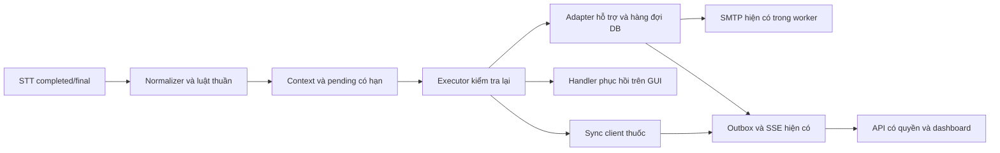

# Bàn giao phân luồng giọng nói cục bộ

Ngày: 10/10/2026. Phạm vi: desktop PyQt5 hiện có, luật tiếng Việt cục bộ và các dịch vụ nghiệp vụ hiện có. Không thêm LLM, NLP cloud, dependency mới hoặc khôi phục phát hiện ngã.

## P0 — Khảo sát và quyết định tích hợp

Đã đọc toàn bộ `plan/KE_HOACH_PHAN_LUONG_GIONG_NOI_LOCAL.md`. Không tìm thấy AGENTS.md trong repository, thư mục con hoặc các thư mục cha `/`, `/mnt`, `/mnt/shared`, `/mnt/shared/Code`. Workspace ban đầu có nhiều thay đổi và file chưa commit; giữ nguyên các thay đổi đó. Báo cáo/dataset mới nằm trong `docs/local_rules`, `reports/local_rules`, `tests/local_rules`.

| Thành phần thật | Đường dẫn | Quyết định |
|---|---|---|
| Entry point/migration | `main.py`, `database/migrator.py` | Giữ startup; thêm migration 005 theo runner hiện có |
| STT hoạt động | `services/local_voice/controller.py`, `worker.py`, `engine.py`, `recorder.py` | Giữ faster-whisper, process/model/micro hiện có; controller chỉ gắn `is_final` khi kết quả completed |
| Text semantic desktop trước đây | `services/transcript_intent/coordinator.py`, `client.py` | Chỉ dùng khi chọn rõ `gemini`; default chuyển sang local_rules |
| Cloud semantic/backend | `services/transcript_intent/backend.py`, `service.py`, `gemini_adapter.py`; `services/voice_ai/semantic/factory.py` | Không gọi từ local mode, không cloud fallback |
| Context/version | `services/local_voice/dispatcher.py`, `services/transcript_intent/context.py` | Tái đọc DB; voice dùng patient_id thật hoặc đúng một legacy mapping camera_face, bỏ cách đoán ID của dashboard |
| Thuốc trên desktop | `services/elder_sync_client.py`, `app/today_todo_widget.py` | Dùng `confirm_dose_taken`, transaction snapshot, sync_inbox và outbox hiện có |
| Các service thuốc khác | `services/medication_service.py`, `modules/medication_adherence/services/adherence_service.py` | Giữ lịch nhắc và service riêng; không tạo đường xác nhận thuốc song song |
| Phục hồi | `app/dashboard.py`, `app/router.py`, `modules/rehabilitation/rehab_session_adapter.py` | Pause bằng handler hiện có; hoàn thành vẫn do camera/verified rep |
| Ánh xạ người nhận | `patients`, `legacy_patient_map`, `patient_caregivers`, `care_team`, `users` | Kiểm tra active, consent, thời hạn liên kết, primary/priority người nhà; không chọn bác sĩ bất kỳ |
| Hỗ trợ và thông báo | `services/voice_ai/business_adapters/assistance_adapter.py`, `services/email_service.py` | Thêm entry point local vào adapter hỗ trợ; tái dùng SMTP transport có guard/test mode |
| Đồng bộ/dashboard | `database/outbox_helper.py`, `services/outbox_relay.py`, `web/auth.py`, `web/sse_hub.py`, `web/api_router.py`, hai portal HTML | Cùng DB thống nhất/outbox/SSE; API đọc transcript chỉ trả yêu cầu gửi tới user đã đăng nhập |

Adapter trợ giúp cũ chủ yếu phát outbox `assistance.requested`, không có hàng đợi giao tin bền vững cho các intent mới và có lời phản hồi gửi chưa dựa trên kết quả transport. Local mode dùng extension `DoctorAssistanceAdapter.local_request_service()` với bảng `voice_requests`/`voice_deliveries`, cùng DB thống nhất. Không ghi thuốc/phục hồi qua các bảng mới này.



## P1 — Parser và bộ luật

Mã: `services/local_rules/engine.py`, `rules.json`. Schema version 1; reject rule_id trùng, intent không hỗ trợ, regex lỗi, role/context không hợp lệ, thời hạn không hợp lệ, alias thời gian ngoài giới hạn. Không cho tắt confirmation của thông báo thông thường hoặc self-report đã uống.

NFC, chữ thường, khoảng trắng/dấu câu; giữ dấu và từ phủ định, thời gian, chủ thể. Alias bác sĩ/bác sỹ được khai báo rõ. Urgent khớp mệnh đề hiện tại rõ, không kích hoạt chỉ vì có nhắc tới từ “cứu tôi” trong câu khác. Không strip dấu toàn bộ, không fuzzy match urgent, không thêm lỗi STT chưa quan sát. Phủ định xử lý theo mệnh đề. Cụm ngoại lệ không thở được/không đứng dậy được có mẫu riêng. Phát biểu quá khứ, giả định, người khác, câu được đọc lại, lời không chắc chắn hỏi lại; mệnh đề hiện tại rõ sau mệnh đề quá khứ vẫn có thể nhận urgent.

Kết quả giữ original_text, normalized_text, rule_ids, matched_text cho mỗi action, context_refs, strong/ambiguous/unknown. Không xác suất giả. Nhiều ý định tương thích được giữ; dừng tập đứng trước gửi. Triệu chứng kèm người nhận rõ không tự thêm bác sĩ. Xung đột bắt đầu/dừng hoặc đã/chưa uống hỏi lại.

Golden dataset: `tests/local_rules/golden.json`, 138 câu tổng hợp, gồm 60 intent, 30 phủ định/thời gian/chủ thể, 15 context, 15 ghép ý định/ngoài phạm vi/biến thể STT và 18 ca ghép/STT bổ sung. Expected gồm intent/action, role, confirmation, context và match level; ví dụ thời gian hoãn có expected parameters. Đây là regression do tác giả thiết kế, không phải dữ liệu người dùng thực hay ước lượng độ chính xác ngoài thực địa.

## P2 — Context và hội thoại

`Dialogue` bind quyết định/recipient vào bản sao snapshot, hết hạn 60 giây. Xác nhận/hủy chỉ có hiệu lực với pending còn hợp lệ. Đổi patient, epoch, màn hình, lượt thuốc, phiên/bài tập hoặc DB snapshot làm pending mất hiệu lực. Restart bỏ pending; không tự gửi vì timeout hoặc mở lại ứng dụng.

Câu mới thay pending cũ. “Không, tôi cần bác sĩ” xử lý yêu cầu mới. Mơ hồ hỏi tối đa hai lượt, sau đó dùng nút Bác sĩ / Người nhà / Hủy. `Rồi/chưa/nhắc lại` cần context lượt thuốc; trên desktop chỉ bind khi màn hình thuốc có đúng một lượt đang nhắc hợp lệ. Mọi self-report đã uống còn phải được người dùng xác nhận tên thuốc, liều snapshot và giờ của lượt đó. Không chọn lượt gần nhất hay gộp nhiều thuốc.

## P3 — Thực thi và UI

`services/local_rules/desktop.py` là biên Qt/executor. Widget/pause/tab/refresh chạy trên UI thread; DB mutation và SMTP/retry chạy bằng worker, kết quả trả qua queue/QTimer. Stop và urgent rõ có thể được xử lý khi worker thông thường còn bận. Retry nền không khóa việc thu transcript mới; background status và idle của STT không được che mất preview đang chờ xác nhận. Tác vụ đã được phê duyệt giữ hồ sơ gốc; kết quả của hồ sơ cũ không hiển thị như kết quả của hồ sơ mới.

- Thuốc: `self_reported_taken` qua sync client và transaction snapshot; metadata thêm `report_source=voice_self_report`. Không đổi đơn/liều. `not_taken` giữ nguyên state, ghi phản hồi vào outbox hiện có, không tạo dose_event đã uống. Hoãn tối đa 3 lần, không cho hoãn lượt quá hạn; mặc định dùng reminder_delay_minutes của lịch, “mười phút” dùng alias 10 phút trong giới hạn 1–30, chỉ đổi occurrence.
- Đọc lịch: mở tab thuốc hiện có. Yêu cầu tập: mở tab bài tập đã chỉ định, người dùng dùng nút Bắt đầu/camera. Dừng: gọi pause handler hiện có. “Xong rồi” không có đường ghi hoàn thành.
- Thuốc cần hỗ trợ: mở thông tin thuốc và chuẩn bị gửi người nhà, vẫn chờ xác nhận.
- Gửi thông thường: preview nguyên văn + tên người nhận, nút Xác nhận/Hủy và voice Đồng ý/Hủy. Urgent rõ gửi ngay; thiếu identity không dùng patient_001 hay contact tùy ý.
- Urgent thiếu một vai trò: chỉ dùng người nhận hợp lệ còn lại, ghi/hiển thị missing_roles. Thiếu cả hai: báo chưa gửi và đường liên hệ thủ công.
- Liên hệ thủ công: đọc số đã xác minh/active trong `emergency_contacts`, kiểm tra giờ trực theo timezone hồ sơ, bao gồm ca qua đêm. Chỉ hiển thị số; không tự quay số hay giả cuộc gọi thành công. Không có identity/contact hợp lệ thì báo thiếu cấu hình.

Request state: open / acknowledged / resolved / cancelled. Delivery state riêng từng user: queued / sending / sent / failed / unknown / cancelled. `sent` chỉ khi adapter trả SMTP_ACCEPTED; không phải thư đã đọc hay người đã đến giúp. Portal chỉ cho recipient có quyền tiếp nhận/giải quyết; lưu actor thật vào outbox. UI dùng nhãn tiếng Việt và chỉ báo tiếp nhận khi DB đã có transition thật.

Khóa chính utterance_id + intent/action identity, unique trong DB; retry giữ request_id, sent/unknown không tự gửi lại. Content repeat là lớp phụ 10 giây; nút Gửi lại tạo yêu cầu mới do người dùng chủ động. Retry failed known pre-submission (FAILED_NETWORK/UNCONFIGURED) có backoff tăng dần từ 5 giây (5 rồi 10 giây trước hai lần retry mặc định), tối đa 3 attempts; Thử giao tin lại chỉ thử những delivery failed, không gửi lại delivery sent. Hàng đợi queued tồn tại qua restart, kiểm tra mapping/consent/expiry trước gửi; yêu cầu hủy/hết hạn không gửi lại. Body giữ thời gian gốc và context.

SMTP không có giao dịch exactly-once cùng SQLite: crash sau claim hoặc sau nộp thư nhưng trước ghi kết quả để trạng thái unknown, không tự gửi lại. Đây là giới hạn có chủ ý để tránh gửi trùng. Có thể dùng Gửi lại chủ động nếu người dùng quyết định cần một yêu cầu mới.

Báo nhầm giữ transcript và lịch sử sent, cập nhật cancelled/đính chính và phát SSE. Không thu hồi email đã gửi; đính chính qua dashboard, không giả email đã được xóa hoặc recipient đã đọc đính chính. Pending thông thường chưa duyệt nằm trong RAM; hủy pending không tạo một thông báo nghiệp vụ.

Transcript chỉ ở bảng request có quyền đọc; outbox/SSE chứa ID tối thiểu. Không ghi audio/token/key. Redact transcript quá retention (mặc định 30 ngày) khi khởi tạo và worker đồng bộ chạy. Không thay retention của hàng đợi thuốc vốn có. Muốn purge khi desktop không chạy cần lịch gọi `RequestService.prune()` của vận hành.

## P4 — Validation và các giới hạn thực tế

Xem `VALIDATION.md`, `reports/local_rules/tests.txt`, `benchmark.json`, `stt-loader-smoke.txt`, `ui-smoke.txt`, `ui-smoke.png`. Toàn bộ thông báo test dùng fake adapters/địa chỉ `.invalid`; DB test tạm. Không gửi tới người thật.

Đã chạy regression, fake-final STT → parser → approval → dịch vụ/DB → fake delivery, API/SSE và dashboard lifecycle. Camera/audio module/SMTP của full-dashboard smoke được thay bằng giả. Lần import GUI với native audio thực bị treo tại PortAudio trong sounddevice do import MediaPipe; đã dừng và không coi lần đó đạt. Lần smoke thiếu người chăm sóc primary bị từ chối đúng cách; fixture sau đó cấu hình recipient giả rõ ràng để kiểm tra end-to-end.

Chưa kiểm chứng microphone thật, STT lời nói thật với người được phép, camera thật đếm động tác, SMTP/network thật, browser tương tác trực tiếp hoặc Windows EXE. Model STT thật đã nạp từ disk, kiểm thử silence; không dùng silence để tuyên bố đã nhận đúng lời nói. Không có audio tiếng Việt đã được cho phép trong tác vụ này để đo chất lượng lời nói.

Không có roster bác sĩ trực gắn user_id trong schema; care_team có nhiều bác sĩ đồng thời thì không tự chọn. Roster điện thoại hiện có được áp dụng cho nút liên hệ thủ công. Không có cấu hình cấp thiết bị cho hồ sơ chưa nhận diện; giữ fail closed và yêu cầu chọn hồ sơ. Parser là bộ luật phạm vi hẹp, có thể hỏi lại ở cấu trúc câu chưa được golden review. Hạ tầng server/SMTP phải được vận hành thực tế để thông báo đến người nhận thật.

## P5 — Cấu hình và mở rộng

Chạy từ thư mục repository:

```bash
# Linux đã kiểm thử trong workspace
QT_QPA_PLATFORM=offscreen AI_CARE_TEST_MODE=1 .venv-linux/bin/python -m pytest tests/local_rules tests/voice_ai/test_local_voice.py tests/transcript_intent tests/test_realtime_sync_12_scenarios.py tests/test_medication.py -q
.venv-linux/bin/python scripts/benchmark_local_rules.py
.venv-linux/bin/python scripts/smoke_local_rules_ui.py
```

Trong môi trường Python đã cài requirements trên Windows, dùng `python -m pytest ...` và `python scripts/benchmark_local_rules.py`; không coi Windows đã được kiểm thử ở đây.

Cấu hình mẫu `.env.example`:

```dotenv
VOICE_SEMANTIC_BACKEND=local_rules
VOICE_AI_ENABLED=false
VOICE_MODEL_PATH=data/models/faster-whisper-small
VOICE_DEVICE=cpu
VOICE_COMPUTE_TYPE=int8
# VOICE_RULES_PATH=/absolute/path/to/reviewed/rules.json
EMAIL_ENABLED=false
```

VOICE_AI_ENABLED=false là chuẩn bị STT khi nhấn micro, không tắt local routing sau khi attach. Local mode không cần Gemini/STT API key. Có thể chạy fake-transcript smoke khi model chưa sẵn sàng; microphone thật vẫn cần model và thiết bị âm thanh hiện có. Muốn email thật phải cấu hình EmailService hiện có và liên kết người nhận qua UI quản trị/đăng ký hiện có, với active + GRANTED + valid_from/valid_to hợp lệ; người nhà mặc định phải xác định được bằng primary và notification_priority. Không điền recipient trong luật hoặc hard-code patient ID.

Migration 005 được main/web runner áp dụng. Bản PyInstaller spec đã thêm JSON rules và SQL migrations; chưa build EXE. Cấu hình JSON gồm pending_seconds, repeat_seconds, request_ttl_seconds (1800), retry_seconds (5), retry_max (3), retention_days (30), snooze_max_minutes (30), snooze_duration_aliases và các rule. Đổi cấu hình cần restart để reload.

Thêm alias: thêm pattern có word boundary trong đúng intent hiện có, giữ phủ định và mẫu urgent chính xác, bổ sung positive + negation + temporal + third-party + multi-intent golden cases rồi chạy regression. Không thêm alias không dấu/lỗi STT chưa quan sát chỉ để nâng tỷ lệ synthetic. Intent mới cần bổ sung catalogue, executor/service/policy và test; config không được tự mở quyền mutation mới. Không tắt approval cho thông báo thông thường/đã uống. Parser không được gọi DB/network.

Giữ code/dependency Gemini cũ vì còn backend opt-in, CLI benchmark và tests sử dụng; `requirements-gemini-backend.txt` vẫn là môi trường backend riêng. Không thêm nó vào runtime local, không xóa SDK dùng bởi workflow khác, không fallback tự động. Không commit/rollback thay đổi người dùng; bàn giao trực tiếp trong workspace.

## Kịch bản demo

1. Chạy fake suite/smoke trước; dùng hồ sơ và recipient demo được cấu hình rõ. Trong demo không gửi tới người thật nếu chưa chủ động thiết lập môi trường vận hành.
2. “Gọi con giúp tôi”: preview đúng tên người nhà; Hủy không gửi, Xác nhận mới tạo request/delivery.
3. “Gọi bác sĩ giúp tôi”: preview đúng bác sĩ assigned; thiếu/multiple bác sĩ báo thiếu lựa chọn, không chọn bất kỳ.
4. “Đến giờ uống thuốc chưa”: mở lịch đã kê. “Tôi uống rồi” ngoài context hỏi lại; với đúng một lượt hợp lệ hỏi xác nhận tên/liều/giờ, ghi voice_self_report. “Tôi chưa uống thuốc” giữ chưa uống; “Mười phút nữa nhắc lại” chỉ đổi occurrence theo giới hạn.
5. Bắt đầu tập bằng UI/camera, nói “Dừng bài tập, gọi con”: pause ngay, sau đó xác nhận liên hệ. “Xong rồi” không ghi camera_verified_completed.
6. “Tôi thấy khó chịu”: hỏi bác sĩ/người nhà, tối đa hai lượt rồi các nút lựa chọn. “Tôi không đau, gọi con”, “Đừng gọi con, gọi bác sĩ” không gửi cho vai trò bị phủ định.
7. Với fake sync client offline, “Tôi không thở được”: queued, không báo sent; nút Liên hệ thủ công vẫn có. Restart/reconnect giữ request_id và gửi mỗi recipient một lần; recipient lỗi có trạng thái riêng. Báo nhầm giữ audit và ngăn queued retry.
8. Trên portal nhận yêu cầu, bấm Tiếp nhận rồi Đã giải quyết: chỉ lúc đó desktop/API có trạng thái tương ứng, không suy từ SMTP_ACCEPTED.
