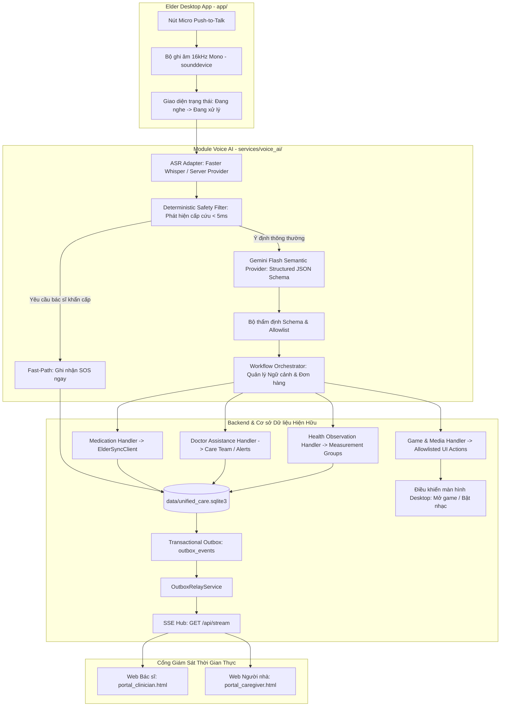

# BẢN ĐỒ TÍCH HỢP VOICE AI VÀO CODEBASE HIỆN HỮU (INTEGRATION MAP)
**Dự án:** Trợ Lý AI Chăm Sóc Người Cao Tuổi & Phục Hồi Chức Năng (Elderly Care AI System)  
**Tệp:** `docs/voice-ai/01_INTEGRATION_MAP.md`  
**Giai đoạn:** Phase 0 — Xác định đường dẫn tích hợp tối thiểu (Minimal Integration Path)  
**Thời điểm thực hiện:** Tháng 10/2026  
**Nguyên tắc chỉ đạo:** AI giải thích ngữ nghĩa; Backend phân quyền và thực thi; Không trùng lặp logic nghiệp vụ.

---

## 1. Ma Trận Ánh Xạ Ý Định Giọng Nói sang Mã Nguồn Hiện Hữu

Tất cả 10 Intent theo đặc tả [VOICE_AI_IMPLEMENTATION_PLAN.md](file:///mnt/shared/Code/AI_Rehabilitation_Safety_Assistant/plan/VOICE_AI_IMPLEMENTATION_PLAN.md) được ánh xạ trực tiếp vào các hàm, bảng CSDL và sự kiện Outbox/SSE hiện có:

| Ý định (Intent) | Mẫu câu tiếng Việt tiêu biểu | Cơ chế Fast-Path / Quy tắc an toàn | Dịch vụ & Hàm nghiệp vụ hiện hữu tái sử dụng | Bảng CSDL đích | Loại sự kiện (Outbox & SSE) | Mức ưu tiên |
|---|---|---|---|---|---|:---:|
| **`DOCTOR_ASSISTANCE`** | "Gọi bác sĩ ngay", "Tôi cần gặp bác sĩ", "Bác sĩ ơi giúp tôi", "Mệt quá gọi bác sĩ" | **Fast-Path cục bộ:** Bắt regex ngay tại máy khách/backend TRƯỚC KHI gửi LLM. Không chờ Gemini phản hồi. | [web/api_router.py#L2045](file:///mnt/shared/Code/AI_Rehabilitation_Safety_Assistant/web/api_router.py#L2045) (`_log_emergency_event`), [services/elder_sync_client.py#L233](file:///mnt/shared/Code/AI_Rehabilitation_Safety_Assistant/services/elder_sync_client.py#L233) | `assistance_requests` (mới) / `alerts` (`HELP_REQUESTED`), `emergency_contact_events` | `assistance.requested` / `medication.alert_created` | **P1 (Cao nhất)** |
| **`HEALTH_REPORT`** | "Từ sáng tôi hơi chóng mặt", "Tôi bị đau đầu âm ỉ", "Bụng tôi hơi khó chịu" | **Red-flag triage:** Nếu có dấu hiệu khó thở, tức ngực, méo miệng -> Tự động leo thang sang `DOCTOR_ASSISTANCE`. | [web/api_router.py#L123](file:///mnt/shared/Code/AI_Rehabilitation_Safety_Assistant/web/api_router.py#L123) (`_add_observation`), [modules/health_monitoring/services/monitoring_service.py](file:///mnt/shared/Code/AI_Rehabilitation_Safety_Assistant/modules/health_monitoring/services/monitoring_service.py) | `symptom_entries`, `measurement_groups`, `health_observations` | `health.observation_created` / `symptom.reported` | **P2** (P0 nếu triệu chứng nguy hiểm) |
| **`MEDICATION_CONFIRM`** | "Tôi đã uống thuốc rồi", "Đã uống viên huyết áp ban sáng", "Vừa uống thuốc xong" | **Xác thực liều đến hạn:** Tra cứu `dose_occurrences` của bệnh nhân trong ngày hôm nay. Nếu có đúng 1 liều -> xác nhận; nếu nhiều liều -> yêu cầu làm rõ; không bao giờ tự suy diễn. | [services/elder_sync_client.py#L348](file:///mnt/shared/Code/AI_Rehabilitation_Safety_Assistant/services/elder_sync_client.py#L348) (`confirm_dose_taken`), [web/api_router.py#L135](file:///mnt/shared/Code/AI_Rehabilitation_Safety_Assistant/web/api_router.py#L135) (`_record_dose_action`) | `dose_occurrences`, `dose_events` (ghi rõ `actor_role='voice_user_declared'`) | `medication.dose_changed` | **P3** |
| **`MEDICATION_NOT_TAKEN`** | "Tôi chưa uống thuốc", "Hôm nay tôi không uống", "Chưa kịp uống đâu" | **Ngăn chặn xác nhận sai:** Tuyệt đối không chuyển trạng thái sang `CONFIRMED`. Ghi nhận ghi chú hoặc trạng thái `SKIPPED`/cần trợ giúp. | [services/elder_sync_client.py#L348](file:///mnt/shared/Code/AI_Rehabilitation_Safety_Assistant/services/elder_sync_client.py#L348) (`action='skipped'`) | `dose_occurrences`, `dose_events` | `medication.dose_changed` | **P3** |
| **`MEDICATION_GUIDANCE`** | "Bây giờ tôi phải uống thuốc nào?", "Thuốc này uống trước hay sau ăn?", "Cho tôi xem hướng dẫn thuốc" | **Chỉ đọc đơn thuốc đã duyệt:** Đọc dữ liệu từ `prescriptions` và `medication_schedules` đang `ACTIVE`. Tuyệt đối không để LLM sáng tạo liều hay tư vấn uống bù. | [web/api_router.py#L183](file:///mnt/shared/Code/AI_Rehabilitation_Safety_Assistant/web/api_router.py#L183) (`_get_prescriptions`), [services/elder_sync_client.py#L416](file:///mnt/shared/Code/AI_Rehabilitation_Safety_Assistant/services/elder_sync_client.py#L416) (`get_today_snapshot`) | Chỉ đọc: `prescriptions`, `prescription_items`, `medications` | Không ghi DB; trả về văn bản/âm thanh hướng dẫn | **P3** |
| **`MEDICATION_REMIND_LATER`** | "10 phút nữa hãy nhắc lại tôi nhé", "Để lát nữa tôi uống", "Nhắc lại sau đi" | **Giới hạn số lần hoãn:** Tối đa 3 lần hoãn theo chính sách an toàn của `adherence_service`. | [services/elder_sync_client.py#L348](file:///mnt/shared/Code/AI_Rehabilitation_Safety_Assistant/services/elder_sync_client.py#L348) (`action='snooze'`) | `dose_occurrences.state = 'SNOOZED'`, `snooze_count += 1` | `medication.dose_changed` | **P3** |
| **`GAME_LAUNCH`** | "Mở trò lật thẻ", "Tôi muốn chơi xếp hình", "Chơi trò rèn luyện trí nhớ" | **Danh sách cho phép (Allowlist):** Chỉ cho phép mở các game đã đăng ký trong `game_types` (`card_matching`, `sequence_recall`). Không chạy lệnh tùy tiện. | [app/cognitive_games_widget.py#L288-L299](file:///mnt/shared/Code/AI_Rehabilitation_Safety_Assistant/app/cognitive_games_widget.py#L288-L299) (`_launch_card_matching`, `_launch_sequence_recall`) | `game_sessions` | Hành động UI: `game.open` | **P4** |
| **`MUSIC_PLAY`** | "Bật nhạc thư giãn", "Mở bài nhạc êm dịu", "Phát nhạc tĩnh tâm" | **Rào chắn âm lượng & bài hát:** Lấy danh sách từ bảng `music_tracks`, âm lượng khởi đầu tối đa 40%, tự kích hoạt hẹn giờ 15 phút. | [modules/cognitive_games/services/audio_service.py](file:///mnt/shared/Code/AI_Rehabilitation_Safety_Assistant/modules/cognitive_games/services/audio_service.py) (`play()`), [app/cognitive_games_widget.py#L271](file:///mnt/shared/Code/AI_Rehabilitation_Safety_Assistant/app/cognitive_games_widget.py#L271) | `listening_sessions` | Hành động UI: `media.play` | **P4** |
| **`MUSIC_PAUSE` / `MUSIC_STOP`** | "Tắt nhạc đi", "Dừng nhạc lại", "Tạm dừng bài hát" | **Thực thi lập tức:** Dừng/tạm dừng bộ phát âm thanh của hệ thống. | [modules/cognitive_games/services/audio_service.py](file:///mnt/shared/Code/AI_Rehabilitation_Safety_Assistant/modules/cognitive_games/services/audio_service.py) (`pause()`, `stop()`), [modules/cognitive_games/ui/music_player_widget.py#L195-L213](file:///mnt/shared/Code/AI_Rehabilitation_Safety_Assistant/modules/cognitive_games/ui/music_player_widget.py#L195-L213) | Cập nhật `listening_sessions` | Hành động UI: `media.pause`, `media.stop` | **P4** |
| **`UNKNOWN` / `CLARIFY`** | Câu nói không rõ, phủ định mập mờ, câu hỏi ngoài y tế ("Thời tiết hôm nay thế nào") | **Không có tác dụng phụ (No Side Effect):** Tuyệt đối không ghi bất kỳ dữ liệu nào vào CSDL. Đặt một câu hỏi ngắn gọn để người dùng nói lại. | Phản hồi văn bản/hội thoại của giao diện; ghi nhận log kiểm toán | Không ghi bảng nghiệp vụ | Không phát sinh sự kiện thay đổi dữ liệu | **N/A** |

---

## 2. Đường Dẫn Tích Hợp Tối Thiểu (Minimal Integration Path)

Kiến trúc tích hợp được thiết kế theo nguyên tắc: **Không đổi tên dự án, không đảo lộn thư mục hiện có, bổ sung một module dịch vụ chuyên biệt tại `services/voice_ai/` đóng vai trò Bộ điều phối và Tiếp hợp (Orchestrator & Adapters)**.



### 2.1. Tầng Ghi Âm & Tương Tác Máy Khách (Audio Capture & UX)
- **Tập tin dự kiến:** `services/voice_ai/audio/capture.py` và `app/voice_interaction_widget.py`.
- **Thư viện sử dụng:** `sounddevice 0.5.6` (đã được cài đặt sẵn trong môi trường `.venv-linux`).
- **Cấu hình âm thanh:**
  - Định dạng: PCM 16-bit, đơn kênh (mono), tần số lấy mẫu **16,000 Hz** (chuẩn đầu vào của Whisper).
  - Cơ chế kích hoạt: **Push-to-Talk (Nhấn để nói)**. Người cao tuổi nhấn/giữ nút Micro to rõ trên thanh tiêu đề của `TodayTodoWidget` hoặc phím tắt (Spacebar).
  - Giới hạn độ dài: Tối đa 20 giây cho mỗi lượt ghi âm. Tự động cắt khi nhả nút hoặc đạt ngưỡng thời gian.
  - Phản hồi trực quan: Biểu tượng Micro đổi màu (Xanh dương: Đang nghe; Vàng cam: Đang dịch văn bản; Xanh lá: Đã ghi nhận).

### 2.2. Tầng Chuyển Giọng Nói Thành Văn Bản (ASR Layer - Faster Whisper)
- **Tập tin dự kiến:**
  - `services/voice_ai/asr/provider.py` (Giao diện `ASRProvider`)
  - `services/voice_ai/asr/faster_whisper_provider.py` (Triển khai Faster Whisper)
  - `services/voice_ai/asr/mock_provider.py` (Dành cho CI/CD và unit test hoàn toàn offline)
- **Thiết kế Factory thích ứng:**
  - Cấu hình qua biến môi trường:
    - `VOICE_ASR_DEPLOYMENT=local`: Chạy Faster Whisper `small` hoặc `base` (CTranslate2 INT8 CPU) trên máy client.
    - `VOICE_ASR_DEPLOYMENT=backend`: Gửi âm thanh lên backend API qua HTTP POST multipart.
    - `VOICE_ASR_DEPLOYMENT=mock`: Dùng dữ liệu kiểm thử giả lập, không phụ thuộc vào thư viện ASR.
  - Ngôn ngữ nhận diện: Cố định `language="vi"` (tiếng Việt), giúp tăng độ chính xác và giảm 30% độ trễ do bỏ qua bước dò ngôn ngữ.

### 2.3. Tầng Bộ Lọc An Toàn Cấp Tốc (Deterministic Fast-Path Safety Detector)
- **Tập tin dự kiến:** `services/voice_ai/safety/assistance_rules.py`.
- **Nguyên lý hoạt động:**
  - Chạy **ngay khi nhận được transcript**, thực thi trong **dưới 5 mili-giây** bằng biểu thức chính quy (Regex) và từ điển từ khóa tiếng Việt đã được tinh chỉnh:
    - Các mẫu câu: `(gọi|kêu|liên hệ|cần)\s+(bác sĩ|bác sỹ|cấp cứu|y tá|trợ giúp|người nhà)`, `(cứu|giúp)\s+(tôi|với)`.
    - Phủ định an toàn: Loại trừ trường hợp có từ phủ định đi kèm, ví dụ: `"không cần gọi bác sĩ"`, `"đừng gọi bác sĩ"`.
  - **Hành động tức thì:** Nếu phát hiện yêu cầu cấp cứu/bác sĩ, hệ thống lập tức ghi nhận yêu cầu trợ giúp vào CSDL và Outbox **trước khi gọi bất kỳ API Gemini LLM nào**. Sự cố mạng hoặc timeout của LLM không bao giờ làm trễ luồng cấp cứu.

### 2.4. Tầng Suy Luận Ngữ Nghĩa (Semantic Layer - Gemini Flash API)
- **Tập tin dự kiến:**
  - `services/voice_ai/semantic/provider.py` (Giao diện `SemanticProvider`)
  - `services/voice_ai/semantic/gemini_provider.py` (Gọi Google Gemini Flash API qua SDK `google-genai`)
  - `services/voice_ai/semantic/schemas.py` (Định nghĩa JSON Schema nghiêm ngặt theo chuẩn OpenAPI 3.0 / Pydantic)
  - `services/voice_ai/semantic/prompts.py` (Prompt hệ thống tiếng Việt tối ưu hóa, ví dụ few-shot, chống prompt injection)
  - `services/voice_ai/semantic/mock_provider.py` (Mock deterministic provider cho test suite)
- **Nguyên tắc bảo mật API Key:**
  - Biến môi trường: `GEMINI_API_KEY` chỉ được đọc trên Backend/Server.
  - Không bao giờ truyền API key xuống giao diện người cao tuổi hay nhúng trong tệp tĩnh.
- **Ràng buộc đầu ra (Structured Outputs):**
  - Sử dụng tính năng `response_mime_type="application/json"` và `response_schema` của Gemini Flash API.
  - Kết quả trả về bắt buộc phải tuân thủ Schema: Danh sách `intents`, loại intent (`type`), thực thể (`entities`), bằng chứng trích xuất trong câu (`evidence_span`), cờ cần làm rõ (`requires_clarification`).

### 2.5. Tầng Bộ Điều Phối Luồng Công Việc (Workflow Orchestrator)
- **Tập tin dự kiến:**
  - `services/voice_ai/orchestrator/router.py` (`VoiceWorkflowOrchestrator`)
  - `services/voice_ai/orchestrator/context_resolver.py` (`VoiceContextResolver`)
  - `services/voice_ai/orchestrator/state_machine.py` (`VoiceSessionStateMachine`)
- **Nhiệm vụ của Orchestrator:**
  1. **Khử trùng lặp (Idempotency):** Kiểm tra `idempotency_key` kết hợp `client_event_id` trước khi thực thi.
  2. **Giải quyết Ngữ cảnh (Context Resolution):** Ghép nối ý định với các đối tượng thực tế của bệnh nhân:
     - Lấy các liều thuốc đến hạn hôm nay của bệnh nhân từ `UnifiedDatabaseManager` để đối chiếu với câu nói "Tôi đã uống thuốc rồi".
     - Xác định bác sĩ đang trong ca trực từ bảng `emergency_contacts` và `care_team`.
  3. **Lập lịch Ưu tiên (Priority Scheduling):** Trong các câu nói chứa nhiều ý định (Multi-intent), ví dụ: *"Tôi uống thuốc rồi, hơi chóng mặt, gọi bác sĩ giúp tôi"*:
     - Ưu tiên 1 (P1): Gọi Bác sĩ trợ giúp -> Commit CSDL & Outbox ngay.
     - Ưu tiên 2 (P2): Ghi nhận triệu chứng chóng mặt -> Lưu quan sát sức khỏe.
     - Ưu tiên 3 (P3): Xác nhận liều thuốc -> Hỏi lại để người già xác nhận liều cụ thể nếu có nhiều liều.
  4. **Ủy quyền cho các Handler hiện hữu (Domain Handlers):**
     - Tuyệt đối không tự viết logic chèn trực tiếp câu lệnh SQL phân mảnh.
     - Tái sử dụng các phương thức chuẩn của [services/elder_sync_client.py](file:///mnt/shared/Code/AI_Rehabilitation_Safety_Assistant/services/elder_sync_client.py) (`confirm_dose_taken`, `record_mood`), [database/outbox_helper.py](file:///mnt/shared/Code/AI_Rehabilitation_Safety_Assistant/database/outbox_helper.py) (`insert_outbox_event`), [web/api_router.py](file:///mnt/shared/Code/AI_Rehabilitation_Safety_Assistant/web/api_router.py).

---

## 3. Danh Mục Các Tệp Cần Bổ Sung (Dự Kiến cho Các Pha Tiếp Theo)

```text
services/voice_ai/
├── __init__.py
├── config.py                     # Đọc biến môi trường VOICE_AI_*
├── audio/
│   ├── __init__.py
│   └── capture.py                # Thu âm sounddevice 16kHz Mono PCM, PTT controller
├── asr/
│   ├── __init__.py
│   ├── provider.py               # Interface ASRProvider & TranscriptResult DTO
│   ├── faster_whisper_provider.py# Faster Whisper CTranslate2 INT8 adapter
│   └── mock_provider.py          # Fixture ASR cho test tự động
├── safety/
│   ├── __init__.py
│   └── assistance_rules.py       # Deterministic fast-path regex & triage rules
├── semantic/
│   ├── __init__.py
│   ├── provider.py               # Interface SemanticProvider & SemanticResult DTO
│   ├── gemini_provider.py        # Google SDK google-genai structured output
│   ├── prompts.py                # System prompt, Vietnamese few-shot examples
│   ├── schemas.py                # JSON schema định nghĩa intents và entities
│   └── mock_provider.py          # Mock semantic provider với 20 kịch bản test
├── orchestrator/
│   ├── __init__.py
│   ├── router.py                 # WorkflowOrchestrator điều phối nghiệp vụ
│   ├── context_resolver.py       # Giải quyết ngữ cảnh bệnh nhân hiện tại
│   └── state_machine.py          # Máy trạng thái hội thoại đa lượt (multi-turn)
├── handlers/
│   ├── __init__.py
│   ├── doctor_handler.py         # Gọi bác sĩ, ghi nhận assistance_requests & alert
│   ├── medication_handler.py     # Xác nhận thuốc, hỏi làm rõ, chỉ dẫn đơn thuốc
│   ├── health_handler.py         # Ghi nhận triệu chứng, cảnh báo đỏ
│   ├── game_handler.py           # Trả về action mở trò chơi cho giao diện
│   └── music_handler.py          # Trả về action điều khiển phát/dừng nhạc
└── api/
    ├── __init__.py
    └── voice_api.py              # Endpoint POST /api/v1/voice/interactions
```

---

## 4. Tham Chiếu Mã Nguồn Chi Tiết (Code References)

1. **Khởi tạo và kết nối CSDL hợp nhất:**
   - [database/connection.py#L42](file:///mnt/shared/Code/AI_Rehabilitation_Safety_Assistant/database/connection.py#L42): `UnifiedDatabaseManager.connect()`
   - [database/outbox_helper.py#L15](file:///mnt/shared/Code/AI_Rehabilitation_Safety_Assistant/database/outbox_helper.py#L15): `insert_outbox_event(conn, patient_id, event_type, ...)`
2. **Xác nhận thuốc và cảnh báo khẩn cấp phía máy khách người già:**
   - [services/elder_sync_client.py#L164-L254](file:///mnt/shared/Code/AI_Rehabilitation_Safety_Assistant/services/elder_sync_client.py#L164-L254): Xử lý sự kiện `medication.confirm`, cập nhật `dose_occurrences`, chèn `dose_events`, sinh `outbox_events`.
   - [services/elder_sync_client.py#L348-L355](file:///mnt/shared/Code/AI_Rehabilitation_Safety_Assistant/services/elder_sync_client.py#L348-L355): `ElderSyncClient.confirm_dose_taken(...)`
3. **Tiếp nhận cảnh báo bác sĩ và đẩy SSE:**
   - [web/api_router.py#L136-L141](file:///mnt/shared/Code/AI_Rehabilitation_Safety_Assistant/web/api_router.py#L136-L141): Tuyến đường `/api/patients/{patient_id}/alerts/{alert_id}/acknowledge`
   - [web/sse_hub.py#L35](file:///mnt/shared/Code/AI_Rehabilitation_Safety_Assistant/web/sse_hub.py#L35): `SSEHub.broadcast_event(patient_id, event_dict)`
   - [services/outbox_relay.py#L45-L95](file:///mnt/shared/Code/AI_Rehabilitation_Safety_Assistant/services/outbox_relay.py#L45-L95): `OutboxRelayService.poll_and_relay()`
4. **Trò chơi và âm nhạc thư giãn:**
   - [app/cognitive_games_widget.py#L51-L80](file:///mnt/shared/Code/AI_Rehabilitation_Safety_Assistant/app/cognitive_games_widget.py#L51-L80): Khởi tạo `CognitiveGamesWidget`
   - [modules/cognitive_games/services/audio_service.py](file:///mnt/shared/Code/AI_Rehabilitation_Safety_Assistant/modules/cognitive_games/services/audio_service.py): `AudioService.play()`, `AudioService.pause()`, `AudioService.stop()`
   - [modules/cognitive_games/ui/music_player_widget.py#L178-L215](file:///mnt/shared/Code/AI_Rehabilitation_Safety_Assistant/modules/cognitive_games/ui/music_player_widget.py#L178-L215): Các sự kiện bấm nút phát nhạc, tạm dừng, dừng nhạc.

