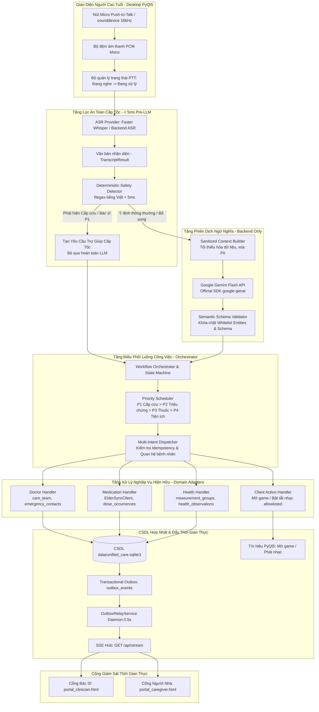
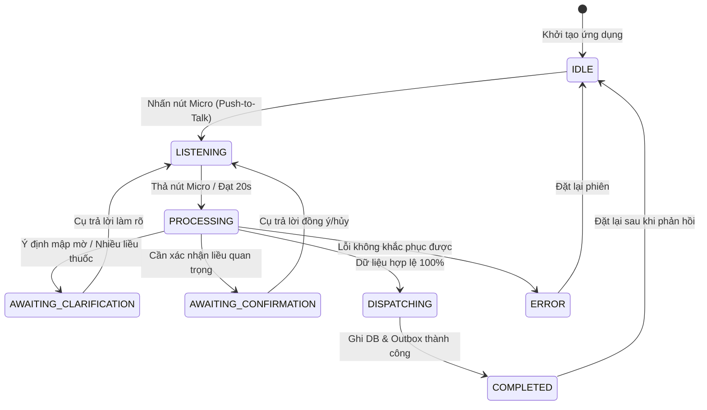

# KIẾN TRÚC CHI TIẾT HỆ THỐNG VOICE AI (DETAILED ARCHITECTURE)
**Dự án:** Trợ Lý AI Chăm Sóc Người Cao Tuổi & Phục Hồi Chức Năng (Elderly Care AI System)  
**Tệp:** `docs/voice-ai/03_ARCHITECTURE.md`  
**Giai đoạn:** Phase 1 — Hợp đồng kiến trúc & Thiết kế kỹ thuật chi tiết  
**Thời điểm thực hiện:** Tháng 10/2026  
**Nguyên tắc cốt lõi:** AI giải thích ngữ nghĩa; Backend kiểm soát, phân quyền và thực thi.

---

## 1. Sơ Đồ Kiến Trúc Luồng Dữ Liệu Toàn Diện (End-to-End Architecture)

---

## 2. Chi Tiết Các Tầng Xử Lý (Pipeline Processing Stages)

### 2.1. Tầng Thu Âm & Giao Diện Người Dùng (Capture & Push-to-Talk UX)
- **Cơ chế thu âm:** Sử dụng thư viện `sounddevice 0.5.6` đã có sẵn trong môi trường Python. Thu âm luồng PCM 16-bit đơn kênh (Mono) ở tần số **16,000 Hz**.
- **Cơ chế Push-to-Talk (Nhấn để nói):**
  - Người dùng bấm giữ nút Micro trên màn hình cảm ứng hoặc giữ phím Spacebar.
  - Khi thả nút, bộ đệm âm thanh đóng gói thành chuỗi byte WAV tiêu chuẩn.
  - Tự động cắt khi đạt giới hạn an toàn 20 giây nhằm chống tràn bộ nhớ và tiết kiệm chi phí suy luận.
  - **Không sử dụng Always-on VAD** trong giai đoạn đầu nhằm triệt tiêu 100% rủi ro kích hoạt ngoài ý muốn do tiếng nói tivi hoặc người nhà trò chuyện xung quanh.

### 2.2. Tầng Chuyển Giọng Nói Thành Văn Bản (ASR Layer)
- **Mô hình mục tiêu:** `SYSTRAN/faster-whisper` với CTranslate2 INT8 CPU/GPU.
- **Tối ưu hóa tiếng Việt:** Thiết lập cố định `language="vi"`, tham số `beam_size=5`, `vad_filter=True`. Việc cố định ngôn ngữ loại bỏ hoàn toàn bước Language Identification, giúp giảm 200–300ms độ trễ.
- **Provider Abstraction:** Lớp `ASRProvider` hỗ trợ chuyển đổi linh hoạt qua cấu hình môi trường:
  - `local`: Chạy trực tiếp Faster Whisper trên thiết bị nếu máy đáp ứng yêu cầu.
  - `backend`: Thiết bị đẩy tệp âm thanh lên Web Server nội bộ qua HTTP POST multipart.
  - `mock`: Dành cho kiểm thử tự động CI/CD đạt tính tất định (deterministic).

### 2.3. Tầng Bộ Lọc An Toàn Cấp Tốc (Deterministic Pre-LLM Safety Detector)
- **Đặc tả thời gian:** Thực thi trong **dưới 5 mili-giây** bằng Regex thuần túy.
- **Nguyên tắc không phụ thuộc LLM:** Các câu thoại cấp cứu (ví dụ: *"Gọi bác sĩ ngay"*, *"Cứu tôi với"*) hoặc triệu chứng cảnh báo đỏ (ví dụ: *"Đau thắt ngực dữ dội, khó thở"*) được phát hiện và gửi thẳng vào CSDL/Outbox **trước khi** tiến hành gọi Gemini API.
- **Xử lý phủ định an toàn:** Các câu chứa phủ định như *"Tôi không cần gọi bác sĩ"*, *"Đừng gọi cấp cứu"* bị triệt tiêu cờ khẩn cấp, tránh phát báo động giả.

### 2.4. Tầng Xây Dựng Ngữ Cảnh Tối Thiểu (Sanitized Context Builder)
- **Giao thức Tối thiểu hóa dữ liệu (Data Minimization):**
  - Tuyệt đối loại bỏ PII: Không truyền họ tên đầy đủ, ngày sinh, CCCD, địa chỉ, hoặc tiền sử bệnh án lên prompt LLM.
  - Chỉ cung cấp ngữ cảnh tối thiểu phục vụ phân giải:
    - Danh sách tên các loại thuốc đến hạn trong ngày hôm nay của bệnh nhân (ví dụ: `["Amlodipine 5mg", "Metformin 500mg"]`).
    - Thời gian hiện tại trong ngày (Sáng, Trưa, Chiều, Tối).
    - Danh mục trò chơi và bài nhạc hợp lệ (`ALLOWED_GAME_TYPES = {"card_matching", "sequence_recall"}`).

### 2.5. Tầng Phân Tích Ngữ Nghĩa (Semantic Layer - Gemini Flash API)
- **Mô hình sử dụng:** Google Gemini Flash family qua SDK chính thức `google-genai`.
- **Bảo mật API Key:** Biến môi trường `GEMINI_API_KEY` chỉ tồn tại trên Backend Server. Tuyệt đối không xuất hiện trong mã nguồn client.
- **Ràng buộc đầu ra (Structured Outputs):**
  - Sử dụng tính năng `response_mime_type="application/json"` với cấu trúc `GEMINI_SEMANTIC_JSON_SCHEMA`.
  - Khóa chặt Enum của 10 Intents và Whitelist Entities.
  - LLM chỉ đóng vai trò phân tích cú pháp; **không có quyền Function Calling / Tool Execution** để tác động trực tiếp vào hệ thống.

### 2.6. Tầng Thẩm Định Ngữ Nghĩa (Semantic Schema Validator)
- Kiểm tra tính tuân thủ của JSON trả về:
  - Kiểm tra `schema_version == "1.0"`, `language == "vi"`.
  - Kiểm tra các trường entity có nằm trong whitelist cho phép hay không.
  - Kiểm tra `evidence_span`: Bắt buộc trích dẫn từ chính câu thoại của người dùng; phát hiện ảo giác (hallucination) nếu trích dẫn từ ngữ không tồn tại trong transcript.

### 2.7. Tầng Lập Lịch Ưu Tiên & Điều Phối Luồng (Orchestrator & Priority Scheduler)
- **Nguyên tắc phân bổ quyền lực:** Mức độ ưu tiên do **Backend chỉ định cố định**, không tin tưởng độ ưu tiên từ LLM:
  - **P1:** `DOCTOR_ASSISTANCE` (Ưu tiên số 1 - Khẩn cấp)
  - **P2:** `HEALTH_REPORT` (Ưu tiên số 2 - Triệu chứng sức khỏe)
  - **P3:** `MEDICATION_*` (Ưu tiên số 3 - Uống thuốc, hoãn thuốc, hướng dẫn thuốc)
  - **P4:** `GAME_*`, `MUSIC_*` (Ưu tiên số 4 - Tiện ích thư giãn)
- **Xử lý Đa ý định (Multi-Intent):** Với câu nói *"Tôi uống thuốc rồi, chóng mặt, gọi bác sĩ giúp tôi"*:
  1. Commit yêu cầu Bác sĩ trợ giúp P1 vào CSDL và Outbox phát SSE ngay lập tức.
  2. Lưu nhận định sức khỏe P2 (triệu chứng chóng mặt).
  3. Xử lý xác nhận thuốc P3 độc lập. Thất bại của liều thuốc không bao giờ làm rollback yêu cầu trợ giúp bác sĩ.

### 2.8. Tầng Tiếp Hợp Nghiệp Vụ & Thực Thi CSDL (Domain Handlers & Persistence)
- **Tái sử dụng 100% logic hiện có:**
  - `MedicationHandler` gọi `ElderSyncClient.confirm_dose_taken(...)`.
  - `DoctorHandler` ghi nhận `assistance_requests`, cập nhật `alerts`, phát `outbox_events` loại `assistance.requested`.
  - `HealthHandler` ghi nhận `measurement_groups` và `symptom_entries`.
  - `GameHandler` và `MusicHandler` trả về các hành động giao diện allowlisted (`game.open`, `media.play`, `media.stop`).
- **Ghi nhận nguồn gốc chính xác:**
  - Mọi thao tác qua giọng nói được lưu vết `actor_role = 'voice_user_declared'`, tuyệt đối không lưu `clinically_verified`.

---

## 3. Ranh Giới Giữa AI và Backend (Boundary of Authority)

| Thành phần | AI (Gemini Flash + Faster Whisper) | Backend Authoritative System |
|---|---|---|
| **Vai trò** | Phiên dịch & Suy luận ngữ nghĩa (Interpreter) | Phân quyền, Thẩm định & Thực thi (Authorizer & Executor) |
| **Quyền ghi CSDL** | **0% (Không có quyền)** | 100% độc quyền qua ACID Transactions |
| **Quyết định mức ưu tiên** | Không được tin cậy | Backend tính toán theo `INTENT_PRIORITY_MAP` |
| **Phân bổ người nhận** | Không được phép chọn bác sĩ | Tra cứu chính xác từ bảng `care_team` và `emergency_contacts` |
| **Xác thực tuân thủ thuốc** | Không suy diễn lâm sàng | Chỉ ghi nhận tự khai báo (`voice_user_declared`) |
| **Quyết định gọi cấp cứu** | Không có quyền chặn | Fast-path Regex kích hoạt ngay, không cần LLM đồng ý |

---

## 4. Mô Hình Máy Trạng Thái Phiên Hội Thoại (Session State Machine)

