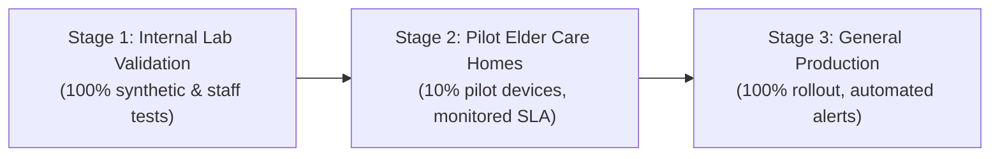

# Voice AI Deployment Runbook, Canary Strategy & Rollback Guide

**System:** Elderly Care AI Assistant (`AI_Rehabilitation_Safety_Assistant`)  
**Component:** Voice AI Subsystem (Faster Whisper + Gemini Flash + Workflow Orchestrator)  
**Version:** v1.0.0  
**Date:** 2026-10-09  

---

## 1. System Inventory & Architecture Summary

The Voice AI system provides natural voice interaction in Vietnamese for elderly patients while maintaining clinical safety, hardware bounding, and authoritative backend authorization.

### Layered Architecture

```
[ Elder Push-to-Talk Button (PyQt5) ]
                │
                ▼
[ services/voice_ai/audio/capture.py ] (16kHz mono PCM WAV, bounded to 20s, in-memory)
                │
                ▼
[ services/voice_ai/asr/provider.py ] (Faster Whisper INT8 Singleton / Mock ASR)
                │
                ▼
[ services/voice_ai/safety/assistance_rules.py ] (Deterministic Fast-Path Safety: <5ms)
                │
       ┌────────┴────────┐
       ▼                 ▼
[ Pure SOS ]      [ Mixed / Normal Utterance ]
       │                 │
       │                 ▼
       │          [ services/voice_ai/semantic/gemini_provider.py ] (Gemini Flash REST, schema 1.0)
       │                 │
       └────────┬────────┘
                │
                ▼
[ services/voice_ai/orchestrator/router.py ] (Priority Scheduling: P1 -> P2 -> P3 -> P4)
                │
                ▼
[ services/voice_ai/business_adapters/ ]
   ├── assistance_adapter.py (W4: Doctor Assistance -> PENDING_ACK)
   ├── medication_adapter.py (W1: Confirm [voice_user_declared] / W2: Guidance)
   ├── health_adapter.py     (W3: Health report -> symptom_entries)
   └── media_games_adapter.py(W5: Games / W6: Music allowlisted tokens)
                │
                ▼
[ data/unified_care.sqlite3 ] (Durable Outbox Events & 3NF Schema)
                │
                ▼
[ services/outbox_relay.py ] ──> [ web/sse_hub.py ] ──> [ Doctor & Caregiver Portals ]
```

---

## 2. Configuration & Operational Feature Flags

All operational switches are configured via environment variables and managed by [`services/voice_ai/config.py`](file:///mnt/shared/Code/AI_Rehabilitation_Safety_Assistant/services/voice_ai/config.py):

| Variable | Default | Purpose |
| :--- | :--- | :--- |
| `VOICE_AI_ENABLED` | `true` | **Master Feature Flag:** Instant kill-switch disabling voice button and falling back to manual UI buttons. |
| `VOICE_AI_FORCE_MOCK_SEMANTIC` | `false` | When `true`, forces offline heuristic parser; protects against external Gemini quota exhaustion. |
| `VOICE_AI_RECORD_AUDIO_CONSENT` | `false` | **Privacy By Design:** When `false`, raw audio PCM is kept in-memory only and never written to disk. |
| `GEMINI_API_KEY` | *None* | Google Gemini API key. Stored on server backend only; never exposed to desktop or web clients. |
| `GEMINI_MODEL` | `gemini-2.5-flash` | Configurable Google Gemini Flash model name. |
| `GEMINI_TIMEOUT_SEC` | `8.0` | Upstream API timeout before falling back to graceful local clarification prompt. |
| `GEMINI_MAX_RETRIES` | `2` | Exponential backoff retry attempts for HTTP 429/503 errors. |
| `VOICE_AI_ASSISTANCE_SLA_SEC` | `60.0` | Maximum time allowed for doctor acknowledgement before escalating to secondary caregivers. |
| `VOICE_AI_IDEMPOTENCY_TTL_SEC` | `600` | TTL in seconds for request deduplication in memory. |

---

## 3. Instant Rollback Procedure (< 30 Seconds)

If any unexpected regression, audio driver failure, or network anomaly occurs:

### Step 1: Flip Master Feature Flag
Update the system environment or `.env` configuration:
```bash
export VOICE_AI_ENABLED=false
```

### Step 2: Restart or Reload Client Process
```bash
# In desktop elder environment:
systemctl --user restart elder_assistant.service
```

### Step 3: Verify Fallback State
- The voice push-to-talk widget hides or switches to inactive status.
- Standard visual touch buttons (SOS button, Medication checkmark, Games cards) remain 100% operational.
- Existing database tables, medication timers, and camera AI detectors (Pose, LBPH face, FaceMesh) continue operating without interruption.

---

## 4. Canary Rollout Strategy

To safeguard elderly users, rollout follows a gated 3-stage progressive release:



### Stage 1: Internal Lab Validation (Days 1–3)
- Execute complete automated test suite (`pytest tests/voice_ai/ -v`).
- Validate audio recording with target USB microphone hardware under simulated noise.
- Confirm peak RAM remains under 550 MB when running concurrently with MediaPipe Pose (5.6 MB), LBPH (2.7 MB), and FaceMesh (3.7 MB).

### Stage 2: Pilot Elder Homes (Days 4–10)
- Deploy to 10 selected elder devices with signed family consent (`VOICE_AI_ENABLED=true`).
- Verify Vietnamese elderly speech accents and speech speeds.
- Monitor `assistance.requested` SLA: ensure 100% of doctor alerts are either acknowledged within 60s or successfully escalated.
- Verify zero false confirmations for medication adherence.

### Stage 3: General Production Release (Day 11+)
- Enable across all active elder sessions.
- Activate continuous Prometheus/Sentry monitoring.

---

## 5. Production Health Metrics & Alert Thresholds

| Metric | Target SLA | Warning Threshold | Critical Incident Action |
| :--- | :--- | :--- | :--- |
| **Fast-Path Safety Latency** | < 5 ms | > 15 ms | Check CPU core pinning; bypass any blocking regex |
| **ASR Latency (p95)** | < 800 ms | > 1500 ms | Switch Whisper compute to INT8 or smaller model size |
| **Gemini Flash p95 Latency** | < 1500 ms | > 4000 ms | Temporarily enable `VOICE_AI_FORCE_MOCK_SEMANTIC` |
| **Gemini 429 Rate** | < 0.1% | > 2.0% | Scale API quota or enable heuristic fallback |
| **Assistance SLA Breaches** | 0 breaches | >= 1 breach | Alert secondary caregiver circle immediately |
| **Duplicate Confirmation Rate** | 0.00% | > 0.00% | Verify Idempotency-Key and sync inbox constraints |

---

## 6. Unresolved High-Risk Issues & Clinical Disclaimers

1. **User-Declared Adherence Limitation:** Voice AI records medication intake strictly as `source=voice_user_declared`. This represents a patient's self-declaration, NOT clinical proof of ingestion. Doctors and clinical staff must never treat self-reported voice confirmations as verified clinical evidence.
2. **Push-to-Talk vs. Background TV:** To prevent background voices or TV dialogue from triggering unintended medication confirmations or false doctor alerts, voice input is strictly push-to-talk. Always-on wake-word is intentionally not deployed in this release.
3. **Emergency Redundancy:** The on-screen physical SOS button and emergency pull-cord remain the primary life-safety mechanisms. The Voice AI assistant is an assistive convenience and does not replace emergency medical response equipment.

